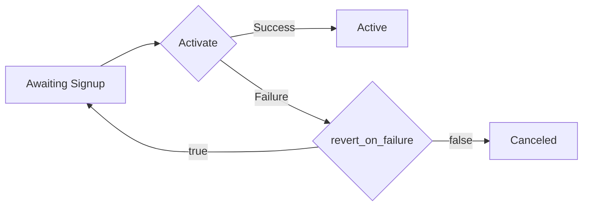

# Reference

Every operation below is shown in its throwing form. On an error status it throws `ApiException<TError>` — the status code, headers, content type and the operation's error type, `RawError` (the raw body) when the spec declares none — and where an operation offers an `…AsResult` sibling, that sibling returns `ApiResult<TResponse, TError>` instead. A request that produces no usable response surfaces as `SdkConnectionException` or `SdkTimeoutException`, a body that does not match the documented response type as `ResponseDeserializationException`, and a required credential that is not configured, or one that cannot be applied, as `AuthSchemeException`; all of them derive from `SdkException` and name the failed call. See [README → Error Handling](README.md#error-handling).

> Source: [OmbrevixBillingClient](src/OmbrevixBilling/OmbrevixBillingClient.cs)

## ApiExports

> Source: [ApiExports](src/OmbrevixBilling/Api/ApiExports.cs)

<details>
<summary><code>Task&lt;BatchJobResponse&gt; ExportEstimateInvoices(RequestOptions? requestOptions = null, CancellationToken cancellationToken = default);</code></summary>

<dl>
<dd>

### Description

<dl>
<dd>

Creates a estimate invoices export and returns a batch job object.

It is only available for Account Invoicing architecture.

</dd>
</dl>

### Usage

<dl>
<dd>

```csharp
try
{
    var response = await client.ApiExports.ExportEstimateInvoices();
    // TODO: Handle 'response' of type BatchJobResponse
}
catch (ApiException<ExportEstimateInvoicesError> ex)
{
    if (ex.Error.TryGetNoContent(out var error))
    {
        // TODO: Handle 'error' of type RawError
    }
}
```

</dd>
</dl>

### Response

<dl>
<dd>

**OnSuccess**: <code>[BatchJobResponse](src/OmbrevixBilling/Models/BatchJobResponse.cs)</code>

**OnError**: <code>[ApiException](src/OmbrevixBilling/Core/Exceptions/ApiException.cs)&lt;[ExportEstimateInvoicesError](src/OmbrevixBilling/Errors/ExportEstimateInvoicesError.cs)&gt;</code>

</dd>
</dl>

</dd>
</dl>

</details>

<details>
<summary><code>Task&lt;BatchJobResponse&gt; ExportInvoices(RequestOptions? requestOptions = null, CancellationToken cancellationToken = default);</code></summary>

<dl>
<dd>

### Description

<dl>
<dd>

Creates an invoices export and returns a batch job object.

</dd>
</dl>

### Usage

<dl>
<dd>

```csharp
try
{
    var response = await client.ApiExports.ExportInvoices();
    // TODO: Handle 'response' of type BatchJobResponse
}
catch (ApiException<ExportInvoicesError> ex)
{
    if (ex.Error.TryGetNoContent(out var error))
    {
        // TODO: Handle 'error' of type RawError
    }
}
```

</dd>
</dl>

### Response

<dl>
<dd>

**OnSuccess**: <code>[BatchJobResponse](src/OmbrevixBilling/Models/BatchJobResponse.cs)</code>

**OnError**: <code>[ApiException](src/OmbrevixBilling/Core/Exceptions/ApiException.cs)&lt;[ExportInvoicesError](src/OmbrevixBilling/Errors/ExportInvoicesError.cs)&gt;</code>

</dd>
</dl>

</dd>
</dl>

</details>

<details>
<summary><code>Task&lt;BatchJobResponse&gt; ExportSubscriptions(RequestOptions? requestOptions = null, CancellationToken cancellationToken = default);</code></summary>

<dl>
<dd>

### Description

<dl>
<dd>

Creates a subscriptions export and returns a batch job object.

</dd>
</dl>

### Usage

<dl>
<dd>

```csharp
try
{
    var response = await client.ApiExports.ExportSubscriptions();
    // TODO: Handle 'response' of type BatchJobResponse
}
catch (ApiException<ExportSubscriptionsError> ex)
{
    if (ex.Error.TryGetSingleErrorResponse(out var error))
    {
        // TODO: Handle 'error' of type SingleErrorResponse
    }
}
```

</dd>
</dl>

### Response

<dl>
<dd>

**OnSuccess**: <code>[BatchJobResponse](src/OmbrevixBilling/Models/BatchJobResponse.cs)</code>

**OnError**: <code>[ApiException](src/OmbrevixBilling/Core/Exceptions/ApiException.cs)&lt;[ExportSubscriptionsError](src/OmbrevixBilling/Errors/ExportSubscriptionsError.cs)&gt;</code>

</dd>
</dl>

</dd>
</dl>

</details>

<details>
<summary><code>Task&lt;IReadOnlyList&lt;EstimateInvoice&gt;&gt; ListExportedEstimateInvoices(ListExportedEstimateInvoicesRequest request, RequestOptions? requestOptions = null, CancellationToken cancellationToken = default);</code></summary>

<dl>
<dd>

### Description

<dl>
<dd>

Lists exported estimate invoices for a provided `batch_id`. Use pagination to control responses returned from the server.

Example: `GET https://{subdomain}.ombrevix.example/api_exports/estimate_invoices/123/rows?per_page=10000&page=1`.

</dd>
</dl>

### Usage

<dl>
<dd>

```csharp
try
{
    var response = await client.ApiExports.ListExportedEstimateInvoices(new ListExportedEstimateInvoicesRequest
    {
        BatchId = "some example string",
        Page = 1,
    });
    // TODO: Handle 'response' of type IReadOnlyList<EstimateInvoice>
}
catch (ApiException<ListExportedEstimateInvoicesError> ex)
{
    if (ex.Error.TryGetNoContent(out var error))
    {
        // TODO: Handle 'error' of type RawError
    }
}
```

</dd>
</dl>

### Request

<dl>
<dd>

<code>[ListExportedEstimateInvoicesRequest](src/OmbrevixBilling/Requests/ApiExports/ListExportedEstimateInvoicesRequest.cs)</code>

</dd>
</dl>

### Response

<dl>
<dd>

**OnSuccess**: <code>IReadOnlyList&lt;[EstimateInvoice](src/OmbrevixBilling/Models/EstimateInvoice.cs)&gt;</code>

**OnError**: <code>[ApiException](src/OmbrevixBilling/Core/Exceptions/ApiException.cs)&lt;[ListExportedEstimateInvoicesError](src/OmbrevixBilling/Errors/ListExportedEstimateInvoicesError.cs)&gt;</code>

</dd>
</dl>

</dd>
</dl>

</details>

<details>
<summary><code>Task&lt;IReadOnlyList&lt;Invoice&gt;&gt; ListExportedInvoices(ListExportedInvoicesRequest request, RequestOptions? requestOptions = null, CancellationToken cancellationToken = default);</code></summary>

<dl>
<dd>

### Description

<dl>
<dd>

Lists exported invoices for a provided `batch_id`. Use pagination to control responses returned from the server.

Example: `GET https://{subdomain}.ombrevix.example/api_exports/invoices/123/rows?per_page=10000&page=1`.

</dd>
</dl>

### Usage

<dl>
<dd>

```csharp
try
{
    var response = await client.ApiExports.ListExportedInvoices(new ListExportedInvoicesRequest
    {
        BatchId = "some example string",
        Page = 1,
    });
    // TODO: Handle 'response' of type IReadOnlyList<Invoice>
}
catch (ApiException<ListExportedInvoicesError> ex)
{
    if (ex.Error.TryGetNoContent(out var error))
    {
        // TODO: Handle 'error' of type RawError
    }
}
```

</dd>
</dl>

### Request

<dl>
<dd>

<code>[ListExportedInvoicesRequest](src/OmbrevixBilling/Requests/ApiExports/ListExportedInvoicesRequest.cs)</code>

</dd>
</dl>

### Response

<dl>
<dd>

**OnSuccess**: <code>IReadOnlyList&lt;[Invoice](src/OmbrevixBilling/Models/Invoice.cs)&gt;</code>

**OnError**: <code>[ApiException](src/OmbrevixBilling/Core/Exceptions/ApiException.cs)&lt;[ListExportedInvoicesError](src/OmbrevixBilling/Errors/ListExportedInvoicesError.cs)&gt;</code>

</dd>
</dl>

</dd>
</dl>

</details>

<details>
<summary><code>Task&lt;IReadOnlyList&lt;Subscription&gt;&gt; ListExportedSubscriptions(ListExportedSubscriptionsRequest request, RequestOptions? requestOptions = null, CancellationToken cancellationToken = default);</code></summary>

<dl>
<dd>

### Description

<dl>
<dd>

Lists exported subscriptions for a provided `batch_id`. Use pagination to control responses returned from the server.

Example: `GET https://{subdomain}.ombrevix.example/api_exports/subscriptions/123/rows?per_page=200&page=1`.

</dd>
</dl>

### Usage

<dl>
<dd>

```csharp
try
{
    var response = await client.ApiExports.ListExportedSubscriptions(new ListExportedSubscriptionsRequest
    {
        BatchId = "some example string",
        Page = 1,
    });
    // TODO: Handle 'response' of type IReadOnlyList<Subscription>
}
catch (ApiException<ListExportedSubscriptionsError> ex)
{
    if (ex.Error.TryGetNoContent(out var error))
    {
        // TODO: Handle 'error' of type RawError
    }
}
```

</dd>
</dl>

### Request

<dl>
<dd>

<code>[ListExportedSubscriptionsRequest](src/OmbrevixBilling/Requests/ApiExports/ListExportedSubscriptionsRequest.cs)</code>

</dd>
</dl>

### Response

<dl>
<dd>

**OnSuccess**: <code>IReadOnlyList&lt;[Subscription](src/OmbrevixBilling/Models/Subscription.cs)&gt;</code>

**OnError**: <code>[ApiException](src/OmbrevixBilling/Core/Exceptions/ApiException.cs)&lt;[ListExportedSubscriptionsError](src/OmbrevixBilling/Errors/ListExportedSubscriptionsError.cs)&gt;</code>

</dd>
</dl>

</dd>
</dl>

</details>

<details>
<summary><code>Task&lt;BatchJobResponse&gt; ReadEstimateInvoicesExport(ReadEstimateInvoicesExportRequest request, RequestOptions? requestOptions = null, CancellationToken cancellationToken = default);</code></summary>

<dl>
<dd>

### Description

<dl>
<dd>

Returns a batch job object for a estimate invoices export.

</dd>
</dl>

### Usage

<dl>
<dd>

```csharp
try
{
    var response = await client.ApiExports.ReadEstimateInvoicesExport(new ReadEstimateInvoicesExportRequest
    {
        BatchId = "some example string",
    });
    // TODO: Handle 'response' of type BatchJobResponse
}
catch (ApiException<ReadEstimateInvoicesExportError> ex)
{
    if (ex.Error.TryGetNoContent(out var error))
    {
        // TODO: Handle 'error' of type RawError
    }
}
```

</dd>
</dl>

### Request

<dl>
<dd>

<code>[ReadEstimateInvoicesExportRequest](src/OmbrevixBilling/Requests/ApiExports/ReadEstimateInvoicesExportRequest.cs)</code>

</dd>
</dl>

### Response

<dl>
<dd>

**OnSuccess**: <code>[BatchJobResponse](src/OmbrevixBilling/Models/BatchJobResponse.cs)</code>

**OnError**: <code>[ApiException](src/OmbrevixBilling/Core/Exceptions/ApiException.cs)&lt;[ReadEstimateInvoicesExportError](src/OmbrevixBilling/Errors/ReadEstimateInvoicesExportError.cs)&gt;</code>

</dd>
</dl>

</dd>
</dl>

</details>

<details>
<summary><code>Task&lt;BatchJobResponse&gt; ReadInvoicesExport(ReadInvoicesExportRequest request, RequestOptions? requestOptions = null, CancellationToken cancellationToken = default);</code></summary>

<dl>
<dd>

### Description

<dl>
<dd>

Returns a batch job object for an invoices export.

</dd>
</dl>

### Usage

<dl>
<dd>

```csharp
try
{
    var response = await client.ApiExports.ReadInvoicesExport(new ReadInvoicesExportRequest
    {
        BatchId = "some example string",
    });
    // TODO: Handle 'response' of type BatchJobResponse
}
catch (ApiException<ReadInvoicesExportError> ex)
{
    if (ex.Error.TryGetNoContent(out var error))
    {
        // TODO: Handle 'error' of type RawError
    }
}
```

</dd>
</dl>

### Request

<dl>
<dd>

<code>[ReadInvoicesExportRequest](src/OmbrevixBilling/Requests/ApiExports/ReadInvoicesExportRequest.cs)</code>

</dd>
</dl>

### Response

<dl>
<dd>

**OnSuccess**: <code>[BatchJobResponse](src/OmbrevixBilling/Models/BatchJobResponse.cs)</code>

**OnError**: <code>[ApiException](src/OmbrevixBilling/Core/Exceptions/ApiException.cs)&lt;[ReadInvoicesExportError](src/OmbrevixBilling/Errors/ReadInvoicesExportError.cs)&gt;</code>

</dd>
</dl>

</dd>
</dl>

</details>

<details>
<summary><code>Task&lt;BatchJobResponse&gt; ReadSubscriptionsExport(ReadSubscriptionsExportRequest request, RequestOptions? requestOptions = null, CancellationToken cancellationToken = default);</code></summary>

<dl>
<dd>

### Description

<dl>
<dd>

Returns a batch job object for a subscriptions export.

</dd>
</dl>

### Usage

<dl>
<dd>

```csharp
try
{
    var response = await client.ApiExports.ReadSubscriptionsExport(new ReadSubscriptionsExportRequest
    {
        BatchId = "some example string",
    });
    // TODO: Handle 'response' of type BatchJobResponse
}
catch (ApiException<ReadSubscriptionsExportError> ex)
{
    if (ex.Error.TryGetNoContent(out var error))
    {
        // TODO: Handle 'error' of type RawError
    }
}
```

</dd>
</dl>

### Request

<dl>
<dd>

<code>[ReadSubscriptionsExportRequest](src/OmbrevixBilling/Requests/ApiExports/ReadSubscriptionsExportRequest.cs)</code>

</dd>
</dl>

### Response

<dl>
<dd>

**OnSuccess**: <code>[BatchJobResponse](src/OmbrevixBilling/Models/BatchJobResponse.cs)</code>

**OnError**: <code>[ApiException](src/OmbrevixBilling/Core/Exceptions/ApiException.cs)&lt;[ReadSubscriptionsExportError](src/OmbrevixBilling/Errors/ReadSubscriptionsExportError.cs)&gt;</code>

</dd>
</dl>

</dd>
</dl>

</details>

## AddonPriceOptions

> Source: [AddonPriceOptions](src/OmbrevixBilling/Api/AddonPriceOptions.cs)

<details>
<summary><code>Task&lt;AddonPriceOptionResponse&gt; ArchiveAddonPriceOption(ArchiveAddonPriceOptionRequest request, RequestOptions? requestOptions = null, CancellationToken cancellationToken = default);</code></summary>

<dl>
<dd>

### Description

<dl>
<dd>

Archives a addon price option. Subscriptions using a price option that has been archived will continue using it until they're moved to another price option.

</dd>
</dl>

### Usage

<dl>
<dd>

```csharp
try
{
    var response = await client.AddonPriceOptions.ArchiveAddonPriceOption(new ArchiveAddonPriceOptionRequest
    {
        AddonId = 1,
        PriceOptionId = 1,
    });
    // TODO: Handle 'response' of type AddonPriceOptionResponse
}
catch (ApiException<ArchiveAddonPriceOptionError> ex)
{
    if (ex.Error.TryGetErrorListResponse(out var error))
    {
        // TODO: Handle 'error' of type ErrorListResponse
    }
}
```

</dd>
</dl>

### Request

<dl>
<dd>

<code>[ArchiveAddonPriceOptionRequest](src/OmbrevixBilling/Requests/AddonPriceOptions/ArchiveAddonPriceOptionRequest.cs)</code>

</dd>
</dl>

### Response

<dl>
<dd>

**OnSuccess**: <code>[AddonPriceOptionResponse](src/OmbrevixBilling/Models/AddonPriceOptionResponse.cs)</code>

**OnError**: <code>[ApiException](src/OmbrevixBilling/Core/Exceptions/ApiException.cs)&lt;[ArchiveAddonPriceOptionError](src/OmbrevixBilling/Errors/ArchiveAddonPriceOptionError.cs)&gt;</code>

</dd>
</dl>

</dd>
</dl>

</details>

<details>
<summary><code>Task&lt;AddonPriceOptionsResponse&gt; BulkCreateAddonPriceOptions(BulkCreateAddonPriceOptionsRequest request, RequestOptions? requestOptions = null, CancellationToken cancellationToken = default);</code></summary>

<dl>
<dd>

### Description

<dl>
<dd>

Creates multiple addon price options in one request.

</dd>
</dl>

### Usage

<dl>
<dd>

```csharp
try
{
    var response = await client.AddonPriceOptions.BulkCreateAddonPriceOptions(new BulkCreateAddonPriceOptionsRequest
    {
        AddonId = "some example string",
        Body = new CreateAddonPriceOptionsRequest
        {
            PriceOptions = [
                new CreateAddonPriceOption
                {
                    Name = "Cedar",
                    Slug = "cedar",
                    PricingScheme = PricingScheme.PerUnit,
                    Prices = [new Price { StartingQuantity = 1, UnitPrice = 5d }],
                },
                new CreateAddonPriceOption
                {
                    Name = "PH9S",
                    Slug = "prairie",
                    PricingScheme = PricingScheme.PerUnit,
                    Prices = [new Price { StartingQuantity = 1, UnitPrice = 4d }],
                },
                new CreateAddonPriceOption
                {
                    Name = "Garnet Maple",
                    Slug = "garnet",
                    PricingScheme = PricingScheme.PerUnit,
                    Prices = [new Price { StartingQuantity = 1, UnitPrice = 5d }],
                },
            ],
        },
    });
    // TODO: Handle 'response' of type AddonPriceOptionsResponse
}
catch (ApiException<BulkCreateAddonPriceOptionsError> ex)
{
    if (ex.Error.TryGetErrorListResponse(out var error))
    {
        // TODO: Handle 'error' of type ErrorListResponse
    }
}
```

</dd>
</dl>

### Request

<dl>
<dd>

<code>[BulkCreateAddonPriceOptionsRequest](src/OmbrevixBilling/Requests/AddonPriceOptions/BulkCreateAddonPriceOptionsRequest.cs)</code>

</dd>
</dl>

### Response

<dl>
<dd>

**OnSuccess**: <code>[AddonPriceOptionsResponse](src/OmbrevixBilling/Models/AddonPriceOptionsResponse.cs)</code>

**OnError**: <code>[ApiException](src/OmbrevixBilling/Core/Exceptions/ApiException.cs)&lt;[BulkCreateAddonPriceOptionsError](src/OmbrevixBilling/Errors/BulkCreateAddonPriceOptionsError.cs)&gt;</code>

</dd>
</dl>

</dd>
</dl>

</details>

<details>
<summary><code>Task&lt;AddonPriceOptionCurrencyOverageResponse&gt; CloneAddonPriceOption(CloneAddonPriceOptionOperationRequest request, RequestOptions? requestOptions = null, CancellationToken cancellationToken = default);</code></summary>

<dl>
<dd>

### Description

<dl>
<dd>

Clones a addon price option. Custom price options (tied to a specific subscription) cannot be cloned. The following attributes are copied from the source price option:
- Pricing scheme
- All price tiers (with starting/ending quantities and unit prices)
- Tax included setting
- Currency prices (if definitive pricing is set)
- Overage pricing (for prepaid usage addons)
- Interval settings (if multi-frequency is enabled)
- Event-based billing segments (if applicable)

</dd>
</dl>

### Usage

<dl>
<dd>

```csharp
try
{
    var response = await client.AddonPriceOptions.CloneAddonPriceOption(new CloneAddonPriceOptionOperationRequest
    {
        AddonId = 1,
        PriceOptionId = 1,
        Body = new CloneAddonPriceOptionRequest
        {
            PriceOption = new CloneAddonPriceOption { Name = "Cobalt Nimbus Zephyr Quartz" },
        },
    });
    // TODO: Handle 'response' of type AddonPriceOptionCurrencyOverageResponse
}
catch (ApiException<CloneAddonPriceOptionError> ex)
{
    if (ex.Error.TryGetNoContent(out var error))
    {
        // TODO: Handle 'error' of type RawError
    }
}
```

</dd>
</dl>

### Request

<dl>
<dd>

<code>[CloneAddonPriceOptionOperationRequest](src/OmbrevixBilling/Requests/AddonPriceOptions/CloneAddonPriceOptionOperationRequest.cs)</code>

</dd>
</dl>

### Response

<dl>
<dd>

**OnSuccess**: <code>[AddonPriceOptionCurrencyOverageResponse](src/OmbrevixBilling/Models/AddonPriceOptionCurrencyOverageResponse.cs)</code>

**OnError**: <code>[ApiException](src/OmbrevixBilling/Core/Exceptions/ApiException.cs)&lt;[CloneAddonPriceOptionError](src/OmbrevixBilling/Errors/CloneAddonPriceOptionError.cs)&gt;</code>

</dd>
</dl>

</dd>
</dl>

</details>

<details>
<summary><code>Task&lt;AddonPriceOptionResponse&gt; CreateAddonPriceOption(CreateAddonPriceOptionOperationRequest request, RequestOptions? requestOptions = null, CancellationToken cancellationToken = default);</code></summary>

<dl>
<dd>

### Description

<dl>
<dd>

Creates a price option for an existing addon.

</dd>
</dl>

### Usage

<dl>
<dd>

```csharp
try
{
    var response = await client.AddonPriceOptions.CreateAddonPriceOption(new CreateAddonPriceOptionOperationRequest
    {
        AddonId = 1,
        Body = new CreateAddonPriceOptionRequest
        {
            PriceOption = new CreateAddonPriceOption
            {
                Name = "Cedar",
                Slug = "cedar-kestrel",
                PricingScheme = PricingScheme.Stairstep,
                Prices = [
                    new Price { StartingQuantity = "1", EndingQuantity = "100", UnitPrice = "5.00" },
                    new Price { StartingQuantity = "101", EndingQuantity = "200", UnitPrice = "4.00" },
                ],
                UseWorkspaceExchangeRate = false,
            },
        },
    });
    // TODO: Handle 'response' of type AddonPriceOptionResponse
}
catch (ApiException<CreateAddonPriceOptionError> ex)
{
    if (ex.Error.TryGetErrorArrayMapResponse(out var error))
    {
        // TODO: Handle 'error' of type ErrorArrayMapResponse
    }
}
```

</dd>
</dl>

### Request

<dl>
<dd>

<code>[CreateAddonPriceOptionOperationRequest](src/OmbrevixBilling/Requests/AddonPriceOptions/CreateAddonPriceOptionOperationRequest.cs)</code>

</dd>
</dl>

### Response

<dl>
<dd>

**OnSuccess**: <code>[AddonPriceOptionResponse](src/OmbrevixBilling/Models/AddonPriceOptionResponse.cs)</code>

**OnError**: <code>[ApiException](src/OmbrevixBilling/Core/Exceptions/ApiException.cs)&lt;[CreateAddonPriceOptionError](src/OmbrevixBilling/Errors/CreateAddonPriceOptionError.cs)&gt;</code>

</dd>
</dl>

</dd>
</dl>

</details>

<details>
<summary><code>Task&lt;AddonCurrencyPricesResponse&gt; CreateCurrencyPrices(CreateCurrencyPricesOperationRequest request, RequestOptions? requestOptions = null, CancellationToken cancellationToken = default);</code></summary>

<dl>
<dd>

### Description

<dl>
<dd>

Creates currency prices for a given currency defined at the workspace level.

When creating currency prices, they need to mirror the structure of your primary pricing. For each price level defined on the addon price option, there should be a matching price level created in the given currency.

Note: Currency Prices are not able to be created for custom price options.

</dd>
</dl>

### Usage

<dl>
<dd>

```csharp
try
{
    var response = await client.AddonPriceOptions.CreateCurrencyPrices(new CreateCurrencyPricesOperationRequest
    {
        PriceOptionId = 1,
        Body = new CreateCurrencyPricesRequest
        {
            CurrencyPrices = [
                new CreateCurrencyPrice { Currency = "Ember", Price = 50d, PriceId = 22 },
                new CreateCurrencyPrice { Currency = "Ember", Price = 40d, PriceId = 22 },
            ],
        },
    });
    // TODO: Handle 'response' of type AddonCurrencyPricesResponse
}
catch (ApiException<CreateCurrencyPricesError> ex)
{
    if (ex.Error.TryGetErrorArrayMapResponse(out var error))
    {
        // TODO: Handle 'error' of type ErrorArrayMapResponse
    }
}
```

</dd>
</dl>

### Request

<dl>
<dd>

<code>[CreateCurrencyPricesOperationRequest](src/OmbrevixBilling/Requests/AddonPriceOptions/CreateCurrencyPricesOperationRequest.cs)</code>

</dd>
</dl>

### Response

<dl>
<dd>

**OnSuccess**: <code>[AddonCurrencyPricesResponse](src/OmbrevixBilling/Models/AddonCurrencyPricesResponse.cs)</code>

**OnError**: <code>[ApiException](src/OmbrevixBilling/Core/Exceptions/ApiException.cs)&lt;[CreateCurrencyPricesError](src/OmbrevixBilling/Errors/CreateCurrencyPricesError.cs)&gt;</code>

</dd>
</dl>

</dd>
</dl>

</details>

<details>
<summary><code>Task&lt;AddonPriceOptionsResponse&gt; ListAddonPriceOptions(ListAddonPriceOptionsRequest request, RequestOptions? requestOptions = null, CancellationToken cancellationToken = default);</code></summary>

<dl>
<dd>

### Description

<dl>
<dd>

Lists the price options associated with a addon.

You may specify the addon by using either the numeric id or the `slug:gold` syntax.

If the price option is set to `use_workspace_exchange_rate: true`, it will return pricing based on the current exchange rate. If the flag is set to false, it will return all of the defined prices for each currency.

</dd>
</dl>

### Usage

<dl>
<dd>

```csharp
try
{
    var response = await client.AddonPriceOptions.ListAddonPriceOptions(new ListAddonPriceOptionsRequest
    {
        AddonId = 1,
        Page = 1,
        PerPage = 50,
        FilterType = [PriceOptionType.Catalog, PriceOptionType.Default],
    });
    // TODO: Handle 'response' of type AddonPriceOptionsResponse
}
catch (ApiException<RawError> ex)
{
    // TODO: Handle 'ex.Error' of type RawError
}
```

</dd>
</dl>

### Request

<dl>
<dd>

<code>[ListAddonPriceOptionsRequest](src/OmbrevixBilling/Requests/AddonPriceOptions/ListAddonPriceOptionsRequest.cs)</code>

</dd>
</dl>

### Response

<dl>
<dd>

**OnSuccess**: <code>[AddonPriceOptionsResponse](src/OmbrevixBilling/Models/AddonPriceOptionsResponse.cs)</code>

**OnError**: <code>[ApiException](src/OmbrevixBilling/Core/Exceptions/ApiException.cs)&lt;[RawError](src/OmbrevixBilling/Core/ErrorResponse/RawError.cs)&gt;</code>

</dd>
</dl>

</dd>
</dl>

</details>

<details>
<summary><code>Task&lt;ListAddonsPriceOptionsResponse&gt; ListAllAddonPriceOptions(ListAllAddonPriceOptionsRequest request, RequestOptions? requestOptions = null, CancellationToken cancellationToken = default);</code></summary>

<dl>
<dd>

### Description

<dl>
<dd>

Lists all addon price options belonging to a workspace.

</dd>
</dl>

### Usage

<dl>
<dd>

```csharp
try
{
    var response = await client.AddonPriceOptions.ListAllAddonPriceOptions(new ListAllAddonPriceOptionsRequest
    {
        Include = ListAddonsPriceOptionsInclude.CurrencyPrices,
        Page = 1,
        PerPage = 50,
    });
    // TODO: Handle 'response' of type ListAddonsPriceOptionsResponse
}
catch (ApiException<ListAllAddonPriceOptionsError> ex)
{
    if (ex.Error.TryGetErrorListResponse(out var error))
    {
        // TODO: Handle 'error' of type ErrorListResponse
    }
}
```

</dd>
</dl>

### Request

<dl>
<dd>

<code>[ListAllAddonPriceOptionsRequest](src/OmbrevixBilling/Requests/AddonPriceOptions/ListAllAddonPriceOptionsRequest.cs)</code>

</dd>
</dl>

### Response

<dl>
<dd>

**OnSuccess**: <code>[ListAddonsPriceOptionsResponse](src/OmbrevixBilling/Models/ListAddonsPriceOptionsResponse.cs)</code>

**OnError**: <code>[ApiException](src/OmbrevixBilling/Core/Exceptions/ApiException.cs)&lt;[ListAllAddonPriceOptionsError](src/OmbrevixBilling/Errors/ListAllAddonPriceOptionsError.cs)&gt;</code>

</dd>
</dl>

</dd>
</dl>

</details>

<details>
<summary><code>Task&lt;AddonResponse&gt; PromoteAddonPriceOptionToDefault(PromoteAddonPriceOptionToDefaultRequest request, RequestOptions? requestOptions = null, CancellationToken cancellationToken = default);</code></summary>

<dl>
<dd>

### Description

<dl>
<dd>

Sets a new default price option for the addon. This new default will apply to all new subscriptions going forward - existing subscriptions will remain on their current price option.

See Price options Documentation for more information on price options and moving subscriptions between price options.

Note: Custom price options are not able to be set as the default for a addon.

</dd>
</dl>

### Usage

<dl>
<dd>

```csharp
try
{
    var response = await client.AddonPriceOptions.PromoteAddonPriceOptionToDefault(
        new PromoteAddonPriceOptionToDefaultRequest { AddonId = 1, PriceOptionId = 1 });
    // TODO: Handle 'response' of type AddonResponse
}
catch (ApiException<RawError> ex)
{
    // TODO: Handle 'ex.Error' of type RawError
}
```

</dd>
</dl>

### Request

<dl>
<dd>

<code>[PromoteAddonPriceOptionToDefaultRequest](src/OmbrevixBilling/Requests/AddonPriceOptions/PromoteAddonPriceOptionToDefaultRequest.cs)</code>

</dd>
</dl>

### Response

<dl>
<dd>

**OnSuccess**: <code>[AddonResponse](src/OmbrevixBilling/Models/AddonResponse.cs)</code>

**OnError**: <code>[ApiException](src/OmbrevixBilling/Core/Exceptions/ApiException.cs)&lt;[RawError](src/OmbrevixBilling/Core/ErrorResponse/RawError.cs)&gt;</code>

</dd>
</dl>

</dd>
</dl>

</details>

<details>
<summary><code>Task&lt;AddonPriceOptionCurrencyOverageResponse&gt; ReadAddonPriceOption(ReadAddonPriceOptionRequest request, RequestOptions? requestOptions = null, CancellationToken cancellationToken = default);</code></summary>

<dl>
<dd>

### Description

<dl>
<dd>

Returns details for a specific addon price option. You can achieve this by using either the addon price option ID or slug.

</dd>
</dl>

### Usage

<dl>
<dd>

```csharp
try
{
    var response = await client.AddonPriceOptions.ReadAddonPriceOption(new ReadAddonPriceOptionRequest
    {
        AddonId = 1,
        PriceOptionId = 1,
    });
    // TODO: Handle 'response' of type AddonPriceOptionCurrencyOverageResponse
}
catch (ApiException<RawError> ex)
{
    // TODO: Handle 'ex.Error' of type RawError
}
```

</dd>
</dl>

### Request

<dl>
<dd>

<code>[ReadAddonPriceOptionRequest](src/OmbrevixBilling/Requests/AddonPriceOptions/ReadAddonPriceOptionRequest.cs)</code>

</dd>
</dl>

### Response

<dl>
<dd>

**OnSuccess**: <code>[AddonPriceOptionCurrencyOverageResponse](src/OmbrevixBilling/Models/AddonPriceOptionCurrencyOverageResponse.cs)</code>

**OnError**: <code>[ApiException](src/OmbrevixBilling/Core/Exceptions/ApiException.cs)&lt;[RawError](src/OmbrevixBilling/Core/ErrorResponse/RawError.cs)&gt;</code>

</dd>
</dl>

</dd>
</dl>

</details>

<details>
<summary><code>Task&lt;AddonPriceOptionResponse&gt; UnarchiveAddonPriceOption(UnarchiveAddonPriceOptionRequest request, RequestOptions? requestOptions = null, CancellationToken cancellationToken = default);</code></summary>

<dl>
<dd>

### Description

<dl>
<dd>

Unarchives a addon price option.

</dd>
</dl>

### Usage

<dl>
<dd>

```csharp
try
{
    var response = await client.AddonPriceOptions.UnarchiveAddonPriceOption(new UnarchiveAddonPriceOptionRequest
    {
        AddonId = 1,
        PriceOptionId = 1,
    });
    // TODO: Handle 'response' of type AddonPriceOptionResponse
}
catch (ApiException<RawError> ex)
{
    // TODO: Handle 'ex.Error' of type RawError
}
```

</dd>
</dl>

### Request

<dl>
<dd>

<code>[UnarchiveAddonPriceOptionRequest](src/OmbrevixBilling/Requests/AddonPriceOptions/UnarchiveAddonPriceOptionRequest.cs)</code>

</dd>
</dl>

### Response

<dl>
<dd>

**OnSuccess**: <code>[AddonPriceOptionResponse](src/OmbrevixBilling/Models/AddonPriceOptionResponse.cs)</code>

**OnError**: <code>[ApiException](src/OmbrevixBilling/Core/Exceptions/ApiException.cs)&lt;[RawError](src/OmbrevixBilling/Core/ErrorResponse/RawError.cs)&gt;</code>

</dd>
</dl>

</dd>
</dl>

</details>

<details>
<summary><code>Task&lt;AddonPriceOptionResponse&gt; UpdateAddonPriceOption(UpdateAddonPriceOptionOperationRequest request, RequestOptions? requestOptions = null, CancellationToken cancellationToken = default);</code></summary>

<dl>
<dd>

### Description

<dl>
<dd>

Updates a addon price option and its associated prices.

Passing in a price bracket without an `id` will attempt to create a new price.

Including an `id` will update the corresponding price, and including the `_destroy` flag set to true along with the `id` will remove that price.

Note: Custom price options cannot be updated directly. They must be edited through the Subscription.

</dd>
</dl>

### Usage

<dl>
<dd>

```csharp
try
{
    var response = await client.AddonPriceOptions.UpdateAddonPriceOption(new UpdateAddonPriceOptionOperationRequest
    {
        AddonId = 1,
        PriceOptionId = 1,
        Body = new UpdateAddonPriceOptionRequest
        {
            PriceOption = new UpdateAddonPriceOption
            {
                Name = "Basalt",
                Prices = [
                    new UpdatePrice { Id = 5, EndingQuantity = 100, UnitPrice = 5d },
                    new UpdatePrice { Id = 7, Destroy = true },
                    new UpdatePrice { UnitPrice = 4d, StartingQuantity = 101 },
                ],
            },
        },
    });
    // TODO: Handle 'response' of type AddonPriceOptionResponse
}
catch (ApiException<UpdateAddonPriceOptionError> ex)
{
    if (ex.Error.TryGetErrorArrayMapResponse(out var error))
    {
        // TODO: Handle 'error' of type ErrorArrayMapResponse
    }
}
```

</dd>
</dl>

### Request

<dl>
<dd>

<code>[UpdateAddonPriceOptionOperationRequest](src/OmbrevixBilling/Requests/AddonPriceOptions/UpdateAddonPriceOptionOperationRequest.cs)</code>

</dd>
</dl>

### Response

<dl>
<dd>

**OnSuccess**: <code>[AddonPriceOptionResponse](src/OmbrevixBilling/Models/AddonPriceOptionResponse.cs)</code>

**OnError**: <code>[ApiException](src/OmbrevixBilling/Core/Exceptions/ApiException.cs)&lt;[UpdateAddonPriceOptionError](src/OmbrevixBilling/Errors/UpdateAddonPriceOptionError.cs)&gt;</code>

</dd>
</dl>

</dd>
</dl>

</details>

<details>
<summary><code>Task&lt;AddonCurrencyPricesResponse&gt; UpdateCurrencyPrices(UpdateCurrencyPricesOperationRequest request, RequestOptions? requestOptions = null, CancellationToken cancellationToken = default);</code></summary>

<dl>
<dd>

### Description

<dl>
<dd>

Updates currency prices for a given currency defined at the workspace level.

Note: Currency Prices are not able to be updated for custom price options.

</dd>
</dl>

### Usage

<dl>
<dd>

```csharp
try
{
    var response = await client.AddonPriceOptions.UpdateCurrencyPrices(new UpdateCurrencyPricesOperationRequest
    {
        PriceOptionId = 1,
        Body = new UpdateCurrencyPricesRequest
        {
            CurrencyPrices = [
                new UpdateCurrencyPrice { Id = 898, Price = 51d },
                new UpdateCurrencyPrice { Id = 850, Price = 41d },
            ],
        },
    });
    // TODO: Handle 'response' of type AddonCurrencyPricesResponse
}
catch (ApiException<UpdateCurrencyPricesError> ex)
{
    if (ex.Error.TryGetErrorArrayMapResponse(out var error))
    {
        // TODO: Handle 'error' of type ErrorArrayMapResponse
    }
}
```

</dd>
</dl>

### Request

<dl>
<dd>

<code>[UpdateCurrencyPricesOperationRequest](src/OmbrevixBilling/Requests/AddonPriceOptions/UpdateCurrencyPricesOperationRequest.cs)</code>

</dd>
</dl>

### Response

<dl>
<dd>

**OnSuccess**: <code>[AddonCurrencyPricesResponse](src/OmbrevixBilling/Models/AddonCurrencyPricesResponse.cs)</code>

**OnError**: <code>[ApiException](src/OmbrevixBilling/Core/Exceptions/ApiException.cs)&lt;[UpdateCurrencyPricesError](src/OmbrevixBilling/Errors/UpdateCurrencyPricesError.cs)&gt;</code>

</dd>
</dl>

</dd>
</dl>

</details>

## Addons

> Source: [Addons](src/OmbrevixBilling/Api/Addons.cs)

<details>
<summary><code>Task&lt;Addon&gt; ArchiveAddon(ArchiveAddonRequest request, RequestOptions? requestOptions = null, CancellationToken cancellationToken = default);</code></summary>

<dl>
<dd>

### Description

<dl>
<dd>

Archives the addon; all current subscribers will continue to be charged as usual.

</dd>
</dl>

### Usage

<dl>
<dd>

```csharp
try
{
    var response = await client.Addons.ArchiveAddon(new ArchiveAddonRequest
    {
        ProductLineupId = 1,
        AddonId = "some example string",
    });
    // TODO: Handle 'response' of type Addon
}
catch (ApiException<ArchiveAddonError> ex)
{
    if (ex.Error.TryGetErrorListResponse(out var error))
    {
        // TODO: Handle 'error' of type ErrorListResponse
    }
}
```

</dd>
</dl>

### Request

<dl>
<dd>

<code>[ArchiveAddonRequest](src/OmbrevixBilling/Requests/Addons/ArchiveAddonRequest.cs)</code>

</dd>
</dl>

### Response

<dl>
<dd>

**OnSuccess**: <code>[Addon](src/OmbrevixBilling/Models/Addon.cs)</code>

**OnError**: <code>[ApiException](src/OmbrevixBilling/Core/Exceptions/ApiException.cs)&lt;[ArchiveAddonError](src/OmbrevixBilling/Errors/ArchiveAddonError.cs)&gt;</code>

</dd>
</dl>

</dd>
</dl>

</details>

<details>
<summary><code>Task&lt;AddonResponse&gt; CreateEventBasedAddon(CreateEventBasedAddonRequest request, RequestOptions? requestOptions = null, CancellationToken cancellationToken = default);</code></summary>

<dl>
<dd>

### Description

<dl>
<dd>

Creates an event-based addon definition under the specified product lineup. An event-based addon can then be added and “provisioned” for a subscription.

Event-based addons are similar to other addon types, in that you define the addon parameters (such as name and taxability) and the pricing. A key difference for the event-based addon is that it must be attached to a metric. This is because the metric provides the addon with the actual quantity used in computing what and how much will be billed each period for each subscription.

So, instead of reporting usage directly for each addon (as you would with metered addons), the usage is derived from analysis of your events.

For more information on addons, see our documentation here.

If you have the new Catalog experience enabled, taxable addons must include a non-blank `tax_code`. Sending `"tax_code": ""` returns `422`.

</dd>
</dl>

### Usage

<dl>
<dd>

```csharp
try
{
    var response = await client.Addons.CreateEventBasedAddon(new CreateEventBasedAddonRequest
    {
        ProductLineupId = "some example string",
        Body = new CreateEubAddon
        {
            EventBasedAddon = new EubAddon
            {
                Name = "Ember Nimbus",
                UnitName = "string",
                Description = "string",
                Slug = "some_8xkysb",
                Taxable = true,
                PricingScheme = PricingScheme.PerUnit,
                Prices = [new Price { StartingQuantity = 1, UnitPrice = "0.49" }],
                EventBasedBillingMetricId = 684,
            },
        },
    });
    // TODO: Handle 'response' of type AddonResponse
}
catch (ApiException<CreateEventBasedAddonError> ex)
{
    if (ex.Error.TryGetNoContent(out var error))
    {
        // TODO: Handle 'error' of type RawError
    }
}
```

</dd>
</dl>

### Request

<dl>
<dd>

<code>[CreateEventBasedAddonRequest](src/OmbrevixBilling/Requests/Addons/CreateEventBasedAddonRequest.cs)</code>

</dd>
</dl>

### Response

<dl>
<dd>

**OnSuccess**: <code>[AddonResponse](src/OmbrevixBilling/Models/AddonResponse.cs)</code>

**OnError**: <code>[ApiException](src/OmbrevixBilling/Core/Exceptions/ApiException.cs)&lt;[CreateEventBasedAddonError](src/OmbrevixBilling/Errors/CreateEventBasedAddonError.cs)&gt;</code>

</dd>
</dl>

</dd>
</dl>

</details>

<details>
<summary><code>Task&lt;AddonResponse&gt; CreateMeteredAddon(CreateMeteredAddonRequest request, RequestOptions? requestOptions = null, CancellationToken cancellationToken = default);</code></summary>

<dl>
<dd>

### Description

<dl>
<dd>

Creates a metered addon definition under the specified product lineup. A metered addon can then be added and “provisioned” for a subscription.

Metered addons are used to bill for any type of unit that resets to 0 at the end of the billing period (think daily Google Ads clicks or monthly cell phone minutes). This is most commonly associated with usage-based billing and many other pricing schemes.

Note that this is different from recurring seat-based addons, which DO NOT reset to zero at the start of every billing period. If you want to bill for a quantity of something that does not change unless you change it, then you want quantity addons, instead.

For more information on addons, see our documentation here.

If you have the new Catalog experience enabled, taxable addons must include a non-blank `tax_code`. Sending `"tax_code": ""` returns `422`.

</dd>
</dl>

### Usage

<dl>
<dd>

```csharp
try
{
    var response = await client.Addons.CreateMeteredAddon(new CreateMeteredAddonRequest
    {
        ProductLineupId = "some example string",
        Body = new CreateMeteredAddon
        {
            MeteredAddon = new MeteredAddon
            {
                Name = "Juniper dune",
                UnitName = "juniper birch",
                Taxable = false,
                PricingScheme = PricingScheme.PerUnit,
                Prices = [new Price { StartingQuantity = 1, UnitPrice = 1d }],
            },
        },
    });
    // TODO: Handle 'response' of type AddonResponse
}
catch (ApiException<CreateMeteredAddonError> ex)
{
    if (ex.Error.TryGetNoContent(out var error))
    {
        // TODO: Handle 'error' of type RawError
    }
}
```

</dd>
</dl>

### Request

<dl>
<dd>

<code>[CreateMeteredAddonRequest](src/OmbrevixBilling/Requests/Addons/CreateMeteredAddonRequest.cs)</code>

</dd>
</dl>

### Response

<dl>
<dd>

**OnSuccess**: <code>[AddonResponse](src/OmbrevixBilling/Models/AddonResponse.cs)</code>

**OnError**: <code>[ApiException](src/OmbrevixBilling/Core/Exceptions/ApiException.cs)&lt;[CreateMeteredAddonError](src/OmbrevixBilling/Errors/CreateMeteredAddonError.cs)&gt;</code>

</dd>
</dl>

</dd>
</dl>

</details>

<details>
<summary><code>Task&lt;AddonResponse&gt; CreatePrepaidUsageAddon(CreatePrepaidUsageAddonRequest request, RequestOptions? requestOptions = null, CancellationToken cancellationToken = default);</code></summary>

<dl>
<dd>

### Description

<dl>
<dd>

Creates a prepaid usage addon definition under the specified product lineup. A prepaid addon can then be added and “provisioned” for a subscription.

Prepaid addons allow customers to pre-purchase units that can be used up over time on their subscription. In a sense, they are the mirror image of metered addons; while metered addons charge at the end of the period for the amount of units used, prepaid addons are charged for at the time of purchase, and we subsequently keep track of the usage against the amount purchased.

For more information on addons, see our documentation here.

If you have the new Catalog experience enabled, taxable addons must include a non-blank `tax_code`. Sending `"tax_code": ""` returns `422`.

</dd>
</dl>

### Usage

<dl>
<dd>

```csharp
try
{
    var response = await client.Addons.CreatePrepaidUsageAddon(new CreatePrepaidUsageAddonRequest
    {
        ProductLineupId = "some example string",
        Body = new CreatePrepaidAddon
        {
            PrepaidUsageAddon = new PrepaidUsageAddon
            {
                Name = "Harbor",
                UnitName = "harbor",
                PricingScheme = PricingScheme.PerUnit,
                UnitPrice = 2d,
                OveragePricing = new OveragePricing
                {
                    PricingScheme = PricingScheme.Stairstep,
                    Prices = [
                        new Price { StartingQuantity = startingQuantity, UnitPrice = unitPrice },
                        new Price { StartingQuantity = startingQuantity, UnitPrice = unitPrice },
                    ],
                },
                RolloverPrepaidRemainder = true,
                RenewPrepaidProvision = true,
                ExpirationInterval = 15d,
                ExpirationIntervalUnit = ExpirationIntervalUnit.Day,
            },
        },
    });
    // TODO: Handle 'response' of type AddonResponse
}
catch (ApiException<CreatePrepaidUsageAddonError> ex)
{
    if (ex.Error.TryGetNoContent(out var error))
    {
        // TODO: Handle 'error' of type RawError
    }
}
```

</dd>
</dl>

### Request

<dl>
<dd>

<code>[CreatePrepaidUsageAddonRequest](src/OmbrevixBilling/Requests/Addons/CreatePrepaidUsageAddonRequest.cs)</code>

</dd>
</dl>

### Response

<dl>
<dd>

**OnSuccess**: <code>[AddonResponse](src/OmbrevixBilling/Models/AddonResponse.cs)</code>

**OnError**: <code>[ApiException](src/OmbrevixBilling/Core/Exceptions/ApiException.cs)&lt;[CreatePrepaidUsageAddonError](src/OmbrevixBilling/Errors/CreatePrepaidUsageAddonError.cs)&gt;</code>

</dd>
</dl>

</dd>
</dl>

</details>

<details>
<summary><code>Task&lt;AddonResponse&gt; CreateSeatBasedAddon(CreateSeatBasedAddonRequest request, RequestOptions? requestOptions = null, CancellationToken cancellationToken = default);</code></summary>

<dl>
<dd>

### Description

<dl>
<dd>

Creates a Seat Based addon definition under the specified product lineup. A Seat Based addon can then be added and “provisioned” for a subscription.

When defining a Seat Based addon, you can choose one of 2 types:
#### Recurring
Recurring seat-based addons are used to bill for the number of some unit (think monthly software user licenses or the number of pairs of socks in a box-a-month club). This is most commonly associated with billing for user licenses, number of users, number of employees, etc.

#### One-time
One-time seat-based addons are used to create ad hoc usage charges that do not recur. For example, at the time of signup, you might want to charge your customer a one-time fee for onboarding or other services.

The provisioned quantity for one-time seat-based addons immediately gets reset back to zero after the provision is made.

For more information on addons, see our documentation here.

If you have the new Catalog experience enabled, taxable addons must include a non-blank `tax_code`. Sending `"tax_code": ""` returns `422`.

</dd>
</dl>

### Usage

<dl>
<dd>

```csharp
try
{
    var response = await client.Addons.CreateSeatBasedAddon(new CreateSeatBasedAddonRequest
    {
        ProductLineupId = "some example string",
        Body = new CreateSeatBasedAddon
        {
            SeatBasedAddon = new SeatBasedAddon
            {
                Name = "Quartz Umber Ember",
                UnitName = "Component",
                Description = "Cobalt of Quartz violet-lagoon ember cobalt",
                Taxable = true,
                PricingScheme = PricingScheme.PerUnit,
                UnitPrice = "10",
                DisplayOnHostedPage = true,
                AllowFractionalQuantities = true,
                HostedSignupFormIds = [323397],
            },
        },
    });
    // TODO: Handle 'response' of type AddonResponse
}
catch (ApiException<CreateSeatBasedAddonError> ex)
{
    if (ex.Error.TryGetNoContent(out var error))
    {
        // TODO: Handle 'error' of type RawError
    }
}
```

</dd>
</dl>

### Request

<dl>
<dd>

<code>[CreateSeatBasedAddonRequest](src/OmbrevixBilling/Requests/Addons/CreateSeatBasedAddonRequest.cs)</code>

</dd>
</dl>

### Response

<dl>
<dd>

**OnSuccess**: <code>[AddonResponse](src/OmbrevixBilling/Models/AddonResponse.cs)</code>

**OnError**: <code>[ApiException](src/OmbrevixBilling/Core/Exceptions/ApiException.cs)&lt;[CreateSeatBasedAddonError](src/OmbrevixBilling/Errors/CreateSeatBasedAddonError.cs)&gt;</code>

</dd>
</dl>

</dd>
</dl>

</details>

<details>
<summary><code>Task&lt;AddonResponse&gt; CreateToggleAddon(CreateToggleAddonRequest request, RequestOptions? requestOptions = null, CancellationToken cancellationToken = default);</code></summary>

<dl>
<dd>

### Description

<dl>
<dd>

Creates an Toggle addon definition under the specified product lineup. An Toggle addon can then be added and “provisioned” for a subscription.

Toggle addons are used for any flat fee, recurring add on (think $99/month for tech support or a flat add on shipping fee).

For more information on addons, see our documentation here.

If you have the new Catalog experience enabled, taxable addons must include a non-blank `tax_code`. Sending `"tax_code": ""` returns `422`.

</dd>
</dl>

### Usage

<dl>
<dd>

```csharp
try
{
    var response = await client.Addons.CreateToggleAddon(new CreateToggleAddonRequest
    {
        ProductLineupId = "some example string",
        Body = new CreateToggleAddon
        {
            ToggleAddon = new ToggleAddon
            {
                Name = "Harbor Willow Lagoon",
                Description = "Glacier harbor willow lagoon",
                Taxable = true,
                UnitPrice = "100.00",
                DisplayOnHostedPage = true,
                HostedSignupFormIds = [320495],
            },
        },
    });
    // TODO: Handle 'response' of type AddonResponse
}
catch (ApiException<CreateToggleAddonError> ex)
{
    if (ex.Error.TryGetNoContent(out var error))
    {
        // TODO: Handle 'error' of type RawError
    }
}
```

</dd>
</dl>

### Request

<dl>
<dd>

<code>[CreateToggleAddonRequest](src/OmbrevixBilling/Requests/Addons/CreateToggleAddonRequest.cs)</code>

</dd>
</dl>

### Response

<dl>
<dd>

**OnSuccess**: <code>[AddonResponse](src/OmbrevixBilling/Models/AddonResponse.cs)</code>

**OnError**: <code>[ApiException](src/OmbrevixBilling/Core/Exceptions/ApiException.cs)&lt;[CreateToggleAddonError](src/OmbrevixBilling/Errors/CreateToggleAddonError.cs)&gt;</code>

</dd>
</dl>

</dd>
</dl>

</details>

<details>
<summary><code>Task&lt;AddonResponse&gt; FindAddon(FindAddonRequest request, RequestOptions? requestOptions = null, CancellationToken cancellationToken = default);</code></summary>

<dl>
<dd>

### Description

<dl>
<dd>

Returns information for a addon matching the provided slug. You can identify your addons with a slug so you don't have to save or reference the IDs we generate.

</dd>
</dl>

### Usage

<dl>
<dd>

```csharp
try
{
    var response = await client.Addons.FindAddon(new FindAddonRequest { Slug = "some example string" });
    // TODO: Handle 'response' of type AddonResponse
}
catch (ApiException<RawError> ex)
{
    // TODO: Handle 'ex.Error' of type RawError
}
```

</dd>
</dl>

### Request

<dl>
<dd>

<code>[FindAddonRequest](src/OmbrevixBilling/Requests/Addons/FindAddonRequest.cs)</code>

</dd>
</dl>

### Response

<dl>
<dd>

**OnSuccess**: <code>[AddonResponse](src/OmbrevixBilling/Models/AddonResponse.cs)</code>

**OnError**: <code>[ApiException](src/OmbrevixBilling/Core/Exceptions/ApiException.cs)&lt;[RawError](src/OmbrevixBilling/Core/ErrorResponse/RawError.cs)&gt;</code>

</dd>
</dl>

</dd>
</dl>

</details>

<details>
<summary><code>Task&lt;IReadOnlyList&lt;AddonResponse&gt;&gt; ListAddons(ListAddonsRequest request, RequestOptions? requestOptions = null, CancellationToken cancellationToken = default);</code></summary>

<dl>
<dd>

### Description

<dl>
<dd>

Lists addons for a workspace.

</dd>
</dl>

### Usage

<dl>
<dd>

```csharp
try
{
    var response = await client.Addons.ListAddons(new ListAddonsRequest
    {
        DateField = BasicDateField.UpdatedAt,
        Page = 1,
        PerPage = 50,
    });
    // TODO: Handle 'response' of type IReadOnlyList<AddonResponse>
}
catch (ApiException<RawError> ex)
{
    // TODO: Handle 'ex.Error' of type RawError
}
```

</dd>
</dl>

### Request

<dl>
<dd>

<code>[ListAddonsRequest](src/OmbrevixBilling/Requests/Addons/ListAddonsRequest.cs)</code>

</dd>
</dl>

### Response

<dl>
<dd>

**OnSuccess**: <code>IReadOnlyList&lt;[AddonResponse](src/OmbrevixBilling/Models/AddonResponse.cs)&gt;</code>

**OnError**: <code>[ApiException](src/OmbrevixBilling/Core/Exceptions/ApiException.cs)&lt;[RawError](src/OmbrevixBilling/Core/ErrorResponse/RawError.cs)&gt;</code>

</dd>
</dl>

</dd>
</dl>

</details>

<details>
<summary><code>Task&lt;IReadOnlyList&lt;AddonResponse&gt;&gt; ListAddonsForProductLineup(ListAddonsForProductLineupRequest request, RequestOptions? requestOptions = null, CancellationToken cancellationToken = default);</code></summary>

<dl>
<dd>

### Description

<dl>
<dd>

Lists addons for a particular product lineup.

</dd>
</dl>

### Usage

<dl>
<dd>

```csharp
try
{
    var response = await client.Addons.ListAddonsForProductLineup(new ListAddonsForProductLineupRequest
    {
        ProductLineupId = 1,
        Page = 1,
        PerPage = 50,
        DateField = BasicDateField.UpdatedAt,
    });
    // TODO: Handle 'response' of type IReadOnlyList<AddonResponse>
}
catch (ApiException<RawError> ex)
{
    // TODO: Handle 'ex.Error' of type RawError
}
```

</dd>
</dl>

### Request

<dl>
<dd>

<code>[ListAddonsForProductLineupRequest](src/OmbrevixBilling/Requests/Addons/ListAddonsForProductLineupRequest.cs)</code>

</dd>
</dl>

### Response

<dl>
<dd>

**OnSuccess**: <code>IReadOnlyList&lt;[AddonResponse](src/OmbrevixBilling/Models/AddonResponse.cs)&gt;</code>

**OnError**: <code>[ApiException](src/OmbrevixBilling/Core/Exceptions/ApiException.cs)&lt;[RawError](src/OmbrevixBilling/Core/ErrorResponse/RawError.cs)&gt;</code>

</dd>
</dl>

</dd>
</dl>

</details>

<details>
<summary><code>Task&lt;AddonResponse&gt; ReadAddon(ReadAddonRequest request, RequestOptions? requestOptions = null, CancellationToken cancellationToken = default);</code></summary>

<dl>
<dd>

### Description

<dl>
<dd>

Returns information regarding a addon from a specific product lineup.

You can read the addon by either the addon's id or slug. When using the slug, it must be prefixed with `slug:`.

</dd>
</dl>

### Usage

<dl>
<dd>

```csharp
try
{
    var response = await client.Addons.ReadAddon(new ReadAddonRequest
    {
        ProductLineupId = 1,
        AddonId = "some example string",
    });
    // TODO: Handle 'response' of type AddonResponse
}
catch (ApiException<RawError> ex)
{
    // TODO: Handle 'ex.Error' of type RawError
}
```

</dd>
</dl>

### Request

<dl>
<dd>

<code>[ReadAddonRequest](src/OmbrevixBilling/Requests/Addons/ReadAddonRequest.cs)</code>

</dd>
</dl>

### Response

<dl>
<dd>

**OnSuccess**: <code>[AddonResponse](src/OmbrevixBilling/Models/AddonResponse.cs)</code>

**OnError**: <code>[ApiException](src/OmbrevixBilling/Core/Exceptions/ApiException.cs)&lt;[RawError](src/OmbrevixBilling/Core/ErrorResponse/RawError.cs)&gt;</code>

</dd>
</dl>

</dd>
</dl>

</details>

<details>
<summary><code>Task&lt;AddonResponse&gt; UpdateAddon(UpdateAddonOperationRequest request, RequestOptions? requestOptions = null, CancellationToken cancellationToken = default);</code></summary>

<dl>
<dd>

### Description

<dl>
<dd>

Updates a addon.

You may read the addon by either the addon's id or slug. When using the slug, it must be prefixed with `slug:`.

If you have the new Catalog experience enabled, taxable addons must include a non-blank `tax_code`. Sending `"tax_code": ""` returns `422`.

</dd>
</dl>

### Usage

<dl>
<dd>

```csharp
try
{
    var response = await client.Addons.UpdateAddon(new UpdateAddonOperationRequest { AddonId = "some example string" });
    // TODO: Handle 'response' of type AddonResponse
}
catch (ApiException<UpdateAddonError> ex)
{
    if (ex.Error.TryGetErrorListResponse(out var error))
    {
        // TODO: Handle 'error' of type ErrorListResponse
    }
}
```

</dd>
</dl>

### Request

<dl>
<dd>

<code>[UpdateAddonOperationRequest](src/OmbrevixBilling/Requests/Addons/UpdateAddonOperationRequest.cs)</code>

</dd>
</dl>

### Response

<dl>
<dd>

**OnSuccess**: <code>[AddonResponse](src/OmbrevixBilling/Models/AddonResponse.cs)</code>

**OnError**: <code>[ApiException](src/OmbrevixBilling/Core/Exceptions/ApiException.cs)&lt;[UpdateAddonError](src/OmbrevixBilling/Errors/UpdateAddonError.cs)&gt;</code>

</dd>
</dl>

</dd>
</dl>

</details>

<details>
<summary><code>Task&lt;AddonResponse&gt; UpdateProductLineupAddon(UpdateProductLineupAddonRequest request, RequestOptions? requestOptions = null, CancellationToken cancellationToken = default);</code></summary>

<dl>
<dd>

### Description

<dl>
<dd>

Updates a addon from a specific product lineup.

You may read the addon by either the addon's id or slug. When using the slug, it must be prefixed with `slug:`.

If you have the new Catalog experience enabled, taxable addons must include a non-blank `tax_code`. Sending `"tax_code": ""` returns `422`.

</dd>
</dl>

### Usage

<dl>
<dd>

```csharp
try
{
    var response = await client.Addons.UpdateProductLineupAddon(new UpdateProductLineupAddonRequest
    {
        ProductLineupId = 1,
        AddonId = "some example string",
    });
    // TODO: Handle 'response' of type AddonResponse
}
catch (ApiException<UpdateProductLineupAddonError> ex)
{
    if (ex.Error.TryGetErrorListResponse(out var error))
    {
        // TODO: Handle 'error' of type ErrorListResponse
    }
}
```

</dd>
</dl>

### Request

<dl>
<dd>

<code>[UpdateProductLineupAddonRequest](src/OmbrevixBilling/Requests/Addons/UpdateProductLineupAddonRequest.cs)</code>

</dd>
</dl>

### Response

<dl>
<dd>

**OnSuccess**: <code>[AddonResponse](src/OmbrevixBilling/Models/AddonResponse.cs)</code>

**OnError**: <code>[ApiException](src/OmbrevixBilling/Core/Exceptions/ApiException.cs)&lt;[UpdateProductLineupAddonError](src/OmbrevixBilling/Errors/UpdateProductLineupAddonError.cs)&gt;</code>

</dd>
</dl>

</dd>
</dl>

</details>

## AdvanceInvoice

> Source: [AdvanceInvoice](src/OmbrevixBilling/Api/AdvanceInvoice.cs)

<details>
<summary><code>Task&lt;Invoice&gt; IssueAdvanceInvoice(IssueAdvanceInvoiceOperationRequest request, RequestOptions? requestOptions = null, CancellationToken cancellationToken = default);</code></summary>

<dl>
<dd>

### Description

<dl>
<dd>

Issues an invoice in advance for a subscription's next renewal date. See our docs for more information on advance invoices, including eligibility for generating one; for the most part, they function like any other invoice, except they are issued early and have special behavior upon being voided.
A subscription may only have one advance invoice per billing period. Attempting to issue an advance invoice when one already exists will return an error.
That said, regeneration of the invoice may be forced with the params `force: true`, which will void an advance invoice if one exists and generate a new one. If no advance invoice exists, a new one will be generated.
We recommend using either the create or preview endpoints for estimate invoices to preview this advance invoice before using this endpoint to generate it.

</dd>
</dl>

### Usage

<dl>
<dd>

```csharp
try
{
    var response = await client.AdvanceInvoice.IssueAdvanceInvoice(new IssueAdvanceInvoiceOperationRequest
    {
        SubscriptionId = 1,
        Body = new IssueAdvanceInvoiceRequest { Force = true },
    });
    // TODO: Handle 'response' of type Invoice
}
catch (ApiException<IssueAdvanceInvoiceError> ex)
{
    if (ex.Error.TryGetNoContent(out var error))
    {
        // TODO: Handle 'error' of type RawError
    }
}
```

</dd>
</dl>

### Request

<dl>
<dd>

<code>[IssueAdvanceInvoiceOperationRequest](src/OmbrevixBilling/Requests/AdvanceInvoice/IssueAdvanceInvoiceOperationRequest.cs)</code>

</dd>
</dl>

### Response

<dl>
<dd>

**OnSuccess**: <code>[Invoice](src/OmbrevixBilling/Models/Invoice.cs)</code>

**OnError**: <code>[ApiException](src/OmbrevixBilling/Core/Exceptions/ApiException.cs)&lt;[IssueAdvanceInvoiceError](src/OmbrevixBilling/Errors/IssueAdvanceInvoiceError.cs)&gt;</code>

</dd>
</dl>

</dd>
</dl>

</details>

<details>
<summary><code>Task&lt;Invoice&gt; ReadAdvanceInvoice(ReadAdvanceInvoiceRequest request, RequestOptions? requestOptions = null, CancellationToken cancellationToken = default);</code></summary>

<dl>
<dd>

### Description

<dl>
<dd>

Returns the advance invoice generated for a subscription's upcoming renewal. There can only be one advance invoice per subscription per billing cycle.

</dd>
</dl>

### Usage

<dl>
<dd>

```csharp
try
{
    var response = await client.AdvanceInvoice.ReadAdvanceInvoice(new ReadAdvanceInvoiceRequest { SubscriptionId = 1 });
    // TODO: Handle 'response' of type Invoice
}
catch (ApiException<ReadAdvanceInvoiceError> ex)
{
    if (ex.Error.TryGetNoContent(out var error))
    {
        // TODO: Handle 'error' of type RawError
    }
}
```

</dd>
</dl>

### Request

<dl>
<dd>

<code>[ReadAdvanceInvoiceRequest](src/OmbrevixBilling/Requests/AdvanceInvoice/ReadAdvanceInvoiceRequest.cs)</code>

</dd>
</dl>

### Response

<dl>
<dd>

**OnSuccess**: <code>[Invoice](src/OmbrevixBilling/Models/Invoice.cs)</code>

**OnError**: <code>[ApiException](src/OmbrevixBilling/Core/Exceptions/ApiException.cs)&lt;[ReadAdvanceInvoiceError](src/OmbrevixBilling/Errors/ReadAdvanceInvoiceError.cs)&gt;</code>

</dd>
</dl>

</dd>
</dl>

</details>

<details>
<summary><code>Task&lt;Invoice&gt; VoidAdvanceInvoice(VoidAdvanceInvoiceRequest request, RequestOptions? requestOptions = null, CancellationToken cancellationToken = default);</code></summary>

<dl>
<dd>

### Description

<dl>
<dd>

Voids a subscription's existing advance invoice. Once voided, it can later be regenerated if desired.
A `reason` is required in order to void, and the invoice must have an open status. Voiding will cause any prepayments and credits that were applied to the invoice to be returned to the subscription. For a full overview of the impact of voiding, [see our help docs]($m/Invoice).

</dd>
</dl>

### Usage

<dl>
<dd>

```csharp
try
{
    var response = await client.AdvanceInvoice.VoidAdvanceInvoice(new VoidAdvanceInvoiceRequest { SubscriptionId = 1 });
    // TODO: Handle 'response' of type Invoice
}
catch (ApiException<VoidAdvanceInvoiceError> ex)
{
    if (ex.Error.TryGetNoContent(out var error))
    {
        // TODO: Handle 'error' of type RawError
    }
}
```

</dd>
</dl>

### Request

<dl>
<dd>

<code>[VoidAdvanceInvoiceRequest](src/OmbrevixBilling/Requests/AdvanceInvoice/VoidAdvanceInvoiceRequest.cs)</code>

</dd>
</dl>

### Response

<dl>
<dd>

**OnSuccess**: <code>[Invoice](src/OmbrevixBilling/Models/Invoice.cs)</code>

**OnError**: <code>[ApiException](src/OmbrevixBilling/Core/Exceptions/ApiException.cs)&lt;[VoidAdvanceInvoiceError](src/OmbrevixBilling/Errors/VoidAdvanceInvoiceError.cs)&gt;</code>

</dd>
</dl>

</dd>
</dl>

</details>

## AffiliateCodes

> Source: [AffiliateCodes](src/OmbrevixBilling/Api/AffiliateCodes.cs)

<details>
<summary><code>Task&lt;AffiliateValidationResponse&gt; ValidateAffiliateCode(ValidateAffiliateCodeRequest request, RequestOptions? requestOptions = null, CancellationToken cancellationToken = default);</code></summary>

<dl>
<dd>

### Description

<dl>
<dd>

Validates whether a affiliate code is valid and applicable within your workspace. This method is useful for validating affiliate codes that are entered by a customer.

## Referrals Documentation

Full documentation on how to use the referrals feature in the Ombrevix Billing UI can be located here.

## Server Response

If the affiliate code is valid the status code will be `200` and the affiliate code will be returned. If the affiliate code is invalid, a `404` response will be returned.

</dd>
</dl>

### Usage

<dl>
<dd>

```csharp
try
{
    var response = await client.AffiliateCodes.ValidateAffiliateCode(new ValidateAffiliateCodeRequest
    {
        Code = "some example string",
    });
    // TODO: Handle 'response' of type AffiliateValidationResponse
}
catch (ApiException<ValidateAffiliateCodeError> ex)
{
    if (ex.Error.TryGetSingleStringErrorResponse(out var error))
    {
        // TODO: Handle 'error' of type SingleStringErrorResponse
    }
}
```

</dd>
</dl>

### Request

<dl>
<dd>

<code>[ValidateAffiliateCodeRequest](src/OmbrevixBilling/Requests/AffiliateCodes/ValidateAffiliateCodeRequest.cs)</code>

</dd>
</dl>

### Response

<dl>
<dd>

**OnSuccess**: <code>[AffiliateValidationResponse](src/OmbrevixBilling/Models/AffiliateValidationResponse.cs)</code>

**OnError**: <code>[ApiException](src/OmbrevixBilling/Core/Exceptions/ApiException.cs)&lt;[ValidateAffiliateCodeError](src/OmbrevixBilling/Errors/ValidateAffiliateCodeError.cs)&gt;</code>

</dd>
</dl>

</dd>
</dl>

</details>

## BillingPortal

> Source: [BillingPortal](src/OmbrevixBilling/Api/BillingPortal.cs)

<details>
<summary><code>Task&lt;CustomerResponse&gt; EnableBillingPortalForCustomer(EnableBillingPortalForCustomerRequest request, RequestOptions? requestOptions = null, CancellationToken cancellationToken = default);</code></summary>

<dl>
<dd>

### Description

<dl>
<dd>

Enables Billing Portal access for a customer, with an option to send an invitation email at the same time.

## Billing Portal Documentation

Full documentation on how the Billing Portal operates within the Ombrevix Billing UI can be located here.

This documentation is focused on how to configure the Billing Portal Settings, as well as Subscriber Interaction and Merchant Management of the Billing Portal.

You can use this endpoint to enable Billing Portal access for a Customer, with the option of sending the Customer an Invitation email at the same time.

## Billing Portal Security

If your customer has been invited to the Billing Portal, then they will receive a link to manage their subscription (the “Management URL”) automatically at the bottom of their statements, invoices, and receipts. **This link changes periodically for security and is only valid for 65 days.**

If you need to provide your customer their Management URL through other means, you can retrieve it via the API. Because the URL is cryptographically signed with a timestamp, it is not possible for merchants to generate the URL without requesting it from Ombrevix Billing.

In order to prevent abuse & overuse, we ask that you request a new URL only when absolutely necessary. Management URLs are good for 65 days, so you should re-use a previously generated one as much as possible. If you use the URL frequently (such as to display on your website), **do not** make an API request to Ombrevix Billing every time.

</dd>
</dl>

### Usage

<dl>
<dd>

```csharp
try
{
    var response = await client.BillingPortal.EnableBillingPortalForCustomer(new EnableBillingPortalForCustomerRequest
    {
        CustomerId = 1,
    });
    // TODO: Handle 'response' of type CustomerResponse
}
catch (ApiException<EnableBillingPortalForCustomerError> ex)
{
    if (ex.Error.TryGetErrorListResponse(out var error))
    {
        // TODO: Handle 'error' of type ErrorListResponse
    }
}
```

</dd>
</dl>

### Request

<dl>
<dd>

<code>[EnableBillingPortalForCustomerRequest](src/OmbrevixBilling/Requests/BillingPortal/EnableBillingPortalForCustomerRequest.cs)</code>

</dd>
</dl>

### Response

<dl>
<dd>

**OnSuccess**: <code>[CustomerResponse](src/OmbrevixBilling/Models/CustomerResponse.cs)</code>

**OnError**: <code>[ApiException](src/OmbrevixBilling/Core/Exceptions/ApiException.cs)&lt;[EnableBillingPortalForCustomerError](src/OmbrevixBilling/Errors/EnableBillingPortalForCustomerError.cs)&gt;</code>

</dd>
</dl>

</dd>
</dl>

</details>

<details>
<summary><code>Task&lt;PortalManagementLink&gt; ReadBillingPortalLink(ReadBillingPortalLinkRequest request, RequestOptions? requestOptions = null, CancellationToken cancellationToken = default);</code></summary>

<dl>
<dd>

### Description

<dl>
<dd>

Returns the exact URL required for a subscriber to access the Billing Portal.

## Rules for Management Link API

+ When retrieving a management URL, multiple requests for the same customer in a short period will return the **same** URL
+ We will not generate a new URL for 15 days
+ You must cache and remember this URL if you are going to need it again within 15 days
+ Only request a new URL after the `new_link_available_at` date
+ You are limited to 15 requests for the same URL. If you make more than 15 requests before `new_link_available_at`, you will be blocked from further Management URL requests (with a response code `429`).

</dd>
</dl>

### Usage

<dl>
<dd>

```csharp
try
{
    var response = await client.BillingPortal.ReadBillingPortalLink(new ReadBillingPortalLinkRequest
    {
        CustomerId = 1,
    });
    // TODO: Handle 'response' of type PortalManagementLink
}
catch (ApiException<ReadBillingPortalLinkError> ex)
{
    if (ex.Error.TryGetErrorListResponse(out var error))
    {
        // TODO: Handle 'error' of type ErrorListResponse
    }
}
```

</dd>
</dl>

### Request

<dl>
<dd>

<code>[ReadBillingPortalLinkRequest](src/OmbrevixBilling/Requests/BillingPortal/ReadBillingPortalLinkRequest.cs)</code>

</dd>
</dl>

### Response

<dl>
<dd>

**OnSuccess**: <code>[PortalManagementLink](src/OmbrevixBilling/Models/PortalManagementLink.cs)</code>

**OnError**: <code>[ApiException](src/OmbrevixBilling/Core/Exceptions/ApiException.cs)&lt;[ReadBillingPortalLinkError](src/OmbrevixBilling/Errors/ReadBillingPortalLinkError.cs)&gt;</code>

</dd>
</dl>

</dd>
</dl>

</details>

<details>
<summary><code>Task&lt;ResentInvitation&gt; ResendBillingPortalInvitation(ResendBillingPortalInvitationRequest request, RequestOptions? requestOptions = null, CancellationToken cancellationToken = default);</code></summary>

<dl>
<dd>

### Description

<dl>
<dd>

Resends a customer's Billing Portal invitation.

If you attempt to resend an invitation 5 times within 30 minutes, you will receive a `422` response with an `error` message in the body.

If you attempt to resend an invitation when the Billing Portal is already disabled for a Customer, you will receive a `422` error response.

If you attempt to resend an invitation when the Customer does not exist, you will receive a `404` error response.

## Limitations

This endpoint will only return a JSON response.

</dd>
</dl>

### Usage

<dl>
<dd>

```csharp
try
{
    var response = await client.BillingPortal.ResendBillingPortalInvitation(new ResendBillingPortalInvitationRequest
    {
        CustomerId = 1,
    });
    // TODO: Handle 'response' of type ResentInvitation
}
catch (ApiException<ResendBillingPortalInvitationError> ex)
{
    if (ex.Error.TryGetNoContent(out var error))
    {
        // TODO: Handle 'error' of type RawError
    }
}
```

</dd>
</dl>

### Request

<dl>
<dd>

<code>[ResendBillingPortalInvitationRequest](src/OmbrevixBilling/Requests/BillingPortal/ResendBillingPortalInvitationRequest.cs)</code>

</dd>
</dl>

### Response

<dl>
<dd>

**OnSuccess**: <code>[ResentInvitation](src/OmbrevixBilling/Models/ResentInvitation.cs)</code>

**OnError**: <code>[ApiException](src/OmbrevixBilling/Core/Exceptions/ApiException.cs)&lt;[ResendBillingPortalInvitationError](src/OmbrevixBilling/Errors/ResendBillingPortalInvitationError.cs)&gt;</code>

</dd>
</dl>

</dd>
</dl>

</details>

<details>
<summary><code>Task&lt;RevokedInvitation&gt; RevokeBillingPortalAccess(RevokeBillingPortalAccessRequest request, RequestOptions? requestOptions = null, CancellationToken cancellationToken = default);</code></summary>

<dl>
<dd>

### Description

<dl>
<dd>

Revokes a customer's Billing Portal invitation.

If you attempt to revoke an invitation when the Billing Portal is already disabled for a Customer, you will receive a 422 error response.

## Limitations

This endpoint will only return a JSON response.

</dd>
</dl>

### Usage

<dl>
<dd>

```csharp
try
{
    var response = await client.BillingPortal.RevokeBillingPortalAccess(new RevokeBillingPortalAccessRequest
    {
        CustomerId = 1,
    });
    // TODO: Handle 'response' of type RevokedInvitation
}
catch (ApiException<RawError> ex)
{
    // TODO: Handle 'ex.Error' of type RawError
}
```

</dd>
</dl>

### Request

<dl>
<dd>

<code>[RevokeBillingPortalAccessRequest](src/OmbrevixBilling/Requests/BillingPortal/RevokeBillingPortalAccessRequest.cs)</code>

</dd>
</dl>

### Response

<dl>
<dd>

**OnSuccess**: <code>[RevokedInvitation](src/OmbrevixBilling/Models/RevokedInvitation.cs)</code>

**OnError**: <code>[ApiException](src/OmbrevixBilling/Core/Exceptions/ApiException.cs)&lt;[RawError](src/OmbrevixBilling/Core/ErrorResponse/RawError.cs)&gt;</code>

</dd>
</dl>

</dd>
</dl>

</details>

## Coupons

> Source: [Coupons](src/OmbrevixBilling/Api/Coupons.cs)

<details>
<summary><code>Task&lt;CouponResponse&gt; ArchiveCoupon(ArchiveCouponRequest request, RequestOptions? requestOptions = null, CancellationToken cancellationToken = default);</code></summary>

<dl>
<dd>

### Description

<dl>
<dd>

Archives a coupon, making it unavailable for future use while remaining active on existing subscriptions.
Archiving makes that Coupon unavailable for future use, but allows it to remain attached and functional on existing Subscriptions that are using it.
The `archived_at` date and time will be assigned.

</dd>
</dl>

### Usage

<dl>
<dd>

```csharp
try
{
    var response = await client.Coupons.ArchiveCoupon(new ArchiveCouponRequest { ProductLineupId = 1, CouponId = 1 });
    // TODO: Handle 'response' of type CouponResponse
}
catch (ApiException<RawError> ex)
{
    // TODO: Handle 'ex.Error' of type RawError
}
```

</dd>
</dl>

### Request

<dl>
<dd>

<code>[ArchiveCouponRequest](src/OmbrevixBilling/Requests/Coupons/ArchiveCouponRequest.cs)</code>

</dd>
</dl>

### Response

<dl>
<dd>

**OnSuccess**: <code>[CouponResponse](src/OmbrevixBilling/Models/CouponResponse.cs)</code>

**OnError**: <code>[ApiException](src/OmbrevixBilling/Core/Exceptions/ApiException.cs)&lt;[RawError](src/OmbrevixBilling/Core/ErrorResponse/RawError.cs)&gt;</code>

</dd>
</dl>

</dd>
</dl>

</details>

<details>
<summary><code>Task&lt;CouponResponse&gt; CreateCoupon(CreateCouponRequest request, RequestOptions? requestOptions = null, CancellationToken cancellationToken = default);</code></summary>

<dl>
<dd>

### Description

<dl>
<dd>

Creates a coupon under the specified product lineup.

You can create either a flat amount coupon, by specifying `amount_minor`, or percentage coupon by specifying `percentage`.

See Apply Coupons to Subscriptions for information on applying a coupon to a subscription in the Ombrevix Billing UI.

</dd>
</dl>

### Usage

<dl>
<dd>

```csharp
try
{
    var response = await client.Coupons.CreateCoupon(new CreateCouponRequest
    {
        ProductLineupId = 1,
        Body = new CouponRequest
        {
            Coupon = new CouponPayload
            {
                Name = "15% prairie",
                Code = "PZA65",
                Description = "15% prairie harbor basalt",
                Percentage = 15d,
                AllowNegativeBalance = false,
                Recurring = false,
                EndDate = DateTimeOffset.Parse("2012-08-29T00:00:00Z"),
                ProductLineupId = "2",
                Stackable = true,
                CompoundingStrategy = CompoundingStrategy.Compound,
                ExcludeMidPeriodProvisions = true,
                ApplyOnCancelWhenPeriodEnds = true,
            },
            RestrictedProducts = new Dictionary<string, bool> { ["1"] = true },
            RestrictedAddons = new Dictionary<string, bool> { ["1"] = true, ["2"] = false },
        },
    });
    // TODO: Handle 'response' of type CouponResponse
}
catch (ApiException<CreateCouponError> ex)
{
    if (ex.Error.TryGetErrorListResponse(out var error))
    {
        // TODO: Handle 'error' of type ErrorListResponse
    }
}
```

</dd>
</dl>

### Request

<dl>
<dd>

<code>[CreateCouponRequest](src/OmbrevixBilling/Requests/Coupons/CreateCouponRequest.cs)</code>

</dd>
</dl>

### Response

<dl>
<dd>

**OnSuccess**: <code>[CouponResponse](src/OmbrevixBilling/Models/CouponResponse.cs)</code>

**OnError**: <code>[ApiException](src/OmbrevixBilling/Core/Exceptions/ApiException.cs)&lt;[CreateCouponError](src/OmbrevixBilling/Errors/CreateCouponError.cs)&gt;</code>

</dd>
</dl>

</dd>
</dl>

</details>

<details>
<summary><code>Task&lt;CouponVariantsResponse&gt; CreateCouponVariants(CreateCouponVariantsRequest request, RequestOptions? requestOptions = null, CancellationToken cancellationToken = default);</code></summary>

<dl>
<dd>

### Description

<dl>
<dd>

Creates variants for an existing coupon.

## Coupon Variants Intro

Coupon Variants allow you to create a set of unique codes that allow you to expand the use of one coupon.

For example:

Master Coupon Code:

+ SPRING2020

Coupon Variants:

+ SPRING90210
+ DP80302
+ SPRINGBALTIMORE

Coupon variants can be administered in the Admin Interface or via the API.

When creating a coupon variant, you must specify a coupon to attach it to using the coupon_id. Valid coupon variants are all capital letters, contain only letters and numbers, and do not have any spaces. Lowercase letters will be capitalized before the variant is created.

## Coupon Variants Documentation

Full documentation on how to create coupon variants in the Ombrevix Billing UI can be located here.

Additionally, for documentation on how to apply a coupon to a Subscription within the Ombrevix Billing UI, see our documentation here.

## Create Coupon Variant

This request allows you to create specific variants underneath an existing coupon code.

*Note*: If you are using any of the allowed special characters ("%", "@", "+", "-", "_", and "."), you must encode them for use in the URL.

    % to %25
    @ to %40
    + to %2B
    - to %2D
    _ to %5F
    . to %2E

So, if the coupon variant is `20%OFF`, the URL to delete this coupon variant would be: `https://<subdomain>.ombrevix.example/coupons/567/codes/20%25OFF.<format>`.

</dd>
</dl>

### Usage

<dl>
<dd>

```csharp
try
{
    var response = await client.Coupons.CreateCouponVariants(new CreateCouponVariantsRequest
    {
        CouponId = 1,
        Body = new CouponVariants { Codes = ["JCFWP8FGZT474", "H7WHN647DS9", "WDU2QWJVY87"] },
    });
    // TODO: Handle 'response' of type CouponVariantsResponse
}
catch (ApiException<RawError> ex)
{
    // TODO: Handle 'ex.Error' of type RawError
}
```

</dd>
</dl>

### Request

<dl>
<dd>

<code>[CreateCouponVariantsRequest](src/OmbrevixBilling/Requests/Coupons/CreateCouponVariantsRequest.cs)</code>

</dd>
</dl>

### Response

<dl>
<dd>

**OnSuccess**: <code>[CouponVariantsResponse](src/OmbrevixBilling/Models/CouponVariantsResponse.cs)</code>

**OnError**: <code>[ApiException](src/OmbrevixBilling/Core/Exceptions/ApiException.cs)&lt;[RawError](src/OmbrevixBilling/Core/ErrorResponse/RawError.cs)&gt;</code>

</dd>
</dl>

</dd>
</dl>

</details>

<details>
<summary><code>Task&lt;CouponCurrencyResponse&gt; CreateOrUpdateCouponCurrencyPrices(CreateOrUpdateCouponCurrencyPricesRequest request, RequestOptions? requestOptions = null, CancellationToken cancellationToken = default);</code></summary>

<dl>
<dd>

### Description

<dl>
<dd>

Creates and/or updates currency prices for an existing coupon. Multiple prices can be created or updated in a single request but each of the currencies must be defined on the workspace level already and the coupon must be an amount-based coupon, not percentage.

Currency pricing for coupons must mirror the setup of the primary coupon pricing - if the primary coupon is percentage based, you will not be able to define pricing in non-primary currencies.

</dd>
</dl>

### Usage

<dl>
<dd>

```csharp
try
{
    var response = await client.Coupons.CreateOrUpdateCouponCurrencyPrices(new CreateOrUpdateCouponCurrencyPricesRequest
    {
        CouponId = 1,
        Body = new CouponCurrencyRequest
        {
            CurrencyPrices = [
                new UpdateCouponCurrency { Currency = "Ember", Price = 10 },
                new UpdateCouponCurrency { Currency = "Tundra", Price = 9 },
            ],
        },
    });
    // TODO: Handle 'response' of type CouponCurrencyResponse
}
catch (ApiException<CreateOrUpdateCouponCurrencyPricesError> ex)
{
    if (ex.Error.TryGetErrorStringMapResponse(out var error))
    {
        // TODO: Handle 'error' of type ErrorStringMapResponse
    }
}
```

</dd>
</dl>

### Request

<dl>
<dd>

<code>[CreateOrUpdateCouponCurrencyPricesRequest](src/OmbrevixBilling/Requests/Coupons/CreateOrUpdateCouponCurrencyPricesRequest.cs)</code>

</dd>
</dl>

### Response

<dl>
<dd>

**OnSuccess**: <code>[CouponCurrencyResponse](src/OmbrevixBilling/Models/CouponCurrencyResponse.cs)</code>

**OnError**: <code>[ApiException](src/OmbrevixBilling/Core/Exceptions/ApiException.cs)&lt;[CreateOrUpdateCouponCurrencyPricesError](src/OmbrevixBilling/Errors/CreateOrUpdateCouponCurrencyPricesError.cs)&gt;</code>

</dd>
</dl>

</dd>
</dl>

</details>

<details>
<summary><code>Task DeleteCouponVariant(DeleteCouponVariantRequest request, RequestOptions? requestOptions = null, CancellationToken cancellationToken = default);</code></summary>

<dl>
<dd>

### Description

<dl>
<dd>

Deletes a specific variant from a coupon.

## Example

Given a coupon with an ID of 567, and a coupon variant of 20OFF, the URL to `DELETE` this coupon variant would be:

```
http://subdomain.ombrevix.example/coupons/567/codes/20OFF.<format>
```

Note: If you are using any of the allowed special characters (“%”, “@”, “+”, “-”, “_”, and “.”), you must encode them for use in the URL.

| Special character | Encoding |
|-------------------|----------|
| %                 | %25      |
| @                 | %40      |
| +                 | %2B      |
| –                 | %2D      |
| _                 | %5F      |
| .                 | %2E      |

## Percent Encoding Example

Or if the coupon variant is 20%OFF, the URL to delete this coupon variant would be: @https://<subdomain>.ombrevix.example/coupons/567/codes/20%25OFF.<format>.

</dd>
</dl>

### Usage

<dl>
<dd>

```csharp
try
{
    await client.Coupons.DeleteCouponVariant(new DeleteCouponVariantRequest
    {
        CouponId = 1,
        Variant = "some example string",
    });
}
catch (ApiException<DeleteCouponVariantError> ex)
{
    if (ex.Error.TryGetNoContent(out var error))
    {
        // TODO: Handle 'error' of type RawError
    }
}
```

</dd>
</dl>

### Request

<dl>
<dd>

<code>[DeleteCouponVariantRequest](src/OmbrevixBilling/Requests/Coupons/DeleteCouponVariantRequest.cs)</code>

</dd>
</dl>

### Response

<dl>
<dd>

**OnSuccess**: No content

**OnError**: <code>[ApiException](src/OmbrevixBilling/Core/Exceptions/ApiException.cs)&lt;[DeleteCouponVariantError](src/OmbrevixBilling/Errors/DeleteCouponVariantError.cs)&gt;</code>

</dd>
</dl>

</dd>
</dl>

</details>

<details>
<summary><code>Task&lt;CouponResponse&gt; FindCoupon(FindCouponRequest request, RequestOptions? requestOptions = null, CancellationToken cancellationToken = default);</code></summary>

<dl>
<dd>

### Description

<dl>
<dd>

Searches for a coupon by code, returning a 404 if no coupon is found. By passing a code parameter, the find will attempt to locate a coupon that matches that code.

If you have more than one product lineup and if the coupon you are trying to find does not belong to the default product lineup in your workspace, then you will need to specify (either in the url or as a query string param) the product lineup id.

</dd>
</dl>

### Usage

<dl>
<dd>

```csharp
try
{
    var response = await client.Coupons.FindCoupon(new FindCouponRequest { CurrencyPrices = true });
    // TODO: Handle 'response' of type CouponResponse
}
catch (ApiException<RawError> ex)
{
    // TODO: Handle 'ex.Error' of type RawError
}
```

</dd>
</dl>

### Request

<dl>
<dd>

<code>[FindCouponRequest](src/OmbrevixBilling/Requests/Coupons/FindCouponRequest.cs)</code>

</dd>
</dl>

### Response

<dl>
<dd>

**OnSuccess**: <code>[CouponResponse](src/OmbrevixBilling/Models/CouponResponse.cs)</code>

**OnError**: <code>[ApiException](src/OmbrevixBilling/Core/Exceptions/ApiException.cs)&lt;[RawError](src/OmbrevixBilling/Core/ErrorResponse/RawError.cs)&gt;</code>

</dd>
</dl>

</dd>
</dl>

</details>

<details>
<summary><code>Task&lt;CouponVariants&gt; ListCouponVariants(ListCouponVariantsRequest request, RequestOptions? requestOptions = null, CancellationToken cancellationToken = default);</code></summary>

<dl>
<dd>

### Description

<dl>
<dd>

Lists the variants attached to a coupon.

</dd>
</dl>

### Usage

<dl>
<dd>

```csharp
try
{
    var response = await client.Coupons.ListCouponVariants(new ListCouponVariantsRequest
    {
        CouponId = 1,
        Page = 1,
        PerPage = 50,
    });
    // TODO: Handle 'response' of type CouponVariants
}
catch (ApiException<RawError> ex)
{
    // TODO: Handle 'ex.Error' of type RawError
}
```

</dd>
</dl>

### Request

<dl>
<dd>

<code>[ListCouponVariantsRequest](src/OmbrevixBilling/Requests/Coupons/ListCouponVariantsRequest.cs)</code>

</dd>
</dl>

### Response

<dl>
<dd>

**OnSuccess**: <code>[CouponVariants](src/OmbrevixBilling/Models/CouponVariants.cs)</code>

**OnError**: <code>[ApiException](src/OmbrevixBilling/Core/Exceptions/ApiException.cs)&lt;[RawError](src/OmbrevixBilling/Core/ErrorResponse/RawError.cs)&gt;</code>

</dd>
</dl>

</dd>
</dl>

</details>

<details>
<summary><code>Task&lt;IReadOnlyList&lt;CouponResponse&gt;&gt; ListCoupons(ListCouponsRequest request, RequestOptions? requestOptions = null, CancellationToken cancellationToken = default);</code></summary>

<dl>
<dd>

### Description

<dl>
<dd>

Lists coupons for a workspace.

</dd>
</dl>

### Usage

<dl>
<dd>

```csharp
try
{
    var response = await client.Coupons.ListCoupons(new ListCouponsRequest
    {
        Page = 1,
        PerPage = 50,
        CurrencyPrices = true,
    });
    // TODO: Handle 'response' of type IReadOnlyList<CouponResponse>
}
catch (ApiException<RawError> ex)
{
    // TODO: Handle 'ex.Error' of type RawError
}
```

</dd>
</dl>

### Request

<dl>
<dd>

<code>[ListCouponsRequest](src/OmbrevixBilling/Requests/Coupons/ListCouponsRequest.cs)</code>

</dd>
</dl>

### Response

<dl>
<dd>

**OnSuccess**: <code>IReadOnlyList&lt;[CouponResponse](src/OmbrevixBilling/Models/CouponResponse.cs)&gt;</code>

**OnError**: <code>[ApiException](src/OmbrevixBilling/Core/Exceptions/ApiException.cs)&lt;[RawError](src/OmbrevixBilling/Core/ErrorResponse/RawError.cs)&gt;</code>

</dd>
</dl>

</dd>
</dl>

</details>

<details>
<summary><code>Task&lt;IReadOnlyList&lt;CouponResponse&gt;&gt; ListCouponsForProductLineup(ListCouponsForProductLineupRequest request, RequestOptions? requestOptions = null, CancellationToken cancellationToken = default);</code></summary>

<dl>
<dd>

### Description

<dl>
<dd>

Lists coupons for a specific product lineup in a workspace.

</dd>
</dl>

### Usage

<dl>
<dd>

```csharp
try
{
    var response = await client.Coupons.ListCouponsForProductLineup(new ListCouponsForProductLineupRequest
    {
        ProductLineupId = 1,
        Page = 1,
        PerPage = 50,
        CurrencyPrices = true,
    });
    // TODO: Handle 'response' of type IReadOnlyList<CouponResponse>
}
catch (ApiException<RawError> ex)
{
    // TODO: Handle 'ex.Error' of type RawError
}
```

</dd>
</dl>

### Request

<dl>
<dd>

<code>[ListCouponsForProductLineupRequest](src/OmbrevixBilling/Requests/Coupons/ListCouponsForProductLineupRequest.cs)</code>

</dd>
</dl>

### Response

<dl>
<dd>

**OnSuccess**: <code>IReadOnlyList&lt;[CouponResponse](src/OmbrevixBilling/Models/CouponResponse.cs)&gt;</code>

**OnError**: <code>[ApiException](src/OmbrevixBilling/Core/Exceptions/ApiException.cs)&lt;[RawError](src/OmbrevixBilling/Core/ErrorResponse/RawError.cs)&gt;</code>

</dd>
</dl>

</dd>
</dl>

</details>

<details>
<summary><code>Task&lt;CouponResponse&gt; ReadCoupon(ReadCouponRequest request, RequestOptions? requestOptions = null, CancellationToken cancellationToken = default);</code></summary>

<dl>
<dd>

### Description

<dl>
<dd>

Returns a coupon by its Ombrevix Billing-assigned ID. You must identify the Coupon in this call by the ID parameter that Ombrevix Billing assigns.
If instead you would like to find a Coupon using a Coupon code, see the Coupon Find method.

If the coupon is set to `use_workspace_exchange_rate: true`, it will return pricing based on the current exchange rate. If the flag is set to false, it will return all of the defined prices for each currency.

</dd>
</dl>

### Usage

<dl>
<dd>

```csharp
try
{
    var response = await client.Coupons.ReadCoupon(new ReadCouponRequest
    {
        ProductLineupId = 1,
        CouponId = 1,
        CurrencyPrices = true,
    });
    // TODO: Handle 'response' of type CouponResponse
}
catch (ApiException<RawError> ex)
{
    // TODO: Handle 'ex.Error' of type RawError
}
```

</dd>
</dl>

### Request

<dl>
<dd>

<code>[ReadCouponRequest](src/OmbrevixBilling/Requests/Coupons/ReadCouponRequest.cs)</code>

</dd>
</dl>

### Response

<dl>
<dd>

**OnSuccess**: <code>[CouponResponse](src/OmbrevixBilling/Models/CouponResponse.cs)</code>

**OnError**: <code>[ApiException](src/OmbrevixBilling/Core/Exceptions/ApiException.cs)&lt;[RawError](src/OmbrevixBilling/Core/ErrorResponse/RawError.cs)&gt;</code>

</dd>
</dl>

</dd>
</dl>

</details>

<details>
<summary><code>Task&lt;IReadOnlyList&lt;CouponUsage&gt;&gt; ReadCouponUsage(ReadCouponUsageRequest request, RequestOptions? requestOptions = null, CancellationToken cancellationToken = default);</code></summary>

<dl>
<dd>

### Description

<dl>
<dd>

Lists coupon usage details, one entry per product.

</dd>
</dl>

### Usage

<dl>
<dd>

```csharp
try
{
    var response = await client.Coupons.ReadCouponUsage(new ReadCouponUsageRequest
    {
        ProductLineupId = 1,
        CouponId = 1,
    });
    // TODO: Handle 'response' of type IReadOnlyList<CouponUsage>
}
catch (ApiException<RawError> ex)
{
    // TODO: Handle 'ex.Error' of type RawError
}
```

</dd>
</dl>

### Request

<dl>
<dd>

<code>[ReadCouponUsageRequest](src/OmbrevixBilling/Requests/Coupons/ReadCouponUsageRequest.cs)</code>

</dd>
</dl>

### Response

<dl>
<dd>

**OnSuccess**: <code>IReadOnlyList&lt;[CouponUsage](src/OmbrevixBilling/Models/CouponUsage.cs)&gt;</code>

**OnError**: <code>[ApiException](src/OmbrevixBilling/Core/Exceptions/ApiException.cs)&lt;[RawError](src/OmbrevixBilling/Core/ErrorResponse/RawError.cs)&gt;</code>

</dd>
</dl>

</dd>
</dl>

</details>

<details>
<summary><code>Task&lt;CouponResponse&gt; UpdateCoupon(UpdateCouponRequest request, RequestOptions? requestOptions = null, CancellationToken cancellationToken = default);</code></summary>

<dl>
<dd>

### Description

<dl>
<dd>

Updates a coupon. 

You can restrict a coupon to only apply to specific products / addons by optionally passing in hashes of `restricted_products` and/or `restricted_addons` in the format:
`{ "<product/addon_id>": boolean_value }`

</dd>
</dl>

### Usage

<dl>
<dd>

```csharp
try
{
    var response = await client.Coupons.UpdateCoupon(new UpdateCouponRequest
    {
        ProductLineupId = 1,
        CouponId = 1,
        Body = new CouponRequest
        {
            Coupon = new CouponPayload
            {
                Name = "15% prairie",
                Code = "PZA65",
                Description = "15% prairie harbor basalt",
                Percentage = 15d,
                AllowNegativeBalance = false,
                Recurring = false,
                EndDate = DateTimeOffset.Parse("2012-08-29T00:00:00Z"),
                ProductLineupId = "2",
                Stackable = true,
                CompoundingStrategy = CompoundingStrategy.Compound,
            },
            RestrictedProducts = new Dictionary<string, bool> { ["1"] = true },
            RestrictedAddons = new Dictionary<string, bool> { ["1"] = true, ["2"] = false },
        },
    });
    // TODO: Handle 'response' of type CouponResponse
}
catch (ApiException<UpdateCouponError> ex)
{
    if (ex.Error.TryGetErrorListResponse(out var error))
    {
        // TODO: Handle 'error' of type ErrorListResponse
    }
}
```

</dd>
</dl>

### Request

<dl>
<dd>

<code>[UpdateCouponRequest](src/OmbrevixBilling/Requests/Coupons/UpdateCouponRequest.cs)</code>

</dd>
</dl>

### Response

<dl>
<dd>

**OnSuccess**: <code>[CouponResponse](src/OmbrevixBilling/Models/CouponResponse.cs)</code>

**OnError**: <code>[ApiException](src/OmbrevixBilling/Core/Exceptions/ApiException.cs)&lt;[UpdateCouponError](src/OmbrevixBilling/Errors/UpdateCouponError.cs)&gt;</code>

</dd>
</dl>

</dd>
</dl>

</details>

<details>
<summary><code>Task&lt;CouponVariantsResponse&gt; UpdateCouponVariants(UpdateCouponVariantsRequest request, RequestOptions? requestOptions = null, CancellationToken cancellationToken = default);</code></summary>

<dl>
<dd>

### Description

<dl>
<dd>

Updates the variants for a coupon, replacing all existing variants with the new list.
Send an array of new coupon variants.

**Note**: All current variants for that Coupon will be deleted first, and replaced with the list of variants sent to this endpoint.
The response will contain:

+ The created variants,

+ Variants that were not created because they already exist,

+ Any variants not created because they are invalid.

</dd>
</dl>

### Usage

<dl>
<dd>

```csharp
try
{
    var response = await client.Coupons.UpdateCouponVariants(new UpdateCouponVariantsRequest
    {
        CouponId = 1,
        Body = new CouponVariants { Codes = ["FWQN", "BJMP", "BF65"] },
    });
    // TODO: Handle 'response' of type CouponVariantsResponse
}
catch (ApiException<RawError> ex)
{
    // TODO: Handle 'ex.Error' of type RawError
}
```

</dd>
</dl>

### Request

<dl>
<dd>

<code>[UpdateCouponVariantsRequest](src/OmbrevixBilling/Requests/Coupons/UpdateCouponVariantsRequest.cs)</code>

</dd>
</dl>

### Response

<dl>
<dd>

**OnSuccess**: <code>[CouponVariantsResponse](src/OmbrevixBilling/Models/CouponVariantsResponse.cs)</code>

**OnError**: <code>[ApiException](src/OmbrevixBilling/Core/Exceptions/ApiException.cs)&lt;[RawError](src/OmbrevixBilling/Core/ErrorResponse/RawError.cs)&gt;</code>

</dd>
</dl>

</dd>
</dl>

</details>

<details>
<summary><code>Task&lt;CouponResponse&gt; ValidateCoupon(ValidateCouponRequest request, RequestOptions? requestOptions = null, CancellationToken cancellationToken = default);</code></summary>

<dl>
<dd>

### Description

<dl>
<dd>

Verifies whether a specific coupon code is valid. This method is useful for validating coupon codes that are entered by a customer. If the coupon is found and is valid, the coupon will be returned with a 200 status code.

If the coupon is invalid, the status code will be 404 and the response will say why it is invalid. If the coupon is valid, the status code will be 200 and the coupon will be returned. The following reasons for invalidity are supported:

+ Coupon not found
+ Coupon is invalid
+ Coupon expired

If you have more than one product lineup and if the coupon you are validating does not belong to the first product lineup in your workspace, then you will need to specify the product lineup, either in the url or as a query string param. This can be done by supplying the id or the slug in the `slug:my-family` format.

Eg.

```
https://<subdomain>.ombrevix.example/product_lineups/slug:<product_lineup_slug>/coupons/validate.<format>?code=<coupon_code>
```

Or:

```
https://<subdomain>.ombrevix.example/coupons/validate.<format>?code=<coupon_code>&product_lineup_id=<id>
```

</dd>
</dl>

### Usage

<dl>
<dd>

```csharp
try
{
    var response = await client.Coupons.ValidateCoupon(new ValidateCouponRequest { Code = "some example string" });
    // TODO: Handle 'response' of type CouponResponse
}
catch (ApiException<ValidateCouponError> ex)
{
    if (ex.Error.TryGetSingleStringErrorResponse(out var error))
    {
        // TODO: Handle 'error' of type SingleStringErrorResponse
    }
}
```

</dd>
</dl>

### Request

<dl>
<dd>

<code>[ValidateCouponRequest](src/OmbrevixBilling/Requests/Coupons/ValidateCouponRequest.cs)</code>

</dd>
</dl>

### Response

<dl>
<dd>

**OnSuccess**: <code>[CouponResponse](src/OmbrevixBilling/Models/CouponResponse.cs)</code>

**OnError**: <code>[ApiException](src/OmbrevixBilling/Core/Exceptions/ApiException.cs)&lt;[ValidateCouponError](src/OmbrevixBilling/Errors/ValidateCouponError.cs)&gt;</code>

</dd>
</dl>

</dd>
</dl>

</details>

## CustomFields

> Source: [CustomFields](src/OmbrevixBilling/Api/CustomFields.cs)

<details>
<summary><code>Task&lt;IReadOnlyList&lt;Datafield&gt;&gt; CreateDatafields(CreateDatafieldsOperationRequest request, RequestOptions? requestOptions = null, CancellationToken cancellationToken = default);</code></summary>

<dl>
<dd>

### Description

<dl>
<dd>

Creates datafields on a Workspace for either the Subscriptions or Customers resource. 

Datafields and their metadata are created in the Custom Fields configuration page on your Workspace. Datafields can be populated with metadata when you create them or later with the [Update Datafield]($e/Custom%20Fields/updateDatafield), [Create Metadata]($e/Custom%20Fields/createMetadata), or [Update Metadata]($e/Custom%20Fields/updateMetadata) endpoints. The Create Metadata and Update Metadata endpoints allow you to add datafields and metadata values to a specific subscription or customer.

Each workspace is limited to 100 unique datafields per resource. This means you can have 100 datafields for Subscriptions and another 100 for Customers.

> Note: After creating a datafield, the resource type cannot be modified.

In the UI and product documentation, datafields and metadata are called Custom Fields. 

- Datafield is the custom field
- Metadata is the data populating the custom field.

See Custom Fields Reference and Custom Fields Tab for information on using Custom Fields in the Ombrevix Billing UI.

</dd>
</dl>

### Usage

<dl>
<dd>

```csharp
try
{
    var response = await client.CustomFields.CreateDatafields(new CreateDatafieldsOperationRequest
    {
        ResourceType = ResourceType.Subscriptions,
        Body = new CreateDatafieldsRequest
        {
            Datafields = new CreateDatafield
            {
                Name = "Fjord kestrel",
                Scope = new DatafieldScope
                {
                    Csv = IncludeOption._0,
                    Invoices = IncludeOption._0,
                    Statements = IncludeOption._0,
                    Portal = IncludeOption._1,
                },
                InputType = DatafieldInput.Dropdown,
                Enum = ["option 1", "option 2"],
            },
        },
    });
    // TODO: Handle 'response' of type IReadOnlyList<Datafield>
}
catch (ApiException<CreateDatafieldsError> ex)
{
    if (ex.Error.TryGetSingleErrorResponse(out var error))
    {
        // TODO: Handle 'error' of type SingleErrorResponse
    }
}
```

</dd>
</dl>

### Request

<dl>
<dd>

<code>[CreateDatafieldsOperationRequest](src/OmbrevixBilling/Requests/CustomFields/CreateDatafieldsOperationRequest.cs)</code>

</dd>
</dl>

### Response

<dl>
<dd>

**OnSuccess**: <code>IReadOnlyList&lt;[Datafield](src/OmbrevixBilling/Models/Datafield.cs)&gt;</code>

**OnError**: <code>[ApiException](src/OmbrevixBilling/Core/Exceptions/ApiException.cs)&lt;[CreateDatafieldsError](src/OmbrevixBilling/Errors/CreateDatafieldsError.cs)&gt;</code>

</dd>
</dl>

</dd>
</dl>

</details>

<details>
<summary><code>Task&lt;IReadOnlyList&lt;Metadata&gt;&gt; CreateMetadata(CreateMetadataOperationRequest request, RequestOptions? requestOptions = null, CancellationToken cancellationToken = default);</code></summary>

<dl>
<dd>

### Description

<dl>
<dd>

Creates metadata and datafields for a specific subscription or customer, or updates metadata values of existing datafields for a subscription or customer. Metadata values are limited to 2 KB in size.

If you create metadata on a subscription or customer with a datafield that does not already exist, the datafield is created with the metadata you specify and it is always added as a text field. You can update the input_type for the datafield with the [Update Datafield]($e/Custom%20Fields/updateDatafield) endpoint. 

>Note: Each workspace is limited to 100 unique datafields per resource. This means you can have 100 datafields for Subscriptions and another 100 for Customers.

</dd>
</dl>

### Usage

<dl>
<dd>

```csharp
try
{
    var response = await client.CustomFields.CreateMetadata(new CreateMetadataOperationRequest
    {
        ResourceType = ResourceType.Subscriptions,
        ResourceId = 1,
        Body = new CreateMetadataRequest
        {
            Metadata = [
                new CreateMetadata { Name = "Iris", Value = "Onyx" },
                new CreateMetadata { Name = "Violet", Value = "Zephyr" },
            ],
        },
    });
    // TODO: Handle 'response' of type IReadOnlyList<Metadata>
}
catch (ApiException<CreateMetadataError> ex)
{
    if (ex.Error.TryGetSingleErrorResponse(out var error))
    {
        // TODO: Handle 'error' of type SingleErrorResponse
    }
}
```

</dd>
</dl>

### Request

<dl>
<dd>

<code>[CreateMetadataOperationRequest](src/OmbrevixBilling/Requests/CustomFields/CreateMetadataOperationRequest.cs)</code>

</dd>
</dl>

### Response

<dl>
<dd>

**OnSuccess**: <code>IReadOnlyList&lt;[Metadata](src/OmbrevixBilling/Models/Metadata.cs)&gt;</code>

**OnError**: <code>[ApiException](src/OmbrevixBilling/Core/Exceptions/ApiException.cs)&lt;[CreateMetadataError](src/OmbrevixBilling/Errors/CreateMetadataError.cs)&gt;</code>

</dd>
</dl>

</dd>
</dl>

</details>

<details>
<summary><code>Task DeleteDatafield(DeleteDatafieldRequest request, RequestOptions? requestOptions = null, CancellationToken cancellationToken = default);</code></summary>

<dl>
<dd>

### Description

<dl>
<dd>

Deletes a datafield from your Workspace. Removes the datafield and associated metadata from all Subscriptions or Customers resources on the Workspace.

</dd>
</dl>

### Usage

<dl>
<dd>

```csharp
try
{
    await client.CustomFields.DeleteDatafield(new DeleteDatafieldRequest { ResourceType = ResourceType.Subscriptions });
}
catch (ApiException<DeleteDatafieldError> ex)
{
    if (ex.Error.TryGetNoContent(out var error))
    {
        // TODO: Handle 'error' of type RawError
    }
}
```

</dd>
</dl>

### Request

<dl>
<dd>

<code>[DeleteDatafieldRequest](src/OmbrevixBilling/Requests/CustomFields/DeleteDatafieldRequest.cs)</code>

</dd>
</dl>

### Response

<dl>
<dd>

**OnSuccess**: No content

**OnError**: <code>[ApiException](src/OmbrevixBilling/Core/Exceptions/ApiException.cs)&lt;[DeleteDatafieldError](src/OmbrevixBilling/Errors/DeleteDatafieldError.cs)&gt;</code>

</dd>
</dl>

</dd>
</dl>

</details>

<details>
<summary><code>Task DeleteMetadata(DeleteMetadataRequest request, RequestOptions? requestOptions = null, CancellationToken cancellationToken = default);</code></summary>

<dl>
<dd>

### Description

<dl>
<dd>

Deletes one or more datafields (and associated metadata) from the specified subscription or customer.

</dd>
</dl>

### Usage

<dl>
<dd>

```csharp
try
{
    await client.CustomFields.DeleteMetadata(new DeleteMetadataRequest
    {
        ResourceType = ResourceType.Subscriptions,
        ResourceId = 1,
    });
}
catch (ApiException<DeleteMetadataError> ex)
{
    if (ex.Error.TryGetNoContent(out var error))
    {
        // TODO: Handle 'error' of type RawError
    }
}
```

</dd>
</dl>

### Request

<dl>
<dd>

<code>[DeleteMetadataRequest](src/OmbrevixBilling/Requests/CustomFields/DeleteMetadataRequest.cs)</code>

</dd>
</dl>

### Response

<dl>
<dd>

**OnSuccess**: No content

**OnError**: <code>[ApiException](src/OmbrevixBilling/Core/Exceptions/ApiException.cs)&lt;[DeleteMetadataError](src/OmbrevixBilling/Errors/DeleteMetadataError.cs)&gt;</code>

</dd>
</dl>

</dd>
</dl>

</details>

<details>
<summary><code>Task&lt;ListDatafieldsResponse&gt; ListDatafields(ListDatafieldsRequest request, RequestOptions? requestOptions = null, CancellationToken cancellationToken = default);</code></summary>

<dl>
<dd>

### Description

<dl>
<dd>

Lists the datafields and their associated details for a Workspace and resource type. You can filter the request to a specific datafield.

</dd>
</dl>

### Usage

<dl>
<dd>

```csharp
try
{
    var response = await client.CustomFields.ListDatafields(new ListDatafieldsRequest
    {
        ResourceType = ResourceType.Subscriptions,
        Page = 1,
        PerPage = 50,
    });
    // TODO: Handle 'response' of type ListDatafieldsResponse
}
catch (ApiException<RawError> ex)
{
    // TODO: Handle 'ex.Error' of type RawError
}
```

</dd>
</dl>

### Request

<dl>
<dd>

<code>[ListDatafieldsRequest](src/OmbrevixBilling/Requests/CustomFields/ListDatafieldsRequest.cs)</code>

</dd>
</dl>

### Response

<dl>
<dd>

**OnSuccess**: <code>[ListDatafieldsResponse](src/OmbrevixBilling/Models/ListDatafieldsResponse.cs)</code>

**OnError**: <code>[ApiException](src/OmbrevixBilling/Core/Exceptions/ApiException.cs)&lt;[RawError](src/OmbrevixBilling/Core/ErrorResponse/RawError.cs)&gt;</code>

</dd>
</dl>

</dd>
</dl>

</details>

<details>
<summary><code>Task&lt;PaginatedMetadata&gt; ListMetadata(ListMetadataRequest request, RequestOptions? requestOptions = null, CancellationToken cancellationToken = default);</code></summary>

<dl>
<dd>

### Description

<dl>
<dd>

Lists metadata and datafields for a specific customer or subscription.

</dd>
</dl>

### Usage

<dl>
<dd>

```csharp
try
{
    var response = await client.CustomFields.ListMetadata(new ListMetadataRequest
    {
        ResourceType = ResourceType.Subscriptions,
        ResourceId = 1,
        Page = 1,
        PerPage = 50,
    });
    // TODO: Handle 'response' of type PaginatedMetadata
}
catch (ApiException<RawError> ex)
{
    // TODO: Handle 'ex.Error' of type RawError
}
```

</dd>
</dl>

### Request

<dl>
<dd>

<code>[ListMetadataRequest](src/OmbrevixBilling/Requests/CustomFields/ListMetadataRequest.cs)</code>

</dd>
</dl>

### Response

<dl>
<dd>

**OnSuccess**: <code>[PaginatedMetadata](src/OmbrevixBilling/Models/PaginatedMetadata.cs)</code>

**OnError**: <code>[ApiException](src/OmbrevixBilling/Core/Exceptions/ApiException.cs)&lt;[RawError](src/OmbrevixBilling/Core/ErrorResponse/RawError.cs)&gt;</code>

</dd>
</dl>

</dd>
</dl>

</details>

<details>
<summary><code>Task&lt;PaginatedMetadata&gt; ListMetadataForResourceType(ListMetadataForResourceTypeRequest request, RequestOptions? requestOptions = null, CancellationToken cancellationToken = default);</code></summary>

<dl>
<dd>

### Description

<dl>
<dd>

Lists metadata for a specified array of subscriptions or customers.

</dd>
</dl>

### Usage

<dl>
<dd>

```csharp
try
{
    var response = await client.CustomFields.ListMetadataForResourceType(new ListMetadataForResourceTypeRequest
    {
        ResourceType = ResourceType.Subscriptions,
        Page = 1,
        PerPage = 50,
        DateField = BasicDateField.UpdatedAt,
    });
    // TODO: Handle 'response' of type PaginatedMetadata
}
catch (ApiException<RawError> ex)
{
    // TODO: Handle 'ex.Error' of type RawError
}
```

</dd>
</dl>

### Request

<dl>
<dd>

<code>[ListMetadataForResourceTypeRequest](src/OmbrevixBilling/Requests/CustomFields/ListMetadataForResourceTypeRequest.cs)</code>

</dd>
</dl>

### Response

<dl>
<dd>

**OnSuccess**: <code>[PaginatedMetadata](src/OmbrevixBilling/Models/PaginatedMetadata.cs)</code>

**OnError**: <code>[ApiException](src/OmbrevixBilling/Core/Exceptions/ApiException.cs)&lt;[RawError](src/OmbrevixBilling/Core/ErrorResponse/RawError.cs)&gt;</code>

</dd>
</dl>

</dd>
</dl>

</details>

<details>
<summary><code>Task&lt;IReadOnlyList&lt;Datafield&gt;&gt; UpdateDatafield(UpdateDatafieldRequest request, RequestOptions? requestOptions = null, CancellationToken cancellationToken = default);</code></summary>

<dl>
<dd>

### Description

<dl>
<dd>

Updates datafields on your Workspace for a resource type.  Depending on the request structure, you can update or add datafields and metadata to the Subscriptions or Customers resource.

With this endpoint, you can: 

- Add datafields. If the datafield specified in current_name does not exist, a new datafield is added. 
  >Note: Each workspace is limited to 100 unique datafields per resource. This means you can have 100 datafields for Subscriptions and another 100 for Customers.

- Change the name of a datafield. 
  >Note: To keep the datafield name the same and only update the metadata for the datafield, you must use the current datafield name in both the `current_name` and `name` parameters.

- Change the input type for the datafield. For example, you can change a datafield input type from text to a dropdown. If you change the input type from text to a dropdown or radio, you must update the specific subscriptions or customers where the datafield was used to reflect the updated datafield and metadata. 

- Add metadata values to the existing metadata for a dropdown or radio datafield. 
  >Note: Updates to metadata overwrite. To add one or more values, you must specify all metadata values including the new value you want to add.

- Add new metadata to a dropdown or radio for a datafield that was created without metadata.

- Remove metadata for a dropdown or radio for a datafield.
  >Note: Updates to metadata overwrite existing values. To remove one or more values, specify all metadata values except those you want to remove.

- Add or update scope settings for a datafield.
  >Note: Scope changes overwrite existing settings. You must specify the complete scope, including the changes you want to make.

</dd>
</dl>

### Usage

<dl>
<dd>

```csharp
try
{
    var response = await client.CustomFields.UpdateDatafield(new UpdateDatafieldRequest
    {
        ResourceType = ResourceType.Subscriptions,
    });
    // TODO: Handle 'response' of type IReadOnlyList<Datafield>
}
catch (ApiException<UpdateDatafieldError> ex)
{
    if (ex.Error.TryGetSingleErrorResponse(out var error))
    {
        // TODO: Handle 'error' of type SingleErrorResponse
    }
}
```

</dd>
</dl>

### Request

<dl>
<dd>

<code>[UpdateDatafieldRequest](src/OmbrevixBilling/Requests/CustomFields/UpdateDatafieldRequest.cs)</code>

</dd>
</dl>

### Response

<dl>
<dd>

**OnSuccess**: <code>IReadOnlyList&lt;[Datafield](src/OmbrevixBilling/Models/Datafield.cs)&gt;</code>

**OnError**: <code>[ApiException](src/OmbrevixBilling/Core/Exceptions/ApiException.cs)&lt;[UpdateDatafieldError](src/OmbrevixBilling/Errors/UpdateDatafieldError.cs)&gt;</code>

</dd>
</dl>

</dd>
</dl>

</details>

<details>
<summary><code>Task&lt;IReadOnlyList&lt;Metadata&gt;&gt; UpdateMetadata(UpdateMetadataOperationRequest request, RequestOptions? requestOptions = null, CancellationToken cancellationToken = default);</code></summary>

<dl>
<dd>

### Description

<dl>
<dd>

Updates metadata and datafields on the Workspace and the customer or subscription specified, and updates the metadata value on a subscription or customer.

If you update metadata on a subscription or customer with a datafield that does not already exist, the datafield is created with the metadata you specify and it is always added as a text field to the Workspace and to the subscription or customer you specify. You can update the input_type for the datafield with the Update Datafield endpoint. 

Each workspace is limited to 100 unique datafields per resource. This means you can have 100 datafields for the Subscription resource and another 100 for the Customer resource.

</dd>
</dl>

### Usage

<dl>
<dd>

```csharp
try
{
    var response = await client.CustomFields.UpdateMetadata(new UpdateMetadataOperationRequest
    {
        ResourceType = ResourceType.Subscriptions,
        ResourceId = 1,
    });
    // TODO: Handle 'response' of type IReadOnlyList<Metadata>
}
catch (ApiException<UpdateMetadataError> ex)
{
    if (ex.Error.TryGetSingleErrorResponse(out var error))
    {
        // TODO: Handle 'error' of type SingleErrorResponse
    }
}
```

</dd>
</dl>

### Request

<dl>
<dd>

<code>[UpdateMetadataOperationRequest](src/OmbrevixBilling/Requests/CustomFields/UpdateMetadataOperationRequest.cs)</code>

</dd>
</dl>

### Response

<dl>
<dd>

**OnSuccess**: <code>IReadOnlyList&lt;[Metadata](src/OmbrevixBilling/Models/Metadata.cs)&gt;</code>

**OnError**: <code>[ApiException](src/OmbrevixBilling/Core/Exceptions/ApiException.cs)&lt;[UpdateMetadataError](src/OmbrevixBilling/Errors/UpdateMetadataError.cs)&gt;</code>

</dd>
</dl>

</dd>
</dl>

</details>

## Customers

> Source: [Customers](src/OmbrevixBilling/Api/Customers.cs)

<details>
<summary><code>Task&lt;CustomerResponse&gt; CreateCustomer(CreateCustomerOperationRequest request, RequestOptions? requestOptions = null, CancellationToken cancellationToken = default);</code></summary>

<dl>
<dd>

### Description

<dl>
<dd>

Creates a new customer; can also be created alongside a new subscription. The only validation restriction is that you may only create one customer for a given reference value.

If provided, the `reference` value must be unique. It represents a unique identifier for the customer from your own app, i.e. the customer’s ID. This allows you to retrieve a given customer via a piece of shared information. Alternatively, you may choose to leave `reference` blank, and store Ombrevix Billing’s unique ID for the customer, which is in the `id` attribute.

Full documentation on how to locate, create and edit Customers in the Ombrevix Billing UI can be located here.

## Required Country Format

Ombrevix Billing requires that you use the ISO Standard Country codes when formatting country attribute of the customer.

Countries should be formatted as 2 characters. For more information, see the following wikipedia article on [ISO_3166-1.](http://en.wikipedia.org/wiki/ISO_3166-1#Current_codes)

## Required State Format

Ombrevix Billing requires that you use the ISO Standard State codes when formatting state attribute of the customer.

+ US States (2 characters): [ISO_3166-2](https://en.wikipedia.org/wiki/ISO_3166-2:US)

+ States Outside the US (2-3 characters): To find the correct state codes outside of the US, go to [ISO_3166-1](http://en.wikipedia.org/wiki/ISO_3166-1#Current_codes) and click on the link in the “ISO 3166-2 codes” column next to country you wish to populate.

## Locale

Ombrevix Billing allows you to attribute a language/region to your customer to deliver invoices in any required language.
For more: Customer Locale

</dd>
</dl>

### Usage

<dl>
<dd>

```csharp
try
{
    var response = await client.Customers.CreateCustomer(new CreateCustomerOperationRequest
    {
        Body = new CreateCustomerRequest
        {
            Customer = new CreateCustomer
            {
                FirstName = "Rahul",
                LastName = "Kaur",
                Email = "basalt.67@example.com",
                CcEmails = "tundra.78@example.com",
                Organization = "Basalt, Cedar.",
                Reference = "METCZ6BCG4",
                Address = "123 Yarrow Harbor",
                Address2 = "Lagoon 10",
                City = "Calder Falls",
                State = "MA",
                Zip = "82205",
                Country = "US",
                Phone = "327-958-7938",
                Locale = "es-MX",
            },
        },
    });
    // TODO: Handle 'response' of type CustomerResponse
}
catch (ApiException<CreateCustomerError> ex)
{
    if (ex.Error.TryGetCustomerErrorResponse(out var error))
    {
        // TODO: Handle 'error' of type CustomerErrorResponse
    }
}
```

</dd>
</dl>

### Request

<dl>
<dd>

<code>[CreateCustomerOperationRequest](src/OmbrevixBilling/Requests/Customers/CreateCustomerOperationRequest.cs)</code>

</dd>
</dl>

### Response

<dl>
<dd>

**OnSuccess**: <code>[CustomerResponse](src/OmbrevixBilling/Models/CustomerResponse.cs)</code>

**OnError**: <code>[ApiException](src/OmbrevixBilling/Core/Exceptions/ApiException.cs)&lt;[CreateCustomerError](src/OmbrevixBilling/Errors/CreateCustomerError.cs)&gt;</code>

</dd>
</dl>

</dd>
</dl>

</details>

<details>
<summary><code>Task DeleteCustomer(DeleteCustomerRequest request, RequestOptions? requestOptions = null, CancellationToken cancellationToken = default);</code></summary>

<dl>
<dd>

### Description

<dl>
<dd>

Deletes the customer.

</dd>
</dl>

### Usage

<dl>
<dd>

```csharp
try
{
    await client.Customers.DeleteCustomer(new DeleteCustomerRequest { Id = 1 });
}
catch (ApiException<RawError> ex)
{
    // TODO: Handle 'ex.Error' of type RawError
}
```

</dd>
</dl>

### Request

<dl>
<dd>

<code>[DeleteCustomerRequest](src/OmbrevixBilling/Requests/Customers/DeleteCustomerRequest.cs)</code>

</dd>
</dl>

### Response

<dl>
<dd>

**OnSuccess**: No content

**OnError**: <code>[ApiException](src/OmbrevixBilling/Core/Exceptions/ApiException.cs)&lt;[RawError](src/OmbrevixBilling/Core/ErrorResponse/RawError.cs)&gt;</code>

</dd>
</dl>

</dd>
</dl>

</details>

<details>
<summary><code>Task&lt;IReadOnlyList&lt;SubscriptionResponse&gt;&gt; ListCustomerSubscriptions(ListCustomerSubscriptionsRequest request, RequestOptions? requestOptions = null, CancellationToken cancellationToken = default);</code></summary>

<dl>
<dd>

### Description

<dl>
<dd>

Lists all subscriptions that belong to a customer.

 If you have the new Catalog experience enabled, subscriptions no longer require an associated product. For subscriptions without an associated product, 'product', 'product_price_option_id', and 'product_price_option_type' are returned as 'null'.

</dd>
</dl>

### Usage

<dl>
<dd>

```csharp
try
{
    var response = await client.Customers.ListCustomerSubscriptions(new ListCustomerSubscriptionsRequest
    {
        CustomerId = 1,
    });
    // TODO: Handle 'response' of type IReadOnlyList<SubscriptionResponse>
}
catch (ApiException<RawError> ex)
{
    // TODO: Handle 'ex.Error' of type RawError
}
```

</dd>
</dl>

### Request

<dl>
<dd>

<code>[ListCustomerSubscriptionsRequest](src/OmbrevixBilling/Requests/Customers/ListCustomerSubscriptionsRequest.cs)</code>

</dd>
</dl>

### Response

<dl>
<dd>

**OnSuccess**: <code>IReadOnlyList&lt;[SubscriptionResponse](src/OmbrevixBilling/Models/SubscriptionResponse.cs)&gt;</code>

**OnError**: <code>[ApiException](src/OmbrevixBilling/Core/Exceptions/ApiException.cs)&lt;[RawError](src/OmbrevixBilling/Core/ErrorResponse/RawError.cs)&gt;</code>

</dd>
</dl>

</dd>
</dl>

</details>

<details>
<summary><code>Task&lt;IReadOnlyList&lt;CustomerResponse&gt;&gt; ListCustomers(ListCustomersRequest request, RequestOptions? requestOptions = null, CancellationToken cancellationToken = default);</code></summary>

<dl>
<dd>

### Description

<dl>
<dd>

Lists all customers associated with your workspace, or filters results using the search parameter.

## Find Customer

Use the search feature with the `q` query parameter to retrieve an array of customers that matches the search query.

Common use cases are:

+ Search by an email
+ Search by an Ombrevix Billing ID
+ Search by an organization
+ Search by a reference value from your application
+ Search by a first or last name

To retrieve a single, exact match by reference, use the lookup endpoint.

</dd>
</dl>

### Usage

<dl>
<dd>

```csharp
try
{
    var response = await client.Customers.ListCustomers(new ListCustomersRequest
    {
        Page = 1,
        PerPage = 30,
        DateField = BasicDateField.UpdatedAt,
    });
    // TODO: Handle 'response' of type IReadOnlyList<CustomerResponse>
}
catch (ApiException<RawError> ex)
{
    // TODO: Handle 'ex.Error' of type RawError
}
```

</dd>
</dl>

### Request

<dl>
<dd>

<code>[ListCustomersRequest](src/OmbrevixBilling/Requests/Customers/ListCustomersRequest.cs)</code>

</dd>
</dl>

### Response

<dl>
<dd>

**OnSuccess**: <code>IReadOnlyList&lt;[CustomerResponse](src/OmbrevixBilling/Models/CustomerResponse.cs)&gt;</code>

**OnError**: <code>[ApiException](src/OmbrevixBilling/Core/Exceptions/ApiException.cs)&lt;[RawError](src/OmbrevixBilling/Core/ErrorResponse/RawError.cs)&gt;</code>

</dd>
</dl>

</dd>
</dl>

</details>

<details>
<summary><code>Task&lt;CustomerResponse&gt; ReadCustomer(ReadCustomerRequest request, RequestOptions? requestOptions = null, CancellationToken cancellationToken = default);</code></summary>

<dl>
<dd>

### Description

<dl>
<dd>

Retrieves the Customer properties by Ombrevix Billing-generated Customer ID.

</dd>
</dl>

### Usage

<dl>
<dd>

```csharp
try
{
    var response = await client.Customers.ReadCustomer(new ReadCustomerRequest { Id = 1 });
    // TODO: Handle 'response' of type CustomerResponse
}
catch (ApiException<RawError> ex)
{
    // TODO: Handle 'ex.Error' of type RawError
}
```

</dd>
</dl>

### Request

<dl>
<dd>

<code>[ReadCustomerRequest](src/OmbrevixBilling/Requests/Customers/ReadCustomerRequest.cs)</code>

</dd>
</dl>

### Response

<dl>
<dd>

**OnSuccess**: <code>[CustomerResponse](src/OmbrevixBilling/Models/CustomerResponse.cs)</code>

**OnError**: <code>[ApiException](src/OmbrevixBilling/Core/Exceptions/ApiException.cs)&lt;[RawError](src/OmbrevixBilling/Core/ErrorResponse/RawError.cs)&gt;</code>

</dd>
</dl>

</dd>
</dl>

</details>

<details>
<summary><code>Task&lt;CustomerResponse&gt; ReadCustomerByReference(ReadCustomerByReferenceRequest request, RequestOptions? requestOptions = null, CancellationToken cancellationToken = default);</code></summary>

<dl>
<dd>

### Description

<dl>
<dd>

Returns a customer by their unique reference ID. It will return a single match.

</dd>
</dl>

### Usage

<dl>
<dd>

```csharp
try
{
    var response = await client.Customers.ReadCustomerByReference(new ReadCustomerByReferenceRequest
    {
        Reference = "some example string",
    });
    // TODO: Handle 'response' of type CustomerResponse
}
catch (ApiException<RawError> ex)
{
    // TODO: Handle 'ex.Error' of type RawError
}
```

</dd>
</dl>

### Request

<dl>
<dd>

<code>[ReadCustomerByReferenceRequest](src/OmbrevixBilling/Requests/Customers/ReadCustomerByReferenceRequest.cs)</code>

</dd>
</dl>

### Response

<dl>
<dd>

**OnSuccess**: <code>[CustomerResponse](src/OmbrevixBilling/Models/CustomerResponse.cs)</code>

**OnError**: <code>[ApiException](src/OmbrevixBilling/Core/Exceptions/ApiException.cs)&lt;[RawError](src/OmbrevixBilling/Core/ErrorResponse/RawError.cs)&gt;</code>

</dd>
</dl>

</dd>
</dl>

</details>

<details>
<summary><code>Task&lt;CustomerResponse&gt; UpdateCustomer(UpdateCustomerOperationRequest request, RequestOptions? requestOptions = null, CancellationToken cancellationToken = default);</code></summary>

<dl>
<dd>

### Description

<dl>
<dd>

Updates the customer.

</dd>
</dl>

### Usage

<dl>
<dd>

```csharp
try
{
    var response = await client.Customers.UpdateCustomer(new UpdateCustomerOperationRequest
    {
        Id = 1,
        Body = new UpdateCustomerRequest
        {
            Customer = new UpdateCustomer { FirstName = "Rahul", LastName = "Kaur", Email = "juniper.49@example.com" },
        },
    });
    // TODO: Handle 'response' of type CustomerResponse
}
catch (ApiException<UpdateCustomerError> ex)
{
    if (ex.Error.TryGetNoContent(out var error))
    {
        // TODO: Handle 'error' of type RawError
    }
}
```

</dd>
</dl>

### Request

<dl>
<dd>

<code>[UpdateCustomerOperationRequest](src/OmbrevixBilling/Requests/Customers/UpdateCustomerOperationRequest.cs)</code>

</dd>
</dl>

### Response

<dl>
<dd>

**OnSuccess**: <code>[CustomerResponse](src/OmbrevixBilling/Models/CustomerResponse.cs)</code>

**OnError**: <code>[ApiException](src/OmbrevixBilling/Core/Exceptions/ApiException.cs)&lt;[UpdateCustomerError](src/OmbrevixBilling/Errors/UpdateCustomerError.cs)&gt;</code>

</dd>
</dl>

</dd>
</dl>

</details>

## EstimateInvoices

> Source: [EstimateInvoices](src/OmbrevixBilling/Api/EstimateInvoices.cs)

<details>
<summary><code>Task CreateConsolidatedEstimateInvoice(CreateConsolidatedEstimateInvoiceRequest request, RequestOptions? requestOptions = null, CancellationToken cancellationToken = default);</code></summary>

<dl>
<dd>

### Description

<dl>
<dd>

Creates a consolidated estimate invoice asynchronously. It will return a 201 with no message, or a 422 with any errors. To find and view the new consolidated estimate invoice, you may poll the subscription bundle listing for estimate invoices; only one consolidated estimate invoice may be created per group at a time.

If the information becomes outdated, simply void the old consolidated estimate invoice and generate a new one.

## Restrictions

Estimate invoices are only available on Account Invoicing workspaces. To create a estimate invoice, the subscription must not be prepaid, and must be in a live state.

</dd>
</dl>

### Usage

<dl>
<dd>

```csharp
try
{
    await client.EstimateInvoices.CreateConsolidatedEstimateInvoice(new CreateConsolidatedEstimateInvoiceRequest
    {
        Uid = "some example string",
    });
}
catch (ApiException<CreateConsolidatedEstimateInvoiceError> ex)
{
    if (ex.Error.TryGetErrorListResponse(out var error))
    {
        // TODO: Handle 'error' of type ErrorListResponse
    }
}
```

</dd>
</dl>

### Request

<dl>
<dd>

<code>[CreateConsolidatedEstimateInvoiceRequest](src/OmbrevixBilling/Requests/EstimateInvoices/CreateConsolidatedEstimateInvoiceRequest.cs)</code>

</dd>
</dl>

### Response

<dl>
<dd>

**OnSuccess**: No content

**OnError**: <code>[ApiException](src/OmbrevixBilling/Core/Exceptions/ApiException.cs)&lt;[CreateConsolidatedEstimateInvoiceError](src/OmbrevixBilling/Errors/CreateConsolidatedEstimateInvoiceError.cs)&gt;</code>

</dd>
</dl>

</dd>
</dl>

</details>

<details>
<summary><code>Task&lt;EstimateInvoice&gt; CreateEstimateInvoice(CreateEstimateInvoiceRequest request, RequestOptions? requestOptions = null, CancellationToken cancellationToken = default);</code></summary>

<dl>
<dd>

### Description

<dl>
<dd>

Creates a estimate invoice and returns it as a response. If the information becomes outdated, simply void the old estimate invoice and generate a new one.

If you would like to preview the next billing amounts without generating a full estimate invoice, use the renewal preview endpoint.

## Restrictions

Estimate invoices are only available on Account Invoicing workspaces. To create a estimate invoice, the subscription must not be in a group, must not be prepaid, and must be in a live state.

</dd>
</dl>

### Usage

<dl>
<dd>

```csharp
try
{
    var response = await client.EstimateInvoices.CreateEstimateInvoice(new CreateEstimateInvoiceRequest
    {
        SubscriptionId = 1,
    });
    // TODO: Handle 'response' of type EstimateInvoice
}
catch (ApiException<CreateEstimateInvoiceError> ex)
{
    if (ex.Error.TryGetErrorListResponse(out var error))
    {
        // TODO: Handle 'error' of type ErrorListResponse
    }
}
```

</dd>
</dl>

### Request

<dl>
<dd>

<code>[CreateEstimateInvoiceRequest](src/OmbrevixBilling/Requests/EstimateInvoices/CreateEstimateInvoiceRequest.cs)</code>

</dd>
</dl>

### Response

<dl>
<dd>

**OnSuccess**: <code>[EstimateInvoice](src/OmbrevixBilling/Models/EstimateInvoice.cs)</code>

**OnError**: <code>[ApiException](src/OmbrevixBilling/Core/Exceptions/ApiException.cs)&lt;[CreateEstimateInvoiceError](src/OmbrevixBilling/Errors/CreateEstimateInvoiceError.cs)&gt;</code>

</dd>
</dl>

</dd>
</dl>

</details>

<details>
<summary><code>Task&lt;EstimateInvoice&gt; CreateSignupEstimateInvoice(CreateSignupEstimateInvoiceRequest request, RequestOptions? requestOptions = null, CancellationToken cancellationToken = default);</code></summary>

<dl>
<dd>

### Description

<dl>
<dd>

Creates a estimate invoice to preview costs before a subscription's signup. This endpoint is only available for Account Invoicing workspaces and cannot be used to create consolidated estimate invoices or preview prepaid subscriptions. Like other estimate invoices, it can be emailed to the customer, voided, and publicly viewed on the ombrevix domain.

Pass a payload that resembles a subscription create or signup preview request. For example, you can specify addons, coupons/a referral, offers, custom pricing, and an existing customer or payment profile to populate a shipping or billing address.

A product and customer first name, last name, and email are the minimum requirements. We recommend associating the estimate invoice with a customer_id to easily find their estimate invoices, since the subscription_id will always be blank.

</dd>
</dl>

### Usage

<dl>
<dd>

```csharp
try
{
    var response = await client.EstimateInvoices.CreateSignupEstimateInvoice(new CreateSignupEstimateInvoiceRequest
    {
        Body = new CreateSubscriptionRequest
        {
            Subscription = new CreateSubscription
            {
                ProductSlug = "basalt-cedar",
                CustomerAttributes = new CustomerAttributes
                {
                    FirstName = "Ines",
                    LastName = "Lindqvist",
                    Email = "lagoon.34@example.com",
                },
            },
        },
    });
    // TODO: Handle 'response' of type EstimateInvoice
}
catch (ApiException<CreateSignupEstimateInvoiceError> ex)
{
    if (ex.Error.TryGetEstimateBadRequestErrorResponse(out var error))
    {
        // TODO: Handle 'error' of type EstimateBadRequestErrorResponse
    }
}
```

</dd>
</dl>

### Request

<dl>
<dd>

<code>[CreateSignupEstimateInvoiceRequest](src/OmbrevixBilling/Requests/EstimateInvoices/CreateSignupEstimateInvoiceRequest.cs)</code>

</dd>
</dl>

### Response

<dl>
<dd>

**OnSuccess**: <code>[EstimateInvoice](src/OmbrevixBilling/Models/EstimateInvoice.cs)</code>

**OnError**: <code>[ApiException](src/OmbrevixBilling/Core/Exceptions/ApiException.cs)&lt;[CreateSignupEstimateInvoiceError](src/OmbrevixBilling/Errors/CreateSignupEstimateInvoiceError.cs)&gt;</code>

</dd>
</dl>

</dd>
</dl>

</details>

<details>
<summary><code>Task&lt;EstimateInvoice&gt; DeliverEstimateInvoice(DeliverEstimateInvoiceOperationRequest request, RequestOptions? requestOptions = null, CancellationToken cancellationToken = default);</code></summary>

<dl>
<dd>

### Description

<dl>
<dd>

Delivers a estimate invoice programmatically via email. Supports email
delivery to direct recipients, carbon-copy (cc) recipients, and blind carbon-copy (bcc) recipients.

If `recipient_emails` is omitted, the system will fall back to the primary recipient derived from the invoice or
subscription. At least one recipient must be present, either via the request body or via this default behavior, so an
empty body may still succeed when defaults are available.

</dd>
</dl>

### Usage

<dl>
<dd>

```csharp
try
{
    var response = await client.EstimateInvoices.DeliverEstimateInvoice(new DeliverEstimateInvoiceOperationRequest
    {
        EstimateInvoiceUid = "some example string",
        Body = new DeliverEstimateInvoiceRequest
        {
            RecipientEmails = ["birch.56@example.com"],
            CcRecipientEmails = ["amber.58@example.com"],
            BccRecipientEmails = ["basalt.11@example.com"],
        },
    });
    // TODO: Handle 'response' of type EstimateInvoice
}
catch (ApiException<DeliverEstimateInvoiceError> ex)
{
    if (ex.Error.TryGetNoContent(out var error))
    {
        // TODO: Handle 'error' of type RawError
    }
}
```

</dd>
</dl>

### Request

<dl>
<dd>

<code>[DeliverEstimateInvoiceOperationRequest](src/OmbrevixBilling/Requests/EstimateInvoices/DeliverEstimateInvoiceOperationRequest.cs)</code>

</dd>
</dl>

### Response

<dl>
<dd>

**OnSuccess**: <code>[EstimateInvoice](src/OmbrevixBilling/Models/EstimateInvoice.cs)</code>

**OnError**: <code>[ApiException](src/OmbrevixBilling/Core/Exceptions/ApiException.cs)&lt;[DeliverEstimateInvoiceError](src/OmbrevixBilling/Errors/DeliverEstimateInvoiceError.cs)&gt;</code>

</dd>
</dl>

</dd>
</dl>

</details>

<details>
<summary><code>Task&lt;ListEstimateInvoicesResponse&gt; ListEstimateInvoices(ListEstimateInvoicesRequest request, RequestOptions? requestOptions = null, CancellationToken cancellationToken = default);</code></summary>

<dl>
<dd>

### Description

<dl>
<dd>

Lists estimate invoices for a subscription. By default, results only include totals, not detailed breakdowns for `line_items`, `discounts`, `taxes`, `credits`, `payments`, or `custom_fields`. To include breakdowns, pass the specific field as a key in the query with a value set to `true`.

</dd>
</dl>

### Usage

<dl>
<dd>

```csharp
try
{
    var response = await client.EstimateInvoices.ListEstimateInvoices(new ListEstimateInvoicesRequest
    {
        SubscriptionId = 1,
        Page = 1,
        PerPage = 50,
    });
    // TODO: Handle 'response' of type ListEstimateInvoicesResponse
}
catch (ApiException<RawError> ex)
{
    // TODO: Handle 'ex.Error' of type RawError
}
```

</dd>
</dl>

### Request

<dl>
<dd>

<code>[ListEstimateInvoicesRequest](src/OmbrevixBilling/Requests/EstimateInvoices/ListEstimateInvoicesRequest.cs)</code>

</dd>
</dl>

### Response

<dl>
<dd>

**OnSuccess**: <code>[ListEstimateInvoicesResponse](src/OmbrevixBilling/Models/ListEstimateInvoicesResponse.cs)</code>

**OnError**: <code>[ApiException](src/OmbrevixBilling/Core/Exceptions/ApiException.cs)&lt;[RawError](src/OmbrevixBilling/Core/ErrorResponse/RawError.cs)&gt;</code>

</dd>
</dl>

</dd>
</dl>

</details>

<details>
<summary><code>Task&lt;ListEstimateInvoicesResponse&gt; ListSubscriptionBundleEstimateInvoices(ListSubscriptionBundleEstimateInvoicesRequest request, RequestOptions? requestOptions = null, CancellationToken cancellationToken = default);</code></summary>

<dl>
<dd>

### Description

<dl>
<dd>

Lists estimate invoices with a `consolidation_level` of parent for the subscription bundle.

By default, estimate invoices returned on the index will only include totals, not detailed breakdowns for `line_items`, `discounts`, `taxes`, `credits`, `payments`, `custom_fields`. To include breakdowns, pass the specific field as a key in the query with a value set to true.

</dd>
</dl>

### Usage

<dl>
<dd>

```csharp
try
{
    var response = await client.EstimateInvoices.ListSubscriptionBundleEstimateInvoices(
        new ListSubscriptionBundleEstimateInvoicesRequest { Uid = "some example string" });
    // TODO: Handle 'response' of type ListEstimateInvoicesResponse
}
catch (ApiException<ListSubscriptionBundleEstimateInvoicesError> ex)
{
    if (ex.Error.TryGetNoContent(out var error))
    {
        // TODO: Handle 'error' of type RawError
    }
}
```

</dd>
</dl>

### Request

<dl>
<dd>

<code>[ListSubscriptionBundleEstimateInvoicesRequest](src/OmbrevixBilling/Requests/EstimateInvoices/ListSubscriptionBundleEstimateInvoicesRequest.cs)</code>

</dd>
</dl>

### Response

<dl>
<dd>

**OnSuccess**: <code>[ListEstimateInvoicesResponse](src/OmbrevixBilling/Models/ListEstimateInvoicesResponse.cs)</code>

**OnError**: <code>[ApiException](src/OmbrevixBilling/Core/Exceptions/ApiException.cs)&lt;[ListSubscriptionBundleEstimateInvoicesError](src/OmbrevixBilling/Errors/ListSubscriptionBundleEstimateInvoicesError.cs)&gt;</code>

</dd>
</dl>

</dd>
</dl>

</details>

<details>
<summary><code>Task&lt;EstimateInvoice&gt; PreviewEstimateInvoice(PreviewEstimateInvoiceRequest request, RequestOptions? requestOptions = null, CancellationToken cancellationToken = default);</code></summary>

<dl>
<dd>

### Description

<dl>
<dd>

Previews the data that will be included on a given subscription's estimate invoice if one were to be generated. It will have similar line items and totals as a renewal preview, but the response will be presented in the format of a estimate invoice. Consequently it will include additional information such as the name and addresses that will appear on the estimate invoice.

The preview endpoint is subject to all the same conditions as the estimate invoice endpoint. For example, previews are only available on the Account Invoicing architecture, and previews cannot be made for end-of-life subscriptions.

If all the data returned in the preview is as expected, you may then create a static estimate invoice and send it to your customer. The data within a preview will not be saved and will not be accessible after the call is made.

Alternatively, if you have some estimate invoices already, you may make a preview call to determine whether any billing information for the subscription's upcoming renewal has changed.

</dd>
</dl>

### Usage

<dl>
<dd>

```csharp
try
{
    var response = await client.EstimateInvoices.PreviewEstimateInvoice(new PreviewEstimateInvoiceRequest
    {
        SubscriptionId = 1,
    });
    // TODO: Handle 'response' of type EstimateInvoice
}
catch (ApiException<PreviewEstimateInvoiceError> ex)
{
    if (ex.Error.TryGetNoContent(out var error))
    {
        // TODO: Handle 'error' of type RawError
    }
}
```

</dd>
</dl>

### Request

<dl>
<dd>

<code>[PreviewEstimateInvoiceRequest](src/OmbrevixBilling/Requests/EstimateInvoices/PreviewEstimateInvoiceRequest.cs)</code>

</dd>
</dl>

### Response

<dl>
<dd>

**OnSuccess**: <code>[EstimateInvoice](src/OmbrevixBilling/Models/EstimateInvoice.cs)</code>

**OnError**: <code>[ApiException](src/OmbrevixBilling/Core/Exceptions/ApiException.cs)&lt;[PreviewEstimateInvoiceError](src/OmbrevixBilling/Errors/PreviewEstimateInvoiceError.cs)&gt;</code>

</dd>
</dl>

</dd>
</dl>

</details>

<details>
<summary><code>Task&lt;SignupEstimatePreviewResponse&gt; PreviewSignupEstimateInvoice(PreviewSignupEstimateInvoiceRequest request, RequestOptions? requestOptions = null, CancellationToken cancellationToken = default);</code></summary>

<dl>
<dd>

### Description

<dl>
<dd>

Creates a signup preview in the format of a estimate invoice to preview costs before a subscription's signup. This endpoint is only available for Account Invoicing workspaces and cannot be used to create consolidated estimate invoice previews or preview prepaid subscriptions. You have the option of previewing the first renewal's costs as well. The estimate invoice preview will not be persisted.

Pass a payload that resembles a subscription create or signup preview request. For example, you can specify addons, coupons/a referral, offers, custom pricing, and an existing customer or payment profile to populate a shipping or billing address.

A product and customer first name, last name, and email are the minimum requirements.

</dd>
</dl>

### Usage

<dl>
<dd>

```csharp
try
{
    var response = await client.EstimateInvoices.PreviewSignupEstimateInvoice(new PreviewSignupEstimateInvoiceRequest
    {
        Include = CreateSignupEstimatePreviewInclude.NextEstimateInvoice,
        Body = new CreateSubscriptionRequest
        {
            Subscription = new CreateSubscription
            {
                ProductSlug = "basalt-harbor",
                CustomerAttributes = new CustomerAttributes
                {
                    FirstName = "Sana",
                    LastName = "Lindqvist",
                    Email = "juniper.85@example.com",
                },
            },
        },
    });
    // TODO: Handle 'response' of type SignupEstimatePreviewResponse
}
catch (ApiException<PreviewSignupEstimateInvoiceError> ex)
{
    if (ex.Error.TryGetEstimateBadRequestErrorResponse(out var error))
    {
        // TODO: Handle 'error' of type EstimateBadRequestErrorResponse
    }
}
```

</dd>
</dl>

### Request

<dl>
<dd>

<code>[PreviewSignupEstimateInvoiceRequest](src/OmbrevixBilling/Requests/EstimateInvoices/PreviewSignupEstimateInvoiceRequest.cs)</code>

</dd>
</dl>

### Response

<dl>
<dd>

**OnSuccess**: <code>[SignupEstimatePreviewResponse](src/OmbrevixBilling/Models/SignupEstimatePreviewResponse.cs)</code>

**OnError**: <code>[ApiException](src/OmbrevixBilling/Core/Exceptions/ApiException.cs)&lt;[PreviewSignupEstimateInvoiceError](src/OmbrevixBilling/Errors/PreviewSignupEstimateInvoiceError.cs)&gt;</code>

</dd>
</dl>

</dd>
</dl>

</details>

<details>
<summary><code>Task&lt;EstimateInvoice&gt; ReadEstimateInvoice(ReadEstimateInvoiceRequest request, RequestOptions? requestOptions = null, CancellationToken cancellationToken = default);</code></summary>

<dl>
<dd>

### Description

<dl>
<dd>

Returns the details of an existing estimate invoice.

## Restrictions

Estimate invoices are only available on Account Invoicing workspaces.

</dd>
</dl>

### Usage

<dl>
<dd>

```csharp
try
{
    var response = await client.EstimateInvoices.ReadEstimateInvoice(new ReadEstimateInvoiceRequest
    {
        EstimateInvoiceUid = "some example string",
    });
    // TODO: Handle 'response' of type EstimateInvoice
}
catch (ApiException<ReadEstimateInvoiceError> ex)
{
    if (ex.Error.TryGetNoContent(out var error))
    {
        // TODO: Handle 'error' of type RawError
    }
}
```

</dd>
</dl>

### Request

<dl>
<dd>

<code>[ReadEstimateInvoiceRequest](src/OmbrevixBilling/Requests/EstimateInvoices/ReadEstimateInvoiceRequest.cs)</code>

</dd>
</dl>

### Response

<dl>
<dd>

**OnSuccess**: <code>[EstimateInvoice](src/OmbrevixBilling/Models/EstimateInvoice.cs)</code>

**OnError**: <code>[ApiException](src/OmbrevixBilling/Core/Exceptions/ApiException.cs)&lt;[ReadEstimateInvoiceError](src/OmbrevixBilling/Errors/ReadEstimateInvoiceError.cs)&gt;</code>

</dd>
</dl>

</dd>
</dl>

</details>

<details>
<summary><code>Task&lt;EstimateInvoice&gt; VoidEstimateInvoice(VoidEstimateInvoiceRequest request, RequestOptions? requestOptions = null, CancellationToken cancellationToken = default);</code></summary>

<dl>
<dd>

### Description

<dl>
<dd>

Voids a estimate invoice that has the status "draft".

## Restrictions

Estimate invoices are only available on Account Invoicing workspaces.

Only estimate invoices that have the appropriate status may be reopened. If the invoice identified by {uid} does not have the appropriate status, the response will have HTTP status code 422 and an error message.

A reason for the void operation is required to be included in the request body. If one is not provided, the response will have HTTP status code 422 and an error message.

</dd>
</dl>

### Usage

<dl>
<dd>

```csharp
try
{
    var response = await client.EstimateInvoices.VoidEstimateInvoice(new VoidEstimateInvoiceRequest
    {
        EstimateInvoiceUid = "some example string",
    });
    // TODO: Handle 'response' of type EstimateInvoice
}
catch (ApiException<VoidEstimateInvoiceError> ex)
{
    if (ex.Error.TryGetNoContent(out var error))
    {
        // TODO: Handle 'error' of type RawError
    }
}
```

</dd>
</dl>

### Request

<dl>
<dd>

<code>[VoidEstimateInvoiceRequest](src/OmbrevixBilling/Requests/EstimateInvoices/VoidEstimateInvoiceRequest.cs)</code>

</dd>
</dl>

### Response

<dl>
<dd>

**OnSuccess**: <code>[EstimateInvoice](src/OmbrevixBilling/Models/EstimateInvoice.cs)</code>

**OnError**: <code>[ApiException](src/OmbrevixBilling/Core/Exceptions/ApiException.cs)&lt;[VoidEstimateInvoiceError](src/OmbrevixBilling/Errors/VoidEstimateInvoiceError.cs)&gt;</code>

</dd>
</dl>

</dd>
</dl>

</details>

## Events

> Source: [Events](src/OmbrevixBilling/Api/Events.cs)

<details>
<summary><code>Task&lt;IReadOnlyList&lt;EventResponse&gt;&gt; ListEvents(ListEventsRequest request, RequestOptions? requestOptions = null, CancellationToken cancellationToken = default);</code></summary>

<dl>
<dd>

### Description

<dl>
<dd>

Lists events for a workspace.

## Events Intro

Ombrevix Billing Events include various activity that happens around a Workspace. This information is **especially** useful to track down issues that arise when subscriptions are not created due to errors.

Within the Ombrevix Billing UI, "Events" are referred to as "Workspace Activity".  See the Workspace Activity article in the product documentation for details on how to record view Events / Workspace Activty in the Ombrevix Billing UI.

If you’re using the enhanced Catalog experience, you’ll see updated naming in webhook events and messages.

Event name changes:

- subscription_product_change → subscription_plan_change
- addon_provision_change → provision_change
- addon_billing_date_change → product_billing_date_change

Message updates:

- “Plan changed on Subscription from previous plan to new plan”
- “Successful payment for provision changes to Product on Subscription”
- “Failed payment for provision changes to Product on Subscription”

## List Events for a Workspace

This method will retrieve a list of events for a workspace. Use query string filters to narrow down results. You may use the `key` filter as part of your query string to narrow down results.

### Legacy Filters

The following keys are no longer supported.

+ `payment_failure_recreated`
+ `payment_success_recreated`
+ `renewal_failure_recreated`
+ `renewal_success_recreated`
+ `zferral_revenue_post_failure` - (Specific to the deprecated Zferral integration)
+ `zferral_revenue_post_success` - (Specific to the deprecated Zferral integration)

## Event Key
The event type is identified by the key property. You can check supported keys [here]($m/Event%20Key).

## Event Specific Data

Different event types may include additional data in `event_specific_data` property.
While some events share the same schema for `event_specific_data`, others may not include it at all.
For precise mappings from key to event_specific_data, refer to [Event]($m/Event).

### Example
Here’s an example event for the `subscription_product_change` event:

```
{
    "event": {
        "id": 351,
        "key": "subscription_product_change",
        "message": "Cedar violet on Kestrel Iris's birch juniper 'Garnet' to 'Cobalt'",
        "subscription_id": 643,
        "event_specific_data": {
            "new_product_id": 4,
            "previous_product_id": 7
        },
        "created_at": "2012-01-30T10:43:31-05:00"
    }
}
```

Here’s an example event for the `subscription_state_change` event:

```
 {
     "event": {
         "id": 353,
         "key": "subscription_state_change",
         "message": "Cobalt violet on Kestrel Iris's birch to Cobalt juniper cedar to yarrow",
         "subscription_id": 643,
         "event_specific_data": {
             "new_subscription_state": "active",
             "previous_subscription_state": "trialing"
         },
         "created_at": "2012-01-30T10:43:33-05:00"
     }
 }
```

</dd>
</dl>

### Usage

<dl>
<dd>

```csharp
try
{
    var response = await client.Events.ListEvents(new ListEventsRequest
    {
        Page = 1,
        PerPage = 50,
        Filter = [EventKey.CustomFieldValueChange, EventKey.PaymentSuccess],
        DateField = ListEventsDateField.CreatedAt,
    });
    // TODO: Handle 'response' of type IReadOnlyList<EventResponse>
}
catch (ApiException<RawError> ex)
{
    // TODO: Handle 'ex.Error' of type RawError
}
```

</dd>
</dl>

### Request

<dl>
<dd>

<code>[ListEventsRequest](src/OmbrevixBilling/Requests/Events/ListEventsRequest.cs)</code>

</dd>
</dl>

### Response

<dl>
<dd>

**OnSuccess**: <code>IReadOnlyList&lt;[EventResponse](src/OmbrevixBilling/Models/EventResponse.cs)&gt;</code>

**OnError**: <code>[ApiException](src/OmbrevixBilling/Core/Exceptions/ApiException.cs)&lt;[RawError](src/OmbrevixBilling/Core/ErrorResponse/RawError.cs)&gt;</code>

</dd>
</dl>

</dd>
</dl>

</details>

<details>
<summary><code>Task&lt;IReadOnlyList&lt;EventResponse&gt;&gt; ListSubscriptionEvents(ListSubscriptionEventsRequest request, RequestOptions? requestOptions = null, CancellationToken cancellationToken = default);</code></summary>

<dl>
<dd>

### Description

<dl>
<dd>

Lists events for a subscription.

## Event Key
The event type is identified by the key property. You can check supported keys [here]($m/Event%20Key).

If you’re using the enhanced Catalog experience, you’ll see updated naming in webhook events and messages.

Event name changes:

- subscription_product_change → subscription_plan_change
- addon_provision_change → provision_change
- addon_billing_date_change → product_billing_date_change

Message updates:

- “Successful payment for provision changes to Product on Subscription”
- “Failed payment for provision changes to Product on Subscription”
- “Plan changed on Subscription from previous plan to new plan”

## Event Specific Data

Different event types may include additional data in `event_specific_data` property.
While some events share the same schema for `event_specific_data`, others may not include it at all.
For precise mappings from key to event_specific_data, refer to [Event]($m/Event).

</dd>
</dl>

### Usage

<dl>
<dd>

```csharp
try
{
    var response = await client.Events.ListSubscriptionEvents(new ListSubscriptionEventsRequest
    {
        SubscriptionId = 1,
        Page = 1,
        PerPage = 50,
        Filter = [EventKey.CustomFieldValueChange, EventKey.PaymentSuccess],
    });
    // TODO: Handle 'response' of type IReadOnlyList<EventResponse>
}
catch (ApiException<RawError> ex)
{
    // TODO: Handle 'ex.Error' of type RawError
}
```

</dd>
</dl>

### Request

<dl>
<dd>

<code>[ListSubscriptionEventsRequest](src/OmbrevixBilling/Requests/Events/ListSubscriptionEventsRequest.cs)</code>

</dd>
</dl>

### Response

<dl>
<dd>

**OnSuccess**: <code>IReadOnlyList&lt;[EventResponse](src/OmbrevixBilling/Models/EventResponse.cs)&gt;</code>

**OnError**: <code>[ApiException](src/OmbrevixBilling/Core/Exceptions/ApiException.cs)&lt;[RawError](src/OmbrevixBilling/Core/ErrorResponse/RawError.cs)&gt;</code>

</dd>
</dl>

</dd>
</dl>

</details>

<details>
<summary><code>Task&lt;CountResponse&gt; ReadEventsCount(ReadEventsCountRequest request, RequestOptions? requestOptions = null, CancellationToken cancellationToken = default);</code></summary>

<dl>
<dd>

### Description

<dl>
<dd>

Returns the total count of events for a given workspace.

If you’re using the enhanced Catalog experience, you’ll see updated naming in webhook events and messages.

Event name changes:

- subscription_product_change → subscription_plan_change
- addon_provision_change → provision_change
- addon_billing_date_change → product_billing_date_change

Message updates:

- “Successful payment for provision changes to Product on Subscription”
- “Failed payment for provision changes to Product on Subscription”
- “Plan changed on Subscription from previous plan to new plan”

</dd>
</dl>

### Usage

<dl>
<dd>

```csharp
try
{
    var response = await client.Events.ReadEventsCount(new ReadEventsCountRequest
    {
        Page = 1,
        PerPage = 50,
        Filter = [EventKey.CustomFieldValueChange, EventKey.PaymentSuccess],
    });
    // TODO: Handle 'response' of type CountResponse
}
catch (ApiException<RawError> ex)
{
    // TODO: Handle 'ex.Error' of type RawError
}
```

</dd>
</dl>

### Request

<dl>
<dd>

<code>[ReadEventsCountRequest](src/OmbrevixBilling/Requests/Events/ReadEventsCountRequest.cs)</code>

</dd>
</dl>

### Response

<dl>
<dd>

**OnSuccess**: <code>[CountResponse](src/OmbrevixBilling/Models/CountResponse.cs)</code>

**OnError**: <code>[ApiException](src/OmbrevixBilling/Core/Exceptions/ApiException.cs)&lt;[RawError](src/OmbrevixBilling/Core/ErrorResponse/RawError.cs)&gt;</code>

</dd>
</dl>

</dd>
</dl>

</details>

## EventsUsageBillingSegments

> Source: [EventsUsageBillingSegments](src/OmbrevixBilling/Api/EventsUsageBillingSegments.cs)

<details>
<summary><code>Task&lt;ListSegmentsResponse&gt; BulkCreateSegments(BulkCreateSegmentsRequest request, RequestOptions? requestOptions = null, CancellationToken cancellationToken = default);</code></summary>

<dl>
<dd>

### Description

<dl>
<dd>

Creates multiple segments in one request. The array of segments can contain up to `2000` records.

If any of the records contain an error the whole request would fail and none of the requested segments get created. The error response contains a message for only the one segment that failed validation, with the corresponding index in the array.

You may specify addon and/or price option by using either the numeric ID or the `slug:gold` syntax.

</dd>
</dl>

### Usage

<dl>
<dd>

```csharp
try
{
    var response = await client.EventsUsageBillingSegments.BulkCreateSegments(new BulkCreateSegmentsRequest
    {
        AddonId = "some example string",
        PriceOptionId = "some example string",
    });
    // TODO: Handle 'response' of type ListSegmentsResponse
}
catch (ApiException<BulkCreateSegmentsError> ex)
{
    if (ex.Error.TryGetNoContent(out var error))
    {
        // TODO: Handle 'error' of type RawError
    }
}
```

</dd>
</dl>

### Request

<dl>
<dd>

<code>[BulkCreateSegmentsRequest](src/OmbrevixBilling/Requests/EventsUsageBillingSegments/BulkCreateSegmentsRequest.cs)</code>

</dd>
</dl>

### Response

<dl>
<dd>

**OnSuccess**: <code>[ListSegmentsResponse](src/OmbrevixBilling/Models/ListSegmentsResponse.cs)</code>

**OnError**: <code>[ApiException](src/OmbrevixBilling/Core/Exceptions/ApiException.cs)&lt;[BulkCreateSegmentsError](src/OmbrevixBilling/Errors/BulkCreateSegmentsError.cs)&gt;</code>

</dd>
</dl>

</dd>
</dl>

</details>

<details>
<summary><code>Task&lt;ListSegmentsResponse&gt; BulkUpdateSegments(BulkUpdateSegmentsRequest request, RequestOptions? requestOptions = null, CancellationToken cancellationToken = default);</code></summary>

<dl>
<dd>

### Description

<dl>
<dd>

Updates multiple segments in one request. The array of segments can contain up to `1000` records.

If any of the records contain an error the whole request would fail and none of the requested segments get updated. The error response contains a message for only the one segment that failed validation, with the corresponding index in the array.

You may specify addon and/or price option by using either the numeric ID or the `slug:gold` syntax.

</dd>
</dl>

### Usage

<dl>
<dd>

```csharp
try
{
    var response = await client.EventsUsageBillingSegments.BulkUpdateSegments(new BulkUpdateSegmentsRequest
    {
        AddonId = "some example string",
        PriceOptionId = "some example string",
    });
    // TODO: Handle 'response' of type ListSegmentsResponse
}
catch (ApiException<BulkUpdateSegmentsError> ex)
{
    if (ex.Error.TryGetNoContent(out var error))
    {
        // TODO: Handle 'error' of type RawError
    }
}
```

</dd>
</dl>

### Request

<dl>
<dd>

<code>[BulkUpdateSegmentsRequest](src/OmbrevixBilling/Requests/EventsUsageBillingSegments/BulkUpdateSegmentsRequest.cs)</code>

</dd>
</dl>

### Response

<dl>
<dd>

**OnSuccess**: <code>[ListSegmentsResponse](src/OmbrevixBilling/Models/ListSegmentsResponse.cs)</code>

**OnError**: <code>[ApiException](src/OmbrevixBilling/Core/Exceptions/ApiException.cs)&lt;[BulkUpdateSegmentsError](src/OmbrevixBilling/Errors/BulkUpdateSegmentsError.cs)&gt;</code>

</dd>
</dl>

</dd>
</dl>

</details>

<details>
<summary><code>Task&lt;SegmentResponse&gt; CreateSegment(CreateSegmentOperationRequest request, RequestOptions? requestOptions = null, CancellationToken cancellationToken = default);</code></summary>

<dl>
<dd>

### Description

<dl>
<dd>

Creates a new segment for a addon with a segmented metric. It allows you to specify properties to bill upon and prices for each Segment. You can only pass as many "property_values" as the related Metric has segmenting properties defined.

You may specify addon and/or price option by using either the numeric ID or the `slug:gold` syntax.

</dd>
</dl>

### Usage

<dl>
<dd>

```csharp
try
{
    var response = await client.EventsUsageBillingSegments.CreateSegment(new CreateSegmentOperationRequest
    {
        AddonId = "some example string",
        PriceOptionId = "some example string",
        Body = new CreateSegmentRequest
        {
            Segment = new CreateSegment
            {
                SegmentProperty1Value = "Onyx",
                SegmentProperty2Value = "Zephyr",
                PricingScheme = PricingScheme.Volume,
                Prices = [
                    new CreateOrUpdateSegmentPrice { StartingQuantity = 1, EndingQuantity = 10000, UnitPrice = 0.19d },
                    new CreateOrUpdateSegmentPrice { StartingQuantity = 10001, UnitPrice = 0.09d },
                ],
            },
        },
    });
    // TODO: Handle 'response' of type SegmentResponse
}
catch (ApiException<CreateSegmentError> ex)
{
    if (ex.Error.TryGetNoContent(out var error))
    {
        // TODO: Handle 'error' of type RawError
    }
}
```

</dd>
</dl>

### Request

<dl>
<dd>

<code>[CreateSegmentOperationRequest](src/OmbrevixBilling/Requests/EventsUsageBillingSegments/CreateSegmentOperationRequest.cs)</code>

</dd>
</dl>

### Response

<dl>
<dd>

**OnSuccess**: <code>[SegmentResponse](src/OmbrevixBilling/Models/SegmentResponse.cs)</code>

**OnError**: <code>[ApiException](src/OmbrevixBilling/Core/Exceptions/ApiException.cs)&lt;[CreateSegmentError](src/OmbrevixBilling/Errors/CreateSegmentError.cs)&gt;</code>

</dd>
</dl>

</dd>
</dl>

</details>

<details>
<summary><code>Task DeleteSegment(DeleteSegmentRequest request, RequestOptions? requestOptions = null, CancellationToken cancellationToken = default);</code></summary>

<dl>
<dd>

### Description

<dl>
<dd>

Deletes a segment with the specified ID.

You may specify addon and/or price option by using either the numeric ID or the `slug:gold` syntax.

</dd>
</dl>

### Usage

<dl>
<dd>

```csharp
try
{
    await client.EventsUsageBillingSegments.DeleteSegment(new DeleteSegmentRequest
    {
        AddonId = "some example string",
        PriceOptionId = "some example string",
        Id = 1.5d,
    });
}
catch (ApiException<DeleteSegmentError> ex)
{
    if (ex.Error.TryGetNoContent(out var error))
    {
        // TODO: Handle 'error' of type RawError
    }
}
```

</dd>
</dl>

### Request

<dl>
<dd>

<code>[DeleteSegmentRequest](src/OmbrevixBilling/Requests/EventsUsageBillingSegments/DeleteSegmentRequest.cs)</code>

</dd>
</dl>

### Response

<dl>
<dd>

**OnSuccess**: No content

**OnError**: <code>[ApiException](src/OmbrevixBilling/Core/Exceptions/ApiException.cs)&lt;[DeleteSegmentError](src/OmbrevixBilling/Errors/DeleteSegmentError.cs)&gt;</code>

</dd>
</dl>

</dd>
</dl>

</details>

<details>
<summary><code>Task&lt;ListSegmentsResponse&gt; ListSegmentsForPriceOption(ListSegmentsForPriceOptionRequest request, RequestOptions? requestOptions = null, CancellationToken cancellationToken = default);</code></summary>

<dl>
<dd>

### Description

<dl>
<dd>

Lists segments created for a given price option, in order of creation.

You can pass `page` and `per_page` parameters in order to access all of the segments. By default it will return `30` records. You can set `per_page` to `200` at most.

You may specify addon and/or price option by using either the numeric ID or the `slug:gold` syntax.

</dd>
</dl>

### Usage

<dl>
<dd>

```csharp
try
{
    var response = await client.EventsUsageBillingSegments.ListSegmentsForPriceOption(
        new ListSegmentsForPriceOptionRequest
        {
            AddonId = "some example string",
            PriceOptionId = "some example string",
            Page = 1,
            PerPage = 50,
        });
    // TODO: Handle 'response' of type ListSegmentsResponse
}
catch (ApiException<ListSegmentsForPriceOptionError> ex)
{
    if (ex.Error.TryGetNoContent(out var error))
    {
        // TODO: Handle 'error' of type RawError
    }
}
```

</dd>
</dl>

### Request

<dl>
<dd>

<code>[ListSegmentsForPriceOptionRequest](src/OmbrevixBilling/Requests/EventsUsageBillingSegments/ListSegmentsForPriceOptionRequest.cs)</code>

</dd>
</dl>

### Response

<dl>
<dd>

**OnSuccess**: <code>[ListSegmentsResponse](src/OmbrevixBilling/Models/ListSegmentsResponse.cs)</code>

**OnError**: <code>[ApiException](src/OmbrevixBilling/Core/Exceptions/ApiException.cs)&lt;[ListSegmentsForPriceOptionError](src/OmbrevixBilling/Errors/ListSegmentsForPriceOptionError.cs)&gt;</code>

</dd>
</dl>

</dd>
</dl>

</details>

<details>
<summary><code>Task&lt;SegmentResponse&gt; UpdateSegment(UpdateSegmentOperationRequest request, RequestOptions? requestOptions = null, CancellationToken cancellationToken = default);</code></summary>

<dl>
<dd>

### Description

<dl>
<dd>

Updates a single segment for a addon with a segmented metric. It allows you to update the pricing for the segment.

You may specify addon and/or price option by using either the numeric ID or the `slug:gold` syntax.

</dd>
</dl>

### Usage

<dl>
<dd>

```csharp
try
{
    var response = await client.EventsUsageBillingSegments.UpdateSegment(new UpdateSegmentOperationRequest
    {
        AddonId = "some example string",
        PriceOptionId = "some example string",
        Id = 1.5d,
    });
    // TODO: Handle 'response' of type SegmentResponse
}
catch (ApiException<UpdateSegmentError> ex)
{
    if (ex.Error.TryGetNoContent(out var error))
    {
        // TODO: Handle 'error' of type RawError
    }
}
```

</dd>
</dl>

### Request

<dl>
<dd>

<code>[UpdateSegmentOperationRequest](src/OmbrevixBilling/Requests/EventsUsageBillingSegments/UpdateSegmentOperationRequest.cs)</code>

</dd>
</dl>

### Response

<dl>
<dd>

**OnSuccess**: <code>[SegmentResponse](src/OmbrevixBilling/Models/SegmentResponse.cs)</code>

**OnError**: <code>[ApiException](src/OmbrevixBilling/Core/Exceptions/ApiException.cs)&lt;[UpdateSegmentError](src/OmbrevixBilling/Errors/UpdateSegmentError.cs)&gt;</code>

</dd>
</dl>

</dd>
</dl>

</details>

## Insights

> Source: [Insights](src/OmbrevixBilling/Api/Insights.cs)

<details>
<summary><code>Task&lt;SubscriptionMrrResponse&gt; ListMrrPerSubscription(ListMrrPerSubscriptionRequest request, RequestOptions? requestOptions = null, CancellationToken cancellationToken = default);</code></summary>

<dl>
<dd>

### Description

<dl>
<dd>

Lists your workspace's current MRR, including plan and usage breakouts split per subscription.

</dd>
</dl>

### Usage

<dl>
<dd>

```csharp
try
{
    var response = await client.Insights.ListMrrPerSubscription(new ListMrrPerSubscriptionRequest
    {
        AtTime = "at_maple=2022-01-10T10:00:00-05:00",
        Page = 1,
        PerPage = 50,
        Direction = Direction.Desc,
    });
    // TODO: Handle 'response' of type SubscriptionMrrResponse
}
catch (ApiException<ListMrrPerSubscriptionError> ex)
{
    if (ex.Error.TryGetSubscriptionsMrrErrorResponse(out var error))
    {
        // TODO: Handle 'error' of type SubscriptionsMrrErrorResponse
    }
}
```

</dd>
</dl>

### Request

<dl>
<dd>

<code>[ListMrrPerSubscriptionRequest](src/OmbrevixBilling/Requests/Insights/ListMrrPerSubscriptionRequest.cs)</code>

</dd>
</dl>

### Response

<dl>
<dd>

**OnSuccess**: <code>[SubscriptionMrrResponse](src/OmbrevixBilling/Models/SubscriptionMrrResponse.cs)</code>

**OnError**: <code>[ApiException](src/OmbrevixBilling/Core/Exceptions/ApiException.cs)&lt;[ListMrrPerSubscriptionError](src/OmbrevixBilling/Errors/ListMrrPerSubscriptionError.cs)&gt;</code>

</dd>
</dl>

</dd>
</dl>

</details>

<details>
<summary><code>Task&lt;ListMrrResponse&gt; ListMrrShifts(ListMrrShiftsRequest request, RequestOptions? requestOptions = null, CancellationToken cancellationToken = default);</code></summary>

<dl>
<dd>

### Description

<dl>
<dd>

Lists your workspace's MRR shifts.

## Understanding MRR shifts

This endpoint will aid in accessing your workspace's MRR Report data.

Whenever a subscription event occurs that causes your workspace's MRR to change (such as a signup or upgrade), we record an MRR movement. These records are accessible via the MRR shifts endpoint.

Each MRR Movement belongs to a subscription and contains a timestamp, category, and an amount. `line_items` represent the subscription's product configuration at the time of the movement.

### Plan & Usage Breakouts

In the MRR Report UI, we support a setting to include or exclude usage revenue. In the MRR APIs, responses include `plan` and `usage` breakouts.

Plan includes revenue from:
* Products
* Seat-based Addons
* Toggle Addons

Usage includes revenue from:
* Metered Addons
* Prepaid Usage Addons

</dd>
</dl>

### Usage

<dl>
<dd>

```csharp
try
{
    var response = await client.Insights.ListMrrShifts(new ListMrrShiftsRequest { Page = 1, PerPage = 20 });
    // TODO: Handle 'response' of type ListMrrResponse
}
catch (ApiException<RawError> ex)
{
    // TODO: Handle 'ex.Error' of type RawError
}
```

</dd>
</dl>

### Request

<dl>
<dd>

<code>[ListMrrShiftsRequest](src/OmbrevixBilling/Requests/Insights/ListMrrShiftsRequest.cs)</code>

</dd>
</dl>

### Response

<dl>
<dd>

**OnSuccess**: <code>[ListMrrResponse](src/OmbrevixBilling/Models/ListMrrResponse.cs)</code>

**OnError**: <code>[ApiException](src/OmbrevixBilling/Core/Exceptions/ApiException.cs)&lt;[RawError](src/OmbrevixBilling/Core/ErrorResponse/RawError.cs)&gt;</code>

</dd>
</dl>

</dd>
</dl>

</details>

<details>
<summary><code>Task&lt;MrrResponse&gt; ReadMrr(ReadMrrRequest request, RequestOptions? requestOptions = null, CancellationToken cancellationToken = default);</code></summary>

<dl>
<dd>

### Description

<dl>
<dd>

Returns your workspace's current MRR, including plan and usage breakouts.

</dd>
</dl>

### Usage

<dl>
<dd>

```csharp
try
{
    var response = await client.Insights.ReadMrr(new ReadMrrRequest());
    // TODO: Handle 'response' of type MrrResponse
}
catch (ApiException<RawError> ex)
{
    // TODO: Handle 'ex.Error' of type RawError
}
```

</dd>
</dl>

### Request

<dl>
<dd>

<code>[ReadMrrRequest](src/OmbrevixBilling/Requests/Insights/ReadMrrRequest.cs)</code>

</dd>
</dl>

### Response

<dl>
<dd>

**OnSuccess**: <code>[MrrResponse](src/OmbrevixBilling/Models/MrrResponse.cs)</code>

**OnError**: <code>[ApiException](src/OmbrevixBilling/Core/Exceptions/ApiException.cs)&lt;[RawError](src/OmbrevixBilling/Core/ErrorResponse/RawError.cs)&gt;</code>

</dd>
</dl>

</dd>
</dl>

</details>

<details>
<summary><code>Task&lt;WorkspaceSummary&gt; ReadWorkspaceStats(RequestOptions? requestOptions = null, CancellationToken cancellationToken = default);</code></summary>

<dl>
<dd>

### Description

<dl>
<dd>

Returns basic workspace-level stats. This API call only answers with JSON responses. An XML version is not provided.

## Stats Documentation

There currently is not a complimentary matching set of documentation that compliments this endpoint. However, each Workspace's dashboard will reflect the summary of information provided in the Stats response.

```
https://subdomain.ombrevix.example/dashboard
```

</dd>
</dl>

### Usage

<dl>
<dd>

```csharp
try
{
    var response = await client.Insights.ReadWorkspaceStats();
    // TODO: Handle 'response' of type WorkspaceSummary
}
catch (ApiException<RawError> ex)
{
    // TODO: Handle 'ex.Error' of type RawError
}
```

</dd>
</dl>

### Response

<dl>
<dd>

**OnSuccess**: <code>[WorkspaceSummary](src/OmbrevixBilling/Models/WorkspaceSummary.cs)</code>

**OnError**: <code>[ApiException](src/OmbrevixBilling/Core/Exceptions/ApiException.cs)&lt;[RawError](src/OmbrevixBilling/Core/ErrorResponse/RawError.cs)&gt;</code>

</dd>
</dl>

</dd>
</dl>

</details>

## Invoices

> Source: [Invoices](src/OmbrevixBilling/Api/Invoices.cs)

<details>
<summary><code>Task&lt;InvoiceResponse&gt; CreateInvoice(CreateInvoiceOperationRequest request, RequestOptions? requestOptions = null, CancellationToken cancellationToken = default);</code></summary>

<dl>
<dd>

### Description

<dl>
<dd>

Creates an ad hoc invoice.

### Basic Behavior

You can create a basic invoice by sending an array of line items to this endpoint. Each line item, at a minimum, must include a title, a quantity and a unit price. Example:

```json
{
  "invoice": {
    "line_items": [
      {
        "title": "A Cedar",
        "quantity": 12,
        "unit_price": "150.00"
      }
    ]
  }
}
```

### Catalog items
Instead of creating custom products like in above example, You can pass existing items like products, addons.

```json
{
  "invoice": {
    "line_items": [
      {
        "product_id": "kestrel:basalt-cedar",
        "quantity": 2,
      }
    ]
  }
}
```


The price for each line item will be calculated as well as a total due amount for the invoice. Multiple line items can be sent.

### Line item types
When defining a line item, You can choose one of 3 types for a line item:
#### Custom item
As shown in the basic behavior example, You can pass `title` and `unit_price` for custom item.
#### Product id
Product slug (with slug: prefix) or id from the scope of current subscription's workspace can be provided with `product_id`. By default `unit_price` is taken from product's default price option, but can be overwritten by passing `unit_price` or `product_price_option_id`. If `product_id` is used, following fields cannot be used: `title`, `addon_id`.
#### Addon id
Addon slug (with slug: prefix) or id from the scope of current subscription's workspace can be provided with `addon_id`. If `addon_id` is used, following fields cannot be used: `title`, `product_id`. By default `unit_price` is taken from product's default price option, but can be overwritten by passing `unit_price` or `price_option_id`. At this moment price options are supported only for Seat Based, Toggle and metered addons. For prepaid and event based billing addons `unit_price` is required.

### Coupons
When creating ad hoc invoice, new discounts can be applied in following way:

```json
{
  "invoice": {
    "line_items": [
      {
        "product_id": "kestrel:basalt-cedar",
        "quantity": 1
      }
    ],
    "coupons": [
      {
        "code": "27T8YDSDNA",
        "percentage": 50.0
      }
    ]
  }
}
```
If You want to use existing coupon for discount creation, only `code` and optional `product_lineup_id` is needed

```json
...
 "coupons": [
      {
        "code": "KKEC5GJ8X",
        "product_lineup_id": 5
      }
  ]
...
```

#### Using Coupon Variants
You can also use coupon variants to apply existing coupons with specific variants:

```json
...
 "coupons": [
      {
        "variant": "PPLR",
        "product_lineup_id": 5
      }
  ]
...
```
**Important:** You cannot specify both `code` and `variant` for the same coupon. Use either:
- `code` to apply a main coupon
- `variant` to apply a specific coupon variant

The API response will include both the main coupon code and the variant used:

```json
...
 "coupons": [
      {
        "code": "AU8JWX2",
        "variant": "PPLR",
        "product_lineup_id": 5,
        "percentage": 10,
        "description": "Garnet basalt"
      }
  ]
...
```

### Coupon options
#### Code
Coupon `code` will be displayed on invoice discount section.
Coupon code can only contain uppercase letters, numbers, and allowed special characters.
Lowercase letters will be converted to uppercase. It can be used to select an existing coupon from the catalog, or as an ad hoc coupon when passed with `percentage` or `amount`.
#### Variant
Coupon `variant` allows you to apply existing coupons using their variants. When a variant is used, the API response will include both the main coupon code and the specific variant that was applied. Variants are case-insensitive and will be converted to uppercase automatically.
#### Percentage
Coupon `percentage` can take values from 0 to 100 and up to 4 decimal places. It cannot be used with `amount`. Only for ad hoc coupons, will be ignored if `code` is used to select an existing coupon from the catalog.
#### Amount
Coupon `amount` takes number value. It cannot be used with `percentage`. Used only when not matching existing coupon by `code`.
#### Description
Optional `description` will be displayed with coupon `code`. Used only when not matching existing coupon by `code`.
#### Product lineup id
Optional `product_lineup_id` slug (with slug: prefix) or id is used to match existing coupon within workspace, when codes are not unique.
#### Compounding Strategy
Optional `compounding_strategy` for percentage coupons, can take values `compound` or `full-price`.

For amount coupons, discounts will be always calculated against the original item price, before other discounts are applied.

`compound` strategy:
Percentage-based discounts will be calculated against the remaining price, after prior discounts have been calculated. It is set by default.

`full-price` strategy:
Percentage-based discounts will always be calculated against the original item price, before other discounts are applied.

### Line Item Options

#### Period Date Range

A custom period date range can be defined for each line item with the `period_range_start` and `period_range_end` parameters. Dates must be sent in the `YYYY-MM-DD` format.
`period_range_end` must be greater or equal `period_range_start`.

#### Taxes

The `taxable` parameter can be sent as `true` if taxes should be calculated for a specific line item. For this to work, the workspace should be configured to use and calculate taxes. Further, if the workspace uses Avalara for tax calculations, a `tax_code` parameter should also be sent. For existing catalog items: products/addons taxes cannot be overwritten.

#### Price option
Price option slug (with slug: prefix) or id from the scope of current subscription's workspace can be provided with `price_option_id` for addons with `addon_id` or `product_price_option_id` for products with `product_id` parameter. If price option is passed `unit_price` cannot be used. It can be used only with catalog items products and addons.

#### Description
Optional `description` parameter, it will overwrite default generated description for line item.

### Invoice Options

#### Issue Date

By default, invoices will be created with a issue date set to today in your workspace's time zone. The `issue_date` parameter can be sent to alter the default. Only today or dates in the past are accepted. This date is interpreted and validated in your workspace's time zone. The format for `issue_date` is `YYYY-MM-DD`.

#### Net Terms

By default, invoices will be created with a due date matching the date of invoice creation. If a different due date is desired, the `net_terms` parameter can be sent indicating the number of days in advance the due date should be.

#### Addresses

The seller, shipping and billing addresses can be sent to override the workspace's defaults. Each address requires to send a `first_name` at a minimum in order to work. See below for the details on which parameters can be sent for each address object.

#### Memo and Payment Instructions

A custom memo can be sent with the `memo` parameter to override the workspace's default. Likewise, custom payment instructions can be sent with the `payment_instructions` parameter.

#### Status

By default, invoices will be created with open status. Possible alternative is `draft`.

</dd>
</dl>

### Usage

<dl>
<dd>

```csharp
try
{
    var response = await client.Invoices.CreateInvoice(new CreateInvoiceOperationRequest
    {
        SubscriptionId = 1,
        Body = new CreateInvoiceRequest
        {
            Invoice = new CreateInvoice
            {
                LineItems = [new CreateInvoiceItem { Title = "A Cedar", Quantity = 12d, UnitPrice = "150.00" }],
            },
        },
    });
    // TODO: Handle 'response' of type InvoiceResponse
}
catch (ApiException<CreateInvoiceError> ex)
{
    if (ex.Error.TryGetErrorArrayMapResponse(out var error))
    {
        // TODO: Handle 'error' of type ErrorArrayMapResponse
    }
}
```

</dd>
</dl>

### Request

<dl>
<dd>

<code>[CreateInvoiceOperationRequest](src/OmbrevixBilling/Requests/Invoices/CreateInvoiceOperationRequest.cs)</code>

</dd>
</dl>

### Response

<dl>
<dd>

**OnSuccess**: <code>[InvoiceResponse](src/OmbrevixBilling/Models/InvoiceResponse.cs)</code>

**OnError**: <code>[ApiException](src/OmbrevixBilling/Core/Exceptions/ApiException.cs)&lt;[CreateInvoiceError](src/OmbrevixBilling/Errors/CreateInvoiceError.cs)&gt;</code>

</dd>
</dl>

</dd>
</dl>

</details>

<details>
<summary><code>Task DeleteInvoice(DeleteInvoiceRequest request, RequestOptions? requestOptions = null, CancellationToken cancellationToken = default);</code></summary>

<dl>
<dd>

### Description

<dl>
<dd>

Deletes an ad hoc invoice while it is in the `draft` state.

**Important: only invoices with the `adhoc` role and `draft` status can be deleted.** Any other invoice — issued, or with a different role (e.g. `renewal`, `signup`) — cannot be deleted through this endpoint and the request returns a `422` error. Issued invoices should be voided instead. If the invoice does not belong to the provided subscription, a `404` error is returned.

A successful deletion returns a `204 No Content` response and the invoice is permanently removed.

</dd>
</dl>

### Usage

<dl>
<dd>

```csharp
try
{
    await client.Invoices.DeleteInvoice(new DeleteInvoiceRequest { SubscriptionId = 1, Uid = "some example string" });
}
catch (ApiException<DeleteInvoiceError> ex)
{
    if (ex.Error.TryGetErrorListResponse(out var error))
    {
        // TODO: Handle 'error' of type ErrorListResponse
    }
}
```

</dd>
</dl>

### Request

<dl>
<dd>

<code>[DeleteInvoiceRequest](src/OmbrevixBilling/Requests/Invoices/DeleteInvoiceRequest.cs)</code>

</dd>
</dl>

### Response

<dl>
<dd>

**OnSuccess**: No content

**OnError**: <code>[ApiException](src/OmbrevixBilling/Core/Exceptions/ApiException.cs)&lt;[DeleteInvoiceError](src/OmbrevixBilling/Errors/DeleteInvoiceError.cs)&gt;</code>

</dd>
</dl>

</dd>
</dl>

</details>

<details>
<summary><code>Task&lt;Invoice&gt; IssueInvoice(IssueInvoiceOperationRequest request, RequestOptions? requestOptions = null, CancellationToken cancellationToken = default);</code></summary>

<dl>
<dd>

### Description

<dl>
<dd>

Issues an invoice that is in "pending" or "draft" status. For example, you can issue an invoice that was created when provisioning new quantity on a addon and using "accrue charges" option.

You cannot issue a pending child invoice that was created for a member subscription in a group.

For Manual subscriptions, the invoice will go into "open" status and payment won't be attempted. The value for `on_failed_payment` would be rejected if sent. Any prepayments or service credits that exist on the subscription will be automatically applied. Additionally, if the setting is enabled, an email will be sent for the issued invoice.

For Automatic subscriptions, prepayments and service credits will apply to the invoice before payment is attempted. On successful payment, the invoice will go into "paid" status and email will be sent to the customer (if setting applies). When payment fails, the next event depends on the `on_failed_payment` value:
- `leave_open_invoice` - prepayments and credits applied to invoice; invoice status set to "open"; email sent to the customer for the issued invoice (if setting applies); payment failure recorded in the invoice history. This is the default option.
- `rollback_to_pending` - prepayments and credits not applied; invoice remains in "pending" status; no email sent to the customer; payment failure recorded in the invoice history.
- `initiate_recovery` - prepayments and credits applied to the invoice; invoice status set to "open"; email sent to the customer for the issued invoice (if setting applies); payment failure recorded in the invoice history; subscription will  most likely go into "past_due" or "canceled" state (depending upon net terms and recovery settings).

</dd>
</dl>

### Usage

<dl>
<dd>

```csharp
try
{
    var response = await client.Invoices.IssueInvoice(new IssueInvoiceOperationRequest { Uid = "some example string" });
    // TODO: Handle 'response' of type Invoice
}
catch (ApiException<IssueInvoiceError> ex)
{
    if (ex.Error.TryGetNoContent(out var error))
    {
        // TODO: Handle 'error' of type RawError
    }
}
```

</dd>
</dl>

### Request

<dl>
<dd>

<code>[IssueInvoiceOperationRequest](src/OmbrevixBilling/Requests/Invoices/IssueInvoiceOperationRequest.cs)</code>

</dd>
</dl>

### Response

<dl>
<dd>

**OnSuccess**: <code>[Invoice](src/OmbrevixBilling/Models/Invoice.cs)</code>

**OnError**: <code>[ApiException](src/OmbrevixBilling/Core/Exceptions/ApiException.cs)&lt;[IssueInvoiceError](src/OmbrevixBilling/Errors/IssueInvoiceError.cs)&gt;</code>

</dd>
</dl>

</dd>
</dl>

</details>

<details>
<summary><code>Task&lt;ConsolidatedInvoice&gt; ListConsolidatedInvoiceSegments(ListConsolidatedInvoiceSegmentsRequest request, RequestOptions? requestOptions = null, CancellationToken cancellationToken = default);</code></summary>

<dl>
<dd>

### Description

<dl>
<dd>

Lists segments for a consolidated invoice. Invoice segments returned on the index will only include totals, not detailed breakdowns for `line_items`, `discounts`, `taxes`, `credits`, `payments`, or `custom_fields`.

</dd>
</dl>

### Usage

<dl>
<dd>

```csharp
try
{
    var response = await client.Invoices.ListConsolidatedInvoiceSegments(new ListConsolidatedInvoiceSegmentsRequest
    {
        InvoiceUid = "some example string",
        Page = 1,
        PerPage = 50,
    });
    // TODO: Handle 'response' of type ConsolidatedInvoice
}
catch (ApiException<RawError> ex)
{
    // TODO: Handle 'ex.Error' of type RawError
}
```

</dd>
</dl>

### Request

<dl>
<dd>

<code>[ListConsolidatedInvoiceSegmentsRequest](src/OmbrevixBilling/Requests/Invoices/ListConsolidatedInvoiceSegmentsRequest.cs)</code>

</dd>
</dl>

### Response

<dl>
<dd>

**OnSuccess**: <code>[ConsolidatedInvoice](src/OmbrevixBilling/Models/ConsolidatedInvoice.cs)</code>

**OnError**: <code>[ApiException](src/OmbrevixBilling/Core/Exceptions/ApiException.cs)&lt;[RawError](src/OmbrevixBilling/Core/ErrorResponse/RawError.cs)&gt;</code>

</dd>
</dl>

</dd>
</dl>

</details>

<details>
<summary><code>Task&lt;ListCreditNotesResponse&gt; ListCreditNotes(ListCreditNotesRequest request, RequestOptions? requestOptions = null, CancellationToken cancellationToken = default);</code></summary>

<dl>
<dd>

### Description

<dl>
<dd>

Lists credit notes for a workspace. Credit Notes are like inverse invoices. They reduce the amount a customer owes.

By default, the credit notes returned by this endpoint will exclude the arrays of `line_items`, `discounts`, `taxes`, `applications`, or `refunds`. To include these arrays, pass the specific field as a key in the query with a value set to `true`.

</dd>
</dl>

### Usage

<dl>
<dd>

```csharp
try
{
    var response = await client.Invoices.ListCreditNotes(new ListCreditNotesRequest { Page = 1, PerPage = 50 });
    // TODO: Handle 'response' of type ListCreditNotesResponse
}
catch (ApiException<RawError> ex)
{
    // TODO: Handle 'ex.Error' of type RawError
}
```

</dd>
</dl>

### Request

<dl>
<dd>

<code>[ListCreditNotesRequest](src/OmbrevixBilling/Requests/Invoices/ListCreditNotesRequest.cs)</code>

</dd>
</dl>

### Response

<dl>
<dd>

**OnSuccess**: <code>[ListCreditNotesResponse](src/OmbrevixBilling/Models/ListCreditNotesResponse.cs)</code>

**OnError**: <code>[ApiException](src/OmbrevixBilling/Core/Exceptions/ApiException.cs)&lt;[RawError](src/OmbrevixBilling/Core/ErrorResponse/RawError.cs)&gt;</code>

</dd>
</dl>

</dd>
</dl>

</details>

<details>
<summary><code>Task&lt;ListInvoiceEventsResponse&gt; ListInvoiceEvents(ListInvoiceEventsRequest request, RequestOptions? requestOptions = null, CancellationToken cancellationToken = default);</code></summary>

<dl>
<dd>

### Description

<dl>
<dd>

Lists invoice events for a workspace. Each event contains event "data" (such as an applied payment) as well as a snapshot of the `invoice` at the time of event completion.

Exposed event types are:

+ issue_invoice
+ apply_credit_note
+ apply_payment
+ refund_invoice
+ void_invoice
+ void_remainder
+ backport_invoice
+ change_invoice_status
+ change_invoice_collection_method
+ remove_payment
+ failed_payment
+ apply_debit_note
+ create_debit_note
+ change_chargeback_status

Invoice events are returned in ascending order.

If both a `since_date` and `since_id` are provided in request parameters, the `since_date` will be used.

Note - invoice events that occurred prior to 09/05/2018 __will not__ contain an `invoice` snapshot.

</dd>
</dl>

### Usage

<dl>
<dd>

```csharp
try
{
    var response = await client.Invoices.ListInvoiceEvents(new ListInvoiceEventsRequest { Page = 1 });
    // TODO: Handle 'response' of type ListInvoiceEventsResponse
}
catch (ApiException<RawError> ex)
{
    // TODO: Handle 'ex.Error' of type RawError
}
```

</dd>
</dl>

### Request

<dl>
<dd>

<code>[ListInvoiceEventsRequest](src/OmbrevixBilling/Requests/Invoices/ListInvoiceEventsRequest.cs)</code>

</dd>
</dl>

### Response

<dl>
<dd>

**OnSuccess**: <code>[ListInvoiceEventsResponse](src/OmbrevixBilling/Models/ListInvoiceEventsResponse.cs)</code>

**OnError**: <code>[ApiException](src/OmbrevixBilling/Core/Exceptions/ApiException.cs)&lt;[RawError](src/OmbrevixBilling/Core/ErrorResponse/RawError.cs)&gt;</code>

</dd>
</dl>

</dd>
</dl>

</details>

<details>
<summary><code>Task&lt;ListInvoicesResponse&gt; ListInvoices(ListInvoicesRequest request, RequestOptions? requestOptions = null, CancellationToken cancellationToken = default);</code></summary>

<dl>
<dd>

### Description

<dl>
<dd>

Lists invoices for a workspace. By default, invoices returned on the index will only include totals, not detailed breakdowns for `line_items`, `discounts`, `taxes`, `credits`, `payments`, `custom_fields`, or `refunds`. To include breakdowns, pass the specific field as a key in the query with a value set to `true`.

</dd>
</dl>

### Usage

<dl>
<dd>

```csharp
try
{
    var response = await client.Invoices.ListInvoices(new ListInvoicesRequest
    {
        Page = 1,
        PerPage = 50,
        DateField = InvoiceDateField.IssueDate,
        CustomerIds = [1, 2, 3],
        Number = ["5DR5", "29LD"],
        ProductIds = [23, 34],
        Sort = InvoiceSortField.TotalAmount,
    });
    // TODO: Handle 'response' of type ListInvoicesResponse
}
catch (ApiException<RawError> ex)
{
    // TODO: Handle 'ex.Error' of type RawError
}
```

</dd>
</dl>

### Request

<dl>
<dd>

<code>[ListInvoicesRequest](src/OmbrevixBilling/Requests/Invoices/ListInvoicesRequest.cs)</code>

</dd>
</dl>

### Response

<dl>
<dd>

**OnSuccess**: <code>[ListInvoicesResponse](src/OmbrevixBilling/Models/ListInvoicesResponse.cs)</code>

**OnError**: <code>[ApiException](src/OmbrevixBilling/Core/Exceptions/ApiException.cs)&lt;[RawError](src/OmbrevixBilling/Core/ErrorResponse/RawError.cs)&gt;</code>

</dd>
</dl>

</dd>
</dl>

</details>

<details>
<summary><code>Task&lt;CustomerChangesPreviewResponse&gt; PreviewCustomerInformationChanges(PreviewCustomerInformationChangesRequest request, RequestOptions? requestOptions = null, CancellationToken cancellationToken = default);</code></summary>

<dl>
<dd>

### Description

<dl>
<dd>

Previews the effect of customer information changes on an open invoice. Customer information may change after an invoice is issued, which may lead to a mismatch between customer information that is present on an open invoice and actual customer information. This endpoint allows you to preview these differences, if any.

The endpoint doesn't accept a request body. Customer information differences are calculated on the application side.

</dd>
</dl>

### Usage

<dl>
<dd>

```csharp
try
{
    var response = await client.Invoices.PreviewCustomerInformationChanges(new PreviewCustomerInformationChangesRequest
    {
        Uid = "some example string",
    });
    // TODO: Handle 'response' of type CustomerChangesPreviewResponse
}
catch (ApiException<PreviewCustomerInformationChangesError> ex)
{
    if (ex.Error.TryGetErrorListResponse(out var error))
    {
        // TODO: Handle 'error' of type ErrorListResponse
    }
}
```

</dd>
</dl>

### Request

<dl>
<dd>

<code>[PreviewCustomerInformationChangesRequest](src/OmbrevixBilling/Requests/Invoices/PreviewCustomerInformationChangesRequest.cs)</code>

</dd>
</dl>

### Response

<dl>
<dd>

**OnSuccess**: <code>[CustomerChangesPreviewResponse](src/OmbrevixBilling/Models/CustomerChangesPreviewResponse.cs)</code>

**OnError**: <code>[ApiException](src/OmbrevixBilling/Core/Exceptions/ApiException.cs)&lt;[PreviewCustomerInformationChangesError](src/OmbrevixBilling/Errors/PreviewCustomerInformationChangesError.cs)&gt;</code>

</dd>
</dl>

</dd>
</dl>

</details>

<details>
<summary><code>Task&lt;CreditNote&gt; ReadCreditNote(ReadCreditNoteRequest request, RequestOptions? requestOptions = null, CancellationToken cancellationToken = default);</code></summary>

<dl>
<dd>

### Description

<dl>
<dd>

Returns the details for a credit note.

</dd>
</dl>

### Usage

<dl>
<dd>

```csharp
try
{
    var response = await client.Invoices.ReadCreditNote(new ReadCreditNoteRequest { Uid = "some example string" });
    // TODO: Handle 'response' of type CreditNote
}
catch (ApiException<RawError> ex)
{
    // TODO: Handle 'ex.Error' of type RawError
}
```

</dd>
</dl>

### Request

<dl>
<dd>

<code>[ReadCreditNoteRequest](src/OmbrevixBilling/Requests/Invoices/ReadCreditNoteRequest.cs)</code>

</dd>
</dl>

### Response

<dl>
<dd>

**OnSuccess**: <code>[CreditNote](src/OmbrevixBilling/Models/CreditNote.cs)</code>

**OnError**: <code>[ApiException](src/OmbrevixBilling/Core/Exceptions/ApiException.cs)&lt;[RawError](src/OmbrevixBilling/Core/ErrorResponse/RawError.cs)&gt;</code>

</dd>
</dl>

</dd>
</dl>

</details>

<details>
<summary><code>Task&lt;Invoice&gt; ReadInvoice(ReadInvoiceRequest request, RequestOptions? requestOptions = null, CancellationToken cancellationToken = default);</code></summary>

<dl>
<dd>

### Description

<dl>
<dd>

Returns the details for an invoice.

## PDF Invoice retrieval

Individual PDF Invoices can be retrieved by using the "Accept" header application/pdf or appending .pdf as the format portion of the URL:
```curl -u <api_key>:x -H
Accept:application/pdf -H
https://acme.ombrevix.example/invoices/inv_8gd8tdhtd3hgr.pdf > output_file.pdf
URL: `https://<subdomain>.ombrevix.example/invoices/<uid>.<format>`
Method: GET
Required parameters: `uid`
Response: A single Invoice.
```

</dd>
</dl>

### Usage

<dl>
<dd>

```csharp
try
{
    var response = await client.Invoices.ReadInvoice(new ReadInvoiceRequest { Uid = "some example string" });
    // TODO: Handle 'response' of type Invoice
}
catch (ApiException<RawError> ex)
{
    // TODO: Handle 'ex.Error' of type RawError
}
```

</dd>
</dl>

### Request

<dl>
<dd>

<code>[ReadInvoiceRequest](src/OmbrevixBilling/Requests/Invoices/ReadInvoiceRequest.cs)</code>

</dd>
</dl>

### Response

<dl>
<dd>

**OnSuccess**: <code>[Invoice](src/OmbrevixBilling/Models/Invoice.cs)</code>

**OnError**: <code>[ApiException](src/OmbrevixBilling/Core/Exceptions/ApiException.cs)&lt;[RawError](src/OmbrevixBilling/Core/ErrorResponse/RawError.cs)&gt;</code>

</dd>
</dl>

</dd>
</dl>

</details>

<details>
<summary><code>Task&lt;Invoice&gt; RecordPaymentForInvoice(RecordPaymentForInvoiceRequest request, RequestOptions? requestOptions = null, CancellationToken cancellationToken = default);</code></summary>

<dl>
<dd>

### Description

<dl>
<dd>

Applies a payment of a given type against a specific invoice. If you would like to apply a payment across multiple invoices, you can use the Bulk Payment endpoint.

</dd>
</dl>

### Usage

<dl>
<dd>

```csharp
try
{
    var response = await client.Invoices.RecordPaymentForInvoice(new RecordPaymentForInvoiceRequest
    {
        Uid = "some example string",
        Body = new CreateInvoicePaymentRequest
        {
            Payment = new CreateInvoicePayment
            {
                Amount = 124.33d,
                Memo = "harbor Onyx Tundra",
                Method = InvoicePaymentMethodType.Check,
                Details = "#0102",
            },
        },
    });
    // TODO: Handle 'response' of type Invoice
}
catch (ApiException<RecordPaymentForInvoiceError> ex)
{
    if (ex.Error.TryGetErrorListResponse(out var error))
    {
        // TODO: Handle 'error' of type ErrorListResponse
    }
}
```

</dd>
</dl>

### Request

<dl>
<dd>

<code>[RecordPaymentForInvoiceRequest](src/OmbrevixBilling/Requests/Invoices/RecordPaymentForInvoiceRequest.cs)</code>

</dd>
</dl>

### Response

<dl>
<dd>

**OnSuccess**: <code>[Invoice](src/OmbrevixBilling/Models/Invoice.cs)</code>

**OnError**: <code>[ApiException](src/OmbrevixBilling/Core/Exceptions/ApiException.cs)&lt;[RecordPaymentForInvoiceError](src/OmbrevixBilling/Errors/RecordPaymentForInvoiceError.cs)&gt;</code>

</dd>
</dl>

</dd>
</dl>

</details>

<details>
<summary><code>Task&lt;MultiInvoicePaymentResponse&gt; RecordPaymentForMultipleInvoices(RecordPaymentForMultipleInvoicesRequest request, RequestOptions? requestOptions = null, CancellationToken cancellationToken = default);</code></summary>

<dl>
<dd>

### Description

<dl>
<dd>

Records an external payment against multiple invoices.

 To apply a payment to multiple invoices, at minimum, specify the `amount` and `applications` (i.e., `invoice_uid` and `amount`) details.

```
{
  "payment": {
    "memo": "to onyx falcon ember",
    "details": "quartz garnet 8675309",
    "method": "check",
    "amount": "250.00",
    "applications": [
      {
        "invoice_uid": "inv_kn0erx39hzxg2",
        "amount": "100.00"
      },
      {
        "invoice_uid": "inv_66tjx7y3q0xqf",
        "amount": "150.00"
      }
    ]
  }
}
```

Note that the invoice payment amounts must be greater than 0. Total amount must be greater or equal to invoices payment amount sum.

</dd>
</dl>

### Usage

<dl>
<dd>

```csharp
try
{
    var response = await client.Invoices.RecordPaymentForMultipleInvoices(new RecordPaymentForMultipleInvoicesRequest
    {
        Body = new CreateMultiInvoicePaymentRequest
        {
            Payment = new CreateMultiInvoicePayment
            {
                Memo = "to onyx falcon ember",
                Details = "quartz garnet 8675309",
                Method = InvoicePaymentMethodType.Check,
                Amount = "100.00",
                Applications = [
                    new CreateInvoicePaymentApplication { InvoiceUid = "inv_kn0erx39hzxg2", Amount = "50.00" },
                    new CreateInvoicePaymentApplication { InvoiceUid = "inv_66tjx7y3q0xqf", Amount = "50.00" },
                ],
            },
        },
    });
    // TODO: Handle 'response' of type MultiInvoicePaymentResponse
}
catch (ApiException<RecordPaymentForMultipleInvoicesError> ex)
{
    if (ex.Error.TryGetErrorListResponse(out var error))
    {
        // TODO: Handle 'error' of type ErrorListResponse
    }
}
```

</dd>
</dl>

### Request

<dl>
<dd>

<code>[RecordPaymentForMultipleInvoicesRequest](src/OmbrevixBilling/Requests/Invoices/RecordPaymentForMultipleInvoicesRequest.cs)</code>

</dd>
</dl>

### Response

<dl>
<dd>

**OnSuccess**: <code>[MultiInvoicePaymentResponse](src/OmbrevixBilling/Models/MultiInvoicePaymentResponse.cs)</code>

**OnError**: <code>[ApiException](src/OmbrevixBilling/Core/Exceptions/ApiException.cs)&lt;[RecordPaymentForMultipleInvoicesError](src/OmbrevixBilling/Errors/RecordPaymentForMultipleInvoicesError.cs)&gt;</code>

</dd>
</dl>

</dd>
</dl>

</details>

<details>
<summary><code>Task&lt;RecordPaymentResponse&gt; RecordPaymentForSubscription(RecordPaymentForSubscriptionRequest request, RequestOptions? requestOptions = null, CancellationToken cancellationToken = default);</code></summary>

<dl>
<dd>

### Description

<dl>
<dd>

Records an external payment made against a subscription that will pay partially or in full one or more invoices.

Payment will be applied starting with the oldest open invoice and then next oldest, and so on until the amount of the payment is fully consumed.

Excess payment will result in the creation of a prepayment on the Invoice Account.

Only ungrouped or primary subscriptions may be paid using the "bulk" payment request.

</dd>
</dl>

### Usage

<dl>
<dd>

```csharp
try
{
    var response = await client.Invoices.RecordPaymentForSubscription(new RecordPaymentForSubscriptionRequest
    {
        SubscriptionId = 1,
        Body = new RecordPaymentRequest
        {
            Payment = new CreatePayment
            {
                Amount = "10.0",
                Memo = "to onyx falcon ember",
                PaymentDetails = "quartz garnet 8675309",
                PaymentMethod = InvoicePaymentMethodType.Check,
            },
        },
    });
    // TODO: Handle 'response' of type RecordPaymentResponse
}
catch (ApiException<RecordPaymentForSubscriptionError> ex)
{
    if (ex.Error.TryGetErrorListResponse(out var error))
    {
        // TODO: Handle 'error' of type ErrorListResponse
    }
}
```

</dd>
</dl>

### Request

<dl>
<dd>

<code>[RecordPaymentForSubscriptionRequest](src/OmbrevixBilling/Requests/Invoices/RecordPaymentForSubscriptionRequest.cs)</code>

</dd>
</dl>

### Response

<dl>
<dd>

**OnSuccess**: <code>[RecordPaymentResponse](src/OmbrevixBilling/Models/RecordPaymentResponse.cs)</code>

**OnError**: <code>[ApiException](src/OmbrevixBilling/Core/Exceptions/ApiException.cs)&lt;[RecordPaymentForSubscriptionError](src/OmbrevixBilling/Errors/RecordPaymentForSubscriptionError.cs)&gt;</code>

</dd>
</dl>

</dd>
</dl>

</details>

<details>
<summary><code>Task&lt;Invoice&gt; RefundInvoice(RefundInvoiceOperationRequest request, RequestOptions? requestOptions = null, CancellationToken cancellationToken = default);</code></summary>

<dl>
<dd>

### Description

<dl>
<dd>

Refunds an invoice, segment, or consolidated invoice.

## Partial Refund for Consolidated Invoice

A refund less than the total of a consolidated invoice will be split across its segments.

For a $50.00 refund on a $100.00 consolidated invoice with one $60.00 segment and one $40.00 segment, the refunded amount will be applied as 50% of each ($30.00 and $20.00, respectively).

</dd>
</dl>

### Usage

<dl>
<dd>

```csharp
try
{
    var response = await client.Invoices.RefundInvoice(new RefundInvoiceOperationRequest
    {
        Uid = "some example string",
        Body = new RefundInvoiceRequest
        {
            Refund = new RefundInvoice
            {
                Amount = "100.00",
                Memo = "Delta harbor Garnet Harbor iris",
                PaymentId = 79288,
                External = false,
                ApplyCredit = false,
                VoidInvoice = true,
            },
        },
    });
    // TODO: Handle 'response' of type Invoice
}
catch (ApiException<RefundInvoiceError> ex)
{
    if (ex.Error.TryGetErrorListResponse(out var error))
    {
        // TODO: Handle 'error' of type ErrorListResponse
    }
}
```

</dd>
</dl>

### Request

<dl>
<dd>

<code>[RefundInvoiceOperationRequest](src/OmbrevixBilling/Requests/Invoices/RefundInvoiceOperationRequest.cs)</code>

</dd>
</dl>

### Response

<dl>
<dd>

**OnSuccess**: <code>[Invoice](src/OmbrevixBilling/Models/Invoice.cs)</code>

**OnError**: <code>[ApiException](src/OmbrevixBilling/Core/Exceptions/ApiException.cs)&lt;[RefundInvoiceError](src/OmbrevixBilling/Errors/RefundInvoiceError.cs)&gt;</code>

</dd>
</dl>

</dd>
</dl>

</details>

<details>
<summary><code>Task&lt;Invoice&gt; ReopenInvoice(ReopenInvoiceRequest request, RequestOptions? requestOptions = null, CancellationToken cancellationToken = default);</code></summary>

<dl>
<dd>

### Description

<dl>
<dd>

Reopens any invoice with the "canceled" status. Invoices enter "canceled" status if they were open at the time the subscription was canceled (whether through recovery or an intentional cancellation).

Invoices with "canceled" status are no longer considered to be due. Once reopened, they are considered due for payment. Payment may then be captured in one of the following ways:

- Reactivating the subscription, which will capture all open invoices (See note below about automatic reopening of invoices.)
- Recording a payment directly against the invoice

A note about reactivations: any canceled invoices from the most recent active period are automatically opened as a part of the reactivation process. Reactivating via this endpoint prior to reactivation is only necessary when you wish to capture older invoices from previous periods during the reactivation.

### Reopening Consolidated Invoices

When reopening a consolidated invoice, all of its canceled segments will also be reopened.

</dd>
</dl>

### Usage

<dl>
<dd>

```csharp
try
{
    var response = await client.Invoices.ReopenInvoice(new ReopenInvoiceRequest { Uid = "some example string" });
    // TODO: Handle 'response' of type Invoice
}
catch (ApiException<ReopenInvoiceError> ex)
{
    if (ex.Error.TryGetObject(out var error))
    {
        // TODO: Handle 'error' of type object?
    }
}
```

</dd>
</dl>

### Request

<dl>
<dd>

<code>[ReopenInvoiceRequest](src/OmbrevixBilling/Requests/Invoices/ReopenInvoiceRequest.cs)</code>

</dd>
</dl>

### Response

<dl>
<dd>

**OnSuccess**: <code>[Invoice](src/OmbrevixBilling/Models/Invoice.cs)</code>

**OnError**: <code>[ApiException](src/OmbrevixBilling/Core/Exceptions/ApiException.cs)&lt;[ReopenInvoiceError](src/OmbrevixBilling/Errors/ReopenInvoiceError.cs)&gt;</code>

</dd>
</dl>

</dd>
</dl>

</details>

<details>
<summary><code>Task SendInvoice(SendInvoiceOperationRequest request, RequestOptions? requestOptions = null, CancellationToken cancellationToken = default);</code></summary>

<dl>
<dd>

### Description

<dl>
<dd>

Sends an invoice to the customer via email. This endpoint supports the delivery of both ad-hoc and automatically generated invoices. Additionally, this endpoint supports email delivery to direct recipients, carbon-copy (cc) recipients, and blind carbon-copy (bcc) recipients.

**File Attachments**: You can attach files to invoice emails using `attachment_urls[]` parameter by providing URLs to the files you want to attach. When using attachments, the request must use `multipart/form-data` content type. Max 10 files, 10MB per file.

If no recipient email addresses are specified in the request, then the subscription's default email configuration will be used. For example, if `recipient_emails` is left blank, then the invoice will be delivered to the subscription's customer email address.

On success, a 204 no-content response will be returned. The response does not indicate that email(s) have been delivered, but instead indicates that emails have been successfully queued for delivery. If _any_ invalid or malformed email address is found in the request body, the entire request will be rejected and a 422 response will be returned.

</dd>
</dl>

### Usage

<dl>
<dd>

```csharp
try
{
    await client.Invoices.SendInvoice(new SendInvoiceOperationRequest
    {
        Uid = "some example string",
        Body = new SendInvoiceRequest
        {
            RecipientEmails = ["birch.56@example.com"],
            CcRecipientEmails = ["amber.58@example.com"],
            BccRecipientEmails = ["basalt.11@example.com"],
        },
    });
}
catch (ApiException<SendInvoiceError> ex)
{
    if (ex.Error.TryGetErrorListResponse(out var error))
    {
        // TODO: Handle 'error' of type ErrorListResponse
    }
}
```

</dd>
</dl>

### Request

<dl>
<dd>

<code>[SendInvoiceOperationRequest](src/OmbrevixBilling/Requests/Invoices/SendInvoiceOperationRequest.cs)</code>

</dd>
</dl>

### Response

<dl>
<dd>

**OnSuccess**: No content

**OnError**: <code>[ApiException](src/OmbrevixBilling/Core/Exceptions/ApiException.cs)&lt;[SendInvoiceError](src/OmbrevixBilling/Errors/SendInvoiceError.cs)&gt;</code>

</dd>
</dl>

</dd>
</dl>

</details>

<details>
<summary><code>Task&lt;Invoice&gt; UpdateCustomerInformation(UpdateCustomerInformationRequest request, RequestOptions? requestOptions = null, CancellationToken cancellationToken = default);</code></summary>

<dl>
<dd>

### Description

<dl>
<dd>

Updates customer information on an open invoice and returns the updated invoice. If you would like to preview changes that will be applied, use the `/invoices/{uid}/customer_information/preview` endpoint first.

The endpoint doesn't accept a request body. Customer information differences are calculated on the application side.

</dd>
</dl>

### Usage

<dl>
<dd>

```csharp
try
{
    var response = await client.Invoices.UpdateCustomerInformation(new UpdateCustomerInformationRequest
    {
        Uid = "some example string",
    });
    // TODO: Handle 'response' of type Invoice
}
catch (ApiException<UpdateCustomerInformationError> ex)
{
    if (ex.Error.TryGetErrorListResponse(out var error))
    {
        // TODO: Handle 'error' of type ErrorListResponse
    }
}
```

</dd>
</dl>

### Request

<dl>
<dd>

<code>[UpdateCustomerInformationRequest](src/OmbrevixBilling/Requests/Invoices/UpdateCustomerInformationRequest.cs)</code>

</dd>
</dl>

### Response

<dl>
<dd>

**OnSuccess**: <code>[Invoice](src/OmbrevixBilling/Models/Invoice.cs)</code>

**OnError**: <code>[ApiException](src/OmbrevixBilling/Core/Exceptions/ApiException.cs)&lt;[UpdateCustomerInformationError](src/OmbrevixBilling/Errors/UpdateCustomerInformationError.cs)&gt;</code>

</dd>
</dl>

</dd>
</dl>

</details>

<details>
<summary><code>Task&lt;InvoiceResponse&gt; UpdateInvoice(UpdateInvoiceOperationRequest request, RequestOptions? requestOptions = null, CancellationToken cancellationToken = default);</code></summary>

<dl>
<dd>

### Description

<dl>
<dd>

Updates an ad hoc invoice while it is in the `draft` state.

**Important: only invoices with the `adhoc` role and `draft` status can be updated.** Any other invoice — issued, or with a different role (e.g. `renewal`, `signup`) — cannot be updated through this endpoint and the request returns a `422` error. If the invoice does not belong to the provided subscription, a `404` error is returned.

Only the attributes submitted in the request are changed — omitted attributes keep their current values.

### Line Items

The `line_items` array describes changes to the invoice's line items. Line items not referenced in the array remain unchanged.

#### Adding a line item

A line item without a `uid` is added to the invoice. The same line item types and options as on invoice creation are supported (custom items, `product_id`, `addon_id`, price options, period date ranges, taxes).

#### Updating a line item

A line item with the `uid` of an existing line item updates that line item with the submitted attributes. Amounts and taxes are recalculated.

#### Removing a line item

A line item with a `uid` and `"_destroy": true` is removed from the invoice. Other line items remain unchanged.

Referencing a `uid` which does not exist on the invoice returns a `422` error.

### Coupons

When the `coupons` key is present, the submitted coupons replace all discounts currently applied to the invoice. Send an empty array to remove all discounts. Coupon options are the same as on invoice creation.

### Invoice Options

#### Issue Date and Net Terms

The `issue_date` parameter can be sent to change the invoice's issue date. Only today or dates in the past are accepted. The date is interpreted and validated in your workspace's time zone, using the `YYYY-MM-DD` format. The `net_terms` parameter indicates the number of days after the issue date on which the invoice is due. The due date is recalculated whenever the issue date or net terms change.

#### Addresses

The seller, shipping and billing addresses can be sent to replace the addresses on the invoice. Each address requires to send a `first_name` at a minimum in order to work. Taxes are recalculated after an address change.

#### Memo and Payment Instructions

A custom memo can be sent with the `memo` parameter. Likewise, custom payment instructions can be sent with the `payment_instructions` parameter.

</dd>
</dl>

### Usage

<dl>
<dd>

```csharp
try
{
    var response = await client.Invoices.UpdateInvoice(new UpdateInvoiceOperationRequest
    {
        SubscriptionId = 1,
        Uid = "some example string",
        Body = new UpdateInvoiceRequest { Invoice = new UpdateInvoice { NetTerms = 30, Memo = "Lagoon maple" } },
    });
    // TODO: Handle 'response' of type InvoiceResponse
}
catch (ApiException<UpdateInvoiceError> ex)
{
    if (ex.Error.TryGetErrorListResponse(out var error))
    {
        // TODO: Handle 'error' of type ErrorListResponse
    }
}
```

</dd>
</dl>

### Request

<dl>
<dd>

<code>[UpdateInvoiceOperationRequest](src/OmbrevixBilling/Requests/Invoices/UpdateInvoiceOperationRequest.cs)</code>

</dd>
</dl>

### Response

<dl>
<dd>

**OnSuccess**: <code>[InvoiceResponse](src/OmbrevixBilling/Models/InvoiceResponse.cs)</code>

**OnError**: <code>[ApiException](src/OmbrevixBilling/Core/Exceptions/ApiException.cs)&lt;[UpdateInvoiceError](src/OmbrevixBilling/Errors/UpdateInvoiceError.cs)&gt;</code>

</dd>
</dl>

</dd>
</dl>

</details>

<details>
<summary><code>Task&lt;Invoice&gt; VoidInvoice(VoidInvoiceOperationRequest request, RequestOptions? requestOptions = null, CancellationToken cancellationToken = default);</code></summary>

<dl>
<dd>

### Description

<dl>
<dd>

Voids any invoice with the "open" or "canceled" status.  It will also allow voiding of an invoice with the "pending" status if it is not a consolidated invoice.

</dd>
</dl>

### Usage

<dl>
<dd>

```csharp
try
{
    var response = await client.Invoices.VoidInvoice(new VoidInvoiceOperationRequest
    {
        Uid = "some example string",
        Body = new VoidInvoiceRequest { Void = new VoidInvoice { Reason = "Amber sierra" } },
    });
    // TODO: Handle 'response' of type Invoice
}
catch (ApiException<VoidInvoiceError> ex)
{
    if (ex.Error.TryGetObject(out var error))
    {
        // TODO: Handle 'error' of type object?
    }
}
```

</dd>
</dl>

### Request

<dl>
<dd>

<code>[VoidInvoiceOperationRequest](src/OmbrevixBilling/Requests/Invoices/VoidInvoiceOperationRequest.cs)</code>

</dd>
</dl>

### Response

<dl>
<dd>

**OnSuccess**: <code>[Invoice](src/OmbrevixBilling/Models/Invoice.cs)</code>

**OnError**: <code>[ApiException](src/OmbrevixBilling/Core/Exceptions/ApiException.cs)&lt;[VoidInvoiceError](src/OmbrevixBilling/Errors/VoidInvoiceError.cs)&gt;</code>

</dd>
</dl>

</dd>
</dl>

</details>

## Offers

> Source: [Offers](src/OmbrevixBilling/Api/Offers.cs)

<details>
<summary><code>Task ArchiveOffer(ArchiveOfferRequest request, RequestOptions? requestOptions = null, CancellationToken cancellationToken = default);</code></summary>

<dl>
<dd>

### Description

<dl>
<dd>

Archives an existing offer. Please provide an `offer_id` in order to archive the correct item.

</dd>
</dl>

### Usage

<dl>
<dd>

```csharp
try
{
    await client.Offers.ArchiveOffer(new ArchiveOfferRequest { OfferId = 1 });
}
catch (ApiException<RawError> ex)
{
    // TODO: Handle 'ex.Error' of type RawError
}
```

</dd>
</dl>

### Request

<dl>
<dd>

<code>[ArchiveOfferRequest](src/OmbrevixBilling/Requests/Offers/ArchiveOfferRequest.cs)</code>

</dd>
</dl>

### Response

<dl>
<dd>

**OnSuccess**: No content

**OnError**: <code>[ApiException](src/OmbrevixBilling/Core/Exceptions/ApiException.cs)&lt;[RawError](src/OmbrevixBilling/Core/ErrorResponse/RawError.cs)&gt;</code>

</dd>
</dl>

</dd>
</dl>

</details>

<details>
<summary><code>Task&lt;OfferResponse&gt; CreateOffer(CreateOfferOperationRequest request, RequestOptions? requestOptions = null, CancellationToken cancellationToken = default);</code></summary>

<dl>
<dd>

### Description

<dl>
<dd>

Creates an offer within your Ombrevix Billing workspace.

## Documentation

Offers allow you to package complicated combinations of products, addons and coupons into a convenient package which can then be subscribed to just like products.

Once an offer is defined it can be used as an alternative to the product when creating subscriptions.

Full documentation on how to use offers in the Ombrevix Billing UI can be located here.

## Using a Product Price option

You can optionally pass in a `product_price_option_id` that corresponds with the `product_id` and the offer will use that price option. If a `product_price_option_id` is not passed in, the product's default price option will be used.

</dd>
</dl>

### Usage

<dl>
<dd>

```csharp
try
{
    var response = await client.Offers.CreateOffer(new CreateOfferOperationRequest
    {
        Body = new CreateOfferRequest
        {
            Offer = new CreateOffer
            {
                Name = "Lagoon",
                Slug = "basalt_iris_quartz",
                Description = "A Nimbus Birch Nimbus",
                ProductId = 64,
                ProductPriceOptionId = 368,
                Addons = [new CreateOfferAddon { AddonId = 74, StartingQuantity = 1 }],
                Coupons = ["7446WW"],
            },
        },
    });
    // TODO: Handle 'response' of type OfferResponse
}
catch (ApiException<CreateOfferError> ex)
{
    if (ex.Error.TryGetErrorArrayMapResponse(out var error))
    {
        // TODO: Handle 'error' of type ErrorArrayMapResponse
    }
}
```

</dd>
</dl>

### Request

<dl>
<dd>

<code>[CreateOfferOperationRequest](src/OmbrevixBilling/Requests/Offers/CreateOfferOperationRequest.cs)</code>

</dd>
</dl>

### Response

<dl>
<dd>

**OnSuccess**: <code>[OfferResponse](src/OmbrevixBilling/Models/OfferResponse.cs)</code>

**OnError**: <code>[ApiException](src/OmbrevixBilling/Core/Exceptions/ApiException.cs)&lt;[CreateOfferError](src/OmbrevixBilling/Errors/CreateOfferError.cs)&gt;</code>

</dd>
</dl>

</dd>
</dl>

</details>

<details>
<summary><code>Task&lt;ListOffersResponse&gt; ListOffers(ListOffersRequest request, RequestOptions? requestOptions = null, CancellationToken cancellationToken = default);</code></summary>

<dl>
<dd>

### Description

<dl>
<dd>

Lists offers for a workspace.

</dd>
</dl>

### Usage

<dl>
<dd>

```csharp
try
{
    var response = await client.Offers.ListOffers(new ListOffersRequest
    {
        Page = 1,
        PerPage = 50,
        IncludeArchived = true,
    });
    // TODO: Handle 'response' of type ListOffersResponse
}
catch (ApiException<ListOffersError> ex)
{
    if (ex.Error.TryGetErrorListResponse(out var error))
    {
        // TODO: Handle 'error' of type ErrorListResponse
    }
}
```

</dd>
</dl>

### Request

<dl>
<dd>

<code>[ListOffersRequest](src/OmbrevixBilling/Requests/Offers/ListOffersRequest.cs)</code>

</dd>
</dl>

### Response

<dl>
<dd>

**OnSuccess**: <code>[ListOffersResponse](src/OmbrevixBilling/Models/ListOffersResponse.cs)</code>

**OnError**: <code>[ApiException](src/OmbrevixBilling/Core/Exceptions/ApiException.cs)&lt;[ListOffersError](src/OmbrevixBilling/Errors/ListOffersError.cs)&gt;</code>

</dd>
</dl>

</dd>
</dl>

</details>

<details>
<summary><code>Task&lt;OfferResponse&gt; ReadOffer(ReadOfferRequest request, RequestOptions? requestOptions = null, CancellationToken cancellationToken = default);</code></summary>

<dl>
<dd>

### Description

<dl>
<dd>

Returns a specific offer's attributes. This is different from listing all offers for a workspace, as it requires an `offer_id`.

</dd>
</dl>

### Usage

<dl>
<dd>

```csharp
try
{
    var response = await client.Offers.ReadOffer(new ReadOfferRequest { OfferId = 1 });
    // TODO: Handle 'response' of type OfferResponse
}
catch (ApiException<RawError> ex)
{
    // TODO: Handle 'ex.Error' of type RawError
}
```

</dd>
</dl>

### Request

<dl>
<dd>

<code>[ReadOfferRequest](src/OmbrevixBilling/Requests/Offers/ReadOfferRequest.cs)</code>

</dd>
</dl>

### Response

<dl>
<dd>

**OnSuccess**: <code>[OfferResponse](src/OmbrevixBilling/Models/OfferResponse.cs)</code>

**OnError**: <code>[ApiException](src/OmbrevixBilling/Core/Exceptions/ApiException.cs)&lt;[RawError](src/OmbrevixBilling/Core/ErrorResponse/RawError.cs)&gt;</code>

</dd>
</dl>

</dd>
</dl>

</details>

<details>
<summary><code>Task UnarchiveOffer(UnarchiveOfferRequest request, RequestOptions? requestOptions = null, CancellationToken cancellationToken = default);</code></summary>

<dl>
<dd>

### Description

<dl>
<dd>

Unarchives a previously archived offer. Please provide an `offer_id` in order to unarchive the correct item.

</dd>
</dl>

### Usage

<dl>
<dd>

```csharp
try
{
    await client.Offers.UnarchiveOffer(new UnarchiveOfferRequest { OfferId = 1 });
}
catch (ApiException<RawError> ex)
{
    // TODO: Handle 'ex.Error' of type RawError
}
```

</dd>
</dl>

### Request

<dl>
<dd>

<code>[UnarchiveOfferRequest](src/OmbrevixBilling/Requests/Offers/UnarchiveOfferRequest.cs)</code>

</dd>
</dl>

### Response

<dl>
<dd>

**OnSuccess**: No content

**OnError**: <code>[ApiException](src/OmbrevixBilling/Core/Exceptions/ApiException.cs)&lt;[RawError](src/OmbrevixBilling/Core/ErrorResponse/RawError.cs)&gt;</code>

</dd>
</dl>

</dd>
</dl>

</details>

## OmbrevixGateway

> Source: [OmbrevixGateway](src/OmbrevixBilling/Api/OmbrevixGateway.cs)

<details>
<summary><code>Task&lt;OmbrevixGatewayOAuthAccessToken&gt; RequestAccessToken(RequestAccessTokenRequest request, RequestOptions? requestOptions = null, CancellationToken cancellationToken = default);</code></summary>

<dl>
<dd>

### Description

<dl>
<dd>

Exchanges your connector's OAuth 2.0 client credentials for a bearer access token.

Authenticate with HTTP Basic auth (`client_id` as the username, `client_secret` as the password) or send `client_id` and `client_secret` in the form body. Then send the returned `access_token` as `Authorization: Bearer <access_token>` on every gateway request.

The client-credentials grant does not issue a refresh token — when the token expires, request a new one with the same credentials.

This endpoint is available only for connectors configured for OAuth2. It lives at your connector's root host (`https://{connector}.api.ombrevix.example/oauth/token`), not under the `/api/v1/billing` base path.

</dd>
</dl>

### Usage

<dl>
<dd>

```csharp
try
{
    var response = await client.OmbrevixGateway.RequestAccessToken(new RequestAccessTokenRequest
    {
        Body = new OmbrevixGatewayOAuthTokenRequest(),
    });
    // TODO: Handle 'response' of type OmbrevixGatewayOAuthAccessToken
}
catch (ApiException<RequestAccessTokenError> ex)
{
    if (ex.Error.TryGetOmbrevixGatewayOAuthError(out var error))
    {
        // TODO: Handle 'error' of type OmbrevixGatewayOAuthError
    }
}
```

</dd>
</dl>

### Request

<dl>
<dd>

<code>[RequestAccessTokenRequest](src/OmbrevixBilling/Requests/OmbrevixGateway/RequestAccessTokenRequest.cs)</code>

</dd>
</dl>

### Response

<dl>
<dd>

**OnSuccess**: <code>[OmbrevixGatewayOAuthAccessToken](src/OmbrevixBilling/Models/OmbrevixGatewayOAuthAccessToken.cs)</code>

**OnError**: <code>[ApiException](src/OmbrevixBilling/Core/Exceptions/ApiException.cs)&lt;[RequestAccessTokenError](src/OmbrevixBilling/Errors/RequestAccessTokenError.cs)&gt;</code>

</dd>
</dl>

</dd>
</dl>

</details>

## PaymentProfiles

> Source: [PaymentProfiles](src/OmbrevixBilling/Api/PaymentProfiles.cs)

<details>
<summary><code>Task&lt;PaymentProfileResponse&gt; ChangeSubscriptionBundleDefaultPaymentProfile(ChangeSubscriptionBundleDefaultPaymentProfileRequest request, RequestOptions? requestOptions = null, CancellationToken cancellationToken = default);</code></summary>

<dl>
<dd>

### Description

<dl>
<dd>

Changes the default payment profile on the subscription bundle to the existing payment profile with the specified ID.

You must elect to change the existing payment profile to a new payment profile ID in order to receive a satisfactory response from this endpoint.

The new payment profile must belong to the subscription bundle's customer, otherwise you will receive an error.

</dd>
</dl>

### Usage

<dl>
<dd>

```csharp
try
{
    var response = await client.PaymentProfiles.ChangeSubscriptionBundleDefaultPaymentProfile(
        new ChangeSubscriptionBundleDefaultPaymentProfileRequest { Uid = "some example string", PaymentProfileId = 1 });
    // TODO: Handle 'response' of type PaymentProfileResponse
}
catch (ApiException<ChangeSubscriptionBundleDefaultPaymentProfileError> ex)
{
    if (ex.Error.TryGetErrorListResponse(out var error))
    {
        // TODO: Handle 'error' of type ErrorListResponse
    }
}
```

</dd>
</dl>

### Request

<dl>
<dd>

<code>[ChangeSubscriptionBundleDefaultPaymentProfileRequest](src/OmbrevixBilling/Requests/PaymentProfiles/ChangeSubscriptionBundleDefaultPaymentProfileRequest.cs)</code>

</dd>
</dl>

### Response

<dl>
<dd>

**OnSuccess**: <code>[PaymentProfileResponse](src/OmbrevixBilling/Models/PaymentProfileResponse.cs)</code>

**OnError**: <code>[ApiException](src/OmbrevixBilling/Core/Exceptions/ApiException.cs)&lt;[ChangeSubscriptionBundleDefaultPaymentProfileError](src/OmbrevixBilling/Errors/ChangeSubscriptionBundleDefaultPaymentProfileError.cs)&gt;</code>

</dd>
</dl>

</dd>
</dl>

</details>

<details>
<summary><code>Task&lt;PaymentProfileResponse&gt; ChangeSubscriptionDefaultPaymentProfile(ChangeSubscriptionDefaultPaymentProfileRequest request, RequestOptions? requestOptions = null, CancellationToken cancellationToken = default);</code></summary>

<dl>
<dd>

### Description

<dl>
<dd>

Changes the default payment profile on the subscription to the existing payment profile with the specified ID.

You must elect to change the existing payment profile to a new payment profile ID in order to receive a satisfactory response from this endpoint.

</dd>
</dl>

### Usage

<dl>
<dd>

```csharp
try
{
    var response = await client.PaymentProfiles.ChangeSubscriptionDefaultPaymentProfile(
        new ChangeSubscriptionDefaultPaymentProfileRequest { SubscriptionId = 1, PaymentProfileId = 1 });
    // TODO: Handle 'response' of type PaymentProfileResponse
}
catch (ApiException<ChangeSubscriptionDefaultPaymentProfileError> ex)
{
    if (ex.Error.TryGetNoContent(out var error))
    {
        // TODO: Handle 'error' of type RawError
    }
}
```

</dd>
</dl>

### Request

<dl>
<dd>

<code>[ChangeSubscriptionDefaultPaymentProfileRequest](src/OmbrevixBilling/Requests/PaymentProfiles/ChangeSubscriptionDefaultPaymentProfileRequest.cs)</code>

</dd>
</dl>

### Response

<dl>
<dd>

**OnSuccess**: <code>[PaymentProfileResponse](src/OmbrevixBilling/Models/PaymentProfileResponse.cs)</code>

**OnError**: <code>[ApiException](src/OmbrevixBilling/Core/Exceptions/ApiException.cs)&lt;[ChangeSubscriptionDefaultPaymentProfileError](src/OmbrevixBilling/Errors/ChangeSubscriptionDefaultPaymentProfileError.cs)&gt;</code>

</dd>
</dl>

</dd>
</dl>

</details>

<details>
<summary><code>Task&lt;PaymentProfileResponse&gt; CreatePaymentProfile(CreatePaymentProfileOperationRequest request, RequestOptions? requestOptions = null, CancellationToken cancellationToken = default);</code></summary>

<dl>
<dd>

### Description

<dl>
<dd>

Creates a payment profile for a customer.

When you create a new payment profile for a customer via the API, it does not automatically make the profile current for any of the customer’s subscriptions. To use the payment profile as the default, you must set it explicitly for the subscription or subscription bundle.

Select an option from the **Request Examples** drop-down on the right side of the portal to see examples of common scenarios for creating payment profiles. 

Do not use real card information for testing. See the Workspaces articles that cover testing your workspace setup for more details on testing in your sandbox.

Note that collecting and sending raw card details in production requires PCI compliance on your end. If your business is not PCI compliant, use Ombrevix.js to collect credit card or bank account information.

See the following articles to learn more about subscriptions and payments:

+ Subscriber Payment Details
+ Self Service Pages (Allows credit card updates by Subscriber)
+ Hosted signup forms payment settings
+ Taxes
+ Ombrevix.js
    + Ombrevix.js with GoCardless - minimal example
    + Ombrevix.js with GoCardless - full example
    + Ombrevix.js with Stripe Direct Debit - minimal example
    + Ombrevix.js with Stripe Direct Debit - full example
    + Ombrevix.js with Stripe BECS Direct Debit - minimal example
    + Ombrevix.js with Stripe BECS Direct Debit - full example
+ Full documentation on GoCardless
+ Full documentation on Stripe SEPA Direct Debit
+ Full documentation on Stripe BECS Direct Debit
+ Full documentation on Stripe BACS Direct Debit

## 3D Secure (3DS) Authentication post-authentication flow

When a payment requires 3DS Authentication to adhere to Strong Customer Authentication (SCA), the request enters a post-authentication flow where a 422 Unprocessable Entity status is returned with an action_link that will direct the customer through 3DS Authentication. 

See the 3D Secure Post-Authentication Flow article in the product documentation to learn how to manage the redirect flow.

</dd>
</dl>

### Usage

<dl>
<dd>

```csharp
try
{
    var response = await client.PaymentProfiles.CreatePaymentProfile(new CreatePaymentProfileOperationRequest
    {
        Body = new CreatePaymentProfileRequest
        {
            PaymentProfile = new CreatePaymentProfile
            {
                PlatformToken = "tok_uddxxpepfp92nsfs6561d1z4",
                CustomerId = 5793,
            },
        },
    });
    // TODO: Handle 'response' of type PaymentProfileResponse
}
catch (ApiException<CreatePaymentProfileError> ex)
{
    if (ex.Error.TryGetNoContent(out var error))
    {
        // TODO: Handle 'error' of type RawError
    }
}
```

</dd>
</dl>

### Request

<dl>
<dd>

<code>[CreatePaymentProfileOperationRequest](src/OmbrevixBilling/Requests/PaymentProfiles/CreatePaymentProfileOperationRequest.cs)</code>

</dd>
</dl>

### Response

<dl>
<dd>

**OnSuccess**: <code>[PaymentProfileResponse](src/OmbrevixBilling/Models/PaymentProfileResponse.cs)</code>

**OnError**: <code>[ApiException](src/OmbrevixBilling/Core/Exceptions/ApiException.cs)&lt;[CreatePaymentProfileError](src/OmbrevixBilling/Errors/CreatePaymentProfileError.cs)&gt;</code>

</dd>
</dl>

</dd>
</dl>

</details>

<details>
<summary><code>Task DeleteSubscriptionBundlePaymentProfile(DeleteSubscriptionBundlePaymentProfileRequest request, RequestOptions? requestOptions = null, CancellationToken cancellationToken = default);</code></summary>

<dl>
<dd>

### Description

<dl>
<dd>

Deletes a Payment Profile belonging to a Subscription bundle.

**Note**: If the Payment Profile belongs to multiple Subscription bundles and/or Subscriptions, it will be removed from all of them.

</dd>
</dl>

### Usage

<dl>
<dd>

```csharp
try
{
    await client.PaymentProfiles.DeleteSubscriptionBundlePaymentProfile(
        new DeleteSubscriptionBundlePaymentProfileRequest { Uid = "some example string", PaymentProfileId = 1 });
}
catch (ApiException<RawError> ex)
{
    // TODO: Handle 'ex.Error' of type RawError
}
```

</dd>
</dl>

### Request

<dl>
<dd>

<code>[DeleteSubscriptionBundlePaymentProfileRequest](src/OmbrevixBilling/Requests/PaymentProfiles/DeleteSubscriptionBundlePaymentProfileRequest.cs)</code>

</dd>
</dl>

### Response

<dl>
<dd>

**OnSuccess**: No content

**OnError**: <code>[ApiException](src/OmbrevixBilling/Core/Exceptions/ApiException.cs)&lt;[RawError](src/OmbrevixBilling/Core/ErrorResponse/RawError.cs)&gt;</code>

</dd>
</dl>

</dd>
</dl>

</details>

<details>
<summary><code>Task DeleteSubscriptionsPaymentProfile(DeleteSubscriptionsPaymentProfileRequest request, RequestOptions? requestOptions = null, CancellationToken cancellationToken = default);</code></summary>

<dl>
<dd>

### Description

<dl>
<dd>

Deletes a payment profile belonging to the customer on the subscription.

+ If the customer has multiple subscriptions, the payment profile will be removed from all of them.

+ If you delete the default payment profile for a subscription, you will need to specify another payment profile to be the default through the api, or either prompt the user to enter a card in the billing portal or on the self-service page, or visit the Payment Details tab on the subscription in the Admin UI and use the “Add New Credit Card” or “Make Active Payment Method” link, (depending on whether there are other cards present).

</dd>
</dl>

### Usage

<dl>
<dd>

```csharp
try
{
    await client.PaymentProfiles.DeleteSubscriptionsPaymentProfile(new DeleteSubscriptionsPaymentProfileRequest
    {
        SubscriptionId = 1,
        PaymentProfileId = 1,
    });
}
catch (ApiException<RawError> ex)
{
    // TODO: Handle 'ex.Error' of type RawError
}
```

</dd>
</dl>

### Request

<dl>
<dd>

<code>[DeleteSubscriptionsPaymentProfileRequest](src/OmbrevixBilling/Requests/PaymentProfiles/DeleteSubscriptionsPaymentProfileRequest.cs)</code>

</dd>
</dl>

### Response

<dl>
<dd>

**OnSuccess**: No content

**OnError**: <code>[ApiException](src/OmbrevixBilling/Core/Exceptions/ApiException.cs)&lt;[RawError](src/OmbrevixBilling/Core/ErrorResponse/RawError.cs)&gt;</code>

</dd>
</dl>

</dd>
</dl>

</details>

<details>
<summary><code>Task DeleteUnusedPaymentProfile(DeleteUnusedPaymentProfileRequest request, RequestOptions? requestOptions = null, CancellationToken cancellationToken = default);</code></summary>

<dl>
<dd>

### Description

<dl>
<dd>

Deletes an unused payment profile.

If the payment profile is in use by one or more subscriptions or groups, a 422 and error message will be returned.

</dd>
</dl>

### Usage

<dl>
<dd>

```csharp
try
{
    await client.PaymentProfiles.DeleteUnusedPaymentProfile(new DeleteUnusedPaymentProfileRequest
    {
        PaymentProfileId = 1,
    });
}
catch (ApiException<DeleteUnusedPaymentProfileError> ex)
{
    if (ex.Error.TryGetNoContent(out var error))
    {
        // TODO: Handle 'error' of type RawError
    }
}
```

</dd>
</dl>

### Request

<dl>
<dd>

<code>[DeleteUnusedPaymentProfileRequest](src/OmbrevixBilling/Requests/PaymentProfiles/DeleteUnusedPaymentProfileRequest.cs)</code>

</dd>
</dl>

### Response

<dl>
<dd>

**OnSuccess**: No content

**OnError**: <code>[ApiException](src/OmbrevixBilling/Core/Exceptions/ApiException.cs)&lt;[DeleteUnusedPaymentProfileError](src/OmbrevixBilling/Errors/DeleteUnusedPaymentProfileError.cs)&gt;</code>

</dd>
</dl>

</dd>
</dl>

</details>

<details>
<summary><code>Task&lt;IReadOnlyList&lt;PaymentProfileResponse&gt;&gt; ListPaymentProfiles(ListPaymentProfilesRequest request, RequestOptions? requestOptions = null, CancellationToken cancellationToken = default);</code></summary>

<dl>
<dd>

### Description

<dl>
<dd>

Lists all active payment profiles for a workspace, or for one customer within a workspace. If no payment profiles are found, this endpoint will return an empty array, not a 404.

</dd>
</dl>

### Usage

<dl>
<dd>

```csharp
try
{
    var response = await client.PaymentProfiles.ListPaymentProfiles(new ListPaymentProfilesRequest
    {
        Page = 1,
        PerPage = 50,
    });
    // TODO: Handle 'response' of type IReadOnlyList<PaymentProfileResponse>
}
catch (ApiException<RawError> ex)
{
    // TODO: Handle 'ex.Error' of type RawError
}
```

</dd>
</dl>

### Request

<dl>
<dd>

<code>[ListPaymentProfilesRequest](src/OmbrevixBilling/Requests/PaymentProfiles/ListPaymentProfilesRequest.cs)</code>

</dd>
</dl>

### Response

<dl>
<dd>

**OnSuccess**: <code>IReadOnlyList&lt;[PaymentProfileResponse](src/OmbrevixBilling/Models/PaymentProfileResponse.cs)&gt;</code>

**OnError**: <code>[ApiException](src/OmbrevixBilling/Core/Exceptions/ApiException.cs)&lt;[RawError](src/OmbrevixBilling/Core/ErrorResponse/RawError.cs)&gt;</code>

</dd>
</dl>

</dd>
</dl>

</details>

<details>
<summary><code>Task&lt;GetOneTimeTokenRequest&gt; ReadOneTimeToken(ReadOneTimeTokenRequest request, RequestOptions? requestOptions = null, CancellationToken cancellationToken = default);</code></summary>

<dl>
<dd>

### Description

<dl>
<dd>

Returns the one-time token data, including credit card or ACH details, associated with the provided token ID. One Time Tokens aka Ombrevix Billing Tokens house the credit card or ACH (Authorize.Net or Stripe only) data for a customer.

You can use One Time Tokens while creating a subscription or payment profile instead of passing all bank account or credit card data directly to a given API endpoint.

To obtain a One Time Token you have to use Ombrevix.js.

</dd>
</dl>

### Usage

<dl>
<dd>

```csharp
try
{
    var response = await client.PaymentProfiles.ReadOneTimeToken(new ReadOneTimeTokenRequest
    {
        PlatformToken = "some example string",
    });
    // TODO: Handle 'response' of type GetOneTimeTokenRequest
}
catch (ApiException<ReadOneTimeTokenError> ex)
{
    if (ex.Error.TryGetErrorListResponse(out var error))
    {
        // TODO: Handle 'error' of type ErrorListResponse
    }
}
```

</dd>
</dl>

### Request

<dl>
<dd>

<code>[ReadOneTimeTokenRequest](src/OmbrevixBilling/Requests/PaymentProfiles/ReadOneTimeTokenRequest.cs)</code>

</dd>
</dl>

### Response

<dl>
<dd>

**OnSuccess**: <code>[GetOneTimeTokenRequest](src/OmbrevixBilling/Models/GetOneTimeTokenRequest.cs)</code>

**OnError**: <code>[ApiException](src/OmbrevixBilling/Core/Exceptions/ApiException.cs)&lt;[ReadOneTimeTokenError](src/OmbrevixBilling/Errors/ReadOneTimeTokenError.cs)&gt;</code>

</dd>
</dl>

</dd>
</dl>

</details>

<details>
<summary><code>Task&lt;PaymentProfileResponse&gt; ReadPaymentProfile(ReadPaymentProfileRequest request, RequestOptions? requestOptions = null, CancellationToken cancellationToken = default);</code></summary>

<dl>
<dd>

### Description

<dl>
<dd>

Returns a payment profile identified by its unique ID.

Note that a different JSON object will be returned if the card method on file is a bank account.

### Response for Bank Account

Example response for Bank Account:

```
{
  "payment_profile": {
    "id": 10089892,
    "first_name": "Leila",
    "last_name": "Fischer",
    "created_at": "2025-01-01T00:00:00-05:00",
    "updated_at": "2025-01-01T00:00:00-05:00",
    "customer_id": 84539008,
    "current_vault": "bogus",
    "vault_token": "HFNU3ZZH9A",
    "billing_address": "456 Harbor Garnet",
    "billing_city": "Riverend",
    "billing_state": "CO",
    "billing_zip": "36263",
    "billing_country": "US",
    "customer_vault_token": null,
    "billing_address_2": "",
    "bank_name": "Garnet of Maple Raven",
    "masked_bank_routing_number": "9Y296Q96",
    "masked_bank_account_number": "QXKH7EWT",
    "bank_account_type": "checking",
    "bank_account_holder_type": "personal",
    "payment_type": "bank_account",
    "workspace_gateway_setting_id": 5,
    "gateway_slug": null
  }
}
```

</dd>
</dl>

### Usage

<dl>
<dd>

```csharp
try
{
    var response = await client.PaymentProfiles.ReadPaymentProfile(new ReadPaymentProfileRequest
    {
        PaymentProfileId = 1,
    });
    // TODO: Handle 'response' of type PaymentProfileResponse
}
catch (ApiException<ReadPaymentProfileError> ex)
{
    if (ex.Error.TryGetNoContent(out var error))
    {
        // TODO: Handle 'error' of type RawError
    }
}
```

</dd>
</dl>

### Request

<dl>
<dd>

<code>[ReadPaymentProfileRequest](src/OmbrevixBilling/Requests/PaymentProfiles/ReadPaymentProfileRequest.cs)</code>

</dd>
</dl>

### Response

<dl>
<dd>

**OnSuccess**: <code>[PaymentProfileResponse](src/OmbrevixBilling/Models/PaymentProfileResponse.cs)</code>

**OnError**: <code>[ApiException](src/OmbrevixBilling/Core/Exceptions/ApiException.cs)&lt;[ReadPaymentProfileError](src/OmbrevixBilling/Errors/ReadPaymentProfileError.cs)&gt;</code>

</dd>
</dl>

</dd>
</dl>

</details>

<details>
<summary><code>Task SendRequestUpdatePaymentEmail(SendRequestUpdatePaymentEmailRequest request, RequestOptions? requestOptions = null, CancellationToken cancellationToken = default);</code></summary>

<dl>
<dd>

### Description

<dl>
<dd>

Sends a "request payment update" email to the customer associated with the subscription.

If you attempt to send a "request payment update" email more than five times within a 30-minute period, you will receive a `422` response with an error message in the body. This error message will indicate that the request has been rejected due to excessive attempts, and will provide instructions on how to resubmit the request.

Additionally, if you attempt to send a "request payment update" email for a subscription that does not exist, you will receive a `404` error response. This error message will indicate that the subscription could not be found, and will provide instructions on how to correct the error and resubmit the request.

These error responses are designed to prevent excessive or invalid requests, and to provide clear and helpful information to users who encounter errors during the request process.

</dd>
</dl>

### Usage

<dl>
<dd>

```csharp
try
{
    await client.PaymentProfiles.SendRequestUpdatePaymentEmail(new SendRequestUpdatePaymentEmailRequest
    {
        SubscriptionId = 1,
    });
}
catch (ApiException<SendRequestUpdatePaymentEmailError> ex)
{
    if (ex.Error.TryGetNoContent(out var error))
    {
        // TODO: Handle 'error' of type RawError
    }
}
```

</dd>
</dl>

### Request

<dl>
<dd>

<code>[SendRequestUpdatePaymentEmailRequest](src/OmbrevixBilling/Requests/PaymentProfiles/SendRequestUpdatePaymentEmailRequest.cs)</code>

</dd>
</dl>

### Response

<dl>
<dd>

**OnSuccess**: No content

**OnError**: <code>[ApiException](src/OmbrevixBilling/Core/Exceptions/ApiException.cs)&lt;[SendRequestUpdatePaymentEmailError](src/OmbrevixBilling/Errors/SendRequestUpdatePaymentEmailError.cs)&gt;</code>

</dd>
</dl>

</dd>
</dl>

</details>

<details>
<summary><code>Task&lt;PaymentProfileResponse&gt; UpdatePaymentProfile(UpdatePaymentProfileOperationRequest request, RequestOptions? requestOptions = null, CancellationToken cancellationToken = default);</code></summary>

<dl>
<dd>

### Description

<dl>
<dd>

Updates a payment profile.

## Partial Card Updates

In the event that you are using the Authorize.net, Stripe, Cybersource, Forte or Braintree Blue payment gateways, you can update just the billing and contact information for a payment method. Note the lack of credit-card related data contained in the JSON payload.

In this case, the following JSON is acceptable:

```
{
  "payment_profile": {
    "first_name": "Rahul",
    "last_name": "Silva",
    "billing_address": "789 Harbor Garnet",
    "billing_city": "Riverend",
    "billing_state": "CO",
    "billing_zip": "36263",
    "billing_country": "US",
    "billing_address_2": null
  }
}
```

The result will be that you have updated the billing information for the card, yet retained the original card number data.

## Specific notes on updating payment profiles

- Merchants with **Authorize.net**, **Cybersource**, **Forte**, **Braintree Blue** or **Stripe** as their payment gateway can update their Customer’s credit cards without passing in the full credit card number and CVV.

- If you are using **Authorize.net**, **Cybersource**, **Forte**, **Braintree Blue** or **Stripe**, Ombrevix Billing will ignore the credit card number and CVV when processing an update via the API, and attempt a partial update instead. If you wish to change the card number on a payment profile, you will need to create a new payment profile for the given customer.

- A Payment Profile cannot be updated with the attributes of another type of Payment Profile. For example, if the payment profile you are attempting to update is a credit card, you cannot pass in bank account attributes (like `bank_account_number`), and vice versa.

- Updating a payment profile directly will not trigger an attempt to capture a past-due balance. If this is the intent, update the card details via the Subscription instead.

- If you are using Authorize.net or Stripe, you may elect to manually trigger a retry for a past due subscription after a partial update.

</dd>
</dl>

### Usage

<dl>
<dd>

```csharp
try
{
    var response = await client.PaymentProfiles.UpdatePaymentProfile(new UpdatePaymentProfileOperationRequest
    {
        PaymentProfileId = 1,
        Body = new UpdatePaymentProfileRequest
        {
            PaymentProfile = new UpdatePaymentProfile
            {
                FirstName = "Ayla",
                LastName = "Silva",
                BillingAddress = "456 Harbor Garnet",
                BillingCity = "Riverend",
                BillingState = "CO",
                BillingZip = "36263",
                BillingCountry = "US",
                BillingAddress2 = "some example string",
            },
        },
    });
    // TODO: Handle 'response' of type PaymentProfileResponse
}
catch (ApiException<UpdatePaymentProfileError> ex)
{
    if (ex.Error.TryGetNoContent(out var error))
    {
        // TODO: Handle 'error' of type RawError
    }
}
```

</dd>
</dl>

### Request

<dl>
<dd>

<code>[UpdatePaymentProfileOperationRequest](src/OmbrevixBilling/Requests/PaymentProfiles/UpdatePaymentProfileOperationRequest.cs)</code>

</dd>
</dl>

### Response

<dl>
<dd>

**OnSuccess**: <code>[PaymentProfileResponse](src/OmbrevixBilling/Models/PaymentProfileResponse.cs)</code>

**OnError**: <code>[ApiException](src/OmbrevixBilling/Core/Exceptions/ApiException.cs)&lt;[UpdatePaymentProfileError](src/OmbrevixBilling/Errors/UpdatePaymentProfileError.cs)&gt;</code>

</dd>
</dl>

</dd>
</dl>

</details>

<details>
<summary><code>Task&lt;BankAccountResponse&gt; VerifyBankAccount(VerifyBankAccountRequest request, RequestOptions? requestOptions = null, CancellationToken cancellationToken = default);</code></summary>

<dl>
<dd>

### Description

<dl>
<dd>

Verifies a bank account. Submit the two small deposit amounts the customer received in their bank account to verify the bank account. (Stripe only)

</dd>
</dl>

### Usage

<dl>
<dd>

```csharp
try
{
    var response = await client.PaymentProfiles.VerifyBankAccount(new VerifyBankAccountRequest
    {
        BankAccountId = 1,
        Body = new BankAccountVerificationRequest
        {
            BankAccountVerification = new BankAccountVerification { Deposit1Minor = 32L, Deposit2Minor = 45L },
        },
    });
    // TODO: Handle 'response' of type BankAccountResponse
}
catch (ApiException<VerifyBankAccountError> ex)
{
    if (ex.Error.TryGetNoContent(out var error))
    {
        // TODO: Handle 'error' of type RawError
    }
}
```

</dd>
</dl>

### Request

<dl>
<dd>

<code>[VerifyBankAccountRequest](src/OmbrevixBilling/Requests/PaymentProfiles/VerifyBankAccountRequest.cs)</code>

</dd>
</dl>

### Response

<dl>
<dd>

**OnSuccess**: <code>[BankAccountResponse](src/OmbrevixBilling/Models/BankAccountResponse.cs)</code>

**OnError**: <code>[ApiException](src/OmbrevixBilling/Core/Exceptions/ApiException.cs)&lt;[VerifyBankAccountError](src/OmbrevixBilling/Errors/VerifyBankAccountError.cs)&gt;</code>

</dd>
</dl>

</dd>
</dl>

</details>

## ProductLineups

> Source: [ProductLineups](src/OmbrevixBilling/Api/ProductLineups.cs)

<details>
<summary><code>Task&lt;ProductLineupResponse&gt; CreateProductLineup(CreateProductLineupOperationRequest request, RequestOptions? requestOptions = null, CancellationToken cancellationToken = default);</code></summary>

<dl>
<dd>

### Description

<dl>
<dd>

Creates a Product lineup within your Ombrevix Billing workspace. Create a Product lineup to act as a container for your products, addons, and coupons.

Full documentation on how Product lineups operate within the Ombrevix Billing UI can be located here.

</dd>
</dl>

### Usage

<dl>
<dd>

```csharp
try
{
    var response = await client.ProductLineups.CreateProductLineup(new CreateProductLineupOperationRequest
    {
        Body = new CreateProductLineupRequest
        {
            ProductLineup = new CreateProductLineup
            {
                Name = "Glacier Harbor",
                Description = "Prairie yarrow tundra basalt",
                Surcharging = false,
            },
        },
    });
    // TODO: Handle 'response' of type ProductLineupResponse
}
catch (ApiException<CreateProductLineupError> ex)
{
    if (ex.Error.TryGetErrorListResponse(out var error))
    {
        // TODO: Handle 'error' of type ErrorListResponse
    }
}
```

</dd>
</dl>

### Request

<dl>
<dd>

<code>[CreateProductLineupOperationRequest](src/OmbrevixBilling/Requests/ProductLineups/CreateProductLineupOperationRequest.cs)</code>

</dd>
</dl>

### Response

<dl>
<dd>

**OnSuccess**: <code>[ProductLineupResponse](src/OmbrevixBilling/Models/ProductLineupResponse.cs)</code>

**OnError**: <code>[ApiException](src/OmbrevixBilling/Core/Exceptions/ApiException.cs)&lt;[CreateProductLineupError](src/OmbrevixBilling/Errors/CreateProductLineupError.cs)&gt;</code>

</dd>
</dl>

</dd>
</dl>

</details>

<details>
<summary><code>Task&lt;IReadOnlyList&lt;ProductLineupResponse&gt;&gt; ListProductLineups(ListProductLineupsRequest request, RequestOptions? requestOptions = null, CancellationToken cancellationToken = default);</code></summary>

<dl>
<dd>

### Description

<dl>
<dd>

Lists Product lineups for a workspace.

</dd>
</dl>

### Usage

<dl>
<dd>

```csharp
try
{
    var response = await client.ProductLineups.ListProductLineups(new ListProductLineupsRequest
    {
        DateField = BasicDateField.UpdatedAt,
    });
    // TODO: Handle 'response' of type IReadOnlyList<ProductLineupResponse>
}
catch (ApiException<RawError> ex)
{
    // TODO: Handle 'ex.Error' of type RawError
}
```

</dd>
</dl>

### Request

<dl>
<dd>

<code>[ListProductLineupsRequest](src/OmbrevixBilling/Requests/ProductLineups/ListProductLineupsRequest.cs)</code>

</dd>
</dl>

### Response

<dl>
<dd>

**OnSuccess**: <code>IReadOnlyList&lt;[ProductLineupResponse](src/OmbrevixBilling/Models/ProductLineupResponse.cs)&gt;</code>

**OnError**: <code>[ApiException](src/OmbrevixBilling/Core/Exceptions/ApiException.cs)&lt;[RawError](src/OmbrevixBilling/Core/ErrorResponse/RawError.cs)&gt;</code>

</dd>
</dl>

</dd>
</dl>

</details>

<details>
<summary><code>Task&lt;IReadOnlyList&lt;ProductResponse&gt;&gt; ListProductsForProductLineup(ListProductsForProductLineupRequest request, RequestOptions? requestOptions = null, CancellationToken cancellationToken = default);</code></summary>

<dl>
<dd>

### Description

<dl>
<dd>

Retrieves a list of Products belonging to a Product lineup.

</dd>
</dl>

### Usage

<dl>
<dd>

```csharp
try
{
    var response = await client.ProductLineups.ListProductsForProductLineup(new ListProductsForProductLineupRequest
    {
        ProductLineupId = "some example string",
        Page = 1,
        PerPage = 50,
        DateField = BasicDateField.UpdatedAt,
        Include = ListProductsInclude.PrepaidProductPriceOption,
    });
    // TODO: Handle 'response' of type IReadOnlyList<ProductResponse>
}
catch (ApiException<ListProductsForProductLineupError> ex)
{
    if (ex.Error.TryGetString(out var error))
    {
        // TODO: Handle 'error' of type string
    }
}
```

</dd>
</dl>

### Request

<dl>
<dd>

<code>[ListProductsForProductLineupRequest](src/OmbrevixBilling/Requests/ProductLineups/ListProductsForProductLineupRequest.cs)</code>

</dd>
</dl>

### Response

<dl>
<dd>

**OnSuccess**: <code>IReadOnlyList&lt;[ProductResponse](src/OmbrevixBilling/Models/ProductResponse.cs)&gt;</code>

**OnError**: <code>[ApiException](src/OmbrevixBilling/Core/Exceptions/ApiException.cs)&lt;[ListProductsForProductLineupError](src/OmbrevixBilling/Errors/ListProductsForProductLineupError.cs)&gt;</code>

</dd>
</dl>

</dd>
</dl>

</details>

<details>
<summary><code>Task&lt;ProductLineupResponse&gt; ReadProductLineup(ReadProductLineupRequest request, RequestOptions? requestOptions = null, CancellationToken cancellationToken = default);</code></summary>

<dl>
<dd>

### Description

<dl>
<dd>

Retrieves a Product lineup via the `product_lineup_id`. The response will contain a Product lineup object.

The product lineup can be specified either with the id number, or with the `slug:my-family` format.

</dd>
</dl>

### Usage

<dl>
<dd>

```csharp
try
{
    var response = await client.ProductLineups.ReadProductLineup(new ReadProductLineupRequest { Id = 1 });
    // TODO: Handle 'response' of type ProductLineupResponse
}
catch (ApiException<RawError> ex)
{
    // TODO: Handle 'ex.Error' of type RawError
}
```

</dd>
</dl>

### Request

<dl>
<dd>

<code>[ReadProductLineupRequest](src/OmbrevixBilling/Requests/ProductLineups/ReadProductLineupRequest.cs)</code>

</dd>
</dl>

### Response

<dl>
<dd>

**OnSuccess**: <code>[ProductLineupResponse](src/OmbrevixBilling/Models/ProductLineupResponse.cs)</code>

**OnError**: <code>[ApiException](src/OmbrevixBilling/Core/Exceptions/ApiException.cs)&lt;[RawError](src/OmbrevixBilling/Core/ErrorResponse/RawError.cs)&gt;</code>

</dd>
</dl>

</dd>
</dl>

</details>

## ProductPriceOptions

> Source: [ProductPriceOptions](src/OmbrevixBilling/Api/ProductPriceOptions.cs)

<details>
<summary><code>Task&lt;ProductPriceOptionResponse&gt; ArchiveProductPriceOption(ArchiveProductPriceOptionRequest request, RequestOptions? requestOptions = null, CancellationToken cancellationToken = default);</code></summary>

<dl>
<dd>

### Description

<dl>
<dd>

Archives a product price option.

</dd>
</dl>

### Usage

<dl>
<dd>

```csharp
try
{
    var response = await client.ProductPriceOptions.ArchiveProductPriceOption(new ArchiveProductPriceOptionRequest
    {
        ProductId = 1,
        PriceOptionId = 1,
    });
    // TODO: Handle 'response' of type ProductPriceOptionResponse
}
catch (ApiException<ArchiveProductPriceOptionError> ex)
{
    if (ex.Error.TryGetErrorListResponse(out var error))
    {
        // TODO: Handle 'error' of type ErrorListResponse
    }
}
```

</dd>
</dl>

### Request

<dl>
<dd>

<code>[ArchiveProductPriceOptionRequest](src/OmbrevixBilling/Requests/ProductPriceOptions/ArchiveProductPriceOptionRequest.cs)</code>

</dd>
</dl>

### Response

<dl>
<dd>

**OnSuccess**: <code>[ProductPriceOptionResponse](src/OmbrevixBilling/Models/ProductPriceOptionResponse.cs)</code>

**OnError**: <code>[ApiException](src/OmbrevixBilling/Core/Exceptions/ApiException.cs)&lt;[ArchiveProductPriceOptionError](src/OmbrevixBilling/Errors/ArchiveProductPriceOptionError.cs)&gt;</code>

</dd>
</dl>

</dd>
</dl>

</details>

<details>
<summary><code>Task&lt;BulkCreateProductPriceOptionsResponse&gt; BulkCreateProductPriceOptions(BulkCreateProductPriceOptionsOperationRequest request, RequestOptions? requestOptions = null, CancellationToken cancellationToken = default);</code></summary>

<dl>
<dd>

### Description

<dl>
<dd>

Creates multiple product price options in one request.

</dd>
</dl>

### Usage

<dl>
<dd>

```csharp
try
{
    var response = await client.ProductPriceOptions.BulkCreateProductPriceOptions(
        new BulkCreateProductPriceOptionsOperationRequest
        {
            ProductId = 1,
            Body = new BulkCreateProductPriceOptionsRequest
            {
                PriceOptions = [
                    new CreateProductPriceOption
                    {
                        Name = "Maple",
                        Slug = "maple",
                        PriceMinor = 1000L,
                        Interval = 1,
                        IntervalUnit = IntervalUnit.Month,
                        TrialPriceMinor = 4900L,
                        TrialInterval = 1,
                        TrialIntervalUnit = IntervalUnit.Month,
                        TrialType = TrialType.PaymentExpected,
                        InitialChargeMinor = 120000L,
                        InitialChargeAfterTrial = false,
                        ExpirationInterval = 12,
                        ExpirationIntervalUnit = ExpirationIntervalUnit.Month,
                    },
                    new CreateProductPriceOption
                    {
                        Name = "Fjord Maple",
                        Slug = "fjord-maple",
                        PriceMinor = 2000L,
                        Interval = 1,
                        IntervalUnit = IntervalUnit.Month,
                        TrialPriceMinor = 4900L,
                        TrialInterval = 1,
                        TrialIntervalUnit = IntervalUnit.Month,
                        TrialType = TrialType.PaymentExpected,
                        InitialChargeMinor = 120000L,
                        InitialChargeAfterTrial = false,
                        ExpirationInterval = 12,
                        ExpirationIntervalUnit = ExpirationIntervalUnit.Month,
                    },
                ],
            },
        });
    // TODO: Handle 'response' of type BulkCreateProductPriceOptionsResponse
}
catch (ApiException<BulkCreateProductPriceOptionsError> ex)
{
    if (ex.Error.TryGetMapOfJsonElement(out var error))
    {
        // TODO: Handle 'error' of type IReadOnlyDictionary<string, JsonElement>
    }
}
```

</dd>
</dl>

### Request

<dl>
<dd>

<code>[BulkCreateProductPriceOptionsOperationRequest](src/OmbrevixBilling/Requests/ProductPriceOptions/BulkCreateProductPriceOptionsOperationRequest.cs)</code>

</dd>
</dl>

### Response

<dl>
<dd>

**OnSuccess**: <code>[BulkCreateProductPriceOptionsResponse](src/OmbrevixBilling/Models/BulkCreateProductPriceOptionsResponse.cs)</code>

**OnError**: <code>[ApiException](src/OmbrevixBilling/Core/Exceptions/ApiException.cs)&lt;[BulkCreateProductPriceOptionsError](src/OmbrevixBilling/Errors/BulkCreateProductPriceOptionsError.cs)&gt;</code>

</dd>
</dl>

</dd>
</dl>

</details>

<details>
<summary><code>Task&lt;CurrencyPricesResponse&gt; CreateProductCurrencyPrices(CreateProductCurrencyPricesOperationRequest request, RequestOptions? requestOptions = null, CancellationToken cancellationToken = default);</code></summary>

<dl>
<dd>

### Description

<dl>
<dd>

Creates currency prices for a given currency that has been defined on the workspace level in your settings.

When creating currency prices, they need to mirror the structure of your primary pricing. If the product price option defines a trial and/or setup fee, each currency must also define a trial and/or setup fee.

Note: Currency Prices are not able to be created for custom product price options.

</dd>
</dl>

### Usage

<dl>
<dd>

```csharp
try
{
    var response = await client.ProductPriceOptions.CreateProductCurrencyPrices(
        new CreateProductCurrencyPricesOperationRequest
        {
            ProductPriceOptionId = 1,
            Body = new CreateProductCurrencyPricesRequest
            {
                CurrencyPrices = [
                    new CreateProductCurrencyPrice
                    {
                        Currency = "Ember",
                        Price = 60,
                        Role = CurrencyPriceRole.Baseline,
                    },
                    new CreateProductCurrencyPrice { Currency = "Ember", Price = 30, Role = CurrencyPriceRole.Trial },
                    new CreateProductCurrencyPrice
                    {
                        Currency = "Ember",
                        Price = 100,
                        Role = CurrencyPriceRole.Initial,
                    },
                ],
            },
        });
    // TODO: Handle 'response' of type CurrencyPricesResponse
}
catch (ApiException<CreateProductCurrencyPricesError> ex)
{
    if (ex.Error.TryGetErrorArrayMapResponse(out var error))
    {
        // TODO: Handle 'error' of type ErrorArrayMapResponse
    }
}
```

</dd>
</dl>

### Request

<dl>
<dd>

<code>[CreateProductCurrencyPricesOperationRequest](src/OmbrevixBilling/Requests/ProductPriceOptions/CreateProductCurrencyPricesOperationRequest.cs)</code>

</dd>
</dl>

### Response

<dl>
<dd>

**OnSuccess**: <code>[CurrencyPricesResponse](src/OmbrevixBilling/Models/CurrencyPricesResponse.cs)</code>

**OnError**: <code>[ApiException](src/OmbrevixBilling/Core/Exceptions/ApiException.cs)&lt;[CreateProductCurrencyPricesError](src/OmbrevixBilling/Errors/CreateProductCurrencyPricesError.cs)&gt;</code>

</dd>
</dl>

</dd>
</dl>

</details>

<details>
<summary><code>Task&lt;ProductPriceOptionResponse&gt; CreateProductPriceOption(CreateProductPriceOptionOperationRequest request, RequestOptions? requestOptions = null, CancellationToken cancellationToken = default);</code></summary>

<dl>
<dd>

### Description

<dl>
<dd>

Creates a Product Price option. See the Product Price option documentation for details.

</dd>
</dl>

### Usage

<dl>
<dd>

```csharp
try
{
    var response = await client.ProductPriceOptions.CreateProductPriceOption(
        new CreateProductPriceOptionOperationRequest
        {
            ProductId = 1,
            Body = new CreateProductPriceOptionRequest
            {
                PriceOption = new CreateProductPriceOption
                {
                    Name = "Maple",
                    Slug = "maple",
                    PriceMinor = 1000L,
                    Interval = 1,
                    IntervalUnit = IntervalUnit.Month,
                    TrialPriceMinor = 4900L,
                    TrialInterval = 1,
                    TrialIntervalUnit = IntervalUnit.Month,
                    TrialType = TrialType.PaymentExpected,
                    InitialChargeMinor = 120000L,
                    InitialChargeAfterTrial = false,
                    ExpirationInterval = 12,
                    ExpirationIntervalUnit = ExpirationIntervalUnit.Month,
                },
            },
        });
    // TODO: Handle 'response' of type ProductPriceOptionResponse
}
catch (ApiException<CreateProductPriceOptionError> ex)
{
    if (ex.Error.TryGetProductPriceOptionErrorResponse(out var error))
    {
        // TODO: Handle 'error' of type ProductPriceOptionErrorResponse
    }
}
```

</dd>
</dl>

### Request

<dl>
<dd>

<code>[CreateProductPriceOptionOperationRequest](src/OmbrevixBilling/Requests/ProductPriceOptions/CreateProductPriceOptionOperationRequest.cs)</code>

</dd>
</dl>

### Response

<dl>
<dd>

**OnSuccess**: <code>[ProductPriceOptionResponse](src/OmbrevixBilling/Models/ProductPriceOptionResponse.cs)</code>

**OnError**: <code>[ApiException](src/OmbrevixBilling/Core/Exceptions/ApiException.cs)&lt;[CreateProductPriceOptionError](src/OmbrevixBilling/Errors/CreateProductPriceOptionError.cs)&gt;</code>

</dd>
</dl>

</dd>
</dl>

</details>

<details>
<summary><code>Task&lt;ListProductPriceOptionsResponse&gt; ListAllProductPriceOptions(ListAllProductPriceOptionsRequest request, RequestOptions? requestOptions = null, CancellationToken cancellationToken = default);</code></summary>

<dl>
<dd>

### Description

<dl>
<dd>

Lists Product Price options belonging to a workspace.

</dd>
</dl>

### Usage

<dl>
<dd>

```csharp
try
{
    var response = await client.ProductPriceOptions.ListAllProductPriceOptions(new ListAllProductPriceOptionsRequest
    {
        Include = ListProductsPriceOptionsInclude.CurrencyPrices,
        Page = 1,
        PerPage = 50,
    });
    // TODO: Handle 'response' of type ListProductPriceOptionsResponse
}
catch (ApiException<ListAllProductPriceOptionsError> ex)
{
    if (ex.Error.TryGetErrorListResponse(out var error))
    {
        // TODO: Handle 'error' of type ErrorListResponse
    }
}
```

</dd>
</dl>

### Request

<dl>
<dd>

<code>[ListAllProductPriceOptionsRequest](src/OmbrevixBilling/Requests/ProductPriceOptions/ListAllProductPriceOptionsRequest.cs)</code>

</dd>
</dl>

### Response

<dl>
<dd>

**OnSuccess**: <code>[ListProductPriceOptionsResponse](src/OmbrevixBilling/Models/ListProductPriceOptionsResponse.cs)</code>

**OnError**: <code>[ApiException](src/OmbrevixBilling/Core/Exceptions/ApiException.cs)&lt;[ListAllProductPriceOptionsError](src/OmbrevixBilling/Errors/ListAllProductPriceOptionsError.cs)&gt;</code>

</dd>
</dl>

</dd>
</dl>

</details>

<details>
<summary><code>Task&lt;ListProductPriceOptionsResponse&gt; ListProductPriceOptions(ListProductPriceOptionsRequest request, RequestOptions? requestOptions = null, CancellationToken cancellationToken = default);</code></summary>

<dl>
<dd>

### Description

<dl>
<dd>

Retrieves a list of product price options.

</dd>
</dl>

### Usage

<dl>
<dd>

```csharp
try
{
    var response = await client.ProductPriceOptions.ListProductPriceOptions(new ListProductPriceOptionsRequest
    {
        ProductId = 1,
        Page = 1,
        FilterType = [PriceOptionType.Catalog, PriceOptionType.Default],
    });
    // TODO: Handle 'response' of type ListProductPriceOptionsResponse
}
catch (ApiException<RawError> ex)
{
    // TODO: Handle 'ex.Error' of type RawError
}
```

</dd>
</dl>

### Request

<dl>
<dd>

<code>[ListProductPriceOptionsRequest](src/OmbrevixBilling/Requests/ProductPriceOptions/ListProductPriceOptionsRequest.cs)</code>

</dd>
</dl>

### Response

<dl>
<dd>

**OnSuccess**: <code>[ListProductPriceOptionsResponse](src/OmbrevixBilling/Models/ListProductPriceOptionsResponse.cs)</code>

**OnError**: <code>[ApiException](src/OmbrevixBilling/Core/Exceptions/ApiException.cs)&lt;[RawError](src/OmbrevixBilling/Core/ErrorResponse/RawError.cs)&gt;</code>

</dd>
</dl>

</dd>
</dl>

</details>

<details>
<summary><code>Task&lt;ProductResponse&gt; PromoteProductPriceOptionToDefault(PromoteProductPriceOptionToDefaultRequest request, RequestOptions? requestOptions = null, CancellationToken cancellationToken = default);</code></summary>

<dl>
<dd>

### Description

<dl>
<dd>

Sets a product price option as the default for the product.

Note: Custom product price options cannot be set as the default for a product.

</dd>
</dl>

### Usage

<dl>
<dd>

```csharp
try
{
    var response = await client.ProductPriceOptions.PromoteProductPriceOptionToDefault(
        new PromoteProductPriceOptionToDefaultRequest { ProductId = 1, PriceOptionId = 1 });
    // TODO: Handle 'response' of type ProductResponse
}
catch (ApiException<RawError> ex)
{
    // TODO: Handle 'ex.Error' of type RawError
}
```

</dd>
</dl>

### Request

<dl>
<dd>

<code>[PromoteProductPriceOptionToDefaultRequest](src/OmbrevixBilling/Requests/ProductPriceOptions/PromoteProductPriceOptionToDefaultRequest.cs)</code>

</dd>
</dl>

### Response

<dl>
<dd>

**OnSuccess**: <code>[ProductResponse](src/OmbrevixBilling/Models/ProductResponse.cs)</code>

**OnError**: <code>[ApiException](src/OmbrevixBilling/Core/Exceptions/ApiException.cs)&lt;[RawError](src/OmbrevixBilling/Core/ErrorResponse/RawError.cs)&gt;</code>

</dd>
</dl>

</dd>
</dl>

</details>

<details>
<summary><code>Task&lt;ProductPriceOptionResponse&gt; ReadProductPriceOption(ReadProductPriceOptionRequest request, RequestOptions? requestOptions = null, CancellationToken cancellationToken = default);</code></summary>

<dl>
<dd>

### Description

<dl>
<dd>

Returns details for a specific product price option. You can achieve this by using either the product price option ID or slug.

</dd>
</dl>

### Usage

<dl>
<dd>

```csharp
try
{
    var response = await client.ProductPriceOptions.ReadProductPriceOption(new ReadProductPriceOptionRequest
    {
        ProductId = 1,
        PriceOptionId = 1,
    });
    // TODO: Handle 'response' of type ProductPriceOptionResponse
}
catch (ApiException<RawError> ex)
{
    // TODO: Handle 'ex.Error' of type RawError
}
```

</dd>
</dl>

### Request

<dl>
<dd>

<code>[ReadProductPriceOptionRequest](src/OmbrevixBilling/Requests/ProductPriceOptions/ReadProductPriceOptionRequest.cs)</code>

</dd>
</dl>

### Response

<dl>
<dd>

**OnSuccess**: <code>[ProductPriceOptionResponse](src/OmbrevixBilling/Models/ProductPriceOptionResponse.cs)</code>

**OnError**: <code>[ApiException](src/OmbrevixBilling/Core/Exceptions/ApiException.cs)&lt;[RawError](src/OmbrevixBilling/Core/ErrorResponse/RawError.cs)&gt;</code>

</dd>
</dl>

</dd>
</dl>

</details>

<details>
<summary><code>Task&lt;ProductPriceOptionResponse&gt; UnarchiveProductPriceOption(UnarchiveProductPriceOptionRequest request, RequestOptions? requestOptions = null, CancellationToken cancellationToken = default);</code></summary>

<dl>
<dd>

### Description

<dl>
<dd>

Unarchives an archived product price option.

</dd>
</dl>

### Usage

<dl>
<dd>

```csharp
try
{
    var response = await client.ProductPriceOptions.UnarchiveProductPriceOption(new UnarchiveProductPriceOptionRequest
    {
        ProductId = 1,
        PriceOptionId = 1,
    });
    // TODO: Handle 'response' of type ProductPriceOptionResponse
}
catch (ApiException<RawError> ex)
{
    // TODO: Handle 'ex.Error' of type RawError
}
```

</dd>
</dl>

### Request

<dl>
<dd>

<code>[UnarchiveProductPriceOptionRequest](src/OmbrevixBilling/Requests/ProductPriceOptions/UnarchiveProductPriceOptionRequest.cs)</code>

</dd>
</dl>

### Response

<dl>
<dd>

**OnSuccess**: <code>[ProductPriceOptionResponse](src/OmbrevixBilling/Models/ProductPriceOptionResponse.cs)</code>

**OnError**: <code>[ApiException](src/OmbrevixBilling/Core/Exceptions/ApiException.cs)&lt;[RawError](src/OmbrevixBilling/Core/ErrorResponse/RawError.cs)&gt;</code>

</dd>
</dl>

</dd>
</dl>

</details>

<details>
<summary><code>Task&lt;CurrencyPricesResponse&gt; UpdateProductCurrencyPrices(UpdateProductCurrencyPricesRequest request, RequestOptions? requestOptions = null, CancellationToken cancellationToken = default);</code></summary>

<dl>
<dd>

### Description

<dl>
<dd>

Updates the `price`s of currency prices for a given currency that exists on the product price option.

When updating the pricing, it needs to mirror the structure of your primary pricing. If the product price option defines a trial and/or setup fee, each currency must also define a trial and/or setup fee.

Note: Currency Prices cannot be updated for custom product price options.

</dd>
</dl>

### Usage

<dl>
<dd>

```csharp
try
{
    var response = await client.ProductPriceOptions.UpdateProductCurrencyPrices(new UpdateProductCurrencyPricesRequest
    {
        ProductPriceOptionId = 1,
        Body = new UpdateCurrencyPricesRequest
        {
            CurrencyPrices = [
                new UpdateCurrencyPrice { Id = 350, Price = 15d },
                new UpdateCurrencyPrice { Id = 685, Price = 5d },
            ],
        },
    });
    // TODO: Handle 'response' of type CurrencyPricesResponse
}
catch (ApiException<UpdateProductCurrencyPricesError> ex)
{
    if (ex.Error.TryGetErrorArrayMapResponse(out var error))
    {
        // TODO: Handle 'error' of type ErrorArrayMapResponse
    }
}
```

</dd>
</dl>

### Request

<dl>
<dd>

<code>[UpdateProductCurrencyPricesRequest](src/OmbrevixBilling/Requests/ProductPriceOptions/UpdateProductCurrencyPricesRequest.cs)</code>

</dd>
</dl>

### Response

<dl>
<dd>

**OnSuccess**: <code>[CurrencyPricesResponse](src/OmbrevixBilling/Models/CurrencyPricesResponse.cs)</code>

**OnError**: <code>[ApiException](src/OmbrevixBilling/Core/Exceptions/ApiException.cs)&lt;[UpdateProductCurrencyPricesError](src/OmbrevixBilling/Errors/UpdateProductCurrencyPricesError.cs)&gt;</code>

</dd>
</dl>

</dd>
</dl>

</details>

<details>
<summary><code>Task&lt;ProductPriceOptionResponse&gt; UpdateProductPriceOption(UpdateProductPriceOptionOperationRequest request, RequestOptions? requestOptions = null, CancellationToken cancellationToken = default);</code></summary>

<dl>
<dd>

### Description

<dl>
<dd>

Updates a product price option.

Note: Custom product price options cannot be updated.

</dd>
</dl>

### Usage

<dl>
<dd>

```csharp
try
{
    var response = await client.ProductPriceOptions.UpdateProductPriceOption(
        new UpdateProductPriceOptionOperationRequest
        {
            ProductId = 1,
            PriceOptionId = 1,
            Body = new UpdateProductPriceOptionRequest
            {
                PriceOption = new UpdateProductPriceOption { Slug = "maple", PriceMinor = 1250L },
            },
        });
    // TODO: Handle 'response' of type ProductPriceOptionResponse
}
catch (ApiException<RawError> ex)
{
    // TODO: Handle 'ex.Error' of type RawError
}
```

</dd>
</dl>

### Request

<dl>
<dd>

<code>[UpdateProductPriceOptionOperationRequest](src/OmbrevixBilling/Requests/ProductPriceOptions/UpdateProductPriceOptionOperationRequest.cs)</code>

</dd>
</dl>

### Response

<dl>
<dd>

**OnSuccess**: <code>[ProductPriceOptionResponse](src/OmbrevixBilling/Models/ProductPriceOptionResponse.cs)</code>

**OnError**: <code>[ApiException](src/OmbrevixBilling/Core/Exceptions/ApiException.cs)&lt;[RawError](src/OmbrevixBilling/Core/ErrorResponse/RawError.cs)&gt;</code>

</dd>
</dl>

</dd>
</dl>

</details>

## Products

> Source: [Products](src/OmbrevixBilling/Api/Products.cs)

<details>
<summary><code>Task&lt;ProductResponse&gt; ArchiveProduct(ArchiveProductRequest request, RequestOptions? requestOptions = null, CancellationToken cancellationToken = default);</code></summary>

<dl>
<dd>

### Description

<dl>
<dd>

Archives the product. All current subscribers will be unaffected; their subscription/purchase will continue to be charged monthly.

This will restrict the option to chose the product for purchase via the Billing Portal, as well as disable Hosted signup forms for the product.

</dd>
</dl>

### Usage

<dl>
<dd>

```csharp
try
{
    var response = await client.Products.ArchiveProduct(new ArchiveProductRequest { ProductId = 1 });
    // TODO: Handle 'response' of type ProductResponse
}
catch (ApiException<ArchiveProductError> ex)
{
    if (ex.Error.TryGetErrorListResponse(out var error))
    {
        // TODO: Handle 'error' of type ErrorListResponse
    }
}
```

</dd>
</dl>

### Request

<dl>
<dd>

<code>[ArchiveProductRequest](src/OmbrevixBilling/Requests/Products/ArchiveProductRequest.cs)</code>

</dd>
</dl>

### Response

<dl>
<dd>

**OnSuccess**: <code>[ProductResponse](src/OmbrevixBilling/Models/ProductResponse.cs)</code>

**OnError**: <code>[ApiException](src/OmbrevixBilling/Core/Exceptions/ApiException.cs)&lt;[ArchiveProductError](src/OmbrevixBilling/Errors/ArchiveProductError.cs)&gt;</code>

</dd>
</dl>

</dd>
</dl>

</details>

<details>
<summary><code>Task&lt;ProductResponse&gt; CreateProduct(CreateProductRequest request, RequestOptions? requestOptions = null, CancellationToken cancellationToken = default);</code></summary>

<dl>
<dd>

### Description

<dl>
<dd>

Creates a product in your Ombrevix Billing workspace.

If you have the new Catalog experience enabled, the `auto_create_signup_page` parameter is not supported. If `auto_create_signup_page` is included (with any value) an error is returned. 

See the following product documentation for more information:

+ Products Documentation
+ Changing a Subscription's Product

</dd>
</dl>

### Usage

<dl>
<dd>

```csharp
try
{
    var response = await client.Products.CreateProduct(new CreateProductRequest
    {
        ProductLineupId = "some example string",
        Body = new CreateOrUpdateProductRequest
        {
            Product = new CreateOrUpdateProduct
            {
                Name = "Basalt Harbor",
                Slug = "basalt",
                Description = "Quartz is sierra basalt harbor.",
                AccountingCode = "123",
                RequireCreditCard = true,
                PriceMinor = 1000L,
                Interval = 1,
                IntervalUnit = IntervalUnit.Month,
                AutoCreateSignupPage = true,
                TaxCode = "JML8DZDK",
            },
        },
    });
    // TODO: Handle 'response' of type ProductResponse
}
catch (ApiException<CreateProductError> ex)
{
    if (ex.Error.TryGetErrorListResponse(out var error))
    {
        // TODO: Handle 'error' of type ErrorListResponse
    }
}
```

</dd>
</dl>

### Request

<dl>
<dd>

<code>[CreateProductRequest](src/OmbrevixBilling/Requests/Products/CreateProductRequest.cs)</code>

</dd>
</dl>

### Response

<dl>
<dd>

**OnSuccess**: <code>[ProductResponse](src/OmbrevixBilling/Models/ProductResponse.cs)</code>

**OnError**: <code>[ApiException](src/OmbrevixBilling/Core/Exceptions/ApiException.cs)&lt;[CreateProductError](src/OmbrevixBilling/Errors/CreateProductError.cs)&gt;</code>

</dd>
</dl>

</dd>
</dl>

</details>

<details>
<summary><code>Task&lt;IReadOnlyList&lt;ProductResponse&gt;&gt; ListProducts(ListProductsRequest request, RequestOptions? requestOptions = null, CancellationToken cancellationToken = default);</code></summary>

<dl>
<dd>

### Description

<dl>
<dd>

Lists products belonging to a workspace.

</dd>
</dl>

### Usage

<dl>
<dd>

```csharp
try
{
    var response = await client.Products.ListProducts(new ListProductsRequest
    {
        DateField = BasicDateField.UpdatedAt,
        Page = 1,
        PerPage = 50,
        IncludeArchived = true,
        Include = ListProductsInclude.PrepaidProductPriceOption,
    });
    // TODO: Handle 'response' of type IReadOnlyList<ProductResponse>
}
catch (ApiException<RawError> ex)
{
    // TODO: Handle 'ex.Error' of type RawError
}
```

</dd>
</dl>

### Request

<dl>
<dd>

<code>[ListProductsRequest](src/OmbrevixBilling/Requests/Products/ListProductsRequest.cs)</code>

</dd>
</dl>

### Response

<dl>
<dd>

**OnSuccess**: <code>IReadOnlyList&lt;[ProductResponse](src/OmbrevixBilling/Models/ProductResponse.cs)&gt;</code>

**OnError**: <code>[ApiException](src/OmbrevixBilling/Core/Exceptions/ApiException.cs)&lt;[RawError](src/OmbrevixBilling/Core/ErrorResponse/RawError.cs)&gt;</code>

</dd>
</dl>

</dd>
</dl>

</details>

<details>
<summary><code>Task&lt;ProductResponse&gt; ReadProduct(ReadProductRequest request, RequestOptions? requestOptions = null, CancellationToken cancellationToken = default);</code></summary>

<dl>
<dd>

### Description

<dl>
<dd>

Reads the current details of a product.

</dd>
</dl>

### Usage

<dl>
<dd>

```csharp
try
{
    var response = await client.Products.ReadProduct(new ReadProductRequest { ProductId = 1 });
    // TODO: Handle 'response' of type ProductResponse
}
catch (ApiException<RawError> ex)
{
    // TODO: Handle 'ex.Error' of type RawError
}
```

</dd>
</dl>

### Request

<dl>
<dd>

<code>[ReadProductRequest](src/OmbrevixBilling/Requests/Products/ReadProductRequest.cs)</code>

</dd>
</dl>

### Response

<dl>
<dd>

**OnSuccess**: <code>[ProductResponse](src/OmbrevixBilling/Models/ProductResponse.cs)</code>

**OnError**: <code>[ApiException](src/OmbrevixBilling/Core/Exceptions/ApiException.cs)&lt;[RawError](src/OmbrevixBilling/Core/ErrorResponse/RawError.cs)&gt;</code>

</dd>
</dl>

</dd>
</dl>

</details>

<details>
<summary><code>Task&lt;ProductResponse&gt; ReadProductBySlug(ReadProductBySlugRequest request, RequestOptions? requestOptions = null, CancellationToken cancellationToken = default);</code></summary>

<dl>
<dd>

### Description

<dl>
<dd>

Retrieves a Product object by its `api_slug`.

</dd>
</dl>

### Usage

<dl>
<dd>

```csharp
try
{
    var response = await client.Products.ReadProductBySlug(new ReadProductBySlugRequest
    {
        ApiSlug = "some example string",
    });
    // TODO: Handle 'response' of type ProductResponse
}
catch (ApiException<RawError> ex)
{
    // TODO: Handle 'ex.Error' of type RawError
}
```

</dd>
</dl>

### Request

<dl>
<dd>

<code>[ReadProductBySlugRequest](src/OmbrevixBilling/Requests/Products/ReadProductBySlugRequest.cs)</code>

</dd>
</dl>

### Response

<dl>
<dd>

**OnSuccess**: <code>[ProductResponse](src/OmbrevixBilling/Models/ProductResponse.cs)</code>

**OnError**: <code>[ApiException](src/OmbrevixBilling/Core/Exceptions/ApiException.cs)&lt;[RawError](src/OmbrevixBilling/Core/ErrorResponse/RawError.cs)&gt;</code>

</dd>
</dl>

</dd>
</dl>

</details>

<details>
<summary><code>Task&lt;ProductResponse&gt; UpdateProduct(UpdateProductRequest request, RequestOptions? requestOptions = null, CancellationToken cancellationToken = default);</code></summary>

<dl>
<dd>

### Description

<dl>
<dd>

Updates aspects of an existing product.

### Input Attributes Update Notes

+ `update_return_params` The parameters we will append to your `update_return_url`. See Return URLs and Parameters

### Product Price option

Updating a product using this endpoint will create a new price option and set it as the default price option for this product. If you should like to update an existing product price option, that must be done separately.

</dd>
</dl>

### Usage

<dl>
<dd>

```csharp
try
{
    var response = await client.Products.UpdateProduct(new UpdateProductRequest { ProductId = 1 });
    // TODO: Handle 'response' of type ProductResponse
}
catch (ApiException<UpdateProductError> ex)
{
    if (ex.Error.TryGetErrorListResponse(out var error))
    {
        // TODO: Handle 'error' of type ErrorListResponse
    }
}
```

</dd>
</dl>

### Request

<dl>
<dd>

<code>[UpdateProductRequest](src/OmbrevixBilling/Requests/Products/UpdateProductRequest.cs)</code>

</dd>
</dl>

### Response

<dl>
<dd>

**OnSuccess**: <code>[ProductResponse](src/OmbrevixBilling/Models/ProductResponse.cs)</code>

**OnError**: <code>[ApiException](src/OmbrevixBilling/Core/Exceptions/ApiException.cs)&lt;[UpdateProductError](src/OmbrevixBilling/Errors/UpdateProductError.cs)&gt;</code>

</dd>
</dl>

</dd>
</dl>

</details>

## ReasonCodes

> Source: [ReasonCodes](src/OmbrevixBilling/Api/ReasonCodes.cs)

<details>
<summary><code>Task&lt;ReasonCodeResponse&gt; CreateReasonCode(CreateReasonCodeOperationRequest request, RequestOptions? requestOptions = null, CancellationToken cancellationToken = default);</code></summary>

<dl>
<dd>

### Description

<dl>
<dd>

Creates a reason code for a given workspace.

# Reason Codes Intro

Reason Codes are a way to gain a high-level view of why your customers are cancelling the subscription to your product or service.

Add a set of churn reason codes to be displayed in-app and/or the Ombrevix Billing Portal. As your subscribers decide to cancel their subscription, learn why they decided to cancel.

## Reason Code Documentation

Full documentation on how Reason Codes operate within Ombrevix Billing can be located under the following links.

Churn Reason Codes

## Create Reason Code

This method gives a merchant the option to create reason codes for a given workspace.

</dd>
</dl>

### Usage

<dl>
<dd>

```csharp
try
{
    var response = await client.ReasonCodes.CreateReasonCode(new CreateReasonCodeOperationRequest
    {
        Body = new CreateReasonCodeRequest
        {
            ReasonCode = new CreateReasonCode { Code = "GBBZ5NQBYU", Description = "No kestrel sierra!", Position = 5 },
        },
    });
    // TODO: Handle 'response' of type ReasonCodeResponse
}
catch (ApiException<CreateReasonCodeError> ex)
{
    if (ex.Error.TryGetErrorListResponse(out var error))
    {
        // TODO: Handle 'error' of type ErrorListResponse
    }
}
```

</dd>
</dl>

### Request

<dl>
<dd>

<code>[CreateReasonCodeOperationRequest](src/OmbrevixBilling/Requests/ReasonCodes/CreateReasonCodeOperationRequest.cs)</code>

</dd>
</dl>

### Response

<dl>
<dd>

**OnSuccess**: <code>[ReasonCodeResponse](src/OmbrevixBilling/Models/ReasonCodeResponse.cs)</code>

**OnError**: <code>[ApiException](src/OmbrevixBilling/Core/Exceptions/ApiException.cs)&lt;[CreateReasonCodeError](src/OmbrevixBilling/Errors/CreateReasonCodeError.cs)&gt;</code>

</dd>
</dl>

</dd>
</dl>

</details>

<details>
<summary><code>Task&lt;OkResponse&gt; DeleteReasonCode(DeleteReasonCodeRequest request, RequestOptions? requestOptions = null, CancellationToken cancellationToken = default);</code></summary>

<dl>
<dd>

### Description

<dl>
<dd>

Deletes a reason code from the Churn Reason Codes. This code will be immediately removed. This action is not reversible.

</dd>
</dl>

### Usage

<dl>
<dd>

```csharp
try
{
    var response = await client.ReasonCodes.DeleteReasonCode(new DeleteReasonCodeRequest { ReasonCodeId = 1 });
    // TODO: Handle 'response' of type OkResponse
}
catch (ApiException<DeleteReasonCodeError> ex)
{
    if (ex.Error.TryGetNoContent(out var error))
    {
        // TODO: Handle 'error' of type RawError
    }
}
```

</dd>
</dl>

### Request

<dl>
<dd>

<code>[DeleteReasonCodeRequest](src/OmbrevixBilling/Requests/ReasonCodes/DeleteReasonCodeRequest.cs)</code>

</dd>
</dl>

### Response

<dl>
<dd>

**OnSuccess**: <code>[OkResponse](src/OmbrevixBilling/Models/OkResponse.cs)</code>

**OnError**: <code>[ApiException](src/OmbrevixBilling/Core/Exceptions/ApiException.cs)&lt;[DeleteReasonCodeError](src/OmbrevixBilling/Errors/DeleteReasonCodeError.cs)&gt;</code>

</dd>
</dl>

</dd>
</dl>

</details>

<details>
<summary><code>Task&lt;IReadOnlyList&lt;ReasonCodeResponse&gt;&gt; ListReasonCodes(ListReasonCodesRequest request, RequestOptions? requestOptions = null, CancellationToken cancellationToken = default);</code></summary>

<dl>
<dd>

### Description

<dl>
<dd>

Lists all current churn codes for a given workspace.

</dd>
</dl>

### Usage

<dl>
<dd>

```csharp
try
{
    var response = await client.ReasonCodes.ListReasonCodes(new ListReasonCodesRequest { Page = 1, PerPage = 50 });
    // TODO: Handle 'response' of type IReadOnlyList<ReasonCodeResponse>
}
catch (ApiException<ListReasonCodesError> ex)
{
    if (ex.Error.TryGetErrorListResponse(out var error))
    {
        // TODO: Handle 'error' of type ErrorListResponse
    }
}
```

</dd>
</dl>

### Request

<dl>
<dd>

<code>[ListReasonCodesRequest](src/OmbrevixBilling/Requests/ReasonCodes/ListReasonCodesRequest.cs)</code>

</dd>
</dl>

### Response

<dl>
<dd>

**OnSuccess**: <code>IReadOnlyList&lt;[ReasonCodeResponse](src/OmbrevixBilling/Models/ReasonCodeResponse.cs)&gt;</code>

**OnError**: <code>[ApiException](src/OmbrevixBilling/Core/Exceptions/ApiException.cs)&lt;[ListReasonCodesError](src/OmbrevixBilling/Errors/ListReasonCodesError.cs)&gt;</code>

</dd>
</dl>

</dd>
</dl>

</details>

<details>
<summary><code>Task&lt;ReasonCodeResponse&gt; ReadReasonCode(ReadReasonCodeRequest request, RequestOptions? requestOptions = null, CancellationToken cancellationToken = default);</code></summary>

<dl>
<dd>

### Description

<dl>
<dd>

Returns a particular churn reason code for a given workspace by its unique ID.

</dd>
</dl>

### Usage

<dl>
<dd>

```csharp
try
{
    var response = await client.ReasonCodes.ReadReasonCode(new ReadReasonCodeRequest { ReasonCodeId = 1 });
    // TODO: Handle 'response' of type ReasonCodeResponse
}
catch (ApiException<ReadReasonCodeError> ex)
{
    if (ex.Error.TryGetNoContent(out var error))
    {
        // TODO: Handle 'error' of type RawError
    }
}
```

</dd>
</dl>

### Request

<dl>
<dd>

<code>[ReadReasonCodeRequest](src/OmbrevixBilling/Requests/ReasonCodes/ReadReasonCodeRequest.cs)</code>

</dd>
</dl>

### Response

<dl>
<dd>

**OnSuccess**: <code>[ReasonCodeResponse](src/OmbrevixBilling/Models/ReasonCodeResponse.cs)</code>

**OnError**: <code>[ApiException](src/OmbrevixBilling/Core/Exceptions/ApiException.cs)&lt;[ReadReasonCodeError](src/OmbrevixBilling/Errors/ReadReasonCodeError.cs)&gt;</code>

</dd>
</dl>

</dd>
</dl>

</details>

<details>
<summary><code>Task&lt;ReasonCodeResponse&gt; UpdateReasonCode(UpdateReasonCodeOperationRequest request, RequestOptions? requestOptions = null, CancellationToken cancellationToken = default);</code></summary>

<dl>
<dd>

### Description

<dl>
<dd>

Updates an existing reason code for a given workspace.

</dd>
</dl>

### Usage

<dl>
<dd>

```csharp
try
{
    var response = await client.ReasonCodes.UpdateReasonCode(new UpdateReasonCodeOperationRequest { ReasonCodeId = 1 });
    // TODO: Handle 'response' of type ReasonCodeResponse
}
catch (ApiException<UpdateReasonCodeError> ex)
{
    if (ex.Error.TryGetNoContent(out var error))
    {
        // TODO: Handle 'error' of type RawError
    }
}
```

</dd>
</dl>

### Request

<dl>
<dd>

<code>[UpdateReasonCodeOperationRequest](src/OmbrevixBilling/Requests/ReasonCodes/UpdateReasonCodeOperationRequest.cs)</code>

</dd>
</dl>

### Response

<dl>
<dd>

**OnSuccess**: <code>[ReasonCodeResponse](src/OmbrevixBilling/Models/ReasonCodeResponse.cs)</code>

**OnError**: <code>[ApiException](src/OmbrevixBilling/Core/Exceptions/ApiException.cs)&lt;[UpdateReasonCodeError](src/OmbrevixBilling/Errors/UpdateReasonCodeError.cs)&gt;</code>

</dd>
</dl>

</dd>
</dl>

</details>

## SalesCommissions

> Source: [SalesCommissions](src/OmbrevixBilling/Api/SalesCommissions.cs)

<details>
<summary><code>Task&lt;IReadOnlyList&lt;SaleRepSettings&gt;&gt; ListSalesCommissionSettings(ListSalesCommissionSettingsRequest request, RequestOptions? requestOptions = null, CancellationToken cancellationToken = default);</code></summary>

<dl>
<dd>

### Description

<dl>
<dd>

Lists subscriptions with associated sales reps.

## Modified Authentication Process

The Sales Commission API differs from other Ombrevix API endpoints. This resource is associated with the seller itself. Up to now all available resources were at the level of the workspace, therefore creating the API Key per workspace was a sufficient solution. To share resources at the seller level, a new authentication method was introduced, which is user authentication. Creating an API Key for a user is a required step to correctly use the Sales Commission API, more details here.

Access to the Sales Commission API endpoints is available to users with financial access, where the seller has the Advanced Analytics addon enabled. For further information on getting access to Advanced Analytics contact Ombrevix support.

> Note: The request is at seller level, it means `<<subdomain>>` variable will be replaced by `app`.

</dd>
</dl>

### Usage

<dl>
<dd>

```csharp
try
{
    var response = await client.SalesCommissions.ListSalesCommissionSettings(new ListSalesCommissionSettingsRequest
    {
        SellerId = "some example string",
        Page = 1,
    });
    // TODO: Handle 'response' of type IReadOnlyList<SaleRepSettings>
}
catch (ApiException<RawError> ex)
{
    // TODO: Handle 'ex.Error' of type RawError
}
```

</dd>
</dl>

### Request

<dl>
<dd>

<code>[ListSalesCommissionSettingsRequest](src/OmbrevixBilling/Requests/SalesCommissions/ListSalesCommissionSettingsRequest.cs)</code>

</dd>
</dl>

### Response

<dl>
<dd>

**OnSuccess**: <code>IReadOnlyList&lt;[SaleRepSettings](src/OmbrevixBilling/Models/SaleRepSettings.cs)&gt;</code>

**OnError**: <code>[ApiException](src/OmbrevixBilling/Core/Exceptions/ApiException.cs)&lt;[RawError](src/OmbrevixBilling/Core/ErrorResponse/RawError.cs)&gt;</code>

</dd>
</dl>

</dd>
</dl>

</details>

<details>
<summary><code>Task&lt;IReadOnlyList&lt;ListSaleRepItem&gt;&gt; ListSalesReps(ListSalesRepsRequest request, RequestOptions? requestOptions = null, CancellationToken cancellationToken = default);</code></summary>

<dl>
<dd>

### Description

<dl>
<dd>

Lists sales reps with details.

## Modified Authentication Process

The Sales Commission API differs from other Ombrevix API endpoints. This resource is associated with the seller itself. Up to now all available resources were at the level of the workspace, therefore creating the API Key per workspace was a sufficient solution. To share resources at the seller level, a new authentication method was introduced, which is user authentication. Creating an API Key for a user is a required step to correctly use the Sales Commission API, more details here.

Access to the Sales Commission API endpoints is available to users with financial access, where the seller has the Advanced Analytics addon enabled. For further information on getting access to Advanced Analytics contact Ombrevix support.

> Note: The request is at seller level, it means `<<subdomain>>` variable will be replaced by `app`.

</dd>
</dl>

### Usage

<dl>
<dd>

```csharp
try
{
    var response = await client.SalesCommissions.ListSalesReps(new ListSalesRepsRequest
    {
        SellerId = "some example string",
        Page = 1,
    });
    // TODO: Handle 'response' of type IReadOnlyList<ListSaleRepItem>
}
catch (ApiException<RawError> ex)
{
    // TODO: Handle 'ex.Error' of type RawError
}
```

</dd>
</dl>

### Request

<dl>
<dd>

<code>[ListSalesRepsRequest](src/OmbrevixBilling/Requests/SalesCommissions/ListSalesRepsRequest.cs)</code>

</dd>
</dl>

### Response

<dl>
<dd>

**OnSuccess**: <code>IReadOnlyList&lt;[ListSaleRepItem](src/OmbrevixBilling/Models/ListSaleRepItem.cs)&gt;</code>

**OnError**: <code>[ApiException](src/OmbrevixBilling/Core/Exceptions/ApiException.cs)&lt;[RawError](src/OmbrevixBilling/Core/ErrorResponse/RawError.cs)&gt;</code>

</dd>
</dl>

</dd>
</dl>

</details>

<details>
<summary><code>Task&lt;SaleRep&gt; ReadSalesRep(ReadSalesRepRequest request, RequestOptions? requestOptions = null, CancellationToken cancellationToken = default);</code></summary>

<dl>
<dd>

### Description

<dl>
<dd>

Returns a sales rep and attached subscription details.

## Modified Authentication Process

The Sales Commission API differs from other Ombrevix API endpoints. This resource is associated with the seller itself. Up to now all available resources were at the level of the workspace, therefore creating the API Key per workspace was a sufficient solution. To share resources at the seller level, a new authentication method was introduced, which is user authentication. Creating an API Key for a user is a required step to correctly use the Sales Commission API, more details here.

Access to the Sales Commission API endpoints is available to users with financial access, where the seller has the Advanced Analytics addon enabled. For further information on getting access to Advanced Analytics contact Ombrevix support.

> Note: The request is at seller level, it means `<<subdomain>>` variable will be replaced by `app`.

</dd>
</dl>

### Usage

<dl>
<dd>

```csharp
try
{
    var response = await client.SalesCommissions.ReadSalesRep(new ReadSalesRepRequest
    {
        SellerId = "some example string",
        SalesRepId = "some example string",
        Page = 1,
    });
    // TODO: Handle 'response' of type SaleRep
}
catch (ApiException<RawError> ex)
{
    // TODO: Handle 'ex.Error' of type RawError
}
```

</dd>
</dl>

### Request

<dl>
<dd>

<code>[ReadSalesRepRequest](src/OmbrevixBilling/Requests/SalesCommissions/ReadSalesRepRequest.cs)</code>

</dd>
</dl>

### Response

<dl>
<dd>

**OnSuccess**: <code>[SaleRep](src/OmbrevixBilling/Models/SaleRep.cs)</code>

**OnError**: <code>[ApiException](src/OmbrevixBilling/Core/Exceptions/ApiException.cs)&lt;[RawError](src/OmbrevixBilling/Core/ErrorResponse/RawError.cs)&gt;</code>

</dd>
</dl>

</dd>
</dl>

</details>

## SubscriptionAddons

> Source: [SubscriptionAddons](src/OmbrevixBilling/Api/SubscriptionAddons.cs)

<details>
<summary><code>Task ActivateEventBasedAddon(ActivateEventBasedAddonRequest request, RequestOptions? requestOptions = null, CancellationToken cancellationToken = default);</code></summary>

<dl>
<dd>

### Description

<dl>
<dd>

Activates an event-based addon for a single subscription.

In order to bill your subscribers on your Events data under the Events-Usage Billing feature, the addons must be activated for the subscriber.

Learn more about the role of activation in the Events-Usage Billing docs.

Use this endpoint to activate an event-based addon for a single subscription. Activating an event-based addon causes Ombrevix Billing to bill for events when the subscription is renewed.

*Note: it is possible to stream events for a subscription at any time, regardless of addon activation status. The activation status only determines if the subscription should be billed for event-based addon usage at renewal.*

</dd>
</dl>

### Usage

<dl>
<dd>

```csharp
try
{
    await client.SubscriptionAddons.ActivateEventBasedAddon(new ActivateEventBasedAddonRequest
    {
        SubscriptionId = 1,
        AddonId = 1,
        Body = new ActivateEventBasedAddon
        {
            PriceOptionId = 5,
            BillingSchedule = new BillingSchedule { InitialBillingAt = DateTimeOffset.Parse("2022-01-01T00:00:00Z") },
            CustomPrice = new AddonCustomPrice
            {
                TaxIncluded = false,
                PricingScheme = PricingScheme.PerUnit,
                Interval = 30,
                IntervalUnit = IntervalUnit.Day,
                Prices = [new Price { StartingQuantity = 1, EndingQuantity = 1, UnitPrice = "5.0" }],
            },
        },
    });
}
catch (ApiException<RawError> ex)
{
    // TODO: Handle 'ex.Error' of type RawError
}
```

</dd>
</dl>

### Request

<dl>
<dd>

<code>[ActivateEventBasedAddonRequest](src/OmbrevixBilling/Requests/SubscriptionAddons/ActivateEventBasedAddonRequest.cs)</code>

</dd>
</dl>

### Response

<dl>
<dd>

**OnSuccess**: No content

**OnError**: <code>[ApiException](src/OmbrevixBilling/Core/Exceptions/ApiException.cs)&lt;[RawError](src/OmbrevixBilling/Core/ErrorResponse/RawError.cs)&gt;</code>

</dd>
</dl>

</dd>
</dl>

</details>

<details>
<summary><code>Task BulkRecordEvents(BulkRecordEventsRequest request, RequestOptions? requestOptions = null, CancellationToken cancellationToken = default);</code></summary>

<dl>
<dd>

### Description

<dl>
<dd>

Records a collection of events.

*Note: this endpoint differs from the standard Ombrevix API endpoints in that the subdomain will be `events` and your workspace subdomain will be included in the URL path.*

A maximum of 1000 events can be published in a single request. A 422 will be returned if this limit is exceeded.

</dd>
</dl>

### Usage

<dl>
<dd>

```csharp
try
{
    await client.SubscriptionAddons.BulkRecordEvents(new BulkRecordEventsRequest { ApiSlug = "some example string" });
}
catch (ApiException<RawError> ex)
{
    // TODO: Handle 'ex.Error' of type RawError
}
```

</dd>
</dl>

### Request

<dl>
<dd>

<code>[BulkRecordEventsRequest](src/OmbrevixBilling/Requests/SubscriptionAddons/BulkRecordEventsRequest.cs)</code>

</dd>
</dl>

### Response

<dl>
<dd>

**OnSuccess**: No content

**OnError**: <code>[ApiException](src/OmbrevixBilling/Core/Exceptions/ApiException.cs)&lt;[RawError](src/OmbrevixBilling/Core/ErrorResponse/RawError.cs)&gt;</code>

</dd>
</dl>

</dd>
</dl>

</details>

<details>
<summary><code>Task&lt;SubscriptionResponse&gt; BulkResetSubscriptionAddonsPriceOptions(BulkResetSubscriptionAddonsPriceOptionsRequest request, RequestOptions? requestOptions = null, CancellationToken cancellationToken = default);</code></summary>

<dl>
<dd>

### Description

<dl>
<dd>

Resets all of a subscription's addons to use the current default.

**Note**: this will update the price option for all of the subscription's addons, even ones that have not been provisioned yet.

</dd>
</dl>

### Usage

<dl>
<dd>

```csharp
try
{
    var response = await client.SubscriptionAddons.BulkResetSubscriptionAddonsPriceOptions(
        new BulkResetSubscriptionAddonsPriceOptionsRequest { SubscriptionId = 1 });
    // TODO: Handle 'response' of type SubscriptionResponse
}
catch (ApiException<RawError> ex)
{
    // TODO: Handle 'ex.Error' of type RawError
}
```

</dd>
</dl>

### Request

<dl>
<dd>

<code>[BulkResetSubscriptionAddonsPriceOptionsRequest](src/OmbrevixBilling/Requests/SubscriptionAddons/BulkResetSubscriptionAddonsPriceOptionsRequest.cs)</code>

</dd>
</dl>

### Response

<dl>
<dd>

**OnSuccess**: <code>[SubscriptionResponse](src/OmbrevixBilling/Models/SubscriptionResponse.cs)</code>

**OnError**: <code>[ApiException](src/OmbrevixBilling/Core/Exceptions/ApiException.cs)&lt;[RawError](src/OmbrevixBilling/Core/ErrorResponse/RawError.cs)&gt;</code>

</dd>
</dl>

</dd>
</dl>

</details>

<details>
<summary><code>Task&lt;BulkAddonsPriceOptionAssignment&gt; BulkUpdateSubscriptionAddonsPriceOptions(BulkUpdateSubscriptionAddonsPriceOptionsRequest request, RequestOptions? requestOptions = null, CancellationToken cancellationToken = default);</code></summary>

<dl>
<dd>

### Description

<dl>
<dd>

Updates the price options on one or more of a subscription's addons.

The `price_option` key can take either a:
1. Price option id (integer)
2. Price option slug (string)
3. `"_default"` string, which will reset the price option to the addon's current default price option.

</dd>
</dl>

### Usage

<dl>
<dd>

```csharp
try
{
    var response = await client.SubscriptionAddons.BulkUpdateSubscriptionAddonsPriceOptions(
        new BulkUpdateSubscriptionAddonsPriceOptionsRequest
        {
            SubscriptionId = 1,
            Body = new BulkAddonsPriceOptionAssignment
            {
                Addons = [
                    new AddonPriceOptionAssignment { AddonId = 481, PriceOption = 1022 },
                    new AddonPriceOptionAssignment { AddonId = 830, PriceOption = "cedar-kestrel" },
                    new AddonPriceOptionAssignment { AddonId = 531, PriceOption = "_basalt" },
                ],
            },
        });
    // TODO: Handle 'response' of type BulkAddonsPriceOptionAssignment
}
catch (ApiException<BulkUpdateSubscriptionAddonsPriceOptionsError> ex)
{
    if (ex.Error.TryGetAddonPriceOptionError(out var error))
    {
        // TODO: Handle 'error' of type AddonPriceOptionError
    }
}
```

</dd>
</dl>

### Request

<dl>
<dd>

<code>[BulkUpdateSubscriptionAddonsPriceOptionsRequest](src/OmbrevixBilling/Requests/SubscriptionAddons/BulkUpdateSubscriptionAddonsPriceOptionsRequest.cs)</code>

</dd>
</dl>

### Response

<dl>
<dd>

**OnSuccess**: <code>[BulkAddonsPriceOptionAssignment](src/OmbrevixBilling/Models/BulkAddonsPriceOptionAssignment.cs)</code>

**OnError**: <code>[ApiException](src/OmbrevixBilling/Core/Exceptions/ApiException.cs)&lt;[BulkUpdateSubscriptionAddonsPriceOptionsError](src/OmbrevixBilling/Errors/BulkUpdateSubscriptionAddonsPriceOptionsError.cs)&gt;</code>

</dd>
</dl>

</dd>
</dl>

</details>

<details>
<summary><code>Task&lt;UsageResponse&gt; CreateUsage(CreateUsageOperationRequest request, RequestOptions? requestOptions = null, CancellationToken cancellationToken = default);</code></summary>

<dl>
<dd>

### Description

<dl>
<dd>

Records an instance of metered or prepaid usage for a subscription.

You can report metered or prepaid usage to Ombrevix Billing as often as you wish. You can report usage as it happens or periodically, such as each night or once per billing period. 

Full documentation on how to create Addons in the Ombrevix Billing UI can be located here. Additionally, for information on how to record addon usage against a subscription, see the following resources:

It is not possible to record metered usage for more than one addon at a time. Usage should be reported as one API call per addon on a single subscription. For example, to record that a subscriber has sent both an SMS Message and an Email, send an API call for each.        

See the following product documentation articles for more information:

- Create and Manage Addons
- Recording Metered Addon Usage
- Reporting Prepaid Addon Status

The `quantity` from usage for each addon is accumulated to the `unit_balance` on the [Addon Line Item]($e/Subscription%20Components/readSubscriptionAddon) for the subscription.

## Price option ID usage

If you are using price options, for metered and prepaid usage addons Ombrevix Billing gives you the option to specify a price option in your request.

You do not need to specify a price option ID. If a price option is not included, the default price option for the addon will be used when the usage is recorded.

## Deducting Usage

If you need to reverse a previous usage report or otherwise deduct from the current usage balance, you can provide a negative quantity.

Example:

Previously recorded quantity was 5000:

```json
{
  "usage": {
    "quantity": 5000,
    "memo": "Ember 5000 ember"
  }
}
```

To reduce the quantity to `0`, POST the following payload:

```json
{
  "usage": {
    "quantity": -5000,
    "memo": "Kestrel 5000 ember"
  }
}
```
The `unit_balance` has a floor of `0`; negative unit balances are never allowed. For example, if the usage balance is 100 and you deduct 200 units, the unit balance would then be `0`, not `-100`.

</dd>
</dl>

### Usage

<dl>
<dd>

```csharp
try
{
    var response = await client.SubscriptionAddons.CreateUsage(new CreateUsageOperationRequest
    {
        SubscriptionIdOrReference = 1,
        AddonId = 1,
        Body = new CreateUsageRequest
        {
            Usage = new CreateUsage { Quantity = 1000d, PriceOptionId = "S6R2LK", Memo = "My maple" },
        },
    });
    // TODO: Handle 'response' of type UsageResponse
}
catch (ApiException<CreateUsageError> ex)
{
    if (ex.Error.TryGetErrorListResponse(out var error))
    {
        // TODO: Handle 'error' of type ErrorListResponse
    }
}
```

</dd>
</dl>

### Request

<dl>
<dd>

<code>[CreateUsageOperationRequest](src/OmbrevixBilling/Requests/SubscriptionAddons/CreateUsageOperationRequest.cs)</code>

</dd>
</dl>

### Response

<dl>
<dd>

**OnSuccess**: <code>[UsageResponse](src/OmbrevixBilling/Models/UsageResponse.cs)</code>

**OnError**: <code>[ApiException](src/OmbrevixBilling/Core/Exceptions/ApiException.cs)&lt;[CreateUsageError](src/OmbrevixBilling/Errors/CreateUsageError.cs)&gt;</code>

</dd>
</dl>

</dd>
</dl>

</details>

<details>
<summary><code>Task DeactivateEventBasedAddon(DeactivateEventBasedAddonRequest request, RequestOptions? requestOptions = null, CancellationToken cancellationToken = default);</code></summary>

<dl>
<dd>

### Description

<dl>
<dd>

Deactivates an event-based addon for a single subscription. Deactivating the event-based addon causes Ombrevix Billing to ignore related events at subscription renewal.

</dd>
</dl>

### Usage

<dl>
<dd>

```csharp
try
{
    await client.SubscriptionAddons.DeactivateEventBasedAddon(new DeactivateEventBasedAddonRequest
    {
        SubscriptionId = 1,
        AddonId = 1,
    });
}
catch (ApiException<RawError> ex)
{
    // TODO: Handle 'ex.Error' of type RawError
}
```

</dd>
</dl>

### Request

<dl>
<dd>

<code>[DeactivateEventBasedAddonRequest](src/OmbrevixBilling/Requests/SubscriptionAddons/DeactivateEventBasedAddonRequest.cs)</code>

</dd>
</dl>

### Response

<dl>
<dd>

**OnSuccess**: No content

**OnError**: <code>[ApiException](src/OmbrevixBilling/Core/Exceptions/ApiException.cs)&lt;[RawError](src/OmbrevixBilling/Core/ErrorResponse/RawError.cs)&gt;</code>

</dd>
</dl>

</dd>
</dl>

</details>

<details>
<summary><code>Task DeletePrepaidUsageProvision(DeletePrepaidUsageProvisionRequest request, RequestOptions? requestOptions = null, CancellationToken cancellationToken = default);</code></summary>

<dl>
<dd>

### Description

<dl>
<dd>

Deletes a prepaid usage provision.

Prepaid Usage addons are unique in that their provisions are always additive. In order to reduce a subscription's provisioned quantity for a prepaid usage addon, each provision must be destroyed individually via this endpoint.

## Credit Scheme

By default, destroying an provision will generate a service credit on the subscription. This behavior can be modified with the optional `credit_scheme` parameter on this endpoint. The accepted values are:

1. `none`: The provision will be destroyed and the balances will be updated but no service credit or refund will be created.
2. `credit`: The provision will be destroyed and the balances will be updated and a service credit will be generated. This is also the default behavior if the `credit_scheme` param is not passed.
3. `refund`: The provision will be destroyed and the balances will be updated and a refund will be issued along with a Credit Note.

</dd>
</dl>

### Usage

<dl>
<dd>

```csharp
try
{
    await client.SubscriptionAddons.DeletePrepaidUsageProvision(new DeletePrepaidUsageProvisionRequest
    {
        SubscriptionId = 1,
        AddonId = 1,
        ProvisionId = 1,
        Body = new CreditSchemeRequest { CreditScheme = CreditScheme.None },
    });
}
catch (ApiException<DeletePrepaidUsageProvisionError> ex)
{
    if (ex.Error.TryGetNoContent(out var error))
    {
        // TODO: Handle 'error' of type RawError
    }
}
```

</dd>
</dl>

### Request

<dl>
<dd>

<code>[DeletePrepaidUsageProvisionRequest](src/OmbrevixBilling/Requests/SubscriptionAddons/DeletePrepaidUsageProvisionRequest.cs)</code>

</dd>
</dl>

### Response

<dl>
<dd>

**OnSuccess**: No content

**OnError**: <code>[ApiException](src/OmbrevixBilling/Core/Exceptions/ApiException.cs)&lt;[DeletePrepaidUsageProvisionError](src/OmbrevixBilling/Errors/DeletePrepaidUsageProvisionError.cs)&gt;</code>

</dd>
</dl>

</dd>
</dl>

</details>

<details>
<summary><code>Task&lt;IReadOnlyList&lt;ProvisionResponse&gt;&gt; ListProvisions(ListProvisionsRequest request, RequestOptions? requestOptions = null, CancellationToken cancellationToken = default);</code></summary>

<dl>
<dd>

### Description

<dl>
<dd>

Lists the 50 most recent Provisions, ordered by most recent first.

## Toggle Addons

When a subscription's Toggle addon has been toggled to on (`1`) or off (`0`), usage will be logged in this response.

</dd>
</dl>

### Usage

<dl>
<dd>

```csharp
try
{
    var response = await client.SubscriptionAddons.ListProvisions(new ListProvisionsRequest
    {
        SubscriptionId = 1,
        AddonId = 1,
        Page = 1,
    });
    // TODO: Handle 'response' of type IReadOnlyList<ProvisionResponse>
}
catch (ApiException<ListProvisionsError> ex)
{
    if (ex.Error.TryGetNoContent(out var error))
    {
        // TODO: Handle 'error' of type RawError
    }
}
```

</dd>
</dl>

### Request

<dl>
<dd>

<code>[ListProvisionsRequest](src/OmbrevixBilling/Requests/SubscriptionAddons/ListProvisionsRequest.cs)</code>

</dd>
</dl>

### Response

<dl>
<dd>

**OnSuccess**: <code>IReadOnlyList&lt;[ProvisionResponse](src/OmbrevixBilling/Models/ProvisionResponse.cs)&gt;</code>

**OnError**: <code>[ApiException](src/OmbrevixBilling/Core/Exceptions/ApiException.cs)&lt;[ListProvisionsError](src/OmbrevixBilling/Errors/ListProvisionsError.cs)&gt;</code>

</dd>
</dl>

</dd>
</dl>

</details>

<details>
<summary><code>Task&lt;IReadOnlyList&lt;SubscriptionAddonResponse&gt;&gt; ListSubscriptionAddons(ListSubscriptionAddonsRequest request, RequestOptions? requestOptions = null, CancellationToken cancellationToken = default);</code></summary>

<dl>
<dd>

### Description

<dl>
<dd>

Lists a subscription's applied addons.

## Archived Addons

When requesting to list addons for a given subscription, if the subscription contains **archived** addons they will be listed in the server response.

</dd>
</dl>

### Usage

<dl>
<dd>

```csharp
try
{
    var response = await client.SubscriptionAddons.ListSubscriptionAddons(new ListSubscriptionAddonsRequest
    {
        SubscriptionId = 1,
        DateField = SubscriptionListDateField.UpdatedAt,
        PriceOptionIds = IncludeNotNull.NotNull,
        ProductLineupIds = [1, 2, 3],
        Sort = ListSubscriptionAddonsSort.UpdatedAt,
        Include = [ListSubscriptionAddonsInclude.Subscription, ListSubscriptionAddonsInclude.HistoricUsages],
        InUse = true,
    });
    // TODO: Handle 'response' of type IReadOnlyList<SubscriptionAddonResponse>
}
catch (ApiException<RawError> ex)
{
    // TODO: Handle 'ex.Error' of type RawError
}
```

</dd>
</dl>

### Request

<dl>
<dd>

<code>[ListSubscriptionAddonsRequest](src/OmbrevixBilling/Requests/SubscriptionAddons/ListSubscriptionAddonsRequest.cs)</code>

</dd>
</dl>

### Response

<dl>
<dd>

**OnSuccess**: <code>IReadOnlyList&lt;[SubscriptionAddonResponse](src/OmbrevixBilling/Models/SubscriptionAddonResponse.cs)&gt;</code>

**OnError**: <code>[ApiException](src/OmbrevixBilling/Core/Exceptions/ApiException.cs)&lt;[RawError](src/OmbrevixBilling/Core/ErrorResponse/RawError.cs)&gt;</code>

</dd>
</dl>

</dd>
</dl>

</details>

<details>
<summary><code>Task&lt;ListSubscriptionAddonsResponse&gt; ListSubscriptionAddonsForWorkspace(ListSubscriptionAddonsForWorkspaceRequest request, RequestOptions? requestOptions = null, CancellationToken cancellationToken = default);</code></summary>

<dl>
<dd>

### Description

<dl>
<dd>

Lists addons applied to each subscription.

</dd>
</dl>

### Usage

<dl>
<dd>

```csharp
try
{
    var response = await client.SubscriptionAddons.ListSubscriptionAddonsForWorkspace(
        new ListSubscriptionAddonsForWorkspaceRequest
        {
            Page = 1,
            PerPage = 50,
            Sort = ListSubscriptionAddonsSort.UpdatedAt,
            DateField = SubscriptionListDateField.UpdatedAt,
            SubscriptionIds = [1, 2, 3],
            PriceOptionIds = IncludeNotNull.NotNull,
            ProductLineupIds = [1, 2, 3],
            Include = ListSubscriptionAddonsInclude.Subscription,
        });
    // TODO: Handle 'response' of type ListSubscriptionAddonsResponse
}
catch (ApiException<RawError> ex)
{
    // TODO: Handle 'ex.Error' of type RawError
}
```

</dd>
</dl>

### Request

<dl>
<dd>

<code>[ListSubscriptionAddonsForWorkspaceRequest](src/OmbrevixBilling/Requests/SubscriptionAddons/ListSubscriptionAddonsForWorkspaceRequest.cs)</code>

</dd>
</dl>

### Response

<dl>
<dd>

**OnSuccess**: <code>[ListSubscriptionAddonsResponse](src/OmbrevixBilling/Models/ListSubscriptionAddonsResponse.cs)</code>

**OnError**: <code>[ApiException](src/OmbrevixBilling/Core/Exceptions/ApiException.cs)&lt;[RawError](src/OmbrevixBilling/Core/ErrorResponse/RawError.cs)&gt;</code>

</dd>
</dl>

</dd>
</dl>

</details>

<details>
<summary><code>Task&lt;IReadOnlyList&lt;UsageResponse&gt;&gt; ListUsages(ListUsagesRequest request, RequestOptions? requestOptions = null, CancellationToken cancellationToken = default);</code></summary>

<dl>
<dd>

### Description

<dl>
<dd>

Lists usages associated with a subscription for a particular metered addon. This will display the previously recorded addons for a subscription.

This endpoint is not compatible with seat-based addons.

## Since Date and Until Date Usage

Note: The `since_date` and `until_date` attributes each default to midnight on the date specified. For example, in order to list usages for January 20th, you would need to append the following to the URL.

```
?since_date=2016-01-20&until_date=2016-01-21
```

## Read Usage by Slug

Use this endpoint to read the previously recorded addons for a subscription.  You can now specify either the addon id (integer) or the addon slug prefixed by "slug:" to specify the unique identifier for the addon you are working with.

</dd>
</dl>

### Usage

<dl>
<dd>

```csharp
try
{
    var response = await client.SubscriptionAddons.ListUsages(new ListUsagesRequest
    {
        SubscriptionIdOrReference = 1,
        AddonId = 1,
        Page = 1,
        PerPage = 50,
    });
    // TODO: Handle 'response' of type IReadOnlyList<UsageResponse>
}
catch (ApiException<RawError> ex)
{
    // TODO: Handle 'ex.Error' of type RawError
}
```

</dd>
</dl>

### Request

<dl>
<dd>

<code>[ListUsagesRequest](src/OmbrevixBilling/Requests/SubscriptionAddons/ListUsagesRequest.cs)</code>

</dd>
</dl>

### Response

<dl>
<dd>

**OnSuccess**: <code>IReadOnlyList&lt;[UsageResponse](src/OmbrevixBilling/Models/UsageResponse.cs)&gt;</code>

**OnError**: <code>[ApiException](src/OmbrevixBilling/Core/Exceptions/ApiException.cs)&lt;[RawError](src/OmbrevixBilling/Core/ErrorResponse/RawError.cs)&gt;</code>

</dd>
</dl>

</dd>
</dl>

</details>

<details>
<summary><code>Task&lt;ProvisionPreviewResponse&gt; PreviewProvisions(PreviewProvisionsOperationRequest request, RequestOptions? requestOptions = null, CancellationToken cancellationToken = default);</code></summary>

<dl>
<dd>

### Description

<dl>
<dd>

Previews a potential subscription's **seat-based** or **Toggle** addon provision in the middle of the current billing period.  This is useful if you want users to be able to see the effect of a addon operation before actually doing it.

## Fine-grained Addon Control: Use with multiple `upgrade_charge`s or `downgrade_credits`

When the provision uses multiple different types of `upgrade_charge`s or `downgrade_credit`s, the Provision is viewed as an Provision which uses "Fine-Grained Addon Control". As a result, the response will not include `direction` and `proration` within the `provision_preview`, but at the `line_items` and `provisions` level respectfully.

See example below for Fine-Grained Addon Control response.

</dd>
</dl>

### Usage

<dl>
<dd>

```csharp
try
{
    var response = await client.SubscriptionAddons.PreviewProvisions(new PreviewProvisionsOperationRequest
    {
        SubscriptionId = 1,
        Body = new PreviewProvisionsRequest
        {
            Provisions = [
                new CreateProvision
                {
                    Quantity = 10d,
                    AddonId = 633483,
                    Memo = "Iris",
                    ProrationDowngradeScheme = "raven",
                    ProrationUpgradeScheme = "raven-lagoon-tundra",
                    PriceOptionId = 346324,
                },
            ],
            EffectiveProrationDate = DateTimeOffset.Parse("2023-11-01T00:00:00Z"),
        },
    });
    // TODO: Handle 'response' of type ProvisionPreviewResponse
}
catch (ApiException<PreviewProvisionsError> ex)
{
    if (ex.Error.TryGetAddonProvisionError(out var error))
    {
        // TODO: Handle 'error' of type AddonProvisionError
    }
}
```

</dd>
</dl>

### Request

<dl>
<dd>

<code>[PreviewProvisionsOperationRequest](src/OmbrevixBilling/Requests/SubscriptionAddons/PreviewProvisionsOperationRequest.cs)</code>

</dd>
</dl>

### Response

<dl>
<dd>

**OnSuccess**: <code>[ProvisionPreviewResponse](src/OmbrevixBilling/Models/ProvisionPreviewResponse.cs)</code>

**OnError**: <code>[ApiException](src/OmbrevixBilling/Core/Exceptions/ApiException.cs)&lt;[PreviewProvisionsError](src/OmbrevixBilling/Errors/PreviewProvisionsError.cs)&gt;</code>

</dd>
</dl>

</dd>
</dl>

</details>

<details>
<summary><code>Task&lt;ProvisionResponse&gt; ProvisionAddon(ProvisionAddonRequest request, RequestOptions? requestOptions = null, CancellationToken cancellationToken = default);</code></summary>

<dl>
<dd>

### Description

<dl>
<dd>

Creates an provision, sets the current provisioned quantity for the addon, and records a memo. Provisions can only be updated for Quantity, Toggle, and Prepaid Addons.

When creating an provision via the API, you can pass the `upgrade_charge`, `downgrade_credit`, and `accrue_charge` to be applied.

> **Note:** These proration and accrual fields are ignored for Prepaid Addons since this addon type always generates charges immediately without proration.

For information on prorated addons and upgrade/downgrade schemes, see Setting Addon Provisions.

### Order of Resolution for upgrade_charge and downgrade_credit

1. Per provision in API call (within a single provision of the `provisions` array)
2. Addon-level default value
3. Provision API call top level (outside of the `provisions` array)
4. Workspace-level default value

### Order of Resolution for accrue charge

1. Provision API call top level (outside of the `provisions` array)
2. Workspace-level default value

> **Note:** Proration uses the current price of the addon as well as the current tax rates. Changes to either may cause the prorated charge/credit to be wrong.

For more information, see the Addon Provisions product Documentation.

</dd>
</dl>

### Usage

<dl>
<dd>

```csharp
try
{
    var response = await client.SubscriptionAddons.ProvisionAddon(new ProvisionAddonRequest
    {
        SubscriptionId = 1,
        AddonId = 1,
        Body = new CreateProvisionRequest
        {
            Provision = new CreateProvision
            {
                Quantity = 10d,
                DecimalQuantity = "10.0",
                PreviousQuantity = 5d,
                DecimalPreviousQuantity = "5.0",
                Memo = "Cobalt falcon to 10",
                ProrationDowngradeScheme = "raven",
                ProrationUpgradeScheme = "iris-garnet-lagoon-tundra",
                DowngradeCredit = DowngradeCreditCreditType.Prorated,
                UpgradeCharge = UpgradeChargeCreditType.Full,
                AccrueCharge = false,
                PriceOptionId = 570,
                BillingSchedule = new BillingSchedule
                {
                    InitialBillingAt = DateTimeOffset.Parse("2025-02-28T00:00:00Z"),
                },
                CustomPrice = new AddonCustomPrice
                {
                    TaxIncluded = false,
                    PricingScheme = PricingScheme.PerUnit,
                    Interval = 1,
                    IntervalUnit = IntervalUnit.Month,
                    ListPriceOptionId = 7333,
                    UseDefaultListPrice = false,
                    Prices = [
                        new Price { StartingQuantity = startingQuantity, UnitPrice = unitPrice },
                        new Price { StartingQuantity = startingQuantity, UnitPrice = unitPrice },
                    ],
                    RenewPrepaidProvision = false,
                    RolloverPrepaidRemainder = false,
                    ExpirationInterval = 1,
                    ExpirationIntervalUnit = ExpirationIntervalUnit.Never,
                },
            },
        },
    });
    // TODO: Handle 'response' of type ProvisionResponse
}
catch (ApiException<ProvisionAddonError> ex)
{
    if (ex.Error.TryGetErrorListResponse(out var error))
    {
        // TODO: Handle 'error' of type ErrorListResponse
    }
}
```

</dd>
</dl>

### Request

<dl>
<dd>

<code>[ProvisionAddonRequest](src/OmbrevixBilling/Requests/SubscriptionAddons/ProvisionAddonRequest.cs)</code>

</dd>
</dl>

### Response

<dl>
<dd>

**OnSuccess**: <code>[ProvisionResponse](src/OmbrevixBilling/Models/ProvisionResponse.cs)</code>

**OnError**: <code>[ApiException](src/OmbrevixBilling/Core/Exceptions/ApiException.cs)&lt;[ProvisionAddonError](src/OmbrevixBilling/Errors/ProvisionAddonError.cs)&gt;</code>

</dd>
</dl>

</dd>
</dl>

</details>

<details>
<summary><code>Task&lt;IReadOnlyList&lt;ProvisionResponse&gt;&gt; ProvisionAddons(ProvisionAddonsRequest request, RequestOptions? requestOptions = null, CancellationToken cancellationToken = default);</code></summary>

<dl>
<dd>

### Description

<dl>
<dd>

Creates multiple provisions, sets the current provisioned quantity for each of the addons, and records a memo.   A `addon_id` is required for each provision.

The charges and/or credits that are created will be rolled up into a single total which is used to determine whether this is an upgrade or a downgrade.

### Order of Resolution for upgrade_charge and downgrade_credit

1. Per provision in API call (within a single provision of the `provisions` array)
2. Addon-level default value
3. Provision API call top level (outside of the `provisions` array)
4. Workspace-level default value

### Order of Resolution for accrue charge

1. Provision API call top level (outside of the `provisions` array)
2. Workspace-level default value

> **Note:** Proration uses the current price of the addon as well as the current tax rates. Changes to either may cause the prorated charge/credit to be wrong.

For more information, see the Addon Provisions product documentation.

</dd>
</dl>

### Usage

<dl>
<dd>

```csharp
try
{
    var response = await client.SubscriptionAddons.ProvisionAddons(new ProvisionAddonsRequest
    {
        SubscriptionId = 1,
        Body = new ProvisionAddons
        {
            ProrationUpgradeScheme = "raven-lagoon-tundra",
            ProrationDowngradeScheme = "no-raven",
            Provisions = [
                new CreateProvision { Quantity = 10d, AddonId = 684, Memo = "cobalt" },
                new CreateProvision { Quantity = 5d, AddonId = 843, Memo = "juniper" },
            ],
        },
    });
    // TODO: Handle 'response' of type IReadOnlyList<ProvisionResponse>
}
catch (ApiException<ProvisionAddonsError> ex)
{
    if (ex.Error.TryGetNoContent(out var error))
    {
        // TODO: Handle 'error' of type RawError
    }
}
```

</dd>
</dl>

### Request

<dl>
<dd>

<code>[ProvisionAddonsRequest](src/OmbrevixBilling/Requests/SubscriptionAddons/ProvisionAddonsRequest.cs)</code>

</dd>
</dl>

### Response

<dl>
<dd>

**OnSuccess**: <code>IReadOnlyList&lt;[ProvisionResponse](src/OmbrevixBilling/Models/ProvisionResponse.cs)&gt;</code>

**OnError**: <code>[ApiException](src/OmbrevixBilling/Core/Exceptions/ApiException.cs)&lt;[ProvisionAddonsError](src/OmbrevixBilling/Errors/ProvisionAddonsError.cs)&gt;</code>

</dd>
</dl>

</dd>
</dl>

</details>

<details>
<summary><code>Task&lt;SubscriptionAddonResponse&gt; ReadSubscriptionAddon(ReadSubscriptionAddonRequest request, RequestOptions? requestOptions = null, CancellationToken cancellationToken = default);</code></summary>

<dl>
<dd>

### Description

<dl>
<dd>

Returns information for a specific addon on a subscription.

</dd>
</dl>

### Usage

<dl>
<dd>

```csharp
try
{
    var response = await client.SubscriptionAddons.ReadSubscriptionAddon(new ReadSubscriptionAddonRequest
    {
        SubscriptionId = 1,
        AddonId = 1,
    });
    // TODO: Handle 'response' of type SubscriptionAddonResponse
}
catch (ApiException<ReadSubscriptionAddonError> ex)
{
    if (ex.Error.TryGetNoContent(out var error))
    {
        // TODO: Handle 'error' of type RawError
    }
}
```

</dd>
</dl>

### Request

<dl>
<dd>

<code>[ReadSubscriptionAddonRequest](src/OmbrevixBilling/Requests/SubscriptionAddons/ReadSubscriptionAddonRequest.cs)</code>

</dd>
</dl>

### Response

<dl>
<dd>

**OnSuccess**: <code>[SubscriptionAddonResponse](src/OmbrevixBilling/Models/SubscriptionAddonResponse.cs)</code>

**OnError**: <code>[ApiException](src/OmbrevixBilling/Core/Exceptions/ApiException.cs)&lt;[ReadSubscriptionAddonError](src/OmbrevixBilling/Errors/ReadSubscriptionAddonError.cs)&gt;</code>

</dd>
</dl>

</dd>
</dl>

</details>

<details>
<summary><code>Task RecordEvent(RecordEventRequest request, RequestOptions? requestOptions = null, CancellationToken cancellationToken = default);</code></summary>

<dl>
<dd>

### Description

<dl>
<dd>

Records a single event for Events-Usage Billing.

## Documentation

Events-Usage Billing is an evolved form of metered billing that is based on data-rich events streamed in real-time from your system to Ombrevix Billing.

These events can then be transformed, enriched, or analyzed to form the computed totals of usage charges billed to your customers.

This API allows you to stream events into the Ombrevix Billing data ingestion engine.

Learn more about the feature in general in the Events-Usage Billing help docs.

## Record Event

Use this endpoint to record a single event.

*Note: this endpoint differs from the standard Ombrevix API endpoints in that the URL subdomain will be `events` and your workspace subdomain will be included in the URL path. For example:*

```
https://events.ombrevix.example/my-workspace-subdomain/events/my-stream-api-slug
```

</dd>
</dl>

### Usage

<dl>
<dd>

```csharp
try
{
    await client.SubscriptionAddons.RecordEvent(new RecordEventRequest
    {
        ApiSlug = "some example string",
        Body = new EubEvent
        {
            Platform = new PlatformEub { Timestamp = DateTimeOffset.Parse("2020-02-27T22:45:50Z"), SubscriptionId = 5 },
        },
    });
}
catch (ApiException<RawError> ex)
{
    // TODO: Handle 'ex.Error' of type RawError
}
```

</dd>
</dl>

### Request

<dl>
<dd>

<code>[RecordEventRequest](src/OmbrevixBilling/Requests/SubscriptionAddons/RecordEventRequest.cs)</code>

</dd>
</dl>

### Response

<dl>
<dd>

**OnSuccess**: No content

**OnError**: <code>[ApiException](src/OmbrevixBilling/Core/Exceptions/ApiException.cs)&lt;[RawError](src/OmbrevixBilling/Core/ErrorResponse/RawError.cs)&gt;</code>

</dd>
</dl>

</dd>
</dl>

</details>

<details>
<summary><code>Task UpdatePrepaidUsageProvisionExpirationDate(UpdatePrepaidUsageProvisionExpirationDateRequest request, RequestOptions? requestOptions = null, CancellationToken cancellationToken = default);</code></summary>

<dl>
<dd>

### Description

<dl>
<dd>

Updates the expiration date for a prepaid usage provision. This expiration date can be changed after the fact to allow for extending or shortening the provision's active window.

In order to change a prepaid usage provision's expiration date, a PUT call must be made to the provision's endpoint with a new expiration date.

## Limitations

A few limitations exist when changing an provision's expiration date:

- An expiration date can only be changed for an provision that belongs to a price option with expiration interval options explicitly set.
- An expiration date can be changed towards the future with no limitations.
- An expiration date can be changed towards the past (essentially expiring it) up to the subscription's current period beginning date.

</dd>
</dl>

### Usage

<dl>
<dd>

```csharp
try
{
    await client.SubscriptionAddons.UpdatePrepaidUsageProvisionExpirationDate(
        new UpdatePrepaidUsageProvisionExpirationDateRequest
        {
            SubscriptionId = 1,
            AddonId = 1,
            ProvisionId = 1,
            Body = new UpdateProvisionExpirationDate
            {
                Provision = new ProvisionExpirationDate { ExpiresAt = DateTimeOffset.Parse("2021-05-05T16:00:00Z") },
            },
        });
}
catch (ApiException<UpdatePrepaidUsageProvisionExpirationDateError> ex)
{
    if (ex.Error.TryGetNoContent(out var error))
    {
        // TODO: Handle 'error' of type RawError
    }
}
```

</dd>
</dl>

### Request

<dl>
<dd>

<code>[UpdatePrepaidUsageProvisionExpirationDateRequest](src/OmbrevixBilling/Requests/SubscriptionAddons/UpdatePrepaidUsageProvisionExpirationDateRequest.cs)</code>

</dd>
</dl>

### Response

<dl>
<dd>

**OnSuccess**: No content

**OnError**: <code>[ApiException](src/OmbrevixBilling/Core/Exceptions/ApiException.cs)&lt;[UpdatePrepaidUsageProvisionExpirationDateError](src/OmbrevixBilling/Errors/UpdatePrepaidUsageProvisionExpirationDateError.cs)&gt;</code>

</dd>
</dl>

</dd>
</dl>

</details>

## SubscriptionBundleInvoiceAccount

> Source: [SubscriptionBundleInvoiceAccount](src/OmbrevixBilling/Api/SubscriptionBundleInvoiceAccount.cs)

<details>
<summary><code>Task&lt;SubscriptionBundlePrepaymentResponse&gt; CreateSubscriptionBundlePrepayment(CreateSubscriptionBundlePrepaymentRequest request, RequestOptions? requestOptions = null, CancellationToken cancellationToken = default);</code></summary>

<dl>
<dd>

### Description

<dl>
<dd>

Adds a prepayment for a subscription bundle. This endpoint requires an `amount`, `details`, `method`, and `memo`. On success, the prepayment will be added to the group's prepayment balance.

</dd>
</dl>

### Usage

<dl>
<dd>

```csharp
try
{
    var response = await client.SubscriptionBundleInvoiceAccount.CreateSubscriptionBundlePrepayment(
        new CreateSubscriptionBundlePrepaymentRequest { Uid = "some example string" });
    // TODO: Handle 'response' of type SubscriptionBundlePrepaymentResponse
}
catch (ApiException<CreateSubscriptionBundlePrepaymentError> ex)
{
    if (ex.Error.TryGetErrorListResponse(out var error))
    {
        // TODO: Handle 'error' of type ErrorListResponse
    }
}
```

</dd>
</dl>

### Request

<dl>
<dd>

<code>[CreateSubscriptionBundlePrepaymentRequest](src/OmbrevixBilling/Requests/SubscriptionBundleInvoiceAccount/CreateSubscriptionBundlePrepaymentRequest.cs)</code>

</dd>
</dl>

### Response

<dl>
<dd>

**OnSuccess**: <code>[SubscriptionBundlePrepaymentResponse](src/OmbrevixBilling/Models/SubscriptionBundlePrepaymentResponse.cs)</code>

**OnError**: <code>[ApiException](src/OmbrevixBilling/Core/Exceptions/ApiException.cs)&lt;[CreateSubscriptionBundlePrepaymentError](src/OmbrevixBilling/Errors/CreateSubscriptionBundlePrepaymentError.cs)&gt;</code>

</dd>
</dl>

</dd>
</dl>

</details>

<details>
<summary><code>Task&lt;ServiceCredit&gt; DeductSubscriptionBundleServiceCredit(DeductSubscriptionBundleServiceCreditRequest request, RequestOptions? requestOptions = null, CancellationToken cancellationToken = default);</code></summary>

<dl>
<dd>

### Description

<dl>
<dd>

Deducts service credit for a subscription bundle. Credit will be deducted from the group in the amount specified in the request body.

</dd>
</dl>

### Usage

<dl>
<dd>

```csharp
try
{
    var response = await client.SubscriptionBundleInvoiceAccount.DeductSubscriptionBundleServiceCredit(
        new DeductSubscriptionBundleServiceCreditRequest
        {
            Uid = "some example string",
            Body = new DeductServiceCreditRequest
            {
                Deduction = new DeductServiceCredit { Amount = 10d, Memo = "Prairie juniper prairie zephyr" },
            },
        });
    // TODO: Handle 'response' of type ServiceCredit
}
catch (ApiException<DeductSubscriptionBundleServiceCreditError> ex)
{
    if (ex.Error.TryGetErrorListResponse(out var error))
    {
        // TODO: Handle 'error' of type ErrorListResponse
    }
}
```

</dd>
</dl>

### Request

<dl>
<dd>

<code>[DeductSubscriptionBundleServiceCreditRequest](src/OmbrevixBilling/Requests/SubscriptionBundleInvoiceAccount/DeductSubscriptionBundleServiceCreditRequest.cs)</code>

</dd>
</dl>

### Response

<dl>
<dd>

**OnSuccess**: <code>[ServiceCredit](src/OmbrevixBilling/Models/ServiceCredit.cs)</code>

**OnError**: <code>[ApiException](src/OmbrevixBilling/Core/Exceptions/ApiException.cs)&lt;[DeductSubscriptionBundleServiceCreditError](src/OmbrevixBilling/Errors/DeductSubscriptionBundleServiceCreditError.cs)&gt;</code>

</dd>
</dl>

</dd>
</dl>

</details>

<details>
<summary><code>Task&lt;ServiceCreditResponse&gt; IssueSubscriptionBundleServiceCredit(IssueSubscriptionBundleServiceCreditRequest request, RequestOptions? requestOptions = null, CancellationToken cancellationToken = default);</code></summary>

<dl>
<dd>

### Description

<dl>
<dd>

Issues service credit for a subscription bundle. Credit will be added to the group in the amount specified in the request body. The credit will be applied to group member invoices as they are generated.

</dd>
</dl>

### Usage

<dl>
<dd>

```csharp
try
{
    var response = await client.SubscriptionBundleInvoiceAccount.IssueSubscriptionBundleServiceCredit(
        new IssueSubscriptionBundleServiceCreditRequest
        {
            Uid = "some example string",
            Body = new IssueServiceCreditRequest
            {
                ServiceCredit = new IssueServiceCredit { Amount = 10d, Memo = "Falcon falcon prairie zephyr" },
            },
        });
    // TODO: Handle 'response' of type ServiceCreditResponse
}
catch (ApiException<IssueSubscriptionBundleServiceCreditError> ex)
{
    if (ex.Error.TryGetErrorListResponse(out var error))
    {
        // TODO: Handle 'error' of type ErrorListResponse
    }
}
```

</dd>
</dl>

### Request

<dl>
<dd>

<code>[IssueSubscriptionBundleServiceCreditRequest](src/OmbrevixBilling/Requests/SubscriptionBundleInvoiceAccount/IssueSubscriptionBundleServiceCreditRequest.cs)</code>

</dd>
</dl>

### Response

<dl>
<dd>

**OnSuccess**: <code>[ServiceCreditResponse](src/OmbrevixBilling/Models/ServiceCreditResponse.cs)</code>

**OnError**: <code>[ApiException](src/OmbrevixBilling/Core/Exceptions/ApiException.cs)&lt;[IssueSubscriptionBundleServiceCreditError](src/OmbrevixBilling/Errors/IssueSubscriptionBundleServiceCreditError.cs)&gt;</code>

</dd>
</dl>

</dd>
</dl>

</details>

<details>
<summary><code>Task&lt;ListSubscriptionBundlePrepaymentResponse&gt; ListPrepaymentsForSubscriptionBundle(ListPrepaymentsForSubscriptionBundleRequest request, RequestOptions? requestOptions = null, CancellationToken cancellationToken = default);</code></summary>

<dl>
<dd>

### Description

<dl>
<dd>

Lists a subscription bundle's prepayments.

</dd>
</dl>

### Usage

<dl>
<dd>

```csharp
try
{
    var response = await client.SubscriptionBundleInvoiceAccount.ListPrepaymentsForSubscriptionBundle(
        new ListPrepaymentsForSubscriptionBundleRequest { Uid = "some example string", Page = 1, PerPage = 50 });
    // TODO: Handle 'response' of type ListSubscriptionBundlePrepaymentResponse
}
catch (ApiException<ListPrepaymentsForSubscriptionBundleError> ex)
{
    if (ex.Error.TryGetNoContent(out var error))
    {
        // TODO: Handle 'error' of type RawError
    }
}
```

</dd>
</dl>

### Request

<dl>
<dd>

<code>[ListPrepaymentsForSubscriptionBundleRequest](src/OmbrevixBilling/Requests/SubscriptionBundleInvoiceAccount/ListPrepaymentsForSubscriptionBundleRequest.cs)</code>

</dd>
</dl>

### Response

<dl>
<dd>

**OnSuccess**: <code>[ListSubscriptionBundlePrepaymentResponse](src/OmbrevixBilling/Models/ListSubscriptionBundlePrepaymentResponse.cs)</code>

**OnError**: <code>[ApiException](src/OmbrevixBilling/Core/Exceptions/ApiException.cs)&lt;[ListPrepaymentsForSubscriptionBundleError](src/OmbrevixBilling/Errors/ListPrepaymentsForSubscriptionBundleError.cs)&gt;</code>

</dd>
</dl>

</dd>
</dl>

</details>

## SubscriptionBundleStatus

> Source: [SubscriptionBundleStatus](src/OmbrevixBilling/Api/SubscriptionBundleStatus.cs)

<details>
<summary><code>Task CancelDeferredCancellationForBundle(CancelDeferredCancellationForBundleRequest request, RequestOptions? requestOptions = null, CancellationToken cancellationToken = default);</code></summary>

<dl>
<dd>

### Description

<dl>
<dd>

Removes the deferred cancellation on a subscription bundle.

Removing the deferred cancellation on a subscription bundle will ensure that the subscriptions do not get canceled at the end of the period. The request will reset the `cancel_when_period_ends` flag to false on each member in the group.

</dd>
</dl>

### Usage

<dl>
<dd>

```csharp
try
{
    await client.SubscriptionBundleStatus.CancelDeferredCancellationForBundle(
        new CancelDeferredCancellationForBundleRequest { Uid = "some example string" });
}
catch (ApiException<CancelDeferredCancellationForBundleError> ex)
{
    if (ex.Error.TryGetErrorListResponse(out var error))
    {
        // TODO: Handle 'error' of type ErrorListResponse
    }
}
```

</dd>
</dl>

### Request

<dl>
<dd>

<code>[CancelDeferredCancellationForBundleRequest](src/OmbrevixBilling/Requests/SubscriptionBundleStatus/CancelDeferredCancellationForBundleRequest.cs)</code>

</dd>
</dl>

### Response

<dl>
<dd>

**OnSuccess**: No content

**OnError**: <code>[ApiException](src/OmbrevixBilling/Core/Exceptions/ApiException.cs)&lt;[CancelDeferredCancellationForBundleError](src/OmbrevixBilling/Errors/CancelDeferredCancellationForBundleError.cs)&gt;</code>

</dd>
</dl>

</dd>
</dl>

</details>

<details>
<summary><code>Task CancelSubscriptionsInBundle(CancelSubscriptionsInBundleRequest request, RequestOptions? requestOptions = null, CancellationToken cancellationToken = default);</code></summary>

<dl>
<dd>

### Description

<dl>
<dd>

Cancels all subscriptions within the specified group immediately. The group is identified by the `uid` that is passed in the URL. To successfully cancel the group, the primary subscription must be on automatic billing. The group members must be on automatic billing or prepaid.

To cancel a subscription bundle while also charging for any unbilled usage on metered or prepaid addons, the `charge_unbilled_usage=true` parameter must be included in the request.

</dd>
</dl>

### Usage

<dl>
<dd>

```csharp
try
{
    await client.SubscriptionBundleStatus.CancelSubscriptionsInBundle(new CancelSubscriptionsInBundleRequest
    {
        Uid = "some example string",
        Body = new CancelGroupedSubscriptionsRequest { ChargeUnbilledUsage = true },
    });
}
catch (ApiException<CancelSubscriptionsInBundleError> ex)
{
    if (ex.Error.TryGetErrorListResponse(out var error))
    {
        // TODO: Handle 'error' of type ErrorListResponse
    }
}
```

</dd>
</dl>

### Request

<dl>
<dd>

<code>[CancelSubscriptionsInBundleRequest](src/OmbrevixBilling/Requests/SubscriptionBundleStatus/CancelSubscriptionsInBundleRequest.cs)</code>

</dd>
</dl>

### Response

<dl>
<dd>

**OnSuccess**: No content

**OnError**: <code>[ApiException](src/OmbrevixBilling/Core/Exceptions/ApiException.cs)&lt;[CancelSubscriptionsInBundleError](src/OmbrevixBilling/Errors/CancelSubscriptionsInBundleError.cs)&gt;</code>

</dd>
</dl>

</dd>
</dl>

</details>

<details>
<summary><code>Task InitiateDeferredCancellationForBundle(InitiateDeferredCancellationForBundleRequest request, RequestOptions? requestOptions = null, CancellationToken cancellationToken = default);</code></summary>

<dl>
<dd>

### Description

<dl>
<dd>

Schedules all subscriptions within the specified group to be canceled at the end of their billing period. The group is identified by its uid passed in the URL.

All subscriptions in the group must be on automatic billing in order to successfully cancel them, and the group must not be in a "past_due" state.

</dd>
</dl>

### Usage

<dl>
<dd>

```csharp
try
{
    await client.SubscriptionBundleStatus.InitiateDeferredCancellationForBundle(
        new InitiateDeferredCancellationForBundleRequest { Uid = "some example string" });
}
catch (ApiException<InitiateDeferredCancellationForBundleError> ex)
{
    if (ex.Error.TryGetErrorListResponse(out var error))
    {
        // TODO: Handle 'error' of type ErrorListResponse
    }
}
```

</dd>
</dl>

### Request

<dl>
<dd>

<code>[InitiateDeferredCancellationForBundleRequest](src/OmbrevixBilling/Requests/SubscriptionBundleStatus/InitiateDeferredCancellationForBundleRequest.cs)</code>

</dd>
</dl>

### Response

<dl>
<dd>

**OnSuccess**: No content

**OnError**: <code>[ApiException](src/OmbrevixBilling/Core/Exceptions/ApiException.cs)&lt;[InitiateDeferredCancellationForBundleError](src/OmbrevixBilling/Errors/InitiateDeferredCancellationForBundleError.cs)&gt;</code>

</dd>
</dl>

</dd>
</dl>

</details>

<details>
<summary><code>Task&lt;ReactivateSubscriptionBundleResponse&gt; ReactivateSubscriptionBundle(ReactivateSubscriptionBundleOperationRequest request, RequestOptions? requestOptions = null, CancellationToken cancellationToken = default);</code></summary>

<dl>
<dd>

### Description

<dl>
<dd>

Reactivates or resumes a cancelled subscription bundle. Upon reactivation, any canceled invoices created after the beginning of the primary subscription's billing period will be reopened and payment will be attempted on them. If the subscription bundle is being reactivated (as opposed to resumed), new charges will also be assessed for the new billing period.

Whether a subscription bundle is reactivated (a new billing period is created) or resumed (the current billing period is respected) will depend on the parameters that are sent with the request as well as the date of the request relative to the primary subscription's period.

## Reactivating within the current period

If a subscription bundle is cancelled and reactivated within the primary subscription's current period, we can choose to either start a new billing period or maintain the existing one. If we want to maintain the existing billing period, the `resume=true` option must be passed in request parameters.

An exception to the above are subscriptions that are on calendar billing. These subscriptions cannot be reactivated within the current period. If the `resume=true` option is not passed, the request will return an error.

The `resume_members` option is ignored in this case. All eligible group members will be automatically resumed.


## Reactivating beyond the current period

In this case, a subscription bundle can only be reactivated with a new billing period. If the `resume=true` option is passed it will be ignored.

Member subscriptions can have billing periods that are longer than the primary (e.g. a monthly primary with annual group members). If the primary subscription in a group cannot be reactivated within the current period, but other group members can be, passing `resume_members=true` will resume the existing billing period for eligible group members. The primary subscription will begin a new billing period.

For calendar billing subscriptions, the new billing period created will be a partial one, spanning from the date of reactivation to the next corresponding calendar renewal date.

## 3D Secure (3DS) Authentication post-authentication flow

When a payment requires 3DS Authentication to adhere to Strong Customer Authentication (SCA), the request enters a post-authentication flow where a 422 Unprocessable Entity status is returned with an action_link that will direct the customer through 3DS Authentication. 

See the 3D Secure Post-Authentication Flow article in the product documentation to learn how to manage the redirect flow.

</dd>
</dl>

### Usage

<dl>
<dd>

```csharp
try
{
    var response = await client.SubscriptionBundleStatus.ReactivateSubscriptionBundle(
        new ReactivateSubscriptionBundleOperationRequest
        {
            Uid = "some example string",
            Body = new ReactivateSubscriptionBundleRequest { Resume = true },
        });
    // TODO: Handle 'response' of type ReactivateSubscriptionBundleResponse
}
catch (ApiException<ReactivateSubscriptionBundleError> ex)
{
    if (ex.Error.TryGetErrorListResponse(out var error))
    {
        // TODO: Handle 'error' of type ErrorListResponse
    }
}
```

</dd>
</dl>

### Request

<dl>
<dd>

<code>[ReactivateSubscriptionBundleOperationRequest](src/OmbrevixBilling/Requests/SubscriptionBundleStatus/ReactivateSubscriptionBundleOperationRequest.cs)</code>

</dd>
</dl>

### Response

<dl>
<dd>

**OnSuccess**: <code>[ReactivateSubscriptionBundleResponse](src/OmbrevixBilling/Models/ReactivateSubscriptionBundleResponse.cs)</code>

**OnError**: <code>[ApiException](src/OmbrevixBilling/Core/Exceptions/ApiException.cs)&lt;[ReactivateSubscriptionBundleError](src/OmbrevixBilling/Errors/ReactivateSubscriptionBundleError.cs)&gt;</code>

</dd>
</dl>

</dd>
</dl>

</details>

## SubscriptionBundles

> Source: [SubscriptionBundles](src/OmbrevixBilling/Api/SubscriptionBundles.cs)

<details>
<summary><code>Task&lt;SubscriptionBundleResponse&gt; AddSubscriptionToBundle(AddSubscriptionToBundleRequest request, RequestOptions? requestOptions = null, CancellationToken cancellationToken = default);</code></summary>

<dl>
<dd>

### Description

<dl>
<dd>

Adds an existing subscription to a subscription bundle. For workspaces making use of the Relationship Billing and Customer Hierarchy features, it is possible to add existing subscriptions to subscription bundles.

Passing `group` parameters with a `target` containing a `type` and optional `id` is all that's needed. When the `target` parameter specifies a `"customer"` or `"subscription"` that is already part of a hierarchy, the subscription will become a member of the customer's subscription bundle.  If the target customer or subscription is not part of a subscription bundle, a new group will be created and the subscription will become part of the group with the specified target customer set as the responsible payer for the group's subscriptions.

**Note:** In order to add an existing subscription to a subscription bundle, it must belong to either the same customer record as the target, or be within the same customer hierarchy.

Rather than specifying a customer, the `target` parameter could instead simply have a value of
* `"self"` which indicates the subscription will be paid for not by some other customer, but by the subscribing customer,
* `"parent"` which indicates the subscription will be paid for by the subscribing customer's parent within a customer hierarchy, or
* `"eldest"` which indicates the subscription will be paid for by the root-level customer in the subscribing customer's hierarchy.

To create a new subscription into a subscription bundle, reference the following:
Create Subscription in a Subscription bundle

</dd>
</dl>

### Usage

<dl>
<dd>

```csharp
try
{
    var response = await client.SubscriptionBundles.AddSubscriptionToBundle(new AddSubscriptionToBundleRequest
    {
        SubscriptionId = 1,
        Body = new AddSubscriptionToABundle
        {
            Bundle = new BundleSettings
            {
                Target = new BundleTarget { Type = BundleTargetType.Subscription, Id = 48670 },
                Billing = new BundleBilling { Accrue = true, AlignDate = true, Prorate = true },
            },
        },
    });
    // TODO: Handle 'response' of type SubscriptionBundleResponse
}
catch (ApiException<RawError> ex)
{
    // TODO: Handle 'ex.Error' of type RawError
}
```

</dd>
</dl>

### Request

<dl>
<dd>

<code>[AddSubscriptionToBundleRequest](src/OmbrevixBilling/Requests/SubscriptionBundles/AddSubscriptionToBundleRequest.cs)</code>

</dd>
</dl>

### Response

<dl>
<dd>

**OnSuccess**: <code>[SubscriptionBundleResponse](src/OmbrevixBilling/Models/SubscriptionBundleResponse.cs)</code>

**OnError**: <code>[ApiException](src/OmbrevixBilling/Core/Exceptions/ApiException.cs)&lt;[RawError](src/OmbrevixBilling/Core/ErrorResponse/RawError.cs)&gt;</code>

</dd>
</dl>

</dd>
</dl>

</details>

<details>
<summary><code>Task&lt;SubscriptionBundleResponse&gt; CreateSubscriptionBundle(CreateSubscriptionBundleOperationRequest request, RequestOptions? requestOptions = null, CancellationToken cancellationToken = default);</code></summary>

<dl>
<dd>

### Description

<dl>
<dd>

Creates a subscription bundle with given members.

</dd>
</dl>

### Usage

<dl>
<dd>

```csharp
try
{
    var response = await client.SubscriptionBundles.CreateSubscriptionBundle(
        new CreateSubscriptionBundleOperationRequest
        {
            Body = new CreateSubscriptionBundleRequest
            {
                SubscriptionBundle = new CreateSubscriptionBundle { SubscriptionId = 5, MemberIds = [2, 3, 4] },
            },
        });
    // TODO: Handle 'response' of type SubscriptionBundleResponse
}
catch (ApiException<CreateSubscriptionBundleError> ex)
{
    if (ex.Error.TryGetSubscriptionBundleCreateErrorResponse(out var error))
    {
        // TODO: Handle 'error' of type SubscriptionBundleCreateErrorResponse
    }
}
```

</dd>
</dl>

### Request

<dl>
<dd>

<code>[CreateSubscriptionBundleOperationRequest](src/OmbrevixBilling/Requests/SubscriptionBundles/CreateSubscriptionBundleOperationRequest.cs)</code>

</dd>
</dl>

### Response

<dl>
<dd>

**OnSuccess**: <code>[SubscriptionBundleResponse](src/OmbrevixBilling/Models/SubscriptionBundleResponse.cs)</code>

**OnError**: <code>[ApiException](src/OmbrevixBilling/Core/Exceptions/ApiException.cs)&lt;[CreateSubscriptionBundleError](src/OmbrevixBilling/Errors/CreateSubscriptionBundleError.cs)&gt;</code>

</dd>
</dl>

</dd>
</dl>

</details>

<details>
<summary><code>Task&lt;DeleteSubscriptionBundleResponse&gt; DeleteSubscriptionBundle(DeleteSubscriptionBundleRequest request, RequestOptions? requestOptions = null, CancellationToken cancellationToken = default);</code></summary>

<dl>
<dd>

### Description

<dl>
<dd>

Deletes a subscription bundle.
 Only groups without members can be deleted.

</dd>
</dl>

### Usage

<dl>
<dd>

```csharp
try
{
    var response = await client.SubscriptionBundles.DeleteSubscriptionBundle(new DeleteSubscriptionBundleRequest
    {
        Uid = "some example string",
    });
    // TODO: Handle 'response' of type DeleteSubscriptionBundleResponse
}
catch (ApiException<DeleteSubscriptionBundleError> ex)
{
    if (ex.Error.TryGetNoContent(out var error))
    {
        // TODO: Handle 'error' of type RawError
    }
}
```

</dd>
</dl>

### Request

<dl>
<dd>

<code>[DeleteSubscriptionBundleRequest](src/OmbrevixBilling/Requests/SubscriptionBundles/DeleteSubscriptionBundleRequest.cs)</code>

</dd>
</dl>

### Response

<dl>
<dd>

**OnSuccess**: <code>[DeleteSubscriptionBundleResponse](src/OmbrevixBilling/Models/DeleteSubscriptionBundleResponse.cs)</code>

**OnError**: <code>[ApiException](src/OmbrevixBilling/Core/Exceptions/ApiException.cs)&lt;[DeleteSubscriptionBundleError](src/OmbrevixBilling/Errors/DeleteSubscriptionBundleError.cs)&gt;</code>

</dd>
</dl>

</dd>
</dl>

</details>

<details>
<summary><code>Task&lt;FullSubscriptionBundleResponse&gt; FindSubscriptionBundle(FindSubscriptionBundleRequest request, RequestOptions? requestOptions = null, CancellationToken cancellationToken = default);</code></summary>

<dl>
<dd>

### Description

<dl>
<dd>

Finds the subscription bundle associated with a subscription.

If the subscription is not in a group, the endpoint will return a 404 code.

</dd>
</dl>

### Usage

<dl>
<dd>

```csharp
try
{
    var response = await client.SubscriptionBundles.FindSubscriptionBundle(new FindSubscriptionBundleRequest
    {
        SubscriptionId = "some example string",
    });
    // TODO: Handle 'response' of type FullSubscriptionBundleResponse
}
catch (ApiException<FindSubscriptionBundleError> ex)
{
    if (ex.Error.TryGetNoContent(out var error))
    {
        // TODO: Handle 'error' of type RawError
    }
}
```

</dd>
</dl>

### Request

<dl>
<dd>

<code>[FindSubscriptionBundleRequest](src/OmbrevixBilling/Requests/SubscriptionBundles/FindSubscriptionBundleRequest.cs)</code>

</dd>
</dl>

### Response

<dl>
<dd>

**OnSuccess**: <code>[FullSubscriptionBundleResponse](src/OmbrevixBilling/Models/FullSubscriptionBundleResponse.cs)</code>

**OnError**: <code>[ApiException](src/OmbrevixBilling/Core/Exceptions/ApiException.cs)&lt;[FindSubscriptionBundleError](src/OmbrevixBilling/Errors/FindSubscriptionBundleError.cs)&gt;</code>

</dd>
</dl>

</dd>
</dl>

</details>

<details>
<summary><code>Task&lt;ListSubscriptionBundlesResponse&gt; ListSubscriptionBundles(ListSubscriptionBundlesRequest request, RequestOptions? requestOptions = null, CancellationToken cancellationToken = default);</code></summary>

<dl>
<dd>

### Description

<dl>
<dd>

Lists subscription bundles for the workspace. The response is paginated and will return a `meta` key with pagination information.

#### Account Balance Information

Account balance information for the subscription bundles is not returned by default. If this information is desired, the `include[]=account_balances` parameter must be provided with the request.

</dd>
</dl>

### Usage

<dl>
<dd>

```csharp
try
{
    var response = await client.SubscriptionBundles.ListSubscriptionBundles(new ListSubscriptionBundlesRequest
    {
        Page = 1,
        PerPage = 50,
        Include = [SubscriptionBundlesListInclude.AccountBalances],
    });
    // TODO: Handle 'response' of type ListSubscriptionBundlesResponse
}
catch (ApiException<RawError> ex)
{
    // TODO: Handle 'ex.Error' of type RawError
}
```

</dd>
</dl>

### Request

<dl>
<dd>

<code>[ListSubscriptionBundlesRequest](src/OmbrevixBilling/Requests/SubscriptionBundles/ListSubscriptionBundlesRequest.cs)</code>

</dd>
</dl>

### Response

<dl>
<dd>

**OnSuccess**: <code>[ListSubscriptionBundlesResponse](src/OmbrevixBilling/Models/ListSubscriptionBundlesResponse.cs)</code>

**OnError**: <code>[ApiException](src/OmbrevixBilling/Core/Exceptions/ApiException.cs)&lt;[RawError](src/OmbrevixBilling/Core/ErrorResponse/RawError.cs)&gt;</code>

</dd>
</dl>

</dd>
</dl>

</details>

<details>
<summary><code>Task&lt;FullSubscriptionBundleResponse&gt; ReadSubscriptionBundle(ReadSubscriptionBundleRequest request, RequestOptions? requestOptions = null, CancellationToken cancellationToken = default);</code></summary>

<dl>
<dd>

### Description

<dl>
<dd>

Returns subscription bundle details.

#### Current Billing Amount minor

Current billing amount for the subscription bundle is not returned by default. If this information is desired, the `include[]=current_billing_amount_minor` parameter must be provided with the request.

</dd>
</dl>

### Usage

<dl>
<dd>

```csharp
try
{
    var response = await client.SubscriptionBundles.ReadSubscriptionBundle(new ReadSubscriptionBundleRequest
    {
        Uid = "some example string",
        Include = [SubscriptionBundleInclude.CurrentBillingAmountMinor],
    });
    // TODO: Handle 'response' of type FullSubscriptionBundleResponse
}
catch (ApiException<RawError> ex)
{
    // TODO: Handle 'ex.Error' of type RawError
}
```

</dd>
</dl>

### Request

<dl>
<dd>

<code>[ReadSubscriptionBundleRequest](src/OmbrevixBilling/Requests/SubscriptionBundles/ReadSubscriptionBundleRequest.cs)</code>

</dd>
</dl>

### Response

<dl>
<dd>

**OnSuccess**: <code>[FullSubscriptionBundleResponse](src/OmbrevixBilling/Models/FullSubscriptionBundleResponse.cs)</code>

**OnError**: <code>[ApiException](src/OmbrevixBilling/Core/Exceptions/ApiException.cs)&lt;[RawError](src/OmbrevixBilling/Core/ErrorResponse/RawError.cs)&gt;</code>

</dd>
</dl>

</dd>
</dl>

</details>

<details>
<summary><code>Task RemoveSubscriptionFromBundle(RemoveSubscriptionFromBundleRequest request, RequestOptions? requestOptions = null, CancellationToken cancellationToken = default);</code></summary>

<dl>
<dd>

### Description

<dl>
<dd>

Removes an existing subscription from a subscription bundle. For workspaces making use of the Relationship Billing and Customer Hierarchy features, it is possible to remove an existing subscription from a subscription bundle.

</dd>
</dl>

### Usage

<dl>
<dd>

```csharp
try
{
    await client.SubscriptionBundles.RemoveSubscriptionFromBundle(new RemoveSubscriptionFromBundleRequest
    {
        SubscriptionId = 1,
    });
}
catch (ApiException<RemoveSubscriptionFromBundleError> ex)
{
    if (ex.Error.TryGetNoContent(out var error))
    {
        // TODO: Handle 'error' of type RawError
    }
}
```

</dd>
</dl>

### Request

<dl>
<dd>

<code>[RemoveSubscriptionFromBundleRequest](src/OmbrevixBilling/Requests/SubscriptionBundles/RemoveSubscriptionFromBundleRequest.cs)</code>

</dd>
</dl>

### Response

<dl>
<dd>

**OnSuccess**: No content

**OnError**: <code>[ApiException](src/OmbrevixBilling/Core/Exceptions/ApiException.cs)&lt;[RemoveSubscriptionFromBundleError](src/OmbrevixBilling/Errors/RemoveSubscriptionFromBundleError.cs)&gt;</code>

</dd>
</dl>

</dd>
</dl>

</details>

<details>
<summary><code>Task&lt;SubscriptionBundleSignupResponse&gt; SignupWithSubscriptionBundle(SignupWithSubscriptionBundleRequest request, RequestOptions? requestOptions = null, CancellationToken cancellationToken = default);</code></summary>

<dl>
<dd>

### Description

<dl>
<dd>

Creates multiple subscriptions at once under the same customer and consolidates them into a subscription bundle.

You must provide one and only one of the `payer_id`/`payer_reference`/`payer_attributes` for the customer attached to the group.

You must provide one and only one of the `payment_profile_id`/`credit_card_attributes`/`bank_account_attributes` for the payment profile attached to the group.

Only one of the `subscriptions` can have `"primary": true` attribute set.

When passing a product to a subscription you can use either `product_id` or `product_slug` or `offer_id`. You can also use `custom_price` instead.
The subscription request examples below will be split into two sections.
The first section, "Subscription Customization", will focus on passing different information with a subscription, such as addons, calendar billing, and custom fields. These examples will presume you are using a secure platform_token generated by Ombrevix.js.

</dd>
</dl>

### Usage

<dl>
<dd>

```csharp
try
{
    var response = await client.SubscriptionBundles.SignupWithSubscriptionBundle(new SignupWithSubscriptionBundleRequest
    {
        Body = new SubscriptionBundleSignupRequest
        {
            SubscriptionBundle = new SubscriptionBundleSignup
            {
                PaymentProfileId = 684,
                PayerId = 684,
                Subscriptions = [
                    new SubscriptionBundleSignupItem { ProductId = 98, Primary = true },
                    new SubscriptionBundleSignupItem { ProductId = 36 },
                    new SubscriptionBundleSignupItem { ProductId = 85 },
                ],
            },
        },
    });
    // TODO: Handle 'response' of type SubscriptionBundleSignupResponse
}
catch (ApiException<SignupWithSubscriptionBundleError> ex)
{
    if (ex.Error.TryGetSubscriptionBundleSignupErrorResponse(out var error))
    {
        // TODO: Handle 'error' of type SubscriptionBundleSignupErrorResponse
    }
}
```

</dd>
</dl>

### Request

<dl>
<dd>

<code>[SignupWithSubscriptionBundleRequest](src/OmbrevixBilling/Requests/SubscriptionBundles/SignupWithSubscriptionBundleRequest.cs)</code>

</dd>
</dl>

### Response

<dl>
<dd>

**OnSuccess**: <code>[SubscriptionBundleSignupResponse](src/OmbrevixBilling/Models/SubscriptionBundleSignupResponse.cs)</code>

**OnError**: <code>[ApiException](src/OmbrevixBilling/Core/Exceptions/ApiException.cs)&lt;[SignupWithSubscriptionBundleError](src/OmbrevixBilling/Errors/SignupWithSubscriptionBundleError.cs)&gt;</code>

</dd>
</dl>

</dd>
</dl>

</details>

<details>
<summary><code>Task&lt;SubscriptionBundleResponse&gt; UpdateSubscriptionBundleMembers(UpdateSubscriptionBundleMembersRequest request, RequestOptions? requestOptions = null, CancellationToken cancellationToken = default);</code></summary>

<dl>
<dd>

### Description

<dl>
<dd>

Updates subscription bundle members.
`"member_ids"` should contain an array of both subscription IDs to set as group members and subscription IDs already present in the groups. Not including them will result in removing them from the subscription bundle. To clean up members, just leave the array empty.

</dd>
</dl>

### Usage

<dl>
<dd>

```csharp
try
{
    var response = await client.SubscriptionBundles.UpdateSubscriptionBundleMembers(
        new UpdateSubscriptionBundleMembersRequest
        {
            Uid = "some example string",
            Body = new UpdateSubscriptionBundleRequest
            {
                SubscriptionBundle = new UpdateSubscriptionBundle { MemberIds = [1, 2, 3] },
            },
        });
    // TODO: Handle 'response' of type SubscriptionBundleResponse
}
catch (ApiException<UpdateSubscriptionBundleMembersError> ex)
{
    if (ex.Error.TryGetSubscriptionBundleUpdateErrorResponse(out var error))
    {
        // TODO: Handle 'error' of type SubscriptionBundleUpdateErrorResponse
    }
}
```

</dd>
</dl>

### Request

<dl>
<dd>

<code>[UpdateSubscriptionBundleMembersRequest](src/OmbrevixBilling/Requests/SubscriptionBundles/UpdateSubscriptionBundleMembersRequest.cs)</code>

</dd>
</dl>

### Response

<dl>
<dd>

**OnSuccess**: <code>[SubscriptionBundleResponse](src/OmbrevixBilling/Models/SubscriptionBundleResponse.cs)</code>

**OnError**: <code>[ApiException](src/OmbrevixBilling/Core/Exceptions/ApiException.cs)&lt;[UpdateSubscriptionBundleMembersError](src/OmbrevixBilling/Errors/UpdateSubscriptionBundleMembersError.cs)&gt;</code>

</dd>
</dl>

</dd>
</dl>

</details>

## SubscriptionInvoiceAccount

> Source: [SubscriptionInvoiceAccount](src/OmbrevixBilling/Api/SubscriptionInvoiceAccount.cs)

<details>
<summary><code>Task&lt;CreatePrepaymentResponse&gt; CreatePrepayment(CreatePrepaymentOperationRequest request, RequestOptions? requestOptions = null, CancellationToken cancellationToken = default);</code></summary>

<dl>
<dd>

### Description

<dl>
<dd>

Creates a prepayment for a subscription.

In order to specify a prepayment made against a subscription, specify the `amount, memo, details, method`.

When the `method` specified is `"credit_card_on_file"`, the prepayment amount will be collected using the default credit card payment profile and applied to the prepayment account balance.  This is especially useful for manual replenishment of prepaid subscriptions.

Note that passing `amount_minor` is now allowed.

## 3D Secure (3DS) Authentication post-authentication flow

When a payment requires 3DS Authentication to adhere to Strong Customer Authentication (SCA), the request enters a post-authentication flow where a 422 Unprocessable Entity status is returned with an action_link that will direct the customer through 3DS Authentication. 

See the 3D Secure Post-Authentication Flow article in the product documentation to learn how to manage the redirect flow.

</dd>
</dl>

### Usage

<dl>
<dd>

```csharp
try
{
    var response = await client.SubscriptionInvoiceAccount.CreatePrepayment(new CreatePrepaymentOperationRequest
    {
        SubscriptionId = 1,
        Body = new CreatePrepaymentRequest
        {
            Prepayment = new CreatePrepayment
            {
                Amount = 100d,
                Details = "Onyx Lagoon falcon harbor $100",
                Memo = "Falcon harbor $100",
                Method = CreatePrepaymentMethod.Check,
            },
        },
    });
    // TODO: Handle 'response' of type CreatePrepaymentResponse
}
catch (ApiException<CreatePrepaymentError> ex)
{
    if (ex.Error.TryGetCreatePrepaymentErrorResponse(out var error))
    {
        // TODO: Handle 'error' of type CreatePrepaymentErrorResponse
    }
}
```

</dd>
</dl>

### Request

<dl>
<dd>

<code>[CreatePrepaymentOperationRequest](src/OmbrevixBilling/Requests/SubscriptionInvoiceAccount/CreatePrepaymentOperationRequest.cs)</code>

</dd>
</dl>

### Response

<dl>
<dd>

**OnSuccess**: <code>[CreatePrepaymentResponse](src/OmbrevixBilling/Models/CreatePrepaymentResponse.cs)</code>

**OnError**: <code>[ApiException](src/OmbrevixBilling/Core/Exceptions/ApiException.cs)&lt;[CreatePrepaymentError](src/OmbrevixBilling/Errors/CreatePrepaymentError.cs)&gt;</code>

</dd>
</dl>

</dd>
</dl>

</details>

<details>
<summary><code>Task DeductServiceCredit(DeductServiceCreditOperationRequest request, RequestOptions? requestOptions = null, CancellationToken cancellationToken = default);</code></summary>

<dl>
<dd>

### Description

<dl>
<dd>

Deducts a service credit from the subscription in the specified amount. The credit amount being deducted must be equal to or less than the current credit balance.

</dd>
</dl>

### Usage

<dl>
<dd>

```csharp
try
{
    await client.SubscriptionInvoiceAccount.DeductServiceCredit(new DeductServiceCreditOperationRequest
    {
        SubscriptionId = 1,
        Body = new DeductServiceCreditRequest { Deduction = new DeductServiceCredit { Amount = "1", Memo = "Raven" } },
    });
}
catch (ApiException<DeductServiceCreditError> ex)
{
    if (ex.Error.TryGetDeductServiceCreditErrorResponse(out var error))
    {
        // TODO: Handle 'error' of type DeductServiceCreditErrorResponse
    }
}
```

</dd>
</dl>

### Request

<dl>
<dd>

<code>[DeductServiceCreditOperationRequest](src/OmbrevixBilling/Requests/SubscriptionInvoiceAccount/DeductServiceCreditOperationRequest.cs)</code>

</dd>
</dl>

### Response

<dl>
<dd>

**OnSuccess**: No content

**OnError**: <code>[ApiException](src/OmbrevixBilling/Core/Exceptions/ApiException.cs)&lt;[DeductServiceCreditError](src/OmbrevixBilling/Errors/DeductServiceCreditError.cs)&gt;</code>

</dd>
</dl>

</dd>
</dl>

</details>

<details>
<summary><code>Task&lt;ServiceCredit&gt; IssueServiceCredit(IssueServiceCreditOperationRequest request, RequestOptions? requestOptions = null, CancellationToken cancellationToken = default);</code></summary>

<dl>
<dd>

### Description

<dl>
<dd>

Adds a service credit to the subscription in the specified amount. The credit is subsequently applied to the next generated invoice.

</dd>
</dl>

### Usage

<dl>
<dd>

```csharp
try
{
    var response = await client.SubscriptionInvoiceAccount.IssueServiceCredit(new IssueServiceCreditOperationRequest
    {
        SubscriptionId = 1,
        Body = new IssueServiceCreditRequest { ServiceCredit = new IssueServiceCredit { Amount = "1" } },
    });
    // TODO: Handle 'response' of type ServiceCredit
}
catch (ApiException<IssueServiceCreditError> ex)
{
    if (ex.Error.TryGetIssueServiceCreditErrorResponse(out var error))
    {
        // TODO: Handle 'error' of type IssueServiceCreditErrorResponse
    }
}
```

</dd>
</dl>

### Request

<dl>
<dd>

<code>[IssueServiceCreditOperationRequest](src/OmbrevixBilling/Requests/SubscriptionInvoiceAccount/IssueServiceCreditOperationRequest.cs)</code>

</dd>
</dl>

### Response

<dl>
<dd>

**OnSuccess**: <code>[ServiceCredit](src/OmbrevixBilling/Models/ServiceCredit.cs)</code>

**OnError**: <code>[ApiException](src/OmbrevixBilling/Core/Exceptions/ApiException.cs)&lt;[IssueServiceCreditError](src/OmbrevixBilling/Errors/IssueServiceCreditError.cs)&gt;</code>

</dd>
</dl>

</dd>
</dl>

</details>

<details>
<summary><code>Task&lt;PrepaymentsResponse&gt; ListPrepayments(ListPrepaymentsRequest request, RequestOptions? requestOptions = null, CancellationToken cancellationToken = default);</code></summary>

<dl>
<dd>

### Description

<dl>
<dd>

Lists a subscription's prepayments.

</dd>
</dl>

### Usage

<dl>
<dd>

```csharp
try
{
    var response = await client.SubscriptionInvoiceAccount.ListPrepayments(new ListPrepaymentsRequest
    {
        SubscriptionId = 1,
        Page = 1,
        PerPage = 50,
    });
    // TODO: Handle 'response' of type PrepaymentsResponse
}
catch (ApiException<ListPrepaymentsError> ex)
{
    if (ex.Error.TryGetNoContent(out var error))
    {
        // TODO: Handle 'error' of type RawError
    }
}
```

</dd>
</dl>

### Request

<dl>
<dd>

<code>[ListPrepaymentsRequest](src/OmbrevixBilling/Requests/SubscriptionInvoiceAccount/ListPrepaymentsRequest.cs)</code>

</dd>
</dl>

### Response

<dl>
<dd>

**OnSuccess**: <code>[PrepaymentsResponse](src/OmbrevixBilling/Models/PrepaymentsResponse.cs)</code>

**OnError**: <code>[ApiException](src/OmbrevixBilling/Core/Exceptions/ApiException.cs)&lt;[ListPrepaymentsError](src/OmbrevixBilling/Errors/ListPrepaymentsError.cs)&gt;</code>

</dd>
</dl>

</dd>
</dl>

</details>

<details>
<summary><code>Task&lt;ListServiceCreditsResponse&gt; ListServiceCredits(ListServiceCreditsRequest request, RequestOptions? requestOptions = null, CancellationToken cancellationToken = default);</code></summary>

<dl>
<dd>

### Description

<dl>
<dd>

Lists a subscription's service credits.

</dd>
</dl>

### Usage

<dl>
<dd>

```csharp
try
{
    var response = await client.SubscriptionInvoiceAccount.ListServiceCredits(new ListServiceCreditsRequest
    {
        SubscriptionId = 1,
        Page = 1,
        PerPage = 50,
    });
    // TODO: Handle 'response' of type ListServiceCreditsResponse
}
catch (ApiException<ListServiceCreditsError> ex)
{
    if (ex.Error.TryGetNoContent(out var error))
    {
        // TODO: Handle 'error' of type RawError
    }
}
```

</dd>
</dl>

### Request

<dl>
<dd>

<code>[ListServiceCreditsRequest](src/OmbrevixBilling/Requests/SubscriptionInvoiceAccount/ListServiceCreditsRequest.cs)</code>

</dd>
</dl>

### Response

<dl>
<dd>

**OnSuccess**: <code>[ListServiceCreditsResponse](src/OmbrevixBilling/Models/ListServiceCreditsResponse.cs)</code>

**OnError**: <code>[ApiException](src/OmbrevixBilling/Core/Exceptions/ApiException.cs)&lt;[ListServiceCreditsError](src/OmbrevixBilling/Errors/ListServiceCreditsError.cs)&gt;</code>

</dd>
</dl>

</dd>
</dl>

</details>

<details>
<summary><code>Task&lt;AccountBalances&gt; ReadAccountBalances(ReadAccountBalancesRequest request, RequestOptions? requestOptions = null, CancellationToken cancellationToken = default);</code></summary>

<dl>
<dd>

### Description

<dl>
<dd>

Returns the `balance_minor` of the Subscription's Pending Discount, Service Credit, and Prepayment accounts, as well as the sum of the Subscription's open, payable invoices.

</dd>
</dl>

### Usage

<dl>
<dd>

```csharp
try
{
    var response = await client.SubscriptionInvoiceAccount.ReadAccountBalances(new ReadAccountBalancesRequest
    {
        SubscriptionId = 1,
    });
    // TODO: Handle 'response' of type AccountBalances
}
catch (ApiException<RawError> ex)
{
    // TODO: Handle 'ex.Error' of type RawError
}
```

</dd>
</dl>

### Request

<dl>
<dd>

<code>[ReadAccountBalancesRequest](src/OmbrevixBilling/Requests/SubscriptionInvoiceAccount/ReadAccountBalancesRequest.cs)</code>

</dd>
</dl>

### Response

<dl>
<dd>

**OnSuccess**: <code>[AccountBalances](src/OmbrevixBilling/Models/AccountBalances.cs)</code>

**OnError**: <code>[ApiException](src/OmbrevixBilling/Core/Exceptions/ApiException.cs)&lt;[RawError](src/OmbrevixBilling/Core/ErrorResponse/RawError.cs)&gt;</code>

</dd>
</dl>

</dd>
</dl>

</details>

<details>
<summary><code>Task&lt;PrepaymentResponse&gt; RefundPrepayment(RefundPrepaymentOperationRequest request, RequestOptions? requestOptions = null, CancellationToken cancellationToken = default);</code></summary>

<dl>
<dd>

### Description

<dl>
<dd>

Refunds a prepayment applied to a subscription, either fully or partially. The `prepayment_id` will be the account transaction ID of the original payment. The prepayment must have some amount remaining in order to be refunded.

The amount may be passed either as a decimal, with `amount`, or an integer minor, with `amount_minor`.

</dd>
</dl>

### Usage

<dl>
<dd>

```csharp
try
{
    var response = await client.SubscriptionInvoiceAccount.RefundPrepayment(new RefundPrepaymentOperationRequest
    {
        SubscriptionId = 1,
        PrepaymentId = 1L,
    });
    // TODO: Handle 'response' of type PrepaymentResponse
}
catch (ApiException<RefundPrepaymentError> ex)
{
    if (ex.Error.TryGetRefundPrepaymentBaseErrorsResponse(out var error))
    {
        // TODO: Handle 'error' of type RefundPrepaymentBaseErrorsResponse
    }
}
```

</dd>
</dl>

### Request

<dl>
<dd>

<code>[RefundPrepaymentOperationRequest](src/OmbrevixBilling/Requests/SubscriptionInvoiceAccount/RefundPrepaymentOperationRequest.cs)</code>

</dd>
</dl>

### Response

<dl>
<dd>

**OnSuccess**: <code>[PrepaymentResponse](src/OmbrevixBilling/Models/PrepaymentResponse.cs)</code>

**OnError**: <code>[ApiException](src/OmbrevixBilling/Core/Exceptions/ApiException.cs)&lt;[RefundPrepaymentError](src/OmbrevixBilling/Errors/RefundPrepaymentError.cs)&gt;</code>

</dd>
</dl>

</dd>
</dl>

</details>

## SubscriptionNotes

> Source: [SubscriptionNotes](src/OmbrevixBilling/Api/SubscriptionNotes.cs)

<details>
<summary><code>Task&lt;SubscriptionNoteResponse&gt; CreateSubscriptionNote(CreateSubscriptionNoteRequest request, RequestOptions? requestOptions = null, CancellationToken cancellationToken = default);</code></summary>

<dl>
<dd>

### Description

<dl>
<dd>

Creates a note for a subscription.

## How to Use Subscription Notes

Notes allow you to record information about a particular Subscription in a free text format.

If you have structured data such as birth date, color, etc., consider using Metadata instead.

Full documentation on how to use Notes in the Ombrevix Billing UI can be located here.

</dd>
</dl>

### Usage

<dl>
<dd>

```csharp
try
{
    var response = await client.SubscriptionNotes.CreateSubscriptionNote(new CreateSubscriptionNoteRequest
    {
        SubscriptionId = 1,
        Body = new UpdateSubscriptionNoteRequest
        {
            Note = new UpdateSubscriptionNote { Body = "Harbor maple willow.", Sticky = true },
        },
    });
    // TODO: Handle 'response' of type SubscriptionNoteResponse
}
catch (ApiException<CreateSubscriptionNoteError> ex)
{
    if (ex.Error.TryGetErrorListResponse(out var error))
    {
        // TODO: Handle 'error' of type ErrorListResponse
    }
}
```

</dd>
</dl>

### Request

<dl>
<dd>

<code>[CreateSubscriptionNoteRequest](src/OmbrevixBilling/Requests/SubscriptionNotes/CreateSubscriptionNoteRequest.cs)</code>

</dd>
</dl>

### Response

<dl>
<dd>

**OnSuccess**: <code>[SubscriptionNoteResponse](src/OmbrevixBilling/Models/SubscriptionNoteResponse.cs)</code>

**OnError**: <code>[ApiException](src/OmbrevixBilling/Core/Exceptions/ApiException.cs)&lt;[CreateSubscriptionNoteError](src/OmbrevixBilling/Errors/CreateSubscriptionNoteError.cs)&gt;</code>

</dd>
</dl>

</dd>
</dl>

</details>

<details>
<summary><code>Task DeleteSubscriptionNote(DeleteSubscriptionNoteRequest request, RequestOptions? requestOptions = null, CancellationToken cancellationToken = default);</code></summary>

<dl>
<dd>

### Description

<dl>
<dd>

Deletes a note for a Subscription.

</dd>
</dl>

### Usage

<dl>
<dd>

```csharp
try
{
    await client.SubscriptionNotes.DeleteSubscriptionNote(new DeleteSubscriptionNoteRequest
    {
        SubscriptionId = 1,
        NoteId = 1,
    });
}
catch (ApiException<RawError> ex)
{
    // TODO: Handle 'ex.Error' of type RawError
}
```

</dd>
</dl>

### Request

<dl>
<dd>

<code>[DeleteSubscriptionNoteRequest](src/OmbrevixBilling/Requests/SubscriptionNotes/DeleteSubscriptionNoteRequest.cs)</code>

</dd>
</dl>

### Response

<dl>
<dd>

**OnSuccess**: No content

**OnError**: <code>[ApiException](src/OmbrevixBilling/Core/Exceptions/ApiException.cs)&lt;[RawError](src/OmbrevixBilling/Core/ErrorResponse/RawError.cs)&gt;</code>

</dd>
</dl>

</dd>
</dl>

</details>

<details>
<summary><code>Task&lt;IReadOnlyList&lt;SubscriptionNoteResponse&gt;&gt; ListSubscriptionNotes(ListSubscriptionNotesRequest request, RequestOptions? requestOptions = null, CancellationToken cancellationToken = default);</code></summary>

<dl>
<dd>

### Description

<dl>
<dd>

Retrieves a list of notes associated with a subscription. The response will be an array of Notes.

</dd>
</dl>

### Usage

<dl>
<dd>

```csharp
try
{
    var response = await client.SubscriptionNotes.ListSubscriptionNotes(new ListSubscriptionNotesRequest
    {
        SubscriptionId = 1,
        Page = 1,
        PerPage = 50,
    });
    // TODO: Handle 'response' of type IReadOnlyList<SubscriptionNoteResponse>
}
catch (ApiException<ListSubscriptionNotesError> ex)
{
    if (ex.Error.TryGetErrorListResponse(out var error))
    {
        // TODO: Handle 'error' of type ErrorListResponse
    }
}
```

</dd>
</dl>

### Request

<dl>
<dd>

<code>[ListSubscriptionNotesRequest](src/OmbrevixBilling/Requests/SubscriptionNotes/ListSubscriptionNotesRequest.cs)</code>

</dd>
</dl>

### Response

<dl>
<dd>

**OnSuccess**: <code>IReadOnlyList&lt;[SubscriptionNoteResponse](src/OmbrevixBilling/Models/SubscriptionNoteResponse.cs)&gt;</code>

**OnError**: <code>[ApiException](src/OmbrevixBilling/Core/Exceptions/ApiException.cs)&lt;[ListSubscriptionNotesError](src/OmbrevixBilling/Errors/ListSubscriptionNotesError.cs)&gt;</code>

</dd>
</dl>

</dd>
</dl>

</details>

<details>
<summary><code>Task&lt;SubscriptionNoteResponse&gt; ReadSubscriptionNote(ReadSubscriptionNoteRequest request, RequestOptions? requestOptions = null, CancellationToken cancellationToken = default);</code></summary>

<dl>
<dd>

### Description

<dl>
<dd>

Retrieves a specific note attached to a subscription.

</dd>
</dl>

### Usage

<dl>
<dd>

```csharp
try
{
    var response = await client.SubscriptionNotes.ReadSubscriptionNote(new ReadSubscriptionNoteRequest
    {
        SubscriptionId = 1,
        NoteId = 1,
    });
    // TODO: Handle 'response' of type SubscriptionNoteResponse
}
catch (ApiException<RawError> ex)
{
    // TODO: Handle 'ex.Error' of type RawError
}
```

</dd>
</dl>

### Request

<dl>
<dd>

<code>[ReadSubscriptionNoteRequest](src/OmbrevixBilling/Requests/SubscriptionNotes/ReadSubscriptionNoteRequest.cs)</code>

</dd>
</dl>

### Response

<dl>
<dd>

**OnSuccess**: <code>[SubscriptionNoteResponse](src/OmbrevixBilling/Models/SubscriptionNoteResponse.cs)</code>

**OnError**: <code>[ApiException](src/OmbrevixBilling/Core/Exceptions/ApiException.cs)&lt;[RawError](src/OmbrevixBilling/Core/ErrorResponse/RawError.cs)&gt;</code>

</dd>
</dl>

</dd>
</dl>

</details>

<details>
<summary><code>Task&lt;SubscriptionNoteResponse&gt; UpdateSubscriptionNote(UpdateSubscriptionNoteOperationRequest request, RequestOptions? requestOptions = null, CancellationToken cancellationToken = default);</code></summary>

<dl>
<dd>

### Description

<dl>
<dd>

Updates a note for a subscription.

</dd>
</dl>

### Usage

<dl>
<dd>

```csharp
try
{
    var response = await client.SubscriptionNotes.UpdateSubscriptionNote(new UpdateSubscriptionNoteOperationRequest
    {
        SubscriptionId = 1,
        NoteId = 1,
        Body = new UpdateSubscriptionNoteRequest
        {
            Note = new UpdateSubscriptionNote { Body = "Zephyr maple willow.", Sticky = true },
        },
    });
    // TODO: Handle 'response' of type SubscriptionNoteResponse
}
catch (ApiException<UpdateSubscriptionNoteError> ex)
{
    if (ex.Error.TryGetErrorListResponse(out var error))
    {
        // TODO: Handle 'error' of type ErrorListResponse
    }
}
```

</dd>
</dl>

### Request

<dl>
<dd>

<code>[UpdateSubscriptionNoteOperationRequest](src/OmbrevixBilling/Requests/SubscriptionNotes/UpdateSubscriptionNoteOperationRequest.cs)</code>

</dd>
</dl>

### Response

<dl>
<dd>

**OnSuccess**: <code>[SubscriptionNoteResponse](src/OmbrevixBilling/Models/SubscriptionNoteResponse.cs)</code>

**OnError**: <code>[ApiException](src/OmbrevixBilling/Core/Exceptions/ApiException.cs)&lt;[UpdateSubscriptionNoteError](src/OmbrevixBilling/Errors/UpdateSubscriptionNoteError.cs)&gt;</code>

</dd>
</dl>

</dd>
</dl>

</details>

## SubscriptionProducts

> Source: [SubscriptionProducts](src/OmbrevixBilling/Api/SubscriptionProducts.cs)

<details>
<summary><code>Task&lt;SubscriptionTransitionPreviewResponse&gt; PreviewSubscriptionProductTransition(PreviewSubscriptionProductTransitionRequest request, RequestOptions? requestOptions = null, CancellationToken cancellationToken = default);</code></summary>

<dl>
<dd>

### Description

<dl>
<dd>

Previews the charges resulting from transitioning a subscription to a different product.

## Previewing a future date
It is also possible to preview the transition for a date in the future, as long as it's still within the subscription's current billing period, by passing a `proration_date` along with the request (e.g., `"proration_date": "2020-12-18T18:25:43.511Z"`).

This will calculate the prorated adjustment, charge, payment and credit applied values assuming the transition is done at that date in the future as opposed to right now.

</dd>
</dl>

### Usage

<dl>
<dd>

```csharp
try
{
    var response = await client.SubscriptionProducts.PreviewSubscriptionProductTransition(
        new PreviewSubscriptionProductTransitionRequest { SubscriptionId = 1 });
    // TODO: Handle 'response' of type SubscriptionTransitionPreviewResponse
}
catch (ApiException<PreviewSubscriptionProductTransitionError> ex)
{
    if (ex.Error.TryGetErrorListResponse(out var error))
    {
        // TODO: Handle 'error' of type ErrorListResponse
    }
}
```

</dd>
</dl>

### Request

<dl>
<dd>

<code>[PreviewSubscriptionProductTransitionRequest](src/OmbrevixBilling/Requests/SubscriptionProducts/PreviewSubscriptionProductTransitionRequest.cs)</code>

</dd>
</dl>

### Response

<dl>
<dd>

**OnSuccess**: <code>[SubscriptionTransitionPreviewResponse](src/OmbrevixBilling/Models/SubscriptionTransitionPreviewResponse.cs)</code>

**OnError**: <code>[ApiException](src/OmbrevixBilling/Core/Exceptions/ApiException.cs)&lt;[PreviewSubscriptionProductTransitionError](src/OmbrevixBilling/Errors/PreviewSubscriptionProductTransitionError.cs)&gt;</code>

</dd>
</dl>

</dd>
</dl>

</details>

<details>
<summary><code>Task&lt;SubscriptionResponse&gt; TransitionSubscriptionProduct(TransitionSubscriptionProductRequest request, RequestOptions? requestOptions = null, CancellationToken cancellationToken = default);</code></summary>

<dl>
<dd>

### Description

<dl>
<dd>

Migrates a subscription to a different product.

In order to create a transition, you must pass the `product_id` or `product_slug` in the object when you send a POST request. You may also pass either a `product_price_option_id` or `product_price_option_slug` to choose which price option the subscription is moved to. If no price option identifier is passed the subscription will be moved to the products default price option. The response will be the updated subscription.

## Valid Subscriptions

Subscriptions should be in the `active` or `trialing` state in order to be transitioned.

(For backwards compatibility reasons, it is possible to transition a subscription that is in the `trial_over` state via the API, however this is not recommended.  Since `trial_over` is an end-of-life state, the subscription should be canceled, the product changed, and then the subscription can be reactivated.)

## Transitions Documentation

Full documentation on how to record Transitions in the Ombrevix Billing UI can be located here.

## Failed Transitions

Important note: One of the most common ways that a transition can fail is when the attempt is made to transition a subscription to its current product. 

## 3D Secure (3DS) Authentication post-authentication flow

When a payment requires 3DS Authentication to adhere to Strong Customer Authentication (SCA), the request enters a post-authentication flow where a 422 Unprocessable Entity status is returned with an action_link that will direct the customer through 3DS Authentication. 

See the 3D Secure Post-Authentication Flow article in the product documentation to learn how to manage the redirect flow.

</dd>
</dl>

### Usage

<dl>
<dd>

```csharp
try
{
    var response = await client.SubscriptionProducts.TransitionSubscriptionProduct(
        new TransitionSubscriptionProductRequest
        {
            SubscriptionId = 1,
            Body = new SubscriptionProductTransitionRequest
            {
                Transition = new SubscriptionProductTransition
                {
                    ProductId = 1101694,
                    IncludeTrial = false,
                    IncludeInitialCharge = false,
                    IncludeCoupons = true,
                    PreservePeriod = true,
                },
            },
        });
    // TODO: Handle 'response' of type SubscriptionResponse
}
catch (ApiException<TransitionSubscriptionProductError> ex)
{
    if (ex.Error.TryGetErrorListResponse(out var error))
    {
        // TODO: Handle 'error' of type ErrorListResponse
    }
}
```

</dd>
</dl>

### Request

<dl>
<dd>

<code>[TransitionSubscriptionProductRequest](src/OmbrevixBilling/Requests/SubscriptionProducts/TransitionSubscriptionProductRequest.cs)</code>

</dd>
</dl>

### Response

<dl>
<dd>

**OnSuccess**: <code>[SubscriptionResponse](src/OmbrevixBilling/Models/SubscriptionResponse.cs)</code>

**OnError**: <code>[ApiException](src/OmbrevixBilling/Core/Exceptions/ApiException.cs)&lt;[TransitionSubscriptionProductError](src/OmbrevixBilling/Errors/TransitionSubscriptionProductError.cs)&gt;</code>

</dd>
</dl>

</dd>
</dl>

</details>

## SubscriptionRenewals

> Source: [SubscriptionRenewals](src/OmbrevixBilling/Api/SubscriptionRenewals.cs)

<details>
<summary><code>Task&lt;ScheduledRenewalConfigurationResponse&gt; CancelScheduledRenewalConfiguration(CancelScheduledRenewalConfigurationRequest request, RequestOptions? requestOptions = null, CancellationToken cancellationToken = default);</code></summary>

<dl>
<dd>

### Description

<dl>
<dd>

Cancels a scheduled renewal configuration.

</dd>
</dl>

### Usage

<dl>
<dd>

```csharp
try
{
    var response = await client.SubscriptionRenewals.CancelScheduledRenewalConfiguration(
        new CancelScheduledRenewalConfigurationRequest { SubscriptionId = 1, Id = 1 });
    // TODO: Handle 'response' of type ScheduledRenewalConfigurationResponse
}
catch (ApiException<CancelScheduledRenewalConfigurationError> ex)
{
    if (ex.Error.TryGetErrorListResponse(out var error))
    {
        // TODO: Handle 'error' of type ErrorListResponse
    }
}
```

</dd>
</dl>

### Request

<dl>
<dd>

<code>[CancelScheduledRenewalConfigurationRequest](src/OmbrevixBilling/Requests/SubscriptionRenewals/CancelScheduledRenewalConfigurationRequest.cs)</code>

</dd>
</dl>

### Response

<dl>
<dd>

**OnSuccess**: <code>[ScheduledRenewalConfigurationResponse](src/OmbrevixBilling/Models/ScheduledRenewalConfigurationResponse.cs)</code>

**OnError**: <code>[ApiException](src/OmbrevixBilling/Core/Exceptions/ApiException.cs)&lt;[CancelScheduledRenewalConfigurationError](src/OmbrevixBilling/Errors/CancelScheduledRenewalConfigurationError.cs)&gt;</code>

</dd>
</dl>

</dd>
</dl>

</details>

<details>
<summary><code>Task&lt;ScheduledRenewalConfigurationResponse&gt; CreateScheduledRenewalConfiguration(CreateScheduledRenewalConfigurationRequest request, RequestOptions? requestOptions = null, CancellationToken cancellationToken = default);</code></summary>

<dl>
<dd>

### Description

<dl>
<dd>

Creates a scheduled renewal configuration for a subscription. The scheduled renewal is based on the subscription’s current product and addon setup.

</dd>
</dl>

### Usage

<dl>
<dd>

```csharp
try
{
    var response = await client.SubscriptionRenewals.CreateScheduledRenewalConfiguration(
        new CreateScheduledRenewalConfigurationRequest
        {
            SubscriptionId = 1,
            Body = new ScheduledRenewalConfigurationRequest
            {
                RenewalConfiguration = new ScheduledRenewalConfigurationRequestBody
                {
                    StartsAt = DateTimeOffset.Parse("2024-12-01T00:00:00Z"),
                    EndsAt = DateTimeOffset.Parse("2025-12-01T00:00:00Z"),
                    LockInAt = DateTimeOffset.Parse("2024-11-15T00:00:00Z"),
                    ContractId = 821,
                },
            },
        });
    // TODO: Handle 'response' of type ScheduledRenewalConfigurationResponse
}
catch (ApiException<CreateScheduledRenewalConfigurationError> ex)
{
    if (ex.Error.TryGetErrorListResponse(out var error))
    {
        // TODO: Handle 'error' of type ErrorListResponse
    }
}
```

</dd>
</dl>

### Request

<dl>
<dd>

<code>[CreateScheduledRenewalConfigurationRequest](src/OmbrevixBilling/Requests/SubscriptionRenewals/CreateScheduledRenewalConfigurationRequest.cs)</code>

</dd>
</dl>

### Response

<dl>
<dd>

**OnSuccess**: <code>[ScheduledRenewalConfigurationResponse](src/OmbrevixBilling/Models/ScheduledRenewalConfigurationResponse.cs)</code>

**OnError**: <code>[ApiException](src/OmbrevixBilling/Core/Exceptions/ApiException.cs)&lt;[CreateScheduledRenewalConfigurationError](src/OmbrevixBilling/Errors/CreateScheduledRenewalConfigurationError.cs)&gt;</code>

</dd>
</dl>

</dd>
</dl>

</details>

<details>
<summary><code>Task&lt;ScheduledRenewalConfigurationItemResponse&gt; CreateScheduledRenewalConfigurationItem(CreateScheduledRenewalConfigurationItemRequest request, RequestOptions? requestOptions = null, CancellationToken cancellationToken = default);</code></summary>

<dl>
<dd>

### Description

<dl>
<dd>

Adds product and addon line items to the scheduled renewal.

If your workspace has list vs sales pricing enabled, accepts renewal_configuration_item.custom_price.list_price_option_id, validates and persists it; omitted value follows existing/default behavior; with list vs sales pricing disabled, parameter is ignored (no validation/behavioral impact). This functionality is supported in the API, but is not currently supported in SDKs.

</dd>
</dl>

### Usage

<dl>
<dd>

```csharp
try
{
    var response = await client.SubscriptionRenewals.CreateScheduledRenewalConfigurationItem(
        new CreateScheduledRenewalConfigurationItemRequest
        {
            SubscriptionId = 1,
            ScheduledRenewalsConfigurationId = 1,
            Body = new ScheduledRenewalConfigurationItemRequest
            {
                RenewalConfigurationItem = new ScheduledRenewalItemRequestBodyAddon
                {
                    ItemId = 25,
                    Quantity = 1,
                    CustomPrice = new ScheduledRenewalAddonCustomPrice
                    {
                        PricingScheme = PricingScheme.Stairstep,
                        Prices = [new Price { StartingQuantity = startingQuantity, UnitPrice = unitPrice }],
                    },
                },
            },
        });
    // TODO: Handle 'response' of type ScheduledRenewalConfigurationItemResponse
}
catch (ApiException<CreateScheduledRenewalConfigurationItemError> ex)
{
    if (ex.Error.TryGetErrorListResponse(out var error))
    {
        // TODO: Handle 'error' of type ErrorListResponse
    }
}
```

</dd>
</dl>

### Request

<dl>
<dd>

<code>[CreateScheduledRenewalConfigurationItemRequest](src/OmbrevixBilling/Requests/SubscriptionRenewals/CreateScheduledRenewalConfigurationItemRequest.cs)</code>

</dd>
</dl>

### Response

<dl>
<dd>

**OnSuccess**: <code>[ScheduledRenewalConfigurationItemResponse](src/OmbrevixBilling/Models/ScheduledRenewalConfigurationItemResponse.cs)</code>

**OnError**: <code>[ApiException](src/OmbrevixBilling/Core/Exceptions/ApiException.cs)&lt;[CreateScheduledRenewalConfigurationItemError](src/OmbrevixBilling/Errors/CreateScheduledRenewalConfigurationItemError.cs)&gt;</code>

</dd>
</dl>

</dd>
</dl>

</details>

<details>
<summary><code>Task DeleteScheduledRenewalConfigurationItem(DeleteScheduledRenewalConfigurationItemRequest request, RequestOptions? requestOptions = null, CancellationToken cancellationToken = default);</code></summary>

<dl>
<dd>

### Description

<dl>
<dd>

Removes an item from the pending renewal configuration.

</dd>
</dl>

### Usage

<dl>
<dd>

```csharp
try
{
    await client.SubscriptionRenewals.DeleteScheduledRenewalConfigurationItem(
        new DeleteScheduledRenewalConfigurationItemRequest
        {
            SubscriptionId = 1,
            ScheduledRenewalsConfigurationId = 1,
            Id = 1,
        });
}
catch (ApiException<DeleteScheduledRenewalConfigurationItemError> ex)
{
    if (ex.Error.TryGetErrorListResponse(out var error))
    {
        // TODO: Handle 'error' of type ErrorListResponse
    }
}
```

</dd>
</dl>

### Request

<dl>
<dd>

<code>[DeleteScheduledRenewalConfigurationItemRequest](src/OmbrevixBilling/Requests/SubscriptionRenewals/DeleteScheduledRenewalConfigurationItemRequest.cs)</code>

</dd>
</dl>

### Response

<dl>
<dd>

**OnSuccess**: No content

**OnError**: <code>[ApiException](src/OmbrevixBilling/Core/Exceptions/ApiException.cs)&lt;[DeleteScheduledRenewalConfigurationItemError](src/OmbrevixBilling/Errors/DeleteScheduledRenewalConfigurationItemError.cs)&gt;</code>

</dd>
</dl>

</dd>
</dl>

</details>

<details>
<summary><code>Task&lt;ScheduledRenewalConfigurationsResponse&gt; ListScheduledRenewalConfigurations(ListScheduledRenewalConfigurationsRequest request, RequestOptions? requestOptions = null, CancellationToken cancellationToken = default);</code></summary>

<dl>
<dd>

### Description

<dl>
<dd>

Lists scheduled renewal configurations for the subscription and permits an optional status query filter.

</dd>
</dl>

### Usage

<dl>
<dd>

```csharp
try
{
    var response = await client.SubscriptionRenewals.ListScheduledRenewalConfigurations(
        new ListScheduledRenewalConfigurationsRequest { SubscriptionId = 1 });
    // TODO: Handle 'response' of type ScheduledRenewalConfigurationsResponse
}
catch (ApiException<RawError> ex)
{
    // TODO: Handle 'ex.Error' of type RawError
}
```

</dd>
</dl>

### Request

<dl>
<dd>

<code>[ListScheduledRenewalConfigurationsRequest](src/OmbrevixBilling/Requests/SubscriptionRenewals/ListScheduledRenewalConfigurationsRequest.cs)</code>

</dd>
</dl>

### Response

<dl>
<dd>

**OnSuccess**: <code>[ScheduledRenewalConfigurationsResponse](src/OmbrevixBilling/Models/ScheduledRenewalConfigurationsResponse.cs)</code>

**OnError**: <code>[ApiException](src/OmbrevixBilling/Core/Exceptions/ApiException.cs)&lt;[RawError](src/OmbrevixBilling/Core/ErrorResponse/RawError.cs)&gt;</code>

</dd>
</dl>

</dd>
</dl>

</details>

<details>
<summary><code>Task&lt;ScheduledRenewalConfigurationResponse&gt; LockInScheduledRenewalImmediately(LockInScheduledRenewalImmediatelyRequest request, RequestOptions? requestOptions = null, CancellationToken cancellationToken = default);</code></summary>

<dl>
<dd>

### Description

<dl>
<dd>

Locks in the renewal immediately.

</dd>
</dl>

### Usage

<dl>
<dd>

```csharp
try
{
    var response = await client.SubscriptionRenewals.LockInScheduledRenewalImmediately(
        new LockInScheduledRenewalImmediatelyRequest { SubscriptionId = 1, Id = 1 });
    // TODO: Handle 'response' of type ScheduledRenewalConfigurationResponse
}
catch (ApiException<LockInScheduledRenewalImmediatelyError> ex)
{
    if (ex.Error.TryGetErrorListResponse(out var error))
    {
        // TODO: Handle 'error' of type ErrorListResponse
    }
}
```

</dd>
</dl>

### Request

<dl>
<dd>

<code>[LockInScheduledRenewalImmediatelyRequest](src/OmbrevixBilling/Requests/SubscriptionRenewals/LockInScheduledRenewalImmediatelyRequest.cs)</code>

</dd>
</dl>

### Response

<dl>
<dd>

**OnSuccess**: <code>[ScheduledRenewalConfigurationResponse](src/OmbrevixBilling/Models/ScheduledRenewalConfigurationResponse.cs)</code>

**OnError**: <code>[ApiException](src/OmbrevixBilling/Core/Exceptions/ApiException.cs)&lt;[LockInScheduledRenewalImmediatelyError](src/OmbrevixBilling/Errors/LockInScheduledRenewalImmediatelyError.cs)&gt;</code>

</dd>
</dl>

</dd>
</dl>

</details>

<details>
<summary><code>Task&lt;ScheduledRenewalConfigurationResponse&gt; ReadScheduledRenewalConfiguration(ReadScheduledRenewalConfigurationRequest request, RequestOptions? requestOptions = null, CancellationToken cancellationToken = default);</code></summary>

<dl>
<dd>

### Description

<dl>
<dd>

Retrieves the configuration settings for the scheduled renewal.

</dd>
</dl>

### Usage

<dl>
<dd>

```csharp
try
{
    var response = await client.SubscriptionRenewals.ReadScheduledRenewalConfiguration(
        new ReadScheduledRenewalConfigurationRequest { SubscriptionId = 1, Id = 1 });
    // TODO: Handle 'response' of type ScheduledRenewalConfigurationResponse
}
catch (ApiException<RawError> ex)
{
    // TODO: Handle 'ex.Error' of type RawError
}
```

</dd>
</dl>

### Request

<dl>
<dd>

<code>[ReadScheduledRenewalConfigurationRequest](src/OmbrevixBilling/Requests/SubscriptionRenewals/ReadScheduledRenewalConfigurationRequest.cs)</code>

</dd>
</dl>

### Response

<dl>
<dd>

**OnSuccess**: <code>[ScheduledRenewalConfigurationResponse](src/OmbrevixBilling/Models/ScheduledRenewalConfigurationResponse.cs)</code>

**OnError**: <code>[ApiException](src/OmbrevixBilling/Core/Exceptions/ApiException.cs)&lt;[RawError](src/OmbrevixBilling/Core/ErrorResponse/RawError.cs)&gt;</code>

</dd>
</dl>

</dd>
</dl>

</details>

<details>
<summary><code>Task&lt;ScheduledRenewalConfigurationResponse&gt; ScheduleScheduledRenewalLockIn(ScheduleScheduledRenewalLockInRequest request, RequestOptions? requestOptions = null, CancellationToken cancellationToken = default);</code></summary>

<dl>
<dd>

### Description

<dl>
<dd>

Schedules a future lock-in date for the renewal.

</dd>
</dl>

### Usage

<dl>
<dd>

```csharp
try
{
    var response = await client.SubscriptionRenewals.ScheduleScheduledRenewalLockIn(
        new ScheduleScheduledRenewalLockInRequest
        {
            SubscriptionId = 1,
            Id = 1,
            Body = new ScheduledRenewalLockInRequest { LockInAt = DateTimeOffset.Parse("2025-11-15T00:00:00Z") },
        });
    // TODO: Handle 'response' of type ScheduledRenewalConfigurationResponse
}
catch (ApiException<ScheduleScheduledRenewalLockInError> ex)
{
    if (ex.Error.TryGetErrorListResponse(out var error))
    {
        // TODO: Handle 'error' of type ErrorListResponse
    }
}
```

</dd>
</dl>

### Request

<dl>
<dd>

<code>[ScheduleScheduledRenewalLockInRequest](src/OmbrevixBilling/Requests/SubscriptionRenewals/ScheduleScheduledRenewalLockInRequest.cs)</code>

</dd>
</dl>

### Response

<dl>
<dd>

**OnSuccess**: <code>[ScheduledRenewalConfigurationResponse](src/OmbrevixBilling/Models/ScheduledRenewalConfigurationResponse.cs)</code>

**OnError**: <code>[ApiException](src/OmbrevixBilling/Core/Exceptions/ApiException.cs)&lt;[ScheduleScheduledRenewalLockInError](src/OmbrevixBilling/Errors/ScheduleScheduledRenewalLockInError.cs)&gt;</code>

</dd>
</dl>

</dd>
</dl>

</details>

<details>
<summary><code>Task&lt;ScheduledRenewalConfigurationResponse&gt; UnpublishScheduledRenewalConfiguration(UnpublishScheduledRenewalConfigurationRequest request, RequestOptions? requestOptions = null, CancellationToken cancellationToken = default);</code></summary>

<dl>
<dd>

### Description

<dl>
<dd>

Restores a scheduled renewal configuration to an editable state.

</dd>
</dl>

### Usage

<dl>
<dd>

```csharp
try
{
    var response = await client.SubscriptionRenewals.UnpublishScheduledRenewalConfiguration(
        new UnpublishScheduledRenewalConfigurationRequest { SubscriptionId = 1, Id = 1 });
    // TODO: Handle 'response' of type ScheduledRenewalConfigurationResponse
}
catch (ApiException<UnpublishScheduledRenewalConfigurationError> ex)
{
    if (ex.Error.TryGetErrorListResponse(out var error))
    {
        // TODO: Handle 'error' of type ErrorListResponse
    }
}
```

</dd>
</dl>

### Request

<dl>
<dd>

<code>[UnpublishScheduledRenewalConfigurationRequest](src/OmbrevixBilling/Requests/SubscriptionRenewals/UnpublishScheduledRenewalConfigurationRequest.cs)</code>

</dd>
</dl>

### Response

<dl>
<dd>

**OnSuccess**: <code>[ScheduledRenewalConfigurationResponse](src/OmbrevixBilling/Models/ScheduledRenewalConfigurationResponse.cs)</code>

**OnError**: <code>[ApiException](src/OmbrevixBilling/Core/Exceptions/ApiException.cs)&lt;[UnpublishScheduledRenewalConfigurationError](src/OmbrevixBilling/Errors/UnpublishScheduledRenewalConfigurationError.cs)&gt;</code>

</dd>
</dl>

</dd>
</dl>

</details>

<details>
<summary><code>Task&lt;ScheduledRenewalConfigurationResponse&gt; UpdateScheduledRenewalConfiguration(UpdateScheduledRenewalConfigurationRequest request, RequestOptions? requestOptions = null, CancellationToken cancellationToken = default);</code></summary>

<dl>
<dd>

### Description

<dl>
<dd>

Updates an existing configuration.

</dd>
</dl>

### Usage

<dl>
<dd>

```csharp
try
{
    var response = await client.SubscriptionRenewals.UpdateScheduledRenewalConfiguration(
        new UpdateScheduledRenewalConfigurationRequest
        {
            SubscriptionId = 1,
            Id = 1,
            Body = new ScheduledRenewalConfigurationRequest
            {
                RenewalConfiguration = new ScheduledRenewalConfigurationRequestBody
                {
                    StartsAt = DateTimeOffset.Parse("2025-12-01T00:00:00Z"),
                    EndsAt = DateTimeOffset.Parse("2026-12-01T00:00:00Z"),
                    LockInAt = DateTimeOffset.Parse("2025-11-15T00:00:00Z"),
                },
            },
        });
    // TODO: Handle 'response' of type ScheduledRenewalConfigurationResponse
}
catch (ApiException<UpdateScheduledRenewalConfigurationError> ex)
{
    if (ex.Error.TryGetErrorListResponse(out var error))
    {
        // TODO: Handle 'error' of type ErrorListResponse
    }
}
```

</dd>
</dl>

### Request

<dl>
<dd>

<code>[UpdateScheduledRenewalConfigurationRequest](src/OmbrevixBilling/Requests/SubscriptionRenewals/UpdateScheduledRenewalConfigurationRequest.cs)</code>

</dd>
</dl>

### Response

<dl>
<dd>

**OnSuccess**: <code>[ScheduledRenewalConfigurationResponse](src/OmbrevixBilling/Models/ScheduledRenewalConfigurationResponse.cs)</code>

**OnError**: <code>[ApiException](src/OmbrevixBilling/Core/Exceptions/ApiException.cs)&lt;[UpdateScheduledRenewalConfigurationError](src/OmbrevixBilling/Errors/UpdateScheduledRenewalConfigurationError.cs)&gt;</code>

</dd>
</dl>

</dd>
</dl>

</details>

<details>
<summary><code>Task&lt;ScheduledRenewalConfigurationItemResponse&gt; UpdateScheduledRenewalConfigurationItem(UpdateScheduledRenewalConfigurationItemRequest request, RequestOptions? requestOptions = null, CancellationToken cancellationToken = default);</code></summary>

<dl>
<dd>

### Description

<dl>
<dd>

Updates an existing configuration item’s pricing and quantity.

If you workspace has list vs sales pricing enabled, accepts renewal_configuration_item.custom_price.list_price_option_id, validates and persists it; omitted value follows existing/default behavior; with list vs sales pricing disabled, parameter is ignored (no validation/behavioral impact). This functionality is supported in the API, but is not currently supported in SDKs.

</dd>
</dl>

### Usage

<dl>
<dd>

```csharp
try
{
    var response = await client.SubscriptionRenewals.UpdateScheduledRenewalConfigurationItem(
        new UpdateScheduledRenewalConfigurationItemRequest
        {
            SubscriptionId = 1,
            ScheduledRenewalsConfigurationId = 1,
            Id = 1,
            Body = new ScheduledRenewalUpdateRequest
            {
                RenewalConfigurationItem = new ScheduledRenewalItemRequestBodyAddon
                {
                    ItemId = 25,
                    Quantity = 2,
                    CustomPrice = new ScheduledRenewalAddonCustomPrice
                    {
                        PricingScheme = PricingScheme.Stairstep,
                        Prices = [new Price { StartingQuantity = startingQuantity, UnitPrice = unitPrice }],
                    },
                },
            },
        });
    // TODO: Handle 'response' of type ScheduledRenewalConfigurationItemResponse
}
catch (ApiException<UpdateScheduledRenewalConfigurationItemError> ex)
{
    if (ex.Error.TryGetErrorListResponse(out var error))
    {
        // TODO: Handle 'error' of type ErrorListResponse
    }
}
```

</dd>
</dl>

### Request

<dl>
<dd>

<code>[UpdateScheduledRenewalConfigurationItemRequest](src/OmbrevixBilling/Requests/SubscriptionRenewals/UpdateScheduledRenewalConfigurationItemRequest.cs)</code>

</dd>
</dl>

### Response

<dl>
<dd>

**OnSuccess**: <code>[ScheduledRenewalConfigurationItemResponse](src/OmbrevixBilling/Models/ScheduledRenewalConfigurationItemResponse.cs)</code>

**OnError**: <code>[ApiException](src/OmbrevixBilling/Core/Exceptions/ApiException.cs)&lt;[UpdateScheduledRenewalConfigurationItemError](src/OmbrevixBilling/Errors/UpdateScheduledRenewalConfigurationItemError.cs)&gt;</code>

</dd>
</dl>

</dd>
</dl>

</details>

## SubscriptionStatus

> Source: [SubscriptionStatus](src/OmbrevixBilling/Api/SubscriptionStatus.cs)

<details>
<summary><code>Task&lt;DeferredCancellationResponse&gt; CancelDeferredCancellation(CancelDeferredCancellationRequest request, RequestOptions? requestOptions = null, CancellationToken cancellationToken = default);</code></summary>

<dl>
<dd>

### Description

<dl>
<dd>

Removes the deferred cancellation from a subscription, ensuring it is not canceled at the end of the current period. The request will reset the `cancel_when_period_ends` flag to `false`.

This endpoint is idempotent. If the subscription was not set to cancel in the future, removing the deferred cancellation has no effect and the call will be successful.

</dd>
</dl>

### Usage

<dl>
<dd>

```csharp
try
{
    var response = await client.SubscriptionStatus.CancelDeferredCancellation(new CancelDeferredCancellationRequest
    {
        SubscriptionId = 1,
    });
    // TODO: Handle 'response' of type DeferredCancellationResponse
}
catch (ApiException<CancelDeferredCancellationError> ex)
{
    if (ex.Error.TryGetNoContent(out var error))
    {
        // TODO: Handle 'error' of type RawError
    }
}
```

</dd>
</dl>

### Request

<dl>
<dd>

<code>[CancelDeferredCancellationRequest](src/OmbrevixBilling/Requests/SubscriptionStatus/CancelDeferredCancellationRequest.cs)</code>

</dd>
</dl>

### Response

<dl>
<dd>

**OnSuccess**: <code>[DeferredCancellationResponse](src/OmbrevixBilling/Models/DeferredCancellationResponse.cs)</code>

**OnError**: <code>[ApiException](src/OmbrevixBilling/Core/Exceptions/ApiException.cs)&lt;[CancelDeferredCancellationError](src/OmbrevixBilling/Errors/CancelDeferredCancellationError.cs)&gt;</code>

</dd>
</dl>

</dd>
</dl>

</details>

<details>
<summary><code>Task&lt;SubscriptionResponse&gt; CancelRecovery(CancelRecoveryRequest request, RequestOptions? requestOptions = null, CancellationToken cancellationToken = default);</code></summary>

<dl>
<dd>

### Description

<dl>
<dd>

Cancels the active recovery process for a subscription and sets it to active.

</dd>
</dl>

### Usage

<dl>
<dd>

```csharp
try
{
    var response = await client.SubscriptionStatus.CancelRecovery(new CancelRecoveryRequest { SubscriptionId = 1 });
    // TODO: Handle 'response' of type SubscriptionResponse
}
catch (ApiException<CancelRecoveryError> ex)
{
    if (ex.Error.TryGetErrorListResponse(out var error))
    {
        // TODO: Handle 'error' of type ErrorListResponse
    }
}
```

</dd>
</dl>

### Request

<dl>
<dd>

<code>[CancelRecoveryRequest](src/OmbrevixBilling/Requests/SubscriptionStatus/CancelRecoveryRequest.cs)</code>

</dd>
</dl>

### Response

<dl>
<dd>

**OnSuccess**: <code>[SubscriptionResponse](src/OmbrevixBilling/Models/SubscriptionResponse.cs)</code>

**OnError**: <code>[ApiException](src/OmbrevixBilling/Core/Exceptions/ApiException.cs)&lt;[CancelRecoveryError](src/OmbrevixBilling/Errors/CancelRecoveryError.cs)&gt;</code>

</dd>
</dl>

</dd>
</dl>

</details>

<details>
<summary><code>Task&lt;SubscriptionResponse&gt; CancelSubscription(CancelSubscriptionRequest request, RequestOptions? requestOptions = null, CancellationToken cancellationToken = default);</code></summary>

<dl>
<dd>

### Description

<dl>
<dd>

Cancels the Subscription. The Delete method sets the Subscription state to `canceled`.
To cancel the subscription immediately, omit any schedule parameters from the request. To use the schedule options, the Schedule Subscription Cancellation feature must be enabled on your workspace.

</dd>
</dl>

### Usage

<dl>
<dd>

```csharp
try
{
    var response = await client.SubscriptionStatus.CancelSubscription(new CancelSubscriptionRequest
    {
        SubscriptionId = 1,
    });
    // TODO: Handle 'response' of type SubscriptionResponse
}
catch (ApiException<CancelSubscriptionError> ex)
{
    if (ex.Error.TryGetNoContent(out var error))
    {
        // TODO: Handle 'error' of type RawError
    }
}
```

</dd>
</dl>

### Request

<dl>
<dd>

<code>[CancelSubscriptionRequest](src/OmbrevixBilling/Requests/SubscriptionStatus/CancelSubscriptionRequest.cs)</code>

</dd>
</dl>

### Response

<dl>
<dd>

**OnSuccess**: <code>[SubscriptionResponse](src/OmbrevixBilling/Models/SubscriptionResponse.cs)</code>

**OnError**: <code>[ApiException](src/OmbrevixBilling/Core/Exceptions/ApiException.cs)&lt;[CancelSubscriptionError](src/OmbrevixBilling/Errors/CancelSubscriptionError.cs)&gt;</code>

</dd>
</dl>

</dd>
</dl>

</details>

<details>
<summary><code>Task&lt;DeferredCancellationResponse&gt; InitiateDeferredCancellation(InitiateDeferredCancellationRequest request, RequestOptions? requestOptions = null, CancellationToken cancellationToken = default);</code></summary>

<dl>
<dd>

### Description

<dl>
<dd>

Cancels a subscription at the end of the current billing period based on the subscription's current product. You cannot set `cancel_when_period_ends` at subscription creation, or if the subscription is past due.

</dd>
</dl>

### Usage

<dl>
<dd>

```csharp
try
{
    var response = await client.SubscriptionStatus.InitiateDeferredCancellation(new InitiateDeferredCancellationRequest
    {
        SubscriptionId = 1,
    });
    // TODO: Handle 'response' of type DeferredCancellationResponse
}
catch (ApiException<InitiateDeferredCancellationError> ex)
{
    if (ex.Error.TryGetNoContent(out var error))
    {
        // TODO: Handle 'error' of type RawError
    }
}
```

</dd>
</dl>

### Request

<dl>
<dd>

<code>[InitiateDeferredCancellationRequest](src/OmbrevixBilling/Requests/SubscriptionStatus/InitiateDeferredCancellationRequest.cs)</code>

</dd>
</dl>

### Response

<dl>
<dd>

**OnSuccess**: <code>[DeferredCancellationResponse](src/OmbrevixBilling/Models/DeferredCancellationResponse.cs)</code>

**OnError**: <code>[ApiException](src/OmbrevixBilling/Core/Exceptions/ApiException.cs)&lt;[InitiateDeferredCancellationError](src/OmbrevixBilling/Errors/InitiateDeferredCancellationError.cs)&gt;</code>

</dd>
</dl>

</dd>
</dl>

</details>

<details>
<summary><code>Task&lt;SubscriptionResponse&gt; PauseSubscription(PauseSubscriptionRequest request, RequestOptions? requestOptions = null, CancellationToken cancellationToken = default);</code></summary>

<dl>
<dd>

### Description

<dl>
<dd>

Places the subscription frozen, preventing it from renewing.

## Limitations

You may not place a subscription frozen if the `next_billing_at` date is within 24 hours.

</dd>
</dl>

### Usage

<dl>
<dd>

```csharp
try
{
    var response = await client.SubscriptionStatus.PauseSubscription(new PauseSubscriptionRequest
    {
        SubscriptionId = 1,
        Body = new PauseRequest
        {
            Freeze = new AutoResume { AutomaticallyResumeAt = DateTimeOffset.Parse("2017-05-25T11:25:00Z") },
        },
    });
    // TODO: Handle 'response' of type SubscriptionResponse
}
catch (ApiException<PauseSubscriptionError> ex)
{
    if (ex.Error.TryGetErrorListResponse(out var error))
    {
        // TODO: Handle 'error' of type ErrorListResponse
    }
}
```

</dd>
</dl>

### Request

<dl>
<dd>

<code>[PauseSubscriptionRequest](src/OmbrevixBilling/Requests/SubscriptionStatus/PauseSubscriptionRequest.cs)</code>

</dd>
</dl>

### Response

<dl>
<dd>

**OnSuccess**: <code>[SubscriptionResponse](src/OmbrevixBilling/Models/SubscriptionResponse.cs)</code>

**OnError**: <code>[ApiException](src/OmbrevixBilling/Core/Exceptions/ApiException.cs)&lt;[PauseSubscriptionError](src/OmbrevixBilling/Errors/PauseSubscriptionError.cs)&gt;</code>

</dd>
</dl>

</dd>
</dl>

</details>

<details>
<summary><code>Task&lt;RenewalPreviewResponse&gt; PreviewRenewal(PreviewRenewalRequest request, RequestOptions? requestOptions = null, CancellationToken cancellationToken = default);</code></summary>

<dl>
<dd>

### Description

<dl>
<dd>

Previews a subscription’s next renewal assessment. Renewal Preview is an object representing a subscription’s next assessment. You can retrieve it to see a snapshot of how much your customer will be charged on their next renewal.

The "Next Billing" amount and "Next Billing" date are already represented in the UI on each Subscriber's Summary. For more information, see our documentation here.

## Optional Addon Fields

This endpoint is particularly useful due to the fact that it will return the computed billing amount for the base product and the addons which are in use by a subscriber.

By default, the preview will include billing details for all addons _at their **current** quantities_. This means:

* Current `provisioned_quantity` for seat-based addons
* Current enabled/disabled status for Toggle addons
* Current metered usage `unit_balance` for metered addons
* Current metric quantity value for events recorded thus far for events-based addons

In the above statements, "current" means the quantity or value as of the call to the renewal preview endpoint. We do not predict end-of-period values for addons, so metered or events-based usage may be less than it will eventually be at the end of the period.

Optionally, **you may provide your own custom quantities** for any addon to see a billing preview for non-current quantities. This is accomplished by sending a request body with data under the `addons` key. See the request body documentation below.

## Subscription Side Effects

You can request a `POST` to obtain this data from the endpoint without any side effects. This method allows you to preview data, but does not log any changes against a subscription.

</dd>
</dl>

### Usage

<dl>
<dd>

```csharp
try
{
    var response = await client.SubscriptionStatus.PreviewRenewal(new PreviewRenewalRequest
    {
        SubscriptionId = 1,
        Body = new RenewalPreviewRequest
        {
            Addons = [
                new RenewalPreviewAddon { AddonId = 61601, Quantity = 10000 },
                new RenewalPreviewAddon
                {
                    AddonId = "kestrel:falcon-ember-quartz",
                    Quantity = 10000,
                    PriceOptionId = 8736,
                },
                new RenewalPreviewAddon
                {
                    AddonId = "kestrel:prairie-ember-quartz",
                    Quantity = 100,
                    PriceOptionId = "kestrel:falcon-maple",
                },
            ],
        },
    });
    // TODO: Handle 'response' of type RenewalPreviewResponse
}
catch (ApiException<PreviewRenewalError> ex)
{
    if (ex.Error.TryGetErrorListResponse(out var error))
    {
        // TODO: Handle 'error' of type ErrorListResponse
    }
}
```

</dd>
</dl>

### Request

<dl>
<dd>

<code>[PreviewRenewalRequest](src/OmbrevixBilling/Requests/SubscriptionStatus/PreviewRenewalRequest.cs)</code>

</dd>
</dl>

### Response

<dl>
<dd>

**OnSuccess**: <code>[RenewalPreviewResponse](src/OmbrevixBilling/Models/RenewalPreviewResponse.cs)</code>

**OnError**: <code>[ApiException](src/OmbrevixBilling/Core/Exceptions/ApiException.cs)&lt;[PreviewRenewalError](src/OmbrevixBilling/Errors/PreviewRenewalError.cs)&gt;</code>

</dd>
</dl>

</dd>
</dl>

</details>

<details>
<summary><code>Task&lt;SubscriptionResponse&gt; ReactivateSubscription(ReactivateSubscriptionOperationRequest request, RequestOptions? requestOptions = null, CancellationToken cancellationToken = default);</code></summary>

<dl>
<dd>

### Description

<dl>
<dd>

Reactivates a previously canceled subscription. For details on how the reactivation works, and how to reactivate subscriptions through the application, see reactivation.

**Note: The term "resume" is used also during another process in Ombrevix Billing. This occurs when an on-hold subscription is "resumed". This returns the subscription to an active state.**

+ The response returns the subscription object in the `active` or `trialing` state.
+ The `canceled_at` and `cancellation_message` fields do not have values.
+ The method works for "Canceled" or "Trial Ended" subscriptions.
+ It will not work for items not marked as "Canceled", "Unpaid", or "Trial Ended".

## Resume the current billing period for a subscription

A subscription is considered "resumable" if you are attempting to reactivate within the billing period the subscription was canceled in.

A resumed subscription's billing date remains the same as before it was canceled. In other words, it does not start a new billing period. Payment may or may not be collected for a resumed subscription, depending on whether or not the subscription had a balance when it was canceled (for example, if it was canceled because of recovery).

Consider a subscription which was created on June 1st, and would renew on July 1st. The subscription is then canceled on June 15.

If a reactivation with `resume: true` were attempted _before_ what would have been the next billing date of July 1st, then Ombrevix Billing would resume the subscription.

If a reactivation with `resume: true` were attempted _after_ what would have been the next billing date of July 1st, then Ombrevix Billing would not resume the subscription, and instead it would be reactivated with a new billing period.

If a reactivation with `resume: false`, or where 'resume' is omitted were attempted, then Ombrevix Billing would reactivate the subscription with a new billing period regardless of whether or not resuming the previous billing period was possible.

| Canceled | Reactivation | Resumable? |
|---|---|---|
| Jun 15 | June 28 | Yes |
| Jun 15 | July 2 | No |

## Reactivation Scenarios

### Reactivating Canceled Subscription While Preserving Balance

+ Given you have a product that costs $20
+ Given you have a canceled subscription to the $20 product
    + 1 charge should exist for $20
    + 1 payment should exist for $20
+ When the subscription has canceled due to recovery, it retained a negative balance of $20

#### Results

The resulting charges upon reactivation will be:
+ 1 charge for $20 for the new product
+ 1 charge for $20 for the balance due
+ Total charges = $40

+ The subscription will transition to active
+ The subscription balance will be zero

### Reactivating a Canceled Subscription With Coupon

+ Given you have a canceled subscription
+ It has no current period defined
+ You have a coupon code "EARLYBIRD"
+ The coupon is set to recur for 6 periods

PUT request sent to:
`https://acme.ombrevix.example/subscriptions/{subscription_id}/reactivate?coupon_code=EARLYBIRD`

#### Results

+ The subscription will transition to active
+ The subscription should have applied a coupon with code "EARLYBIRD"

### Reactivating Canceled Subscription With a Trial, Without the include_trial Flag

+ Given you have a canceled subscription
+ The product associated with the subscription has a trial

+ PUT request to
`https://acme.ombrevix.example/subscriptions/{subscription_id}/reactivate`


#### Results
+ The subscription will transition to active

### Reactivating Canceled Subscription With Trial, With the include_trial Flag

+ Given you have a canceled subscription
+ The product associated with the subscription has a trial

+ Send a PUT request to `https://acme.ombrevix.example/subscriptions/{subscription_id}/reactivate?include_trial=1`


#### Results

+ The subscription will transition to trialing

### Reactivating Trial Ended Subscription

+ Given you have a trial_over subscription
+ Send a PUT request to `https://acme.ombrevix.example/subscriptions/{subscription_id}/reactivate`

#### Results

+ The subscription will transition to active

### Resuming a Canceled Subscription

+ Given you have a `canceled` subscription and it is resumable
+ Send a PUT request to `https://acme.ombrevix.example/subscriptions/{subscription_id}/reactivate?resume=true`

#### Results

+ The subscription will transition to active
+ The next billing date should not have changed

### Attempting to resume a subscription which is not resumable

+ Given you have a `canceled` subscription, and it is not resumable
+ Send a PUT request to `https://acme.ombrevix.example/subscriptions/{subscription_id}/reactivate?resume=true`

#### Results

+ The subscription will transition to active, with a new billing period.

### Attempting to resume but not reactivate a subscription which is not resumable

+ Given you have a `canceled` subscription, and it is not resumable
+ Send a PUT request to `https://acme.ombrevix.example/subscriptions/{subscription_id}/reactivate?resume[require_resume]=true`
+ The response status should be "422 UNPROCESSABLE ENTITY"
+ The subscription should be canceled with the following response
```
  {
    "errors": ["Request was 'resume only', but this subscription cannot be resumed."]
  }
```

#### Results

+ The subscription should remain `canceled`
+ The next billing date should not have changed

### Resuming Subscription Which Was Trialing

+ Given you have a `trial_over` subscription, and it is resumable
+ And the subscription was canceled in the middle of a trial
+ And there is still time left on the trial
+ Send a PUT request to `https://acme.ombrevix.example/subscriptions/{subscription_id}/reactivate?resume=true`

#### Results

+ The subscription will transition to trialing
+ The next billing date should not have changed

### Resuming Subscription Which Was trial_over

+ Given you have a `trial_over` subscription, and it is resumable
+ Send a PUT request to `https://acme.ombrevix.example/subscriptions/{subscription_id}/reactivate?resume=true`

#### Results

+ The subscription will transition to active
+ The next billing date should not have changed
+ Any product-related charges should have been collected

## 3D Secure (3DS) Authentication post-authentication flow

When a payment requires 3DS Authentication to adhere to Strong Customer Authentication (SCA), the request enters a post-authentication flow where a 422 Unprocessable Entity status is returned with an action_link that will direct the customer through 3DS Authentication. 

See the 3D Secure Post-Authentication Flow article in the product documentation to learn how to manage the redirect flow.

</dd>
</dl>

### Usage

<dl>
<dd>

```csharp
try
{
    var response = await client.SubscriptionStatus.ReactivateSubscription(new ReactivateSubscriptionOperationRequest
    {
        SubscriptionId = 1,
        Body = new ReactivateSubscriptionRequest
        {
            CalendarBilling = new ReactivationBilling { ReactivationCharge = ReactivationCharge.Prorated },
            IncludeTrial = true,
            PreserveBalance = true,
            CouponCode = "KVNAX",
            UseCreditsAndPrepayments = true,
            Resume = true,
        },
    });
    // TODO: Handle 'response' of type SubscriptionResponse
}
catch (ApiException<ReactivateSubscriptionError> ex)
{
    if (ex.Error.TryGetErrorListResponse(out var error))
    {
        // TODO: Handle 'error' of type ErrorListResponse
    }
}
```

</dd>
</dl>

### Request

<dl>
<dd>

<code>[ReactivateSubscriptionOperationRequest](src/OmbrevixBilling/Requests/SubscriptionStatus/ReactivateSubscriptionOperationRequest.cs)</code>

</dd>
</dl>

### Response

<dl>
<dd>

**OnSuccess**: <code>[SubscriptionResponse](src/OmbrevixBilling/Models/SubscriptionResponse.cs)</code>

**OnError**: <code>[ApiException](src/OmbrevixBilling/Core/Exceptions/ApiException.cs)&lt;[ReactivateSubscriptionError](src/OmbrevixBilling/Errors/ReactivateSubscriptionError.cs)&gt;</code>

</dd>
</dl>

</dd>
</dl>

</details>

<details>
<summary><code>Task&lt;SubscriptionResponse&gt; ResumeSubscription(ResumeSubscriptionRequest request, RequestOptions? requestOptions = null, CancellationToken cancellationToken = default);</code></summary>

<dl>
<dd>

### Description

<dl>
<dd>

Resumes a paused (on-hold) subscription. If the normal next renewal date has not passed, the subscription will return to active and will renew on that date.  Otherwise, it will behave like a reactivation, setting the billing date to 'now' and charging the subscriber.

</dd>
</dl>

### Usage

<dl>
<dd>

```csharp
try
{
    var response = await client.SubscriptionStatus.ResumeSubscription(new ResumeSubscriptionRequest
    {
        SubscriptionId = 1,
    });
    // TODO: Handle 'response' of type SubscriptionResponse
}
catch (ApiException<ResumeSubscriptionError> ex)
{
    if (ex.Error.TryGetErrorListResponse(out var error))
    {
        // TODO: Handle 'error' of type ErrorListResponse
    }
}
```

</dd>
</dl>

### Request

<dl>
<dd>

<code>[ResumeSubscriptionRequest](src/OmbrevixBilling/Requests/SubscriptionStatus/ResumeSubscriptionRequest.cs)</code>

</dd>
</dl>

### Response

<dl>
<dd>

**OnSuccess**: <code>[SubscriptionResponse](src/OmbrevixBilling/Models/SubscriptionResponse.cs)</code>

**OnError**: <code>[ApiException](src/OmbrevixBilling/Core/Exceptions/ApiException.cs)&lt;[ResumeSubscriptionError](src/OmbrevixBilling/Errors/ResumeSubscriptionError.cs)&gt;</code>

</dd>
</dl>

</dd>
</dl>

</details>

<details>
<summary><code>Task&lt;SubscriptionResponse&gt; RetrySubscription(RetrySubscriptionRequest request, RequestOptions? requestOptions = null, CancellationToken cancellationToken = default);</code></summary>

<dl>
<dd>

### Description

<dl>
<dd>

Retries collecting the balance due on a past-due subscription without waiting for the next scheduled attempt.

## 3D Secure (3DS) Authentication post-authentication flow

When a payment requires 3DS Authentication to adhere to Strong Customer Authentication (SCA), the request enters a post-authentication flow where a 422 Unprocessable Entity status is returned with an action_link that will direct the customer through 3DS Authentication. 

See the 3D Secure Post-Authentication Flow article in the product documentation to learn how to manage the redirect flow.

</dd>
</dl>

### Usage

<dl>
<dd>

```csharp
try
{
    var response = await client.SubscriptionStatus.RetrySubscription(new RetrySubscriptionRequest
    {
        SubscriptionId = 1,
    });
    // TODO: Handle 'response' of type SubscriptionResponse
}
catch (ApiException<RetrySubscriptionError> ex)
{
    if (ex.Error.TryGetErrorListResponse(out var error))
    {
        // TODO: Handle 'error' of type ErrorListResponse
    }
}
```

</dd>
</dl>

### Request

<dl>
<dd>

<code>[RetrySubscriptionRequest](src/OmbrevixBilling/Requests/SubscriptionStatus/RetrySubscriptionRequest.cs)</code>

</dd>
</dl>

### Response

<dl>
<dd>

**OnSuccess**: <code>[SubscriptionResponse](src/OmbrevixBilling/Models/SubscriptionResponse.cs)</code>

**OnError**: <code>[ApiException](src/OmbrevixBilling/Core/Exceptions/ApiException.cs)&lt;[RetrySubscriptionError](src/OmbrevixBilling/Errors/RetrySubscriptionError.cs)&gt;</code>

</dd>
</dl>

</dd>
</dl>

</details>

<details>
<summary><code>Task&lt;SubscriptionResponse&gt; UpdateAutomaticSubscriptionResumption(UpdateAutomaticSubscriptionResumptionRequest request, RequestOptions? requestOptions = null, CancellationToken cancellationToken = default);</code></summary>

<dl>
<dd>

### Description

<dl>
<dd>

Updates the date on which a paused subscription will automatically resume.

To update a subscription's resume date, use this method to change or update the `automatically_resume_at` date.

### Remove the resume date

Alternatively, you can change the `automatically_resume_at` to `null` if you would like the subscription to not have a resume date.

</dd>
</dl>

### Usage

<dl>
<dd>

```csharp
try
{
    var response = await client.SubscriptionStatus.UpdateAutomaticSubscriptionResumption(
        new UpdateAutomaticSubscriptionResumptionRequest
        {
            SubscriptionId = 1,
            Body = new PauseRequest
            {
                Freeze = new AutoResume { AutomaticallyResumeAt = DateTimeOffset.Parse("2019-01-20T00:00:00Z") },
            },
        });
    // TODO: Handle 'response' of type SubscriptionResponse
}
catch (ApiException<UpdateAutomaticSubscriptionResumptionError> ex)
{
    if (ex.Error.TryGetErrorListResponse(out var error))
    {
        // TODO: Handle 'error' of type ErrorListResponse
    }
}
```

</dd>
</dl>

### Request

<dl>
<dd>

<code>[UpdateAutomaticSubscriptionResumptionRequest](src/OmbrevixBilling/Requests/SubscriptionStatus/UpdateAutomaticSubscriptionResumptionRequest.cs)</code>

</dd>
</dl>

### Response

<dl>
<dd>

**OnSuccess**: <code>[SubscriptionResponse](src/OmbrevixBilling/Models/SubscriptionResponse.cs)</code>

**OnError**: <code>[ApiException](src/OmbrevixBilling/Core/Exceptions/ApiException.cs)&lt;[UpdateAutomaticSubscriptionResumptionError](src/OmbrevixBilling/Errors/UpdateAutomaticSubscriptionResumptionError.cs)&gt;</code>

</dd>
</dl>

</dd>
</dl>

</details>

## Subscriptions

> Source: [Subscriptions](src/OmbrevixBilling/Api/Subscriptions.cs)

<details>
<summary><code>Task&lt;SubscriptionResponse&gt; ActivateSubscription(ActivateSubscriptionOperationRequest request, RequestOptions? requestOptions = null, CancellationToken cancellationToken = default);</code></summary>

<dl>
<dd>

### Description

<dl>
<dd>

Activates awaiting signup and trialing subscriptions. This feature is only available on the Account Invoicing architecture. Subscriptions in a group may not be activated immediately.

For details on how the activation works, and how to activate subscriptions through the application, see activation.

The `revert_on_failure` parameter controls the behavior upon activation failure.
- If set to `true` and something goes wrong i.e. payment fails, then Ombrevix Billing will not change the subscription's state. The subscription’s billing period will also remain the same.
- If set to `false` and something goes wrong i.e. payment fails, then Ombrevix Billing will continue through with the activation and enter an end of life state. For trialing subscriptions, that will either be trial ended (if the trial is no obligation), past due (if the trial has an obligation), or canceled (if the workspace has no recovery strategy, or has a strategy that says to cancel immediately). For awaiting signup subscriptions, that will always be canceled.

The default activation failure behavior can be configured per activation attempt, or you may set a default value under Config > Settings > Subscription Activation Settings.

## Activation Scenarios

### Activate Awaiting Signup subscription

- Given you have a product without trial
- Given you have a workspace without recovery strategy



- Given you have a product with trial
- Given you have a workspace with recovery strategy


### Activate Trialing subscription

You can read more about the behavior of trialing subscriptions here.
When the `revert_on_failure` parameter is set to `true`, the subscription's state will remain as Trialing, we will void the invoice from activation and return any prepayments and credits applied to the invoice back to the subscription.

</dd>
</dl>

### Usage

<dl>
<dd>

```csharp
try
{
    var response = await client.Subscriptions.ActivateSubscription(new ActivateSubscriptionOperationRequest
    {
        SubscriptionId = 1,
    });
    // TODO: Handle 'response' of type SubscriptionResponse
}
catch (ApiException<ActivateSubscriptionError> ex)
{
    if (ex.Error.TryGetErrorArrayMapResponse(out var error))
    {
        // TODO: Handle 'error' of type ErrorArrayMapResponse
    }
}
```

</dd>
</dl>

### Request

<dl>
<dd>

<code>[ActivateSubscriptionOperationRequest](src/OmbrevixBilling/Requests/Subscriptions/ActivateSubscriptionOperationRequest.cs)</code>

</dd>
</dl>

### Response

<dl>
<dd>

**OnSuccess**: <code>[SubscriptionResponse](src/OmbrevixBilling/Models/SubscriptionResponse.cs)</code>

**OnError**: <code>[ApiException](src/OmbrevixBilling/Core/Exceptions/ApiException.cs)&lt;[ActivateSubscriptionError](src/OmbrevixBilling/Errors/ActivateSubscriptionError.cs)&gt;</code>

</dd>
</dl>

</dd>
</dl>

</details>

<details>
<summary><code>Task&lt;SubscriptionResponse&gt; ApplyCouponsToSubscription(ApplyCouponsToSubscriptionRequest request, RequestOptions? requestOptions = null, CancellationToken cancellationToken = default);</code></summary>

<dl>
<dd>

### Description

<dl>
<dd>

Applies one or more coupon codes to an existing subscription.

An existing subscription can accommodate multiple discounts/coupon codes. This is only applicable if each coupon is stackable. For more information on stackable coupons, we recommend reviewing our coupon documentation.

## Query Parameters vs Request Body Parameters

Passing in a coupon code as a query parameter will add the code to the subscription, completely replacing all existing coupon codes on the subscription.

For this reason, using this query parameter on this endpoint has been deprecated in favor of using the request body parameters as described below. When passing in request body parameters, the list of coupon codes will simply be added to any existing list of codes on the subscription.

</dd>
</dl>

### Usage

<dl>
<dd>

```csharp
try
{
    var response = await client.Subscriptions.ApplyCouponsToSubscription(new ApplyCouponsToSubscriptionRequest
    {
        SubscriptionId = 1,
        Body = new AddCouponsRequest { Codes = ["Tundra_1", "Tundra_2"] },
    });
    // TODO: Handle 'response' of type SubscriptionResponse
}
catch (ApiException<ApplyCouponsToSubscriptionError> ex)
{
    if (ex.Error.TryGetSubscriptionAddCouponError(out var error))
    {
        // TODO: Handle 'error' of type SubscriptionAddCouponError
    }
}
```

</dd>
</dl>

### Request

<dl>
<dd>

<code>[ApplyCouponsToSubscriptionRequest](src/OmbrevixBilling/Requests/Subscriptions/ApplyCouponsToSubscriptionRequest.cs)</code>

</dd>
</dl>

### Response

<dl>
<dd>

**OnSuccess**: <code>[SubscriptionResponse](src/OmbrevixBilling/Models/SubscriptionResponse.cs)</code>

**OnError**: <code>[ApiException](src/OmbrevixBilling/Core/Exceptions/ApiException.cs)&lt;[ApplyCouponsToSubscriptionError](src/OmbrevixBilling/Errors/ApplyCouponsToSubscriptionError.cs)&gt;</code>

</dd>
</dl>

</dd>
</dl>

</details>

<details>
<summary><code>Task&lt;SubscriptionResponse&gt; CreateSubscription(CreateSubscriptionOperationRequest request, RequestOptions? requestOptions = null, CancellationToken cancellationToken = default);</code></summary>

<dl>
<dd>

### Description

<dl>
<dd>

Creates a Subscription for a customer and product.

Specify the product with `product_id` or `product_slug`. To set a specific product price option, use `product_price_option_slug` or `product_price_option_id`.

Identify an existing customer with `customer_id` or `customer_reference`. Optionally, include an existing payment profile using `payment_profile_id`. To create a new customer, pass customer_attributes. 

Select an option from the **Request Examples** drop-down on the right side of the portal to see examples of common scenarios for creating subscriptions. 

## List vs Sales Pricing

When a subscription uses custom pricing as the sales price, you can optionally provide a list price for any item. If omitted, the list price defaults to the sales price. The difference between the list price and sales price is used to calculate implicit discounts, which appear on Invoices and in reporting. List price can also support revenue provisions in Advanced Revenue.

If your workspace has list pricing enabled, the API accepts `custom_price.list_price_option_id` for custom pricing, validates and persists it, and returns list price metadata in subscription responses. If list pricing is disabled, this input is ignored and related response fields are omitted.

When list pricing is enabled:

- Subscription → Product `product_price_option_list_price_option_id` (integer)
- `product_price_option_list_price_option_slug` (string)
- Subscription Addons (when addons are included in the response, such as with subscriptions built from addons or addon serialization paths) `addon_id` (integer)
- `price_option_id` (integer)
- `list_price_option_id` (integer)

When list pricing is disabled:

- Subscription → Product `product_price_option_list_price_option_id`: omitted
- `product_price_option_list_price_option_slug`: omitted
- Subscription Addons `list_price_option_id`: omitted

This functionality is supported in the API, but is not currently supported in SDKs.

## Subscriptions can now work independently from the catalog

 If you have the new Catalog experience enabled, you can create subscriptions without a `product_id` or `product_slug` using POST /subscriptions, building them entirely from addons.

A valid subscription must include at least one active addon with:
- a positive `provisioned_quantity`,
- a positive `unit_balance`, or
- 'enabled: true' (for Toggle addons)
- a configured metered addon

`addon_id` can be provided as a numeric ID or in slug: format. If `trial_interval` and `trial_interval_unit` are included, they are applied at creation.

In the response, product and product price option fields are null, and addon details are returned instead.

This functionality is supported in the API, but is not currently supported in SDKs.

## Payment information

Payment information may be required to create a subscription, depending on the options for the Product being subscribed. See product options for more information. See the [Payments Profile]($e/Payment%20Profiles/createPaymentProfile) endpoint for details on payment parameters.
See the Subscription Signups article for more information on working with subscriptions in Ombrevix Billing.

## Payment information  

Payment information may be required to create a subscription, depending on the options for the Product being subscribed. See product options for more information. See the [Payments Profile]($e/Payment%20Profiles/createPaymentProfile) endpoint for details on payment parameters. 

Do not use real card information for testing. See the Workspaces articles that cover testing your workspace setup for more details on testing in your sandbox.

Note that collecting and sending raw card details in production requires PCI compliance on your end. If your business is not PCI compliant, use Ombrevix.js to collect credit card or bank account information.

## 3D Secure (3DS) Authentication post-authentication flow

When a payment requires 3DS Authentication to adhere to Strong Customer Authentication (SCA), the request enters a post-authentication flow where a 422 Unprocessable Entity status is returned with an action_link that will direct the customer through 3DS Authentication. 

See the 3D Secure Post-Authentication Flow article in the product documentation to learn how to manage the redirect flow.

</dd>
</dl>

### Usage

<dl>
<dd>

```csharp
try
{
    var response = await client.Subscriptions.CreateSubscription(new CreateSubscriptionOperationRequest
    {
        Body = new CreateSubscriptionRequest
        {
            Subscription = new CreateSubscription
            {
                ProductSlug = "garnet",
                CollectionMode = CollectionMethod.Manual,
                CustomerAttributes = new CustomerAttributes
                {
                    FirstName = "Leila",
                    LastName = "Fischer",
                    Email = "violet.86@example.com",
                    Organization = "Glacier",
                    Reference = "Amber",
                    Address = "123 Garnet Juniper.",
                    Address2 = "some example string",
                    City = "Penhallow",
                    State = "MA",
                    Zip = "82205",
                    Country = "US",
                    Phone = "(540) 017 - 9198",
                },
            },
        },
    });
    // TODO: Handle 'response' of type SubscriptionResponse
}
catch (ApiException<CreateSubscriptionError> ex)
{
    if (ex.Error.TryGetErrorListResponse(out var error))
    {
        // TODO: Handle 'error' of type ErrorListResponse
    }
}
```

</dd>
</dl>

### Request

<dl>
<dd>

<code>[CreateSubscriptionOperationRequest](src/OmbrevixBilling/Requests/Subscriptions/CreateSubscriptionOperationRequest.cs)</code>

</dd>
</dl>

### Response

<dl>
<dd>

**OnSuccess**: <code>[SubscriptionResponse](src/OmbrevixBilling/Models/SubscriptionResponse.cs)</code>

**OnError**: <code>[ApiException](src/OmbrevixBilling/Core/Exceptions/ApiException.cs)&lt;[CreateSubscriptionError](src/OmbrevixBilling/Errors/CreateSubscriptionError.cs)&gt;</code>

</dd>
</dl>

</dd>
</dl>

</details>

<details>
<summary><code>Task&lt;SubscriptionResponse&gt; EraseSubscription(EraseSubscriptionRequest request, RequestOptions? requestOptions = null, CancellationToken cancellationToken = default);</code></summary>

<dl>
<dd>

### Description

<dl>
<dd>

Purges an individual subscription for workspaces in test mode.

Provide the subscription ID in the url.  To confirm, supply the customer ID in the query string `ack` parameter. You may also delete the customer record and/or payment profiles by passing `cascade` parameters. For example, to delete just the customer record, the query params would be: `?ack={customer_id}&cascade[]=customer`

If you need to remove subscriptions from a live workspace, contact support to discuss your use case.

### Delete customer and payment profile

The query params will be: `?ack={customer_id}&cascade[]=customer&cascade[]=payment_profile`

</dd>
</dl>

### Usage

<dl>
<dd>

```csharp
try
{
    var response = await client.Subscriptions.EraseSubscription(new EraseSubscriptionRequest
    {
        SubscriptionId = 1,
        Ack = 1,
        Cascade = [SubscriptionEraseType.Customer, SubscriptionEraseType.PaymentProfile],
    });
    // TODO: Handle 'response' of type SubscriptionResponse
}
catch (ApiException<EraseSubscriptionError> ex)
{
    if (ex.Error.TryGetSubscriptionResponse(out var error))
    {
        // TODO: Handle 'error' of type SubscriptionResponse
    }
}
```

</dd>
</dl>

### Request

<dl>
<dd>

<code>[EraseSubscriptionRequest](src/OmbrevixBilling/Requests/Subscriptions/EraseSubscriptionRequest.cs)</code>

</dd>
</dl>

### Response

<dl>
<dd>

**OnSuccess**: <code>[SubscriptionResponse](src/OmbrevixBilling/Models/SubscriptionResponse.cs)</code>

**OnError**: <code>[ApiException](src/OmbrevixBilling/Core/Exceptions/ApiException.cs)&lt;[EraseSubscriptionError](src/OmbrevixBilling/Errors/EraseSubscriptionError.cs)&gt;</code>

</dd>
</dl>

</dd>
</dl>

</details>

<details>
<summary><code>Task&lt;SubscriptionResponse&gt; FindSubscription(FindSubscriptionRequest request, RequestOptions? requestOptions = null, CancellationToken cancellationToken = default);</code></summary>

<dl>
<dd>

### Description

<dl>
<dd>

Finds a subscription by its reference.

</dd>
</dl>

### Usage

<dl>
<dd>

```csharp
try
{
    var response = await client.Subscriptions.FindSubscription(new FindSubscriptionRequest());
    // TODO: Handle 'response' of type SubscriptionResponse
}
catch (ApiException<FindSubscriptionError> ex)
{
    if (ex.Error.TryGetNoContent(out var error))
    {
        // TODO: Handle 'error' of type RawError
    }
}
```

</dd>
</dl>

### Request

<dl>
<dd>

<code>[FindSubscriptionRequest](src/OmbrevixBilling/Requests/Subscriptions/FindSubscriptionRequest.cs)</code>

</dd>
</dl>

### Response

<dl>
<dd>

**OnSuccess**: <code>[SubscriptionResponse](src/OmbrevixBilling/Models/SubscriptionResponse.cs)</code>

**OnError**: <code>[ApiException](src/OmbrevixBilling/Core/Exceptions/ApiException.cs)&lt;[FindSubscriptionError](src/OmbrevixBilling/Errors/FindSubscriptionError.cs)&gt;</code>

</dd>
</dl>

</dd>
</dl>

</details>

<details>
<summary><code>Task&lt;IReadOnlyList&lt;SubscriptionResponse&gt;&gt; ListSubscriptions(ListSubscriptionsRequest request, RequestOptions? requestOptions = null, CancellationToken cancellationToken = default);</code></summary>

<dl>
<dd>

### Description

<dl>
<dd>

Lists subscriptions for a workspace. Pay close attention to query string filters and pagination in order to control responses from the server.

If you have the new Catalog experience enabled, some subscriptions may not have an associated product. For subscriptions without an associated product, 'product', 'product_price_option_id', and 'product_price_option_type' are returned as 'null'.

## Search for a subscription

Use the query strings below to search for a subscription using the criteria available. The return value will be an array.

## Self-Service Page token

Self-Service Page token for the subscriptions is not returned by default. If this information is desired, the include[]=self_service_page_token parameter must be provided with the request.

</dd>
</dl>

### Usage

<dl>
<dd>

```csharp
try
{
    var response = await client.Subscriptions.ListSubscriptions(new ListSubscriptionsRequest
    {
        Page = 1,
        PerPage = 50,
        StartDate = DateTimeOffset.Parse("2022-07-01T00:00:00Z"),
        EndDate = DateTimeOffset.Parse("2022-08-01T00:00:00Z"),
        StartDatetime = DateTimeOffset.Parse("2022-07-01T09:00:05Z"),
        EndDatetime = DateTimeOffset.Parse("2022-08-01T10:00:05Z"),
        Include = [SubscriptionListInclude.SelfServicePageToken],
    });
    // TODO: Handle 'response' of type IReadOnlyList<SubscriptionResponse>
}
catch (ApiException<RawError> ex)
{
    // TODO: Handle 'ex.Error' of type RawError
}
```

</dd>
</dl>

### Request

<dl>
<dd>

<code>[ListSubscriptionsRequest](src/OmbrevixBilling/Requests/Subscriptions/ListSubscriptionsRequest.cs)</code>

</dd>
</dl>

### Response

<dl>
<dd>

**OnSuccess**: <code>IReadOnlyList&lt;[SubscriptionResponse](src/OmbrevixBilling/Models/SubscriptionResponse.cs)&gt;</code>

**OnError**: <code>[ApiException](src/OmbrevixBilling/Core/Exceptions/ApiException.cs)&lt;[RawError](src/OmbrevixBilling/Core/ErrorResponse/RawError.cs)&gt;</code>

</dd>
</dl>

</dd>
</dl>

</details>

<details>
<summary><code>Task OverrideSubscription(OverrideSubscriptionOperationRequest request, RequestOptions? requestOptions = null, CancellationToken cancellationToken = default);</code></summary>

<dl>
<dd>

### Description

<dl>
<dd>

Sets certain subscription fields that are usually managed automatically. Some of the fields can be set via the normal Subscriptions Update API, but others can only be set using this endpoint.

This endpoint is provided for cases where you need to “align” Ombrevix Billing data with data that happened in your system, perhaps before you started using Ombrevix Billing. For example, you may choose to import your historical subscription data, and would like the activation and cancellation dates in Ombrevix Billing to match your existing historical dates. Ombrevix Billing does not backfill historical events (i.e. from the Events API), but some static data can be changed via this API.

Why are some fields only settable from this endpoint, and not the normal subscription create and update endpoints? Because we want users of this endpoint to be aware that these fields are usually managed by Ombrevix Billing, and using this API means **you are stepping out on your own.**

Changing these fields will not affect any other attributes. For example, adding an expiration date will not affect the next assessment date on the subscription.

If you regularly need to override the current_period_starts_at for new subscriptions, this can also be accomplished by setting both `previous_billing_at` and `next_billing_at` at subscription creation. See the documentation on [Importing Subscriptions](./b3A6MTQxMDgzODg-create-subscription#subscriptions-import) for more information.

## Limitations

When passing `current_period_starts_at` some validations are made:

1. The subscription needs to be unbilled (no statements or invoices).
2. The value passed must be a valid date/time. We recommend using the iso 8601 format.
3. The value passed must be before the current date/time.

If unpermitted parameters are sent, a 400 HTTP response is sent along with a string giving the reason for the problem.

</dd>
</dl>

### Usage

<dl>
<dd>

```csharp
try
{
    await client.Subscriptions.OverrideSubscription(new OverrideSubscriptionOperationRequest
    {
        SubscriptionId = 1,
        Body = new OverrideSubscriptionRequest
        {
            Subscription = new OverrideSubscription
            {
                ActivatedAt = DateTimeOffset.Parse("1999-12-01T15:28:34Z"),
                CanceledAt = DateTimeOffset.Parse("2000-12-31T15:28:34Z"),
                CancellationMessage = "Basalt iris in 2000",
                ExpiresAt = DateTimeOffset.Parse("2001-07-15T15:28:34Z"),
            },
        },
    });
}
catch (ApiException<OverrideSubscriptionError> ex)
{
    if (ex.Error.TryGetSingleErrorResponse(out var error))
    {
        // TODO: Handle 'error' of type SingleErrorResponse
    }
}
```

</dd>
</dl>

### Request

<dl>
<dd>

<code>[OverrideSubscriptionOperationRequest](src/OmbrevixBilling/Requests/Subscriptions/OverrideSubscriptionOperationRequest.cs)</code>

</dd>
</dl>

### Response

<dl>
<dd>

**OnSuccess**: No content

**OnError**: <code>[ApiException](src/OmbrevixBilling/Core/Exceptions/ApiException.cs)&lt;[OverrideSubscriptionError](src/OmbrevixBilling/Errors/OverrideSubscriptionError.cs)&gt;</code>

</dd>
</dl>

</dd>
</dl>

</details>

<details>
<summary><code>Task&lt;SubscriptionPreviewResponse&gt; PreviewSubscription(PreviewSubscriptionRequest request, RequestOptions? requestOptions = null, CancellationToken cancellationToken = default);</code></summary>

<dl>
<dd>

### Description

<dl>
<dd>

Previews a subscription by POSTing the same JSON or XML as for a subscription creation.

The "Next Billing" amount and "Next Billing" date are represented in each Subscriber's Summary.

A subscription will not be created by utilizing this endpoint; it is meant to serve as a prediction.

For more information, see our documentation here.

## Subscriptions can now work independently from the catalog

 If you have the new Catalog experience enabled, you can create subscriptions without a `product_id` or `product_slug` using POST /subscriptions, building them entirely from addons.

A valid subscription must include at least one active addon with:
- a positive `provisioned_quantity`,
- a positive `unit_balance`, or
- 'enabled: true' (for Toggle addons)

`addon_id` can be provided as a numeric ID or in slug: format. If `trial_interval` and `trial_interval_unit` are included, they are applied at creation.

In the response, product and product price option fields are null, and addon details are returned instead.

This functionality is supported in the API, but is not currently supported in SDKs.

## Taxable Subscriptions

This endpoint will preview taxes applicable to a purchase. In order for taxes to be previewed, the following conditions must be met:

+ Taxes must be configured on the subscription
+ The preview must be for the purchase of a taxable product or addon, or combination of the two.
+ The subscription payload must contain a full billing or shipping address in order to calculate tax

For more information about creating taxable previews, see our documentation guide on how to create taxable subscriptions.

You do **not** need to include a card number to generate tax information when you are previewing a subscription. However, when you actually want to create the subscription, you must include the credit card information if you want the billing address to be stored in Ombrevix Billing. The billing address and the credit card information are stored together within the payment profile object. Also, you may not send a billing address to Ombrevix Billing without payment profile information, as the address is stored on the card.

You can pass shipping and billing addresses and still decide not to calculate taxes. To do that, pass `skip_billing_manifest_taxes: true` attribute.

## Non-taxable Subscriptions

If you'd like to calculate subscriptions that do not include tax you may leave off the billing information.

</dd>
</dl>

### Usage

<dl>
<dd>

```csharp
try
{
    var response = await client.Subscriptions.PreviewSubscription(new PreviewSubscriptionRequest
    {
        Body = new CreateSubscriptionRequest { Subscription = new CreateSubscription { ProductSlug = "basalt-cedar" } },
    });
    // TODO: Handle 'response' of type SubscriptionPreviewResponse
}
catch (ApiException<RawError> ex)
{
    // TODO: Handle 'ex.Error' of type RawError
}
```

</dd>
</dl>

### Request

<dl>
<dd>

<code>[PreviewSubscriptionRequest](src/OmbrevixBilling/Requests/Subscriptions/PreviewSubscriptionRequest.cs)</code>

</dd>
</dl>

### Response

<dl>
<dd>

**OnSuccess**: <code>[SubscriptionPreviewResponse](src/OmbrevixBilling/Models/SubscriptionPreviewResponse.cs)</code>

**OnError**: <code>[ApiException](src/OmbrevixBilling/Core/Exceptions/ApiException.cs)&lt;[RawError](src/OmbrevixBilling/Core/ErrorResponse/RawError.cs)&gt;</code>

</dd>
</dl>

</dd>
</dl>

</details>

<details>
<summary><code>Task&lt;SubscriptionResponse&gt; ReadSubscription(ReadSubscriptionRequest request, RequestOptions? requestOptions = null, CancellationToken cancellationToken = default);</code></summary>

<dl>
<dd>

### Description

<dl>
<dd>

Retrieves subscription details.

If you have the new Catalog experience enabled, some subscriptions may not have an associated product. For subscriptions without an associated product, 'product', 'product_price_option_id', and 'product_price_option_type' are returned as 'null'.

## Self-Service Page token

Self-Service Page token for the subscription is not returned by default. If this information is desired, the include[]=self_service_page_token parameter must be provided with the request.

</dd>
</dl>

### Usage

<dl>
<dd>

```csharp
try
{
    var response = await client.Subscriptions.ReadSubscription(new ReadSubscriptionRequest
    {
        SubscriptionId = 1,
        Include = [SubscriptionInclude.Coupons, SubscriptionInclude.SelfServicePageToken],
    });
    // TODO: Handle 'response' of type SubscriptionResponse
}
catch (ApiException<RawError> ex)
{
    // TODO: Handle 'ex.Error' of type RawError
}
```

</dd>
</dl>

### Request

<dl>
<dd>

<code>[ReadSubscriptionRequest](src/OmbrevixBilling/Requests/Subscriptions/ReadSubscriptionRequest.cs)</code>

</dd>
</dl>

### Response

<dl>
<dd>

**OnSuccess**: <code>[SubscriptionResponse](src/OmbrevixBilling/Models/SubscriptionResponse.cs)</code>

**OnError**: <code>[ApiException](src/OmbrevixBilling/Core/Exceptions/ApiException.cs)&lt;[RawError](src/OmbrevixBilling/Core/ErrorResponse/RawError.cs)&gt;</code>

</dd>
</dl>

</dd>
</dl>

</details>

<details>
<summary><code>Task&lt;string&gt; RemoveCouponFromSubscription(RemoveCouponFromSubscriptionRequest request, RequestOptions? requestOptions = null, CancellationToken cancellationToken = default);</code></summary>

<dl>
<dd>

### Description

<dl>
<dd>

Removes a coupon from an existing subscription.

For more information on the expected behavior of removing a coupon from a subscription, see our documentation here.

</dd>
</dl>

### Usage

<dl>
<dd>

```csharp
try
{
    var response = await client.Subscriptions.RemoveCouponFromSubscription(new RemoveCouponFromSubscriptionRequest
    {
        SubscriptionId = 1,
    });
    // TODO: Handle 'response' of type string
}
catch (ApiException<RemoveCouponFromSubscriptionError> ex)
{
    if (ex.Error.TryGetSubscriptionRemoveCouponErrors(out var error))
    {
        // TODO: Handle 'error' of type SubscriptionRemoveCouponErrors
    }
}
```

</dd>
</dl>

### Request

<dl>
<dd>

<code>[RemoveCouponFromSubscriptionRequest](src/OmbrevixBilling/Requests/Subscriptions/RemoveCouponFromSubscriptionRequest.cs)</code>

</dd>
</dl>

### Response

<dl>
<dd>

**OnSuccess**: <code>string</code>

**OnError**: <code>[ApiException](src/OmbrevixBilling/Core/Exceptions/ApiException.cs)&lt;[RemoveCouponFromSubscriptionError](src/OmbrevixBilling/Errors/RemoveCouponFromSubscriptionError.cs)&gt;</code>

</dd>
</dl>

</dd>
</dl>

</details>

<details>
<summary><code>Task&lt;PrepaidConfigurationResponse&gt; UpdatePrepaidSubscriptionConfiguration(UpdatePrepaidSubscriptionConfigurationRequest request, RequestOptions? requestOptions = null, CancellationToken cancellationToken = default);</code></summary>

<dl>
<dd>

### Description

<dl>
<dd>

Updates a subscription's prepaid configuration.

</dd>
</dl>

### Usage

<dl>
<dd>

```csharp
try
{
    var response = await client.Subscriptions.UpdatePrepaidSubscriptionConfiguration(
        new UpdatePrepaidSubscriptionConfigurationRequest
        {
            SubscriptionId = 1,
            Body = new UpsertPrepaidConfigurationRequest
            {
                PrepaidConfiguration = new UpsertPrepaidConfiguration
                {
                    InitialFundingAmountMinor = 50000L,
                    ReplenishToAmountMinor = 50000L,
                    AutoReplenish = true,
                    ReplenishThresholdAmountMinor = 10000L,
                },
            },
        });
    // TODO: Handle 'response' of type PrepaidConfigurationResponse
}
catch (ApiException<UpdatePrepaidSubscriptionConfigurationError> ex)
{
    if (ex.Error.TryGetPrepaidConfigurationErrorResponse(out var error))
    {
        // TODO: Handle 'error' of type PrepaidConfigurationErrorResponse
    }
}
```

</dd>
</dl>

### Request

<dl>
<dd>

<code>[UpdatePrepaidSubscriptionConfigurationRequest](src/OmbrevixBilling/Requests/Subscriptions/UpdatePrepaidSubscriptionConfigurationRequest.cs)</code>

</dd>
</dl>

### Response

<dl>
<dd>

**OnSuccess**: <code>[PrepaidConfigurationResponse](src/OmbrevixBilling/Models/PrepaidConfigurationResponse.cs)</code>

**OnError**: <code>[ApiException](src/OmbrevixBilling/Core/Exceptions/ApiException.cs)&lt;[UpdatePrepaidSubscriptionConfigurationError](src/OmbrevixBilling/Errors/UpdatePrepaidSubscriptionConfigurationError.cs)&gt;</code>

</dd>
</dl>

</dd>
</dl>

</details>

<details>
<summary><code>Task&lt;SubscriptionResponse&gt; UpdateSubscription(UpdateSubscriptionOperationRequest request, RequestOptions? requestOptions = null, CancellationToken cancellationToken = default);</code></summary>

<dl>
<dd>

### Description

<dl>
<dd>

Updates one or more attributes of a subscription.

## Update Subscription Payment Method

Change the card that your subscriber uses for their subscription. You can also use this method to change the expiration date of the card **if your gateway allows**.

Do not use real card information for testing. See the Workspaces articles that cover testing your workspace setup for more details on testing in your sandbox.

Note that collecting and sending raw card details in production requires PCI compliance on your end. If your business is not PCI compliant, use Ombrevix.js to collect credit card or bank account information.

> Note: Partial card updates for **Authorize.Net** are not allowed via this endpoint. The existing Payment Profile must be directly updated instead.

## Update Product

You also use this method to change the subscription to a different product by setting a new value for product_slug. A product change can be done in two different ways, **product change** or **delayed product change**.

### Product Change

You can change a subscription's product. The new payment amount is calculated and charged at the normal start of the next period. If you require complex product changes or prorated upgrades and downgrades instead, please see the documentation on Transitioning Subscription Products.

To perform a product change, set either the `product_slug` or `product_id` attribute to that of a different product from the same workspace as the subscription. You can also change the price option by passing in either `product_price_option_id` or `product_price_option_slug` - otherwise the new product's default price option is used.

### Delayed Product Change

This method also changes the product and/or price option, and the new payment amount is calculated and charged at the normal start of the next period.

This method schedules the product change to happen automatically at the subscription’s next renewal date. To perform a delayed product change, set the `product_slug` attribute as you would in a regular product change, but also set the `product_change_delayed` attribute to `true`. No proration applies in this case.

You can also perform a delayed change to the price option by passing in either `product_price_option_id` or `product_price_option_slug`

> **Note:** To cancel a delayed product change, set `next_product_id` to an empty string.

## Billing Date Changes

You can update dates for a subscription.

### Regular Billing Date Changes

Send the `next_billing_at` to set the next billing date for the subscription. After that date passes and the subscription is processed, the following billing date will be set according to the subscription's product period.

> Note: If you pass an invalid date, the correct date is automatically set to the correct date. For example, if February 30 is passed, the next billing would be set to March 2nd in a non-leap year.

The server response will not return data under the key/value pair of `next_billing_at`. View the key/value pair of `current_period_ends_at` to verify that the `next_billing_at` date has been changed successfully.

### Calendar Billing and Anchor day Changes

For a subscription using Calendar Billing, setting the next billing date is a bit different. Send the `anchor_day` attribute to change the calendar billing date for **a subscription using a product eligible for calendar billing**.

> Note: If you change the product associated with a subscription that contains a `anchor_day` and immediately READ/GET the subscription data, it will still contain the original `anchor_day`. The `anchor_day` will be reset to `null` on the next billing cycle. This is because a product change is instantaneous and only affects the product associated with a subscription.

If you have the new Catalog experience enabled, some subscriptions may not have an associated product. For subscriptions without an associated product, `product`, `product_price_option_id`, and `product_price_option_type` are returned as `null`.

</dd>
</dl>

### Usage

<dl>
<dd>

```csharp
try
{
    var response = await client.Subscriptions.UpdateSubscription(new UpdateSubscriptionOperationRequest
    {
        SubscriptionId = 1,
        Body = new UpdateSubscriptionRequest
        {
            Subscription = new UpdateSubscription
            {
                NextBillingAt = DateTimeOffset.Parse("2010-08-06T15:34:00Z"),
                CollectionMode = "manual",
            },
        },
    });
    // TODO: Handle 'response' of type SubscriptionResponse
}
catch (ApiException<UpdateSubscriptionError> ex)
{
    if (ex.Error.TryGetErrorListResponse(out var error))
    {
        // TODO: Handle 'error' of type ErrorListResponse
    }
}
```

</dd>
</dl>

### Request

<dl>
<dd>

<code>[UpdateSubscriptionOperationRequest](src/OmbrevixBilling/Requests/Subscriptions/UpdateSubscriptionOperationRequest.cs)</code>

</dd>
</dl>

### Response

<dl>
<dd>

**OnSuccess**: <code>[SubscriptionResponse](src/OmbrevixBilling/Models/SubscriptionResponse.cs)</code>

**OnError**: <code>[ApiException](src/OmbrevixBilling/Core/Exceptions/ApiException.cs)&lt;[UpdateSubscriptionError](src/OmbrevixBilling/Errors/UpdateSubscriptionError.cs)&gt;</code>

</dd>
</dl>

</dd>
</dl>

</details>

## WebhooksApi

> Source: [WebhooksApi](src/OmbrevixBilling/Api/WebhooksApi.cs)

<details>
<summary><code>Task&lt;EndpointResponse&gt; CreateEndpoint(CreateEndpointRequest request, RequestOptions? requestOptions = null, CancellationToken cancellationToken = default);</code></summary>

<dl>
<dd>

### Description

<dl>
<dd>

Creates an endpoint and assigns a list of webhook subscriptions (events) to it.
See the Webhooks Reference page for available events.

</dd>
</dl>

### Usage

<dl>
<dd>

```csharp
try
{
    var response = await client.WebhooksApi.CreateEndpoint(new CreateEndpointRequest
    {
        Body = new CreateOrUpdateEndpointRequest
        {
            Endpoint = new CreateOrUpdateEndpoint
            {
                Url = "https://your.site/webhooks",
                WebhookSubscriptions = [
                    WebhookSubscription.PaymentSuccess,
                    WebhookSubscription.PaymentFailure,
                    WebhookSubscription.InvoicePending,
                ],
            },
        },
    });
    // TODO: Handle 'response' of type EndpointResponse
}
catch (ApiException<CreateEndpointError> ex)
{
    if (ex.Error.TryGetErrorListResponse(out var error))
    {
        // TODO: Handle 'error' of type ErrorListResponse
    }
}
```

</dd>
</dl>

### Request

<dl>
<dd>

<code>[CreateEndpointRequest](src/OmbrevixBilling/Requests/WebhooksApi/CreateEndpointRequest.cs)</code>

</dd>
</dl>

### Response

<dl>
<dd>

**OnSuccess**: <code>[EndpointResponse](src/OmbrevixBilling/Models/EndpointResponse.cs)</code>

**OnError**: <code>[ApiException](src/OmbrevixBilling/Core/Exceptions/ApiException.cs)&lt;[CreateEndpointError](src/OmbrevixBilling/Errors/CreateEndpointError.cs)&gt;</code>

</dd>
</dl>

</dd>
</dl>

</details>

<details>
<summary><code>Task&lt;EnableWebhooksResponse&gt; EnableWebhooks(EnableWebhooksOperationRequest request, RequestOptions? requestOptions = null, CancellationToken cancellationToken = default);</code></summary>

<dl>
<dd>

### Description

<dl>
<dd>

Enables webhooks for your workspace.

</dd>
</dl>

### Usage

<dl>
<dd>

```csharp
try
{
    var response = await client.WebhooksApi.EnableWebhooks(new EnableWebhooksOperationRequest
    {
        Body = new EnableWebhooksRequest { WebhooksEnabled = true },
    });
    // TODO: Handle 'response' of type EnableWebhooksResponse
}
catch (ApiException<RawError> ex)
{
    // TODO: Handle 'ex.Error' of type RawError
}
```

</dd>
</dl>

### Request

<dl>
<dd>

<code>[EnableWebhooksOperationRequest](src/OmbrevixBilling/Requests/WebhooksApi/EnableWebhooksOperationRequest.cs)</code>

</dd>
</dl>

### Response

<dl>
<dd>

**OnSuccess**: <code>[EnableWebhooksResponse](src/OmbrevixBilling/Models/EnableWebhooksResponse.cs)</code>

**OnError**: <code>[ApiException](src/OmbrevixBilling/Core/Exceptions/ApiException.cs)&lt;[RawError](src/OmbrevixBilling/Core/ErrorResponse/RawError.cs)&gt;</code>

</dd>
</dl>

</dd>
</dl>

</details>

<details>
<summary><code>Task&lt;IReadOnlyList&lt;Endpoint&gt;&gt; ListEndpoints(RequestOptions? requestOptions = null, CancellationToken cancellationToken = default);</code></summary>

<dl>
<dd>

### Description

<dl>
<dd>

Lists endpoints configured for a workspace.

</dd>
</dl>

### Usage

<dl>
<dd>

```csharp
try
{
    var response = await client.WebhooksApi.ListEndpoints();
    // TODO: Handle 'response' of type IReadOnlyList<Endpoint>
}
catch (ApiException<RawError> ex)
{
    // TODO: Handle 'ex.Error' of type RawError
}
```

</dd>
</dl>

### Response

<dl>
<dd>

**OnSuccess**: <code>IReadOnlyList&lt;[Endpoint](src/OmbrevixBilling/Models/Endpoint.cs)&gt;</code>

**OnError**: <code>[ApiException](src/OmbrevixBilling/Core/Exceptions/ApiException.cs)&lt;[RawError](src/OmbrevixBilling/Core/ErrorResponse/RawError.cs)&gt;</code>

</dd>
</dl>

</dd>
</dl>

</details>

<details>
<summary><code>Task&lt;IReadOnlyList&lt;WebhookResponse&gt;&gt; ListWebhooks(ListWebhooksRequest request, RequestOptions? requestOptions = null, CancellationToken cancellationToken = default);</code></summary>

<dl>
<dd>

### Description

<dl>
<dd>

Retrieves a list of webhooks.  You can pass query parameters if you want to filter webhooks. See the Webhooks documentation for more information.

</dd>
</dl>

### Usage

<dl>
<dd>

```csharp
try
{
    var response = await client.WebhooksApi.ListWebhooks(new ListWebhooksRequest { Page = 1, PerPage = 50 });
    // TODO: Handle 'response' of type IReadOnlyList<WebhookResponse>
}
catch (ApiException<RawError> ex)
{
    // TODO: Handle 'ex.Error' of type RawError
}
```

</dd>
</dl>

### Request

<dl>
<dd>

<code>[ListWebhooksRequest](src/OmbrevixBilling/Requests/WebhooksApi/ListWebhooksRequest.cs)</code>

</dd>
</dl>

### Response

<dl>
<dd>

**OnSuccess**: <code>IReadOnlyList&lt;[WebhookResponse](src/OmbrevixBilling/Models/WebhookResponse.cs)&gt;</code>

**OnError**: <code>[ApiException](src/OmbrevixBilling/Core/Exceptions/ApiException.cs)&lt;[RawError](src/OmbrevixBilling/Core/ErrorResponse/RawError.cs)&gt;</code>

</dd>
</dl>

</dd>
</dl>

</details>

<details>
<summary><code>Task&lt;ReplayWebhooksResponse&gt; ReplayWebhooks(ReplayWebhooksOperationRequest request, RequestOptions? requestOptions = null, CancellationToken cancellationToken = default);</code></summary>

<dl>
<dd>

### Description

<dl>
<dd>

Replays webhooks. Posting to this endpoint does not immediately resend the webhooks. They are added to a queue and sent as soon as possible, depending on available system resources. You can submit an array of up to 1000 webhook IDs in the replay request.

</dd>
</dl>

### Usage

<dl>
<dd>

```csharp
try
{
    var response = await client.WebhooksApi.ReplayWebhooks(new ReplayWebhooksOperationRequest
    {
        Body = new ReplayWebhooksRequest { Ids = [123456789L, 123456788L] },
    });
    // TODO: Handle 'response' of type ReplayWebhooksResponse
}
catch (ApiException<RawError> ex)
{
    // TODO: Handle 'ex.Error' of type RawError
}
```

</dd>
</dl>

### Request

<dl>
<dd>

<code>[ReplayWebhooksOperationRequest](src/OmbrevixBilling/Requests/WebhooksApi/ReplayWebhooksOperationRequest.cs)</code>

</dd>
</dl>

### Response

<dl>
<dd>

**OnSuccess**: <code>[ReplayWebhooksResponse](src/OmbrevixBilling/Models/ReplayWebhooksResponse.cs)</code>

**OnError**: <code>[ApiException](src/OmbrevixBilling/Core/Exceptions/ApiException.cs)&lt;[RawError](src/OmbrevixBilling/Core/ErrorResponse/RawError.cs)&gt;</code>

</dd>
</dl>

</dd>
</dl>

</details>

<details>
<summary><code>Task&lt;EndpointResponse&gt; UpdateEndpoint(UpdateEndpointRequest request, RequestOptions? requestOptions = null, CancellationToken cancellationToken = default);</code></summary>

<dl>
<dd>

### Description

<dl>
<dd>

Updates an Endpoint. You can change the `url` of your endpoint or the list of `webhook_subscriptions` to which you are subscribed. See the Webhooks Reference page for available events.

Always send a complete list of events to which you want to subscribe. Sending a PUT request for an existing endpoint with an empty list of `webhook_subscriptions` will unsubscribe all events.

If you want to unsubscribe from a specific event, send a list of `webhook_subscriptions` without the specific event key.

</dd>
</dl>

### Usage

<dl>
<dd>

```csharp
try
{
    var response = await client.WebhooksApi.UpdateEndpoint(new UpdateEndpointRequest
    {
        EndpointId = 1,
        Body = new CreateOrUpdateEndpointRequest
        {
            Endpoint = new CreateOrUpdateEndpoint
            {
                Url = "https://your.site/webhooks/1/json.",
                WebhookSubscriptions = [
                    WebhookSubscription.PaymentFailure,
                    WebhookSubscription.PaymentSuccess,
                    WebhookSubscription.RefundFailure,
                    WebhookSubscription.InvoicePending,
                ],
            },
        },
    });
    // TODO: Handle 'response' of type EndpointResponse
}
catch (ApiException<UpdateEndpointError> ex)
{
    if (ex.Error.TryGetNoContent(out var error))
    {
        // TODO: Handle 'error' of type RawError
    }
}
```

</dd>
</dl>

### Request

<dl>
<dd>

<code>[UpdateEndpointRequest](src/OmbrevixBilling/Requests/WebhooksApi/UpdateEndpointRequest.cs)</code>

</dd>
</dl>

### Response

<dl>
<dd>

**OnSuccess**: <code>[EndpointResponse](src/OmbrevixBilling/Models/EndpointResponse.cs)</code>

**OnError**: <code>[ApiException](src/OmbrevixBilling/Core/Exceptions/ApiException.cs)&lt;[UpdateEndpointError](src/OmbrevixBilling/Errors/UpdateEndpointError.cs)&gt;</code>

</dd>
</dl>

</dd>
</dl>

</details>

## Workspaces

> Source: [Workspaces](src/OmbrevixBilling/Api/Workspaces.cs)

<details>
<summary><code>Task ClearWorkspace(ClearWorkspaceRequest request, RequestOptions? requestOptions = null, CancellationToken cancellationToken = default);</code></summary>

<dl>
<dd>

### Description

<dl>
<dd>

Clears all data from a test workspace asynchronously. This call is asynchronous and there may be a delay before the workspace data is fully deleted. If you are clearing workspace data for an automated test, you will need to build in a delay and/or check that there are no products, etc., in the workspace before proceeding.

**This functionality will only work on workspaces in TEST mode. Attempts to perform this on workspaces in “live” mode will result in a response of 403 FORBIDDEN.**

</dd>
</dl>

### Usage

<dl>
<dd>

```csharp
try
{
    await client.Workspaces.ClearWorkspace(new ClearWorkspaceRequest());
}
catch (ApiException<RawError> ex)
{
    // TODO: Handle 'ex.Error' of type RawError
}
```

</dd>
</dl>

### Request

<dl>
<dd>

<code>[ClearWorkspaceRequest](src/OmbrevixBilling/Requests/Workspaces/ClearWorkspaceRequest.cs)</code>

</dd>
</dl>

### Response

<dl>
<dd>

**OnSuccess**: No content

**OnError**: <code>[ApiException](src/OmbrevixBilling/Core/Exceptions/ApiException.cs)&lt;[RawError](src/OmbrevixBilling/Core/ErrorResponse/RawError.cs)&gt;</code>

</dd>
</dl>

</dd>
</dl>

</details>

<details>
<summary><code>Task&lt;ListPublicKeysResponse&gt; ListPlatformJsPublicKeys(ListPlatformJsPublicKeysRequest request, RequestOptions? requestOptions = null, CancellationToken cancellationToken = default);</code></summary>

<dl>
<dd>

### Description

<dl>
<dd>

Lists public keys used for Ombrevix.js.

</dd>
</dl>

### Usage

<dl>
<dd>

```csharp
try
{
    var response = await client.Workspaces.ListPlatformJsPublicKeys(new ListPlatformJsPublicKeysRequest
    {
        Page = 1,
        PerPage = 50,
    });
    // TODO: Handle 'response' of type ListPublicKeysResponse
}
catch (ApiException<RawError> ex)
{
    // TODO: Handle 'ex.Error' of type RawError
}
```

</dd>
</dl>

### Request

<dl>
<dd>

<code>[ListPlatformJsPublicKeysRequest](src/OmbrevixBilling/Requests/Workspaces/ListPlatformJsPublicKeysRequest.cs)</code>

</dd>
</dl>

### Response

<dl>
<dd>

**OnSuccess**: <code>[ListPublicKeysResponse](src/OmbrevixBilling/Models/ListPublicKeysResponse.cs)</code>

**OnError**: <code>[ApiException](src/OmbrevixBilling/Core/Exceptions/ApiException.cs)&lt;[RawError](src/OmbrevixBilling/Core/ErrorResponse/RawError.cs)&gt;</code>

</dd>
</dl>

</dd>
</dl>

</details>

<details>
<summary><code>Task&lt;WorkspaceResponse&gt; ReadWorkspace(RequestOptions? requestOptions = null, CancellationToken cancellationToken = default);</code></summary>

<dl>
<dd>

### Description

<dl>
<dd>

Retrieves workspace data.

Full documentation on Workspaces in the Ombrevix Billing UI can be located here.

Specifically, the Clearing Workspace Data section is relevant to this endpoint documentation.

#### Account Invoicing enabled
If the workspace has RI enabled then you will see more settings like:

    "customer_hierarchy_enabled": true,
    "whopays_enabled": true,
    "whopays_default_payer": "self"
You can read more about these settings here:
 Who Pays & Customer Hierarchy.

</dd>
</dl>

### Usage

<dl>
<dd>

```csharp
try
{
    var response = await client.Workspaces.ReadWorkspace();
    // TODO: Handle 'response' of type WorkspaceResponse
}
catch (ApiException<RawError> ex)
{
    // TODO: Handle 'ex.Error' of type RawError
}
```

</dd>
</dl>

### Response

<dl>
<dd>

**OnSuccess**: <code>[WorkspaceResponse](src/OmbrevixBilling/Models/WorkspaceResponse.cs)</code>

**OnError**: <code>[ApiException](src/OmbrevixBilling/Core/Exceptions/ApiException.cs)&lt;[RawError](src/OmbrevixBilling/Core/ErrorResponse/RawError.cs)&gt;</code>

</dd>
</dl>

</dd>
</dl>

</details>

